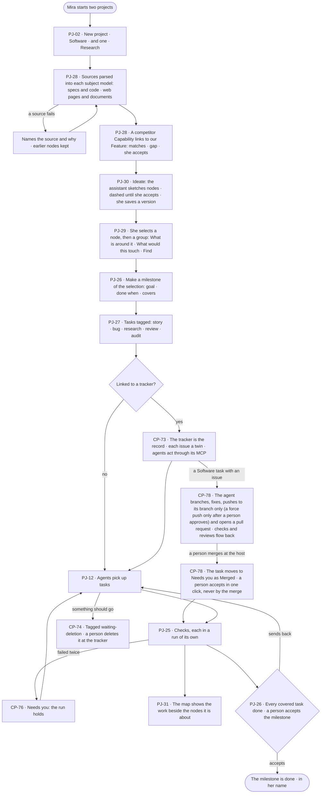

# Plan and run work from the project graph

> **Mira**, a decision maker, runs two projects on one deployment — a **Software** project for her product and a **Research** project on a competitor — and wants each to go from an idea to an accepted result the same way: sketch on a map, ask the graph, plan milestones from a selection, let agents work, and accept only what its checks and a person's review support.

## The journey

## Steps

| # | Step | Product · surface | Story | Board |
|---|---|---|---|---|
| 1 | Start a Software project and a Research project | Projects · New project | [PJ-02](../capabilities/projects/features/PJ-F01-projects-and-tasks/stories/PJ-02-start-a-project-of-its-type/story.md) | `projects.projects · New` |
| 2 | Add sources; the subject models are parsed; link a competitor Capability to our Feature | Projects · a project › Map | [PJ-28](../capabilities/projects/features/PJ-F07-the-project-graph/stories/PJ-28-ground-a-project-in-its-subject-model/story.md) | `projects.graph` |
| 3 | Sketch nodes with the assistant; save a version | Projects · a project › Map | [PJ-30](../capabilities/projects/features/PJ-F07-the-project-graph/stories/PJ-30-sketch-nodes-with-the-assistant/story.md) | `projects.graph · Sketch` |
| 4 | Ask the graph from a node or a group | Projects · a project › Map | [PJ-29](../capabilities/projects/features/PJ-F07-the-project-graph/stories/PJ-29-ask-the-graph-from-a-node-or-a-group/story.md) | `projects.graph · Map · Ask` |
| 5 | Make a milestone of the selection | Projects · a project › Map · Milestones | [PJ-26](../capabilities/projects/features/PJ-F01-projects-and-tasks/stories/PJ-26-make-a-milestone-from-a-selection/story.md) | `projects.graph · Make a milestone` |
| 6 | Tag the tasks | Projects · a task | [PJ-27](../capabilities/projects/features/PJ-F01-projects-and-tasks/stories/PJ-27-tag-a-task/story.md) | `projects.tasks · Detail · Tags` |
| 7 | Connect a tracker and link the project | Settings › Connections · a project | [CP-73](../os/control/features/CP-F12-issue-trackers/stories/CP-73-connect-an-issue-tracker-and-link-a-project/story.md) | `settings.plugins · Trackers` |
| 7a | A Software task's issue goes to a branch, a pull request, checks and reviews; a person merges at the host | Projects · a task · Inbox | [CP-78](../os/control/features/CP-F12-issue-trackers/stories/CP-78-fix-an-issue-through-a-branch-and-a-pull-request/story.md) | `projects.tasks · Detail · Pull request` |
| 8 | Agents work the tasks; checks run in runs of their own | Projects · a task | [PJ-12](../capabilities/projects/features/PJ-F01-projects-and-tasks/stories/PJ-12-write-a-task-hand-it-on-and-accept-the-result/story.md) · [PJ-25](../capabilities/projects/features/PJ-F01-projects-and-tasks/stories/PJ-25-gate-a-task-on-its-checks/story.md) | `projects.tasks · Detail` |
| 9 | See the work beside the nodes | Projects · a project › Map | [PJ-31](../capabilities/projects/features/PJ-F07-the-project-graph/stories/PJ-31-see-the-work-in-the-same-graph/story.md) | `projects.graph · Map · Work` |
| 10 | Accept the milestone | Inbox › Needs you | [PJ-26](../capabilities/projects/features/PJ-F01-projects-and-tasks/stories/PJ-26-make-a-milestone-from-a-selection/story.md) | `projects.projects · Detail · Milestones · Ready to accept` |

## Branches

| When | What happens | Story | Board |
|---|---|---|---|
| A source cannot be read | Names the source and why; earlier nodes stay | PJ-28.5 | `projects.graph · Sources · Source failed` |
| A person not on the team opens the sketch | Accept and save disabled — *Join the team to change it* | PJ-30.10 | `projects.graph · Sketch · Not on the team` |
| An answer would pass its token budget | It is cut, saying how many; a budget over the limit is refused | PJ-29.3 | `projects.graph · Answer · Over the limit` |
| The tracker changed a field Mira changed | The tracker's value stays and the thread says what changed | CP-73.6 | `projects.tasks · Detail · Tracker changed it` |
| An agent would create more than 5 issues | The run holds; a card names each | CP-73.9 · CP-76.3 | `inbox · Needs you · Agent waiting` |
| A check fails twice | The run holds; a card in Needs you | CP-76.4 | `inbox · Needs you · Agent waiting` |
| An agent pushes to the default branch, a workflow file, or tries to merge | Refused, naming the ref or that a merge is never granted; a person merges at the host | CP-78.4 · CP-78.11 | `projects.tasks · Detail · Pull request` |
| An agent asks to delete an issue | Refused — it tags waiting-deletion; a person deletes it at the tracker | CP-74.1 · CP-74.3 | `settings.plugins · Waiting deletion` |
| An Operator not on the team | Acts disabled — *Join the team to change it* | PJ-26.11 | `projects.projects · Detail · Milestones · Not on the team` |
| The project has no read + write graph database | The map draws subject nodes only and says the work graph is off | PJ-31.5 | `projects.graph · Map · Work graph off` |

## Done when

- A milestone of each project reads *Done*, accepted by a person on the team after every covered task's checks passed in a run of its own.
- No pull request was merged, and no branch or issue deleted, by an agent or by Invana.
- No outside issue was deleted by an agent or by Invana; every deletion waiting reads in Needs you until a person acts at the tracker.
