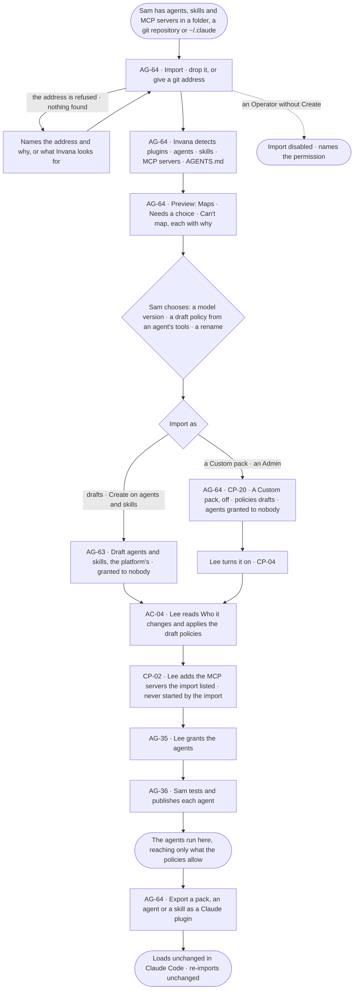

# Bring my agents over

> **Sam**, who builds agents, already works with Claude Code — a `~/.claude` directory, a repository with agents and skills, an MCP setup — and wants them running in Invana in one step, reaching only what **Lee**, the Admin, allows, and wants to take them out again.

## The journey

## Steps

| # | Step | Product · surface | Story | Board |
|---|---|---|---|---|
| 1 | Point Invana at a folder, a zip, a `~/.claude`-style directory or a git address | Agents · Skills · Import | [AG-64](../capabilities/agents/features/AG-F08-portable-agents-and-skills/stories/AG-64-bring-my-agents-over-and-take-invanas-out/story.md) | `agents.skills · Import · Source` |
| 2 | Read the preview and make the choices | Agents · Skills · Import | AG-64 · [AG-63](../capabilities/agents/features/AG-F08-portable-agents-and-skills/stories/AG-63-bring-in-agents-and-skills-from-an-agent-tools-folder/story.md) | `agents.skills · Import · Preview` · `agents.skills · Import · Choices` |
| 3 | Import as a Custom pack, or as drafts | Settings › Connections › Team packs · Agents | AG-64 · [CP-20](../os/control/features/CP-F02-plugins-and-outside-tools/stories/CP-20-install-a-team-pack/story.md) | `settings.packs · Custom pack` |
| 4 | Apply the draft policies | Access Plane · Access Policies | AC-04 | `settings.policies · Waiting to apply` |
| 5 | Add the MCP servers the import listed | Control Plane · Plugins and MCP | [CP-02](../os/control/features/CP-F02-plugins-and-outside-tools/stories/CP-02-add-an-outside-mcp-server-and-let-agents-call-its-tools/story.md) | `settings.plugins · Servers to add` |
| 6 | Grant the agents; test and publish them | Agents · the catalogue | AG-35 · AG-36 | — |
| 7 | Export as a Claude plugin | Agents · Skills · Export | AG-64 | `agents.skills · Export` |

## Branches

| When | What happens | Story | Board |
|---|---|---|---|
| The git address is not https, is private or not an allowed host | Refused, naming the address and why; nothing fetched | AG-64.2 | `agents.skills · Import · Address refused` |
| A hook, a command or a settings file is in the source | Left out, named; nothing runs | AG-64.11 | `agents.skills · Import · Preview · Can't map` |
| A skill carries a script | Needs approval; runs only once an Admin approved it | AG-64.11 | `agents.skills · Import · Preview` |
| An MCP server is a local process | Refused — Invana reaches servers by address | AG-63.6 | `agents.skills · Import · Preview · Can't map` |
| A name is already in the catalogue | A new version or a rename, chosen by Sam | AG-64.6 | `agents.skills · Import · Choices` |
| An Operator without Create | Import, Custom pack and Export disabled, naming the permission | AG-64.18 | `agents.skills · Import disabled` |

## Done when

- Every agent Sam brought is a draft the platform owns, granted to nobody until Lee grants it, and reaching only what a policy Lee applied allows.
- Nothing ran at import: no script, hook, command or local-process server.
- An exported pack opens in Claude Code with no Invana field outside its extension block and imports back unchanged.
