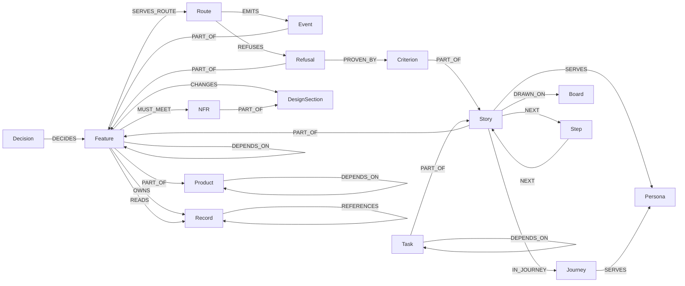

# Ontology of the specs

> What Invana's specs are made of as a graph: every node kind and edge type, the spec structure each is read from,
> and the questions the graph answers.

The `specs/**/*.md` files are the only source. `python3 scripts/specs/check.py --graph` parses them into
`specs-graph.json`; the graph is never edited by hand. A fact no file states is never guessed: a reference to an id no
file defines, or a row the parser cannot read, is listed in `analysis.dangling`, and `check.py --placeholders` names
the stub that would hold it. The JSON keys are the docstring of `scripts/specs/graph.py`; this page is what they mean.

## The schema

The diagram draws one arrow per pair of kinds; [Edge types](#edge-types) lists every pair each type joins.
`MENTIONS` (any → any) is left out.

## Node kinds

| Kind | Means | Id | Read from |
|---|---|---|---|
| Product | A capability or an OS product — a body of features under a pillar | its code (`PJ`) | a `product.md`'s front-matter |
| Feature | One thing a product does, with its rules, access and `## Engine` | `PJ-F01` | a `feature.md`'s front-matter |
| Story | One act a person takes, with its *Who can*, flow, criteria and screens | `PJ-02` | a `story.md`'s front-matter |
| Criterion | One *Given · When · Then* a story is accepted by | `PJ-02.17` | a row of a story's `## Acceptance criteria` table (first header `#`) |
| Task | One piece of work a role delivers a story by | `PJ-02-T1` | a row of a story's `task.md` |
| Journey | A path a persona takes across stories to reach an outcome | `J01` | a file in `specs/journeys/`, its front-matter |
| Step | A point of a journey that is not a story — a decision, a start or end, a refusal | `J03:F` | a node of a journey's *The journey* flowchart whose label starts with no story id |
| Persona | A person's job — what they come to Invana to do | `persona:<key>` | the first column of [personas](personas.md) › *The people* |
| Board | A screen state the designer draws | `board:<name>` | a feature's `boards:` keys · a story's *Screens* cells · a task's *Boards* cells |
| Record | A table the engine stores | `record:<table>` | a backticked name in the first cell of a feature's `## Engine` › *Records* |
| Route | An API endpoint | `route:<METHOD> <path>` | a backticked `METHOD /path` in the first cell of *Routes*, with the header's `after` prefix |
| Event | A fact the engine writes to the event store | `event:<name>` | a backticked name in the first cell of *Events* |
| Refusal | A way the engine says no — a status and its sentence | `<feature>/R<n>` | the n-th row of a feature's *Refusals* tables |
| NFR | A non-functional requirement with its number | `NFR-<PILLAR>-<n>` | the table in [system design](system-design.md) § 3 |
| DesignSection | A section of the system design | `system-design#<n>` | a `## <n>. Title` heading of [system design](system-design.md) |
| Decision | A choice made and the reason for it | `<owner id>/D<n>` | the n-th row of a `## Decisions` table, or of a *Decision* table in a design section |

### Fields

| Field | On | Holds |
|---|---|---|
| `id` · `kind` · `title` | every node | as in [Node kinds](#node-kinds); the title is the front-matter `title` or the row it is read from |
| `path` | every node | the repo-relative file it is read from; `null` for a persona or a board no file holds |
| `status` | every node | the file's or row's status; a criterion, record, route, event or refusal takes its story's or feature's |
| `placeholder` | every node | `status: placeholder`, or a section body starting `> Placeholder —` |
| `product` | every node | the product code it belongs to |
| `description` | Product · Feature · Story · Journey | the first paragraph under the `# ` title — the summary, or a story's *As … I want … so that …* |
| `description` | Persona | its *Comes to Invana to* cell |
| `description` | Criterion · Record · Route · Event · Refusal | *Given — When — Then* · the *Notes* cell · the *Does* cell · the *When* cell · the *When* cell |
| `owner` | Task | the role that delivers it |
| `journey` · `shape` | Step | its journey's id; `decision` · `terminal` · `step` |
| `columns` | Record | the column names its *Columns* cell lists |

## Edge types

| Type | From → to | Means | Read from |
|---|---|---|---|
| `PART_OF` | Feature → Product · Story → Feature · Criterion → Story · Task → Story · Event → Feature · Refusal → Feature · NFR → DesignSection | The source is a piece of the target | `product:` · `feature:` · the story of the criteria table or `task.md` · the feature's *Events* and *Refusals* · § 3 |
| `DEPENDS_ON` | Product → Product · Feature → Feature · Task → Task | The source cannot be done before the target | a product's `## Depends on` · `depends_on:` · a task's *Depends on* cell |
| `SERVES` | Product · Feature · Story · Journey → Persona | The source is for that person | `personas:` |
| `IN_JOURNEY` | Story · Feature → Journey | The source is a stop on the journey | a journey's `stories:` · a feature's `journeys:` |
| `NEXT` | Story · Step → Story · Step | One stop of a journey leads to the next | an arrow of a journey's *The journey* flowchart; its `label` is the arrow's |
| `DRAWN_ON` | Feature · Story · Journey · Task → Board | The source is drawn on that board | `boards:` · *Screens* · *Boards* |
| `OWNS` | Feature → Record | The feature is the one home of the table | a row of its *Records* |
| `READS` | Feature → Record | The feature reads a table another feature owns | a backticked record in a *Reads* row's *Record* cell |
| `REFERENCES` | Record → Record | A column of the source points at a row of the target | a `<name>_id` column, matched to exactly one record |
| `SERVES_ROUTE` | Feature → Route | The feature answers the route | a row of its *Routes* |
| `EMITS` | Route → Event | Calling the route writes the event | the event row's *Route* column, else a route named in its *When* cell |
| `REFUSES` | Route → Refusal | Calling the route can be refused this way | the refusal row's *Route* column, else a route named in its *When* cell |
| `PROVEN_BY` | Refusal → Criterion | The criterion is where a person meets the refusal | the criterion ids in its *Criterion* cell |
| `MUST_MEET` | Feature · Story → NFR | The source is held to the requirement | `nfrs:` · an NFR's *Constrains* cell · NFR ids in `## System impact` |
| `CHANGES` | Feature → DesignSection | The feature changes that part of the system design | `§ <n>` in `## System impact` |
| `DECIDES` | Decision → Product · Feature · DesignSection | The decision governs the target | the Decisions table it is a row of |
| `MENTIONS` | any → any | An id named in prose where no typed edge joins the two | prose |

| Rule | Detail |
|---|---|
| One home | An id two features define is kept by the first, in path order; the second row is dangling (`owned twice`) |
| None stated | A first cell of `—` says there is none and adds nothing |
| Never guessed | A `_id` column matching no record or several, a *Reads* row naming no record, an event or refusal whose route matches none or several — dangling, never an edge |
| An API-only refusal | A *Criterion* cell starting `API only` needs no criterion; any other cell that names none is dangling |

## The questions the graph answers

| Question | Walk |
|---|---|
| What does a story depend on? | Story `PART_OF` Feature `DEPENDS_ON`* Feature `PART_OF` Product `DEPENDS_ON`* Product; and the feature's `MUST_MEET` NFRs and its `OWNS` and `READS` records |
| Which criterion proves a refusal? | Refusal `PROVEN_BY` Criterion `PART_OF` Story |
| Which refusals has a story no criterion for? | The story's feature ← `PART_OF` Refusal with no `PROVEN_BY` and no `API only` cell |
| Which features read a record? | Record ← `READS` Feature; its owner is Record ← `OWNS` Feature |
| What breaks if a record changes? | Record ← `OWNS` · `READS` Feature ← `PART_OF` Story; and Record ← `REFERENCES` Record, again |
| What does a route do? | Route ← `SERVES_ROUTE` Feature; Route `EMITS` Event; Route `REFUSES` Refusal `PROVEN_BY` Criterion |
| What does a journey reach? | Journey ← `IN_JOURNEY` Story; its `NEXT` chain from start to end, through the stories other journeys share; each story's feature, product and personas |
| Who is a persona's work for? | Persona ← `SERVES` Story · Journey · Feature |
| What must be drawn? | Story `DRAWN_ON` Board — a board no canvas file draws is listed by `--placeholders` |
| What blocks what? | `analysis.blockers` · `analysis.cycles` · `analysis.chains` over `DEPENDS_ON`, `MUST_MEET`, `CHANGES` |

## What the graph flags

| Flag | Means |
|---|---|
| Cycle | Two or more nodes that depend on each other over `DEPENDS_ON` |
| Blocking chain | The longest `DEPENDS_ON` chains of three nodes or more |
| Blocker | A node at `specified` or beyond that depends on, must meet or changes a node at `idea` or a placeholder |
| Orphan | A node with no edge |
| Gap | A feature with no `## Engine`, no `## System impact` or no `nfrs:`, or with a placeholder one |
| Dangling | A reference to an id no file defines, or an Engine row or cell the parser cannot read |

## Not built yet — the code layer

| Kind or edge | Means |
|---|---|
| Module · Class · Method | The engine, Studio and integration code, read from the source tree |
| `IMPLEMENTED_IN` | Story · Route · Record → Module · Class · Method — where the spec is built |

Until it lands, the spec graph stops at the Engine tables: it says what is specified, never where it is built.

## Decisions

| Decision | Detail |
|---|---|
| An event and a refusal are part of their feature | `PART_OF` Feature, so each has its one home even when no spec names its route |
| A refusal's id is its row | `<feature>/R<n>`, as a decision is `<owner>/D<n>` — the same sentence repeats across features |
| A record's references are exact | A `_id` column resolves to one record or is dangling — never the nearest name |
