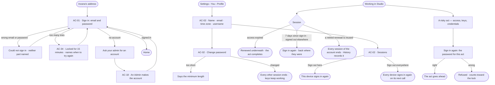
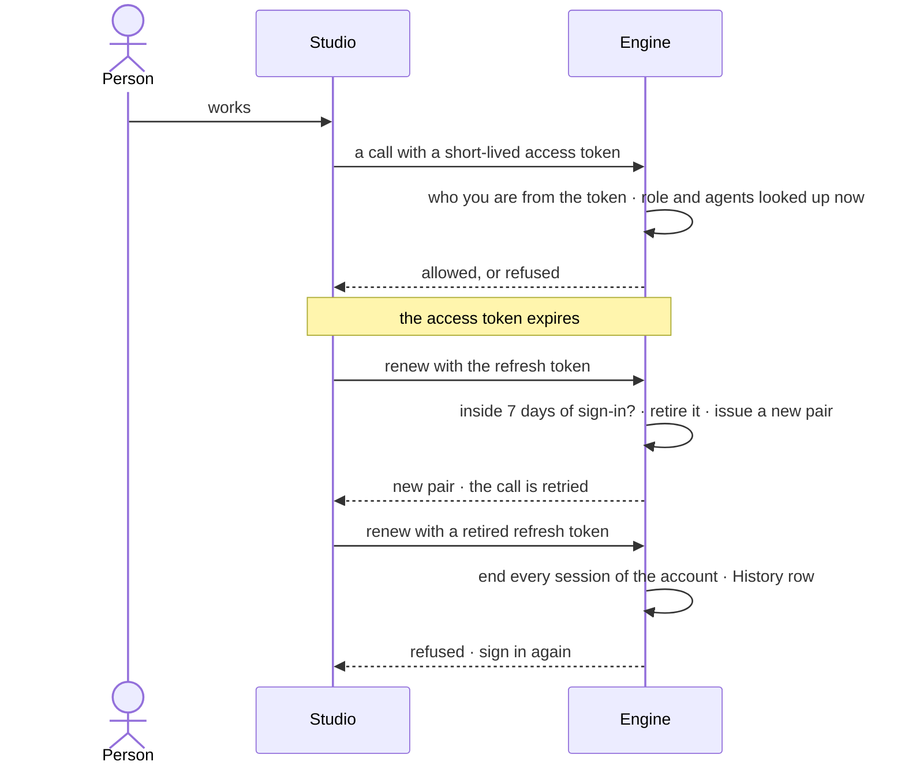

# Sign in, account and sessions

> Sign in with a password to an account an Admin made, and keep it in order: one's name, password and username, and
> the places one is signed in. The decision it helps make: *is my account mine, and is every place it is signed in one
> I trust?*

## User journey

Journeys this feature is a step of: [J01 · From a fresh deployment to a first answer](../../../../journeys/J01-from-a-fresh-deployment-to-a-first-answer.md) · [J05 · Join a team](../../../../journeys/J05-join-a-team.md) · [J07 · Ready a deployment](../../../../journeys/J07-ready-a-deployment.md)

## Stories

| ID | Story | Status |
|---|---|---|
| AC-01 | [Sign in](stories/AC-01-sign-in/story.md) | idea |
| AC-34 | [Slow down guessing at sign-in](stories/AC-34-slow-down-guessing-at-sign-in/story.md) | idea |
| AC-02 | [Keep my account and sessions in order](stories/AC-02-keep-my-account-username-and-sessions-in-order/story.md) | idea |
| AC-18 | [Give a person an account](stories/AC-18-give-a-person-an-account/story.md) | idea |

## Access

| Act | Role ([the role table](../AC-F02-access-policies/feature.md#the-role-table)) | Everyone else sees |
|---|---|---|
| Sign in | Every person with an active account — Operator, Modeller, Admin. A service user, an agent and the system user never sign in | *Ask your admin for an account* — there is no sign-up form |
| Read and change one's own name, email, time zone and username | The person themselves, in a session | — |
| Change one's own password | The person themselves, in a session, with the current password | — |
| Sign out here · sign out everywhere | The person themselves, in a session | — |
| Make an account · set a new password for one | Admin — from the command line, or signed in through the API with the password again; never with a key ([AC-18](stories/AC-18-give-a-person-an-account/story.md)) | Refused, naming the Admin role |
| Another person's profile, password or sessions | No one in Studio; an Admin deactivates a person ([AC-23](../AC-F03-directory/stories/AC-23-deactivate-a-person-who-leaves/story.md)) | — |

## States

| State | What the person sees |
|---|---|
| First use | The account as an Admin made it: name, email, username; one session — this one |
| Empty after a filter | — no filter on this surface |
| Loading | Sign in shows its card at once and the button says it is signing in; *Profile* opens at once, fields filling in place |
| Has data | Profile, username and its rules, *Sign out here* and *Sign out everywhere* |
| Failed | Sign in says it could not sign in, never which part was wrong; a lock names when to try again; on the account, what could not save, in a sentence, naming the rule — the minimum length, the cooldown's end, a taken username |
| Agent working or proposing | — no agent acts on an account |
| No access | A person without an account reads *Ask your admin for an account*; every person reaches their own account, nobody reaches another's |

## Rules

| Rule | Detail |
|---|---|
| Password only | A person signs in with their email and password; there is no other way in ([Not building](#not-building)) |
| Email is how a person signs in | Unique, folded to lowercase |
| Errors never confirm an account | A failed sign-in, a lock and a refused account never say whether an email is in use |
| Guessing is slow | 10 failed sign-ins to one email in 15 minutes lock it for 15 minutes; sign-in and renewal take at most 30 requests a minute from one address; both are recorded (NFR-SEC-6) |
| A username names a person | Shown in the Directory, History and the command line; lowercase letters, digits and single hyphens, 2–64 characters, unique in the deployment; it changes at most once per cooldown |
| A session is short-lived and renewable | A short-lived access token for every call, a refresh token that renews it; renewing retires the old one |
| A session has an absolute lifetime | Every session ends 7 days after its sign-in, however often it renewed |
| Reusing a retired refresh token ends every session | It is refused, every session of the account ends, and History records it |
| Role and agents are read on every call | So a role change, a lost grant or a deactivation takes effect at the next call |
| A password change ends every other session | Keys keep working — a script should not break because a person changed their password |
| Risky acts sign in again | Changing access, keys or credentials asks for the password for that act, however recent the session; a key never does them |
| Studio keeps the session in local storage, behind a strict policy | Both tokens sit in the browser's local storage; Studio is served with a Content Security Policy that runs scripts from its own origin only, so no injected script runs to read them |
| Already signed in | Reaching the sign-in page with a live session resumes it and goes where the person was heading; only an address inside Studio is followed |
| A session ends cleanly | When it ends, the person signs in again and returns to the page they were on |
| No one deletes an account | A person who leaves is deactivated by an Admin, so their work and History keep a name ([AC-F03](../AC-F03-directory/feature.md#decisions)) |
| Leans on | Keys ([AC-F10](../AC-F10-keys/feature.md)) · the Directory (AC-F03) · History (AC-F06) |

## Data touched

| Record | Read or write |
|---|---|
| The account — email, username, name, password, when the username last changed | Write · read |
| Sessions — the refresh token, retired or live, and when it signed in | Write · read |
| Failed sign-ins and locks | Write · read |
| History rows of a sign-in, a lock, a password change, a username change and a refused reuse (AC-F06) | Write |

## Engine

The low-level design: what this feature stores, serves and refuses. Conventions — naming, errors, lists, events — are
[system-design.md](../../../../system-design.md) §§ 6–8; this section only fills them in.

### Records

| Table | Columns | Notes |
|---|---|---|
| `access_users` — the account columns | `email?` (folded to lowercase, unique) · `username` (unique) · `password_hash?` · `first_name` · `last_name?` · `time_zone?` · `username_last_changed_at?` · `preferences` (theme, the assistant closed) · `created_at` | Install-wide. `kind`, `role` and `is_active` are the Directory's ([AC-F03](../AC-F03-directory/feature.md#engine)); only `kind = person` has an email and a password |
| `access_refresh_tokens` | `user_id` · `token_hash` (unique) · `signed_in_at` (carried across rotation) · `issued_at` · `expires_at` (at most `signed_in_at` + 7 days) · `retired_at?` · `retired_why?` (`rotated` · `signed_out` · `password_changed` · `reuse` · `deactivated`) | One live row per session; the opaque value is hashed |
| `access_sign_in_failures` | `email_folded` · `at` · `address` | Kept 15 minutes; counted per email, whether or not an account has it |
| `access_locks` | `email_folded` (unique) · `locked_until` | One row while locked |

### Reads

| Record | Owner |
|---|---|
| Keys — a `Bearer` value carrying the key prefix | [AC-F10](../AC-F10-keys/feature.md#engine) |
| A person's kind, role, active or not, and the agents they may use | [AC-F03](../AC-F03-directory/feature.md#engine) |
| History — every event this feature writes | [AC-F06](../AC-F06-history/feature.md#engine) |

### Routes

| Route, after `/api/v1/access/auth` | Does | Story |
|---|---|---|
| `GET /username-available?username=` | Advisory and unauthenticated: `available` · `taken` · `invalid` | AC-02 |
| `POST /register` | An Admin makes an account, from a session, with the password again | AC-18 |
| `POST /login` | Sign in — answers `{access_token, refresh_token, token_type: "bearer"}` | AC-01 · AC-34 |
| `POST /refresh` | Rotate the pair — takes `{refresh_token}` in the body | AC-01 · AC-02 |
| `POST /logout` | Retire this session's refresh row — takes `{refresh_token}` | AC-02 |
| `POST /logout-everywhere` | Retire every refresh row of the account | AC-02 |
| `GET /me` · `PATCH /me` | The account, its role and the agents it may use · change names, email, time zone, preferences and the username | AC-02 |
| `POST /me/password` | Change the password — `{current_password, new_password}`; every other session ends | AC-02 |

### Events

| Event | When |
|---|---|
| `access.auth.register` | An account is made — by the API or `invana users create` |
| `access.auth.login` · `access.auth.login_failed` | A sign-in succeeds · fails; the failure never names which part was wrong |
| `access.auth.locked` · `access.auth.rate_limited` | An email is locked · an address passes its rate |
| `access.auth.logout` · `access.auth.refresh` | A session ends — one, or every one (`details.all`) · a pair rotates |
| `access.auth.password_change` · `access.auth.username_change` | A password changes, by the person or `invana users update-password` · a username changes, old and new in `details` |
| `access.auth.reuse_detected` | A retired refresh token is presented again; every session of the account ends |
| `access.auth.step_up_failed` | A risky act carried a wrong password |

### Refusals

| Status | When | Sentence | Criterion |
|---|---|---|---|
| 401 | A wrong email or password, or a sign-in as anyone but a person | *Could not sign in.* | AC-01.3 · AC-01.9 |
| 401 | A deactivated person signs in with the right password | *This account is deactivated.* | AC-23.4 |
| 429 | Sign-in to a locked email, right password or not | *Too many tries — sign in again after {time}.* | AC-34.1 · AC-34.3 |
| 429 | Sign-in or renewal past 30 requests a minute from one address | *Too many requests — try again in a minute.* | AC-34.4 |
| 401 | A refresh with a retired token — every session of the account ends | *This session has ended — sign in again.* | AC-02.13 |
| 401 | A refresh with an expired or unknown token, or past 7 days since sign-in | *This session has ended — sign in again.* | AC-02.14 · AC-02.20 |
| 401 | A risky act without the password, or with a wrong one | *Enter your password again to do this.* | AC-02.21 |
| 403 | Changing a password, making an account, or any risky act with a key | *This needs a person's session, not a key.* | AC-02.18 · AC-18.8 |
| 403 | `POST /register` by someone whose role is not Admin | [AC-F02 › Refusals](../AC-F02-access-policies/feature.md#refusals) | AC-18.8 |
| 401 | `POST /me/password` with a wrong current password | *Your current password is not right.* | AC-02.3 |
| 422 | A password shorter than the deployment's minimum | *A password needs at least {n} characters.* | AC-02.3 · AC-18.5 |
| 422 | A username outside the rules | *{username} cannot be a username — {rule}.* | AC-02.5 · AC-18.5 |
| 409 | A username or email already used | *{value} is taken.* | AC-02.7 · AC-18.4 |
| 409 | A username change inside the cooldown | *Your username can change again on {date}.* | AC-02.8 |
| 404 | `invana users update-password` for an email or username no account has | *No account has {value}.* | AC-18.7 |

### CLI

| Command | Does |
|---|---|
| `invana users create --email --username --first-name [--last-name] [--role]` | Makes a person's account for whoever has shell access; prompts for the password, never a default; `--role` is Operator unless given |
| `invana users update-password <email or username>` | Sets a new password; the account's other sessions end, its keys keep working, a lock on its email clears |

### Mechanisms

| Mechanism | How |
|---|---|
| The access token carries identity only | A short-lived JWT (15 minutes): the subject and its session — never the role or the agents one may use, both of which change while a token lives |
| Role and agents looked up per request | Every call reads the person's role, active state and grants now ([AC-F03](../AC-F03-directory/feature.md#engine)), so a change takes effect on the next call |
| The refresh token is a row | Opaque, hashed, one live row per session; retiring it is a database update, there is no denylist |
| Rotation | One transaction retires the presented row and issues a new pair; `signed_in_at` carries over and `expires_at` never passes `signed_in_at` + 7 days, so rotating never freshens a sign-in or lengthens a session |
| Reuse | A presented row already retired as `rotated` retires every live row of the account as `reuse` and writes `access.auth.reuse_detected` |
| Renewed underneath | Studio renews an expired access token on any call but `login`, `refresh` and `logout`, and retries the call once |
| Where the tokens travel | In the `Authorization` header and the request body, never a cookie, never a URL — except the `?token=` fallback on stream routes ([system design § 8](../../../../system-design.md#8-apis-and-events)) |
| Studio's storage and its policy | Both tokens in the browser's local storage. Studio is served with `Content-Security-Policy: default-src 'self'; script-src 'self'; object-src 'none'; base-uri 'self'; frame-ancestors 'none'; connect-src 'self' <engine origin>` — no inline script, no outside script |
| Passwords | bcrypt, the cost and the minimum length from the deployment's configuration; an unknown email is checked against a dummy hash so timing never confirms an account. A change retires every other refresh row of the account as `password_changed` |
| Lockout | Each failed sign-in or wrong step-up password adds an `access_sign_in_failures` row for the folded email; the 10th inside 15 minutes writes `access_locks` until 15 minutes on. A locked email is refused before the password is checked. The lock lapses, or `invana users update-password` clears it |
| Rate limit | Sign-in, renewal, the token endpoint and the MCP server ([AC-F11](../AC-F11-connect-an-mcp-client/feature.md#engine)) count requests per address per minute in Postgres; past 30, `429` |
| Usernames | Matched against `^[a-z0-9](?:[a-z0-9-]*[a-z0-9])?$`, 2–64 characters, no double hyphen, folded to lowercase. The cooldown reads `username_last_changed_at`, thirty days unless the deployment sets another. Uniqueness is enforced on write; `username-available` is advisory |
| A key or a session | A `Bearer` value with the key prefix is a key ([AC-F10](../AC-F10-keys/feature.md#engine)), one with the MCP prefix a connected client's ([AC-F11](../AC-F11-connect-an-mcp-client/feature.md#engine)); anything else is decoded as a JWT |
| Signing in again | A risky route — the access writes of [AC-F02](../AC-F02-access-policies/feature.md#engine) and [AC-F03](../AC-F03-directory/feature.md#engine), minting and revoking keys ([AC-F10](../AC-F10-keys/feature.md#engine)), making an account, and the credential writes of the Control Plane — takes `password` in its body and verifies it against the session's account before it acts; a wrong one counts toward the lock. A key or a connected client's token on one of these routes is refused |

## System impact

| HLD section | Change | NFRs |
|---|---|---|
| § 6 Data and storage | Four install-wide tables in Postgres | — |
| § 8 APIs and events | The `/api/v1/access/auth` routes and `access.auth.*` events; who calls and how they prove it — a person in Studio | — |
| § 12 Qualities | Security: password only; opaque, rotated, server-side refresh tokens; reuse ends every session; a 7-day absolute lifetime; risky acts sign in again; a lockout and a rate limit; a strict Content Security Policy | NFR-SEC-2 · NFR-SEC-4 · NFR-SEC-6 |

The code change is [migrations.md](../../../../migrations.md) M13.

## Decisions

| Decision | Detail |
|---|---|
| You is a part of Settings | *Settings › You* holds *Profile* (name, email, time zone, username, password, sessions), *Keys* ([AC-F10](../AC-F10-keys/feature.md)) and *Connected clients* ([AC-F11](../AC-F11-connect-an-mcp-client/feature.md)); there is no profile page of its own |
| Sessions are two acts, not a list | *Sign out here* and *Sign out everywhere*; there is no list of devices — the engine keeps no device names |
| Password rules are configuration | Minimum length and hashing cost are the deployment's, with sane defaults |
| No sign-up form | Accounts are made by an Admin; the sign-in card says whom to ask |
| Local storage behind a strict policy | Tokens sit in local storage, so the engine stays cookie-free and CSRF-free; the Content Security Policy is what keeps a script from reading them |
| The lock is per email, not per account | Counting by the folded email locks an unknown email exactly like a known one, so a lock never confirms an account |
| Signing in again is the password for the act | However recent the session, a risky act carries the password; a window since sign-in would let a borrowed, unlocked laptop change access |

## Open questions

| Question | Who answers |
|---|---|

## Not building

| Item | Why not |
|---|---|
| Single sign-on — OIDC, SAML — and SCIM provisioning | Password sign-in only for now; one way in keeps the first deployments simple to run |
| Multi-factor authentication | Not now; risky acts sign in again and sessions end in 7 days |
| A sign-up form · invitations | Accounts are made by an Admin |
| Email verification · password reset by email | Needs a mail path the account does not have; an Admin sets a new password from the command line |
| Deleting one's own account | Work, ownership and History must keep a name; an Admin deactivates a person who leaves |
| A list of devices signed in | The engine keeps no device names; *Sign out everywhere* acts on all of them |
| Session cookies | Tokens travel in headers and bodies; a cookie would bring CSRF with it |
| Long sessions for convenience | A session ends 7 days after sign-in; software that needs a long-lived credential uses a key ([AC-F10](../AC-F10-keys/feature.md)) |
| Avatars and bios | An account is an identity, not a profile page |
