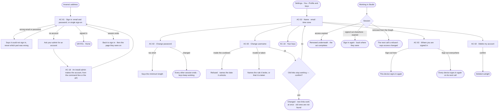
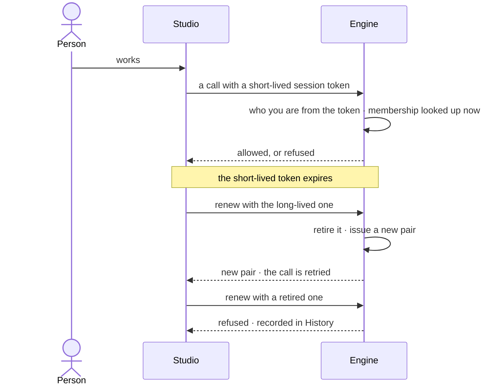

# Sign in, account and sessions

> Sign in with an account an Admin made, and keep it in order: a person's own account — their name, password and username — the address every Graph link starts with — and the
> places they are signed in. The decision it helps make: *is my account mine, and is every place it is signed in one I
> trust?*

## User journey

Journeys this feature is a step of: [J01 · From an empty install to a first answer](../../../../journeys/J01-from-an-empty-install-to-a-first-answer.md) · [J05 · Join a Graph someone set up](../../../../journeys/J05-join-a-graph-someone-set-up.md) · [J07 · Ready an install for its Graphs](../../../../journeys/J07-ready-an-install-for-its-graphs.md)

## Stories

| ID | Story | Status |
|---|---|---|
| AC-01 | [Sign in](stories/AC-01-sign-in/story.md) | idea |
| AC-02 | [Keep my account, username and sessions in order](stories/AC-02-keep-my-account-username-and-sessions-in-order/story.md) | idea |
| AC-18 | [Give a person an account](stories/AC-18-give-a-person-an-account/story.md) | idea |

## Access

| Act | Role (`.claude/team/TEAM.md` §7) | Everyone else sees |
|---|---|---|
| Sign in | Anyone with an account | *Ask your admin for an account* — there is no sign-up form |
| Read and change one's own name, password and username | The person themselves — any signed-in account | — |
| Sign out here · sign out everywhere | The person themselves | — |
| Delete one's own account | The person themselves, signed in — never with a key | — |
| Make an account · set a new password for one | Admin — the install Admin, from the command line or a signed-in session through the API; never with a key (AC-18) | Refused; the sign-in card reads *Ask your admin for an account* |
| Another person's account | No one in Studio; install administration only | — |

## States

| State | What the person sees |
|---|---|
| First use | The account as made at sign-up: name, email, username; one session — this one |
| Empty after a filter | — no filter on this surface |
| Loading | Sign in shows its card at once and the button says it is signing in; the account section opens at once, fields filling in place |
| Has data | Profile, username and its rules, the places they are signed in, their keys |
| Failed | Sign in says it could not sign in, never which part was wrong; on the account, what could not save, in a sentence, naming the rule — the minimum length, the cooldown's end, a taken username |
| Agent working or proposing | — no agent acts on an account |
| No access | A person without an account reads *Ask your admin for an account*; every person reaches their own account, nobody reaches another's |

## Rules

| Rule | Detail |
|---|---|
| Email is how a person signs in | Unique, folded to lowercase; changing it is its own act |
| Errors never confirm an account | A failed sign-in or sign-up never says whether an email is in use |
| A username is an address | `/u/<username>/<graph>/…`; lowercase letters, digits and single hyphens, 2–64 characters, unique on the install. Only `u` is reserved |
| A username changes rarely | Once per cooldown — thirty days unless the install sets another |
| Old addresses do not forward | After a change, old links are not found; the change says so before it is confirmed |
| A session is short-lived and renewable | A short-lived token for every call, a long-lived one that renews it; renewing retires the old one |
| Reusing a retired session is a signal | It is refused and recorded |
| Membership is checked on every call | So removing someone from a Graph takes effect at once |
| A password change ends every other session | Keys keep working — a script should not break because a person changed their password |
| Managing credentials needs a session | Changing a password and deleting the account cannot be done with a key |
| Already signed in | Reaching the sign-in page with a live session resumes it and goes where the person was heading; only an address inside Studio is followed |
| Deletes are outright | There is no trash for an account |
| A session ends cleanly | When it ends, the person signs in again and returns to the page they were on |
| Leans on | Keys (AC-10) · Home (GR-F01) · History (AC-F06) |

## Data touched

| Record | Read or write |
|---|---|
| The account — email, username, name, password, when the username last changed | Write · read |
| Sessions — the long-lived renewing token, retired or live | Write · read |
| Keys (AC-10) | Read |
| History rows of a password change, a username change and a refused reuse (AC-F06) | Write |

## Engine

The low-level design: what this feature stores, serves and refuses. Conventions — naming, errors, lists, events — are
[system-design.md](../../../../system-design.md) §§ 6–8; this section only fills them in.

### Records

| Table | Columns | Notes |
|---|---|---|
| `access_users` | `email?` (folded to lowercase, unique) · `username` (unique on the install) · `password_hash?` · `first_name` · `last_name?` · `time_zone?` · `is_superuser` · `is_active` · `is_service_account` · `agent_operated` (a service account's mark) · `username_last_changed_at?` · `preferences` (theme, the assistant closed; a service account's description) · `created_at` | Install-wide, no `graph_id`. A service account has no email and no usable password ([AC-F03](../AC-F03-groups-keys-and-holders/feature.md#engine)) |
| `access_refresh_tokens` | `user_id` · `token_hash` (unique) · `signed_in_at` (carried across rotation) · `issued_at` · `expires_at` · `revoked_at?` | One live row per session; the opaque value is hashed |

### Reads

| Record | Owner |
|---|---|
| Keys — a `Bearer` value carrying the key prefix | [AC-F03](../AC-F03-groups-keys-and-holders/feature.md#engine) |
| Membership and the roles held in each Graph | [GR-F04](../../../graph/features/GR-F04-this-graph/feature.md#engine) |
| History — every event this feature writes | [AC-F06](../AC-F06-history/feature.md#engine) |

### Routes

| Route, after `/api/v1/access/auth` (install-wide) | Does | Story |
|---|---|---|
| `GET /username-available?username=` | Advisory and unauthenticated: `available` · `taken` · `invalid` · `reserved` (for `u`) | AC-02 |
| `POST /register` | The install Admin makes an account, from a signed-in session | AC-18 |
| `POST /login` | Sign in — answers `{access_token, refresh_token, token_type: "bearer"}` | AC-01 |
| `POST /refresh` | Rotate the pair — takes `{refresh_token}` in the body | AC-01 · AC-02 |
| `POST /logout` | Retire this session's refresh row — takes `{refresh_token}` | AC-02 |
| `POST /logout-everywhere` | Retire every refresh row of the account | AC-02 |
| `GET /me` · `PATCH /me` · `DELETE /me` | The account and its Graphs with the roles held in each · change names, time zone, preferences and the username · delete the account outright | AC-02 |
| `POST /me/password` | Change the password; every other session ends | AC-02 |

### Events

| Event | When |
|---|---|
| `access.auth.register` | An account is made — by the API or `invana users create` |
| `access.auth.login` · `access.auth.login_failed` | A sign-in succeeds · fails; the failure never names which part was wrong |
| `access.auth.logout` · `access.auth.refresh` | A session ends — one, or every one (`details.all`) · a pair rotates |
| `access.auth.password_change` · `access.auth.username_change` | A password changes, by the person or `invana users update-password` · a username changes, old and new in `details` |
| `access.auth.reuse_detected` | A retired refresh token is presented again |

### Refusals

| Status | When | Sentence | Criterion |
|---|---|---|---|
| 401 | A wrong email or password, or a sign-in as a service account | *Could not sign in.* | AC-01.3 · AC-02.19 · AC-09.6 |
| 401 | A refresh with a retired token — recorded as `access.auth.reuse_detected` | *This session has ended — sign in again.* | AC-02.13 |
| 401 | A refresh with an expired or unknown token | *This session has ended — sign in again.* | AC-02.14 |
| 401 | An access change, a confidential or personal send, or raising a limit, more than 15 minutes after the session's `signed_in_at` | *Sign in again to do this.* | AC-04.21 |
| 403 | Changing a password, deleting the account or making one with a key | *This needs a signed-in session, not a key.* | AC-10.12 · AC-02.18 · AC-18.8 |
| 403 | `POST /register` by someone who is not the install Admin | *Only an Admin makes accounts.* | AC-18.8 |
| 422 | A password shorter than the install's minimum | *A password needs at least {n} characters.* | AC-02.3 · AC-18.5 |
| 422 | A username outside the rules | *{username} cannot be a username — {rule}.* | AC-02.5 · AC-18.5 |
| 409 | A username or email already on the install | *{value} is taken.* | AC-02.7 · AC-18.4 |
| 409 | A username change inside the cooldown | *Your username can change again on {date}.* | AC-02.8 |
| 404 | `invana users update-password` for an email or username no account has | *No account has {value}.* | AC-18.7 |

### CLI

| Command | Does |
|---|---|
| `invana users create --email --username --first-name [--last-name] [--superuser]` | Makes an account for whoever has shell access; prompts for the password, never a default |
| `invana users update-password <email or username>` | Sets a new password; the account's other sessions end, its keys keep working |

### Mechanisms

| Mechanism | How |
|---|---|
| The access token carries identity only | A short-lived JWT: the subject and the superuser flag — never membership or the username, both of which change while a token lives |
| Membership is looked up per request | Every Graph-scoped call reads membership now ([GR-F04](../../../graph/features/GR-F04-this-graph/feature.md#engine)), so a removal takes effect on the next call |
| The refresh token is a row | Opaque, hashed, one live row per session; revoking is a database update, there is no denylist |
| Rotation | One transaction retires the presented row and issues a new pair; `signed_in_at` carries over, so rotating never freshens a sign-in |
| Renewed underneath | Studio renews an expired access token on any call but `login`, `refresh` and `logout`, and retries the call once |
| Where the refresh token travels | In the body, never a cookie; `refresh`, `logout` and `logout-everywhere` take `{refresh_token}` |
| Passwords | bcrypt, the cost and the minimum length from the install's configuration; verification is constant-time. A change revokes every other refresh row of the account |
| Usernames | Matched against `^[a-z0-9](?:[a-z0-9-]*[a-z0-9])?$`, 2–64 characters, no double hyphen, folded to lowercase; `u` is reserved. The cooldown reads `username_last_changed_at`, thirty days unless the install sets another. Uniqueness is enforced on write; `username-available` is advisory |
| A key or a session | A `Bearer` value with the key prefix is looked up as a key ([AC-F03](../AC-F03-groups-keys-and-holders/feature.md#engine)); anything else is decoded as a JWT |
| Session-only acts | Changing a password, deleting the account, making an account, and the key and access writes [AC-F03](../AC-F03-groups-keys-and-holders/feature.md#engine) and [AC-F02](../AC-F02-access-rules/feature.md#engine) name, need a session token — a key is refused |
| A fresh sign-in | `signed_in_at` on the session's refresh row is checked by the acts [Access › Decisions](../../product.md#decisions) names; older than 15 minutes, the act is refused until the person signs in again |
| Deleting an account | Removes the account, its refresh rows, its keys and its memberships; its History rows keep the name as it was ([AC-F06](../AC-F06-history/feature.md#engine)) |

## System impact

| HLD section | Change | NFRs |
|---|---|---|
| § 6 Data and storage | Two install-wide tables in Invana's own store | — |
| § 8 APIs and events | The install-wide `/api/v1/access/auth` routes and `access.auth.*` events | — |
| § 12 Qualities | Security: opaque, rotated, server-side refresh tokens; reuse is recorded; passwords bcrypt; a fresh sign-in gates the riskiest acts | — |

## Decisions

| Decision | Detail |
|---|---|
| You is a part of Settings | *Settings › You › Profile and keys* holds the profile, username, sessions and keys; there is no profile page of its own |
| One name, one address | The username is both what a person is called in links and their address; there is no separate display handle |
| Password rules are configuration | Minimum length and hashing cost are the install's, with sane defaults |
| No sign-up form | Accounts are made by an Admin; the sign-in card says whom to ask |
| A username is 2 to 64 characters, and only `u` is reserved | A one-character name is refused (`core/auth/schemas.py` `USERNAME_MIN = 2`, checked again in `core/auth/managers/auth.py`); `/u/<username>/…` keeps every username clear of Studio's own routes, so the one segment `u` is the only word reserved ([Engine › Mechanisms](#mechanisms)) |
| Being Admin opens no Graph | The install Admin runs the install; it is never a way into a Graph's contents |

## Open questions

| Question | Who answers |
|---|---|
| Does *Where you are signed in* list each device, or only offer *Sign out here* and *Sign out everywhere*? The board draws neither yet. Recommend: the two acts only — a list needs device names the engine does not keep | Ravi |

## Not building

| Item | Why not |
|---|---|
| A sign-up form | Accounts are made by an Admin |
| Email verification | Not what stands between a person and value yet |
| Password reset by email | Needs a mail path the product does not have |
| Avatars and bios | An account is an identity, not a profile page |
| Single sign-on | Later, once someone needs it |
| Redirects from old usernames | An address that forwards silently hides a rename |
| A list of reserved words beyond `u` | The `/u/` prefix makes them unneeded |
| Device fingerprinting | Signing out here or everywhere is enough to act on |
| Long sessions for convenience | A session stays short; a person who needs a long-lived credential mints a key (AC-10) |
