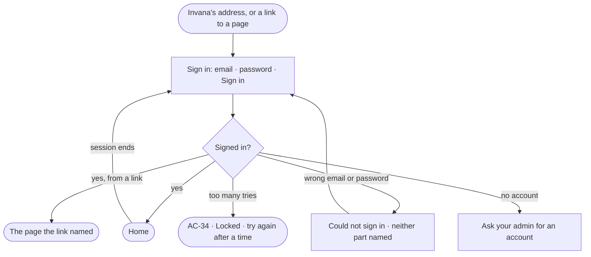

# AC-01 · Sign in

**As** an analyst **I want** to sign in with my email and password **so that** only people with an account reach the
deployment, and I come back to the page I was on.

Tasks: [task.md](task.md) · Feature: [AC-F01](../../feature.md)

## Who can

| Lens | Can | Otherwise sees |
|---|---|---|
| Admin | Sign in with their email and password; lands on Home | — |
| Operator | Sign in with their email and password; lands on Home | A person without an account reads *Ask your admin for an account* |

## Flow

## Acceptance criteria

| # | Given | When | Then |
|---|---|---|---|
| AC-01.1 | Sign in opens | it draws | one card: Invana, the deployment's address, email, password and *Sign in* — nothing else |
| AC-01.2 | A right email and password | the person signs in | they land on Home |
| AC-01.3 | A wrong email or password | the person signs in | it says it could not sign in, never which of the two was wrong, and keeps the email |
| AC-01.5 | A link to a page and no session | the person signs in | they land on that page, not Home |
| AC-01.6 | A session that ends | the person acts | they are sent to sign in and, once signed in, returned to the page they were on |
| AC-01.7 | Signing in | it is waiting on the engine | the button says it is signing in and cannot be pressed twice |
| AC-01.8 | A person without an account | they read the card | it says *Ask your admin for an account*; there is no sign-up form |
| AC-01.9 | A service user, an agent or the system user | a sign-in is tried with its username or email | it is refused as *Could not sign in* — only people sign in |

## Screens

| Surface | Lens | First use | Empty after a filter | Loading | Has data | Failed | Agent working or proposing | No access |
|---|---|---|---|---|---|---|---|---|
| Sign in | Admin | access.signin | — | access.signin · Signing in | access.signin | access.signin · Could not sign in | — | — |
| Sign in | Operator | access.signin | — | access.signin · Signing in | access.signin | access.signin · Could not sign in | — | access.signin · No account |
