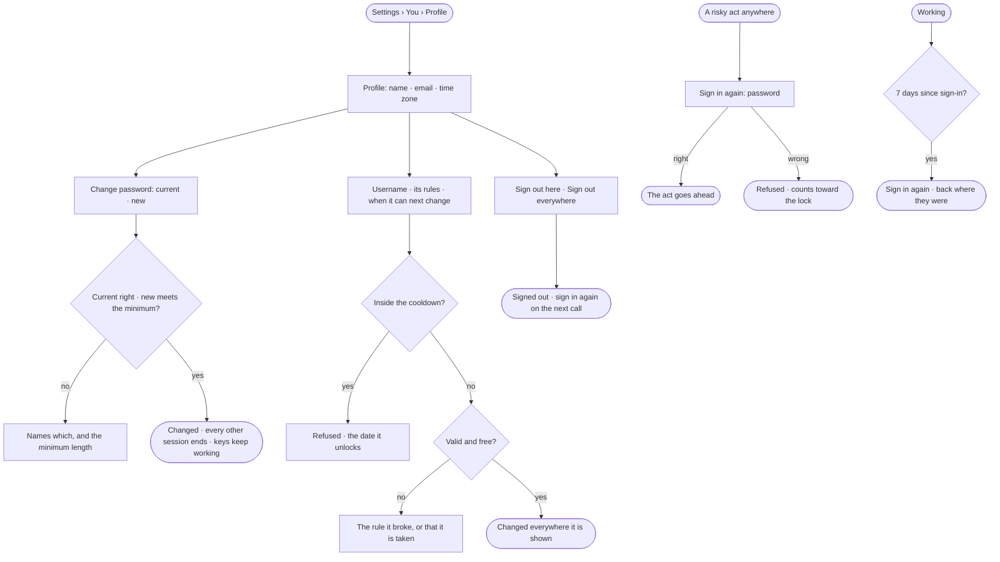

# AC-02 · Keep my account and sessions in order

**As** an analyst **I want** my name, password and username in one place, to sign out a device I do not trust, and
to be asked for my password before anything risky is done in my name **so that** losing a laptop is not a password
change and a prayer, and a session left open cannot change access.

Tasks: [task.md](task.md) · Feature: [AC-F01](../../feature.md)

## Who can

| Lens | Can | Otherwise sees |
|---|---|---|
| Admin | Their own account: name, email, time zone, username, password; sign out here or everywhere. Signs in again for every risky act | Another person's account is not in Studio; a person who leaves is deactivated ([AC-23](../../../AC-F03-directory/stories/AC-23-deactivate-a-person-who-leaves/story.md)) |
| Operator | Their own account: name, email, time zone, username, password; sign out here or everywhere. Signs in again for every risky act | Another person's account is not in Studio |

## Flow

## Acceptance criteria

| # | Given | When | Then |
|---|---|---|---|
| AC-02.1 | A signed-in person | they open *Settings › You › Profile* | their name, email, time zone and username read, with *Sign out here* and *Sign out everywhere*; *Keys* and *Connected clients* are tabs beside it |
| AC-02.2 | The profile | the person changes their first or last name | it saves; a first name is required, a last name is not |
| AC-02.3 | A password change | the current password is wrong, or the new one is shorter than the deployment's minimum | it is refused, naming which — the current password, or the minimum length |
| AC-02.4 | A password change | it saves | every other session ends on its next call; the person's keys and connected clients keep working |
| AC-02.5 | A new username | it breaks a rule — not 2–64 characters, not lowercase letters, digits and single hyphens, a hyphen at either end | it is refused, naming the rule |
| AC-02.6 | A new username typed with capitals | it is read | the field shows it folded to lowercase, as it will be saved |
| AC-02.7 | A username already taken in the deployment | it is saved | it is refused, saying it is taken |
| AC-02.8 | A username changed inside the cooldown | it is saved | it is refused, naming the date it unlocks |
| AC-02.9 | A valid, free username | it is saved | it changes at once in the Directory, History and the command line; the old one is not kept as another name |
| AC-02.10 | A signed-in person | they press *Sign out everywhere* | every device returns to sign-in on its next call |
| AC-02.11 | A signed-in person | they press *Sign out here* | this device returns to sign-in; the others stay signed in |
| AC-02.12 | A session whose access token expired mid-act | the person acts | it is renewed underneath and the act completes |
| AC-02.13 | A retired refresh token | it is used again | it is refused, every session of the account ends, and History records it (AC-F06) |
| AC-02.14 | A session that cannot be renewed | the person acts | they are told the session ended, sign in again, and return where they were |
| AC-02.15 | A person with a live session | they reach the sign-in page | it says *Restoring your session…* and goes where they were heading — only to an address inside Studio — never asking for the password |
| AC-02.16 | A stored session that is not valid | the sign-in page opens | the stored session is dropped and the sign-in form shows |
| AC-02.17 | A person whose role changed, who lost an agent, or who was deactivated while working | their next call is made | it is read with the new role and agents — or refused — and Studio says their access changed |
| AC-02.18 | A call made with a key | it changes a password or makes any risky act | it is refused — *This needs a person's session, not a key* |
| AC-02.19 | A failed sign-in, a lock or a used email | the message is read | it never says whether an account exists |
| AC-02.20 | A session renewed again and again | 7 days have passed since its sign-in | its next renewal is refused and the person signs in again, returning where they were |
| AC-02.21 | A risky act — changing access, keys or credentials | the person makes it | *Sign in again* asks for their password for this act, however recent the session; a right one lets the act go ahead, a wrong one refuses it and counts toward the lock (AC-34.6) |
| AC-02.22 | Any page of Studio | it is served | it carries a Content Security Policy that runs scripts from Studio's own origin only; an injected inline script does not run |

## Screens

| Surface | Lens | First use | Empty after a filter | Loading | Has data | Failed | Agent working or proposing | No access |
|---|---|---|---|---|---|---|---|---|
| Profile | Admin | settings.me | — | settings.me · Loading | settings.me | settings.me · Could not save | — | — |
| Profile | Operator | settings.me | — | settings.me · Loading | settings.me | settings.me · Could not save | — | — |
| Username | Admin | — | — | — | settings.me · Username | settings.me · Inside the cooldown | — | — |
| Username | Operator | — | — | — | settings.me · Username | settings.me · Inside the cooldown | — | — |
| Password and sessions | Admin | — | — | — | settings.me · Sessions | settings.me · Password refused | — | — |
| Password and sessions | Operator | — | — | — | settings.me · Sessions | settings.me · Password refused | — | — |
| Sign in again | Admin | — | — | access.sign_in_again · Checking | access.sign_in_again | access.sign_in_again · Wrong password | — | — |
| Sign in again | Operator | — | — | access.sign_in_again · Checking | access.sign_in_again | access.sign_in_again · Wrong password | — | — |
