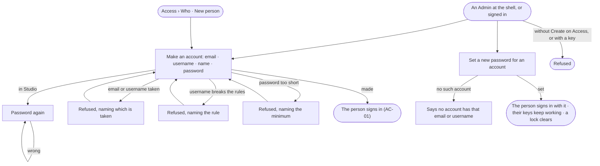

# AC-18 · Give a person an account

**As** an Admin **I want** to make an account for a person, or set a new password for one who lost theirs,
**so that** only the people I name can sign in, and nobody signs in with a default password.

Tasks: [task.md](task.md) · Feature: [AC-F01](../../feature.md)

## Who can

| Access | Can | Otherwise sees |
|---|---|---|
| Admin | With Create on Access: make a person's account — email, username, name and password — from the command line or, signed in, from Access › Who or the API with the password again; set a new password for an account from the command line | — |
| Operator | — | *New person* is absent from People; making an account through the API is refused, naming Create on Access; the sign-in card reads *Ask your admin for an account* (AC-01.8) |

## Flow

## Acceptance criteria

| # | Given | When | Then |
|---|---|---|---|
| AC-18.1 | Someone at the shell | they run `invana users create` with an email, a username, a name and a password | the account is made holding the newcomers' policies, and the person can sign in with them (AC-01.2) |
| AC-18.2 | An empty deployment | `invana createsuperuser` is run | the first account is made, holding *Super user*; no account exists that the person at the shell did not name, and none has a default password |
| AC-18.3 | An Admin signed in | they make an account through the API, entering their password again | it is made holding the newcomers' policies, and History records who made it |
| AC-18.4 | An email or a username already in the deployment | an account is made with it | it is refused, naming which one is taken |
| AC-18.5 | A username that breaks the rules, or a password shorter than the deployment's minimum | an account is made with it | it is refused, naming the rule (AC-02.5 · AC-02.3) |
| AC-18.6 | Someone at the shell | they run `invana users update-password` for an email or a username | the password is set; the person's other sessions end, their keys keep working (AC-02.4) and a lock on their email clears (AC-34.7) |
| AC-18.7 | An email or a username no account has | a new password is set for it | it says no account has it, and changes nothing |
| AC-18.8 | A person without Create on Access, or any call made with a key | an account is made through the API | it is refused — it needs Create on Access, from a session |
| AC-18.9 | An Admin in Access › Who | they press *New person*, fill 1 email, username and name · 2 a first password, and enter their own password again | it is made as AC-18.3 makes it, each refusal of AC-18.4 and AC-18.5 shown in place on its field; no email is sent |
| AC-18.10 | The *New person* steps | *Next* or *Make the account* is pressed with an email or username taken, or a password that breaks the rules | *Taken* or *Breaks the rules* reads in place on the step that holds the cause, with *Back*; nothing is made |
| AC-18.11 | An Admin | they make the account and sign in again | *Sign in again* names *Make the account*; a right password returns to *Made* and the person in *Users*; a wrong password returns to the same *Sign in again* with the message |

## Screens

In Studio an account is made from Access › Who › *New person*; the command line and the API make it too.

| Surface | Access | First use | Empty after a filter | Loading | Has data | Failed | Agent working or proposing | No access |
|---|---|---|---|---|---|---|---|---|
| New person · 1 Who | Admin | settings.people · New person | — | — | settings.people · New person · Filled | settings.people · New person · Taken | — | — |
| New person · 1 Who | Operator | — | — | — | — | — | — | settings.people · New person · Locked · Users |
| New person · 2 First password | Admin | — | — | — | settings.people · New person · First password | settings.people · New person · Breaks the rules | — | — |
| New person · 2 First password | Operator | — | — | — | — | — | — | settings.people · New person · Locked · Users |
| New person · password again and made | Admin | — | — | access.signin · Sign in again · Make the account · Checking | settings.people · New person · Made | access.signin · Sign in again · Make the account · Wrong password | — | — |
| New person · password again and made | Operator | — | — | — | — | — | — | settings.people · New person · Locked |
| Where it lands · Users | Admin | — | — | — | settings.people | — | — | — |
| Where it lands · Users | Operator | — | — | — | settings.people · Locked · Users | — | — | settings.people · Locked · Users |
