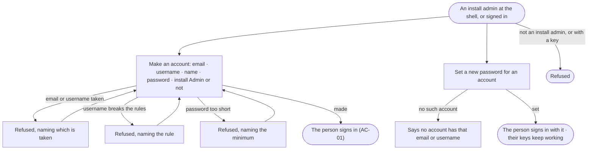

# AC-18 · Give a person an account

**As** an install admin **I want** to make an account for a person, or set a new password for one who lost theirs,
**so that** only the people I name can sign in, and nobody signs in with a default password.

Tasks: [task.md](task.md) · Feature: [AC-F01](../../feature.md)

## Who can

| Lens | Can | Otherwise sees |
|---|---|---|
| Admin | Make an account — email, username, name, password, and whether it is an install Admin — from the command line or, signed in, from the API; set a new password for an account from the command line | — |
| Operator | — | Making an account through the API is refused; the sign-in card reads *Ask your admin for an account* (AC-01.8) |

## Flow

## Acceptance criteria

| # | Given | When | Then |
|---|---|---|---|
| AC-18.1 | An install admin at the shell | they run `invana users create` with an email, a username, a name and a password | the account is made, and the person can sign in with them (AC-01.2) |
| AC-18.2 | An empty install | `invana users create --superuser` is run | the first install Admin is made; no account exists that the person at the shell did not name, and none has a default password |
| AC-18.3 | An install Admin signed in | they make an account through the API | it is made, and History records who made it |
| AC-18.4 | An email or a username already on the install | an account is made with it | it is refused, naming which one is taken |
| AC-18.5 | A username that breaks the rules, or a password shorter than the install's minimum | an account is made with it | it is refused, naming the rule (AC-02.5 · AC-02.3) |
| AC-18.6 | An install admin at the shell | they run `invana users update-password` for an email or a username | the password is set; the person's other sessions end and their keys keep working (AC-02.4 · AC-10.13) |
| AC-18.7 | An email or a username no account has | a new password is set for it | it says no account has it, and changes nothing |
| AC-18.8 | An Operator, or any call made with a key | an account is made through the API | it is refused — making an account is the install Admin's, from a signed-in session |

## Screens

No Studio surface: accounts are made from the command line or the API, and install administration is not a product
surface ([Access › Not building](../../../../product.md#not-building)).

| Surface | Lens | First use | Empty after a filter | Loading | Has data | Failed | Agent working or proposing | No access |
|---|---|---|---|---|---|---|---|---|
| Make an account | Admin | — | — | — | — | — | — | — |
| Make an account | Operator | — | — | — | — | — | — | — |
