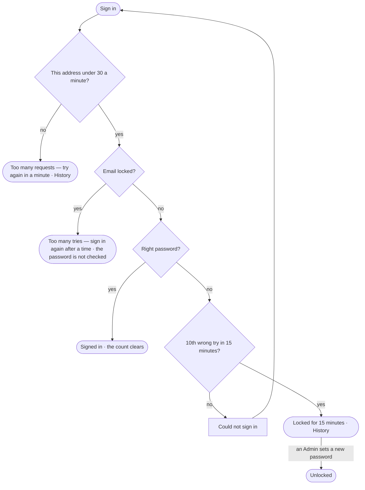

# AC-34 · Slow down guessing at sign-in

**As** an Admin **I want** an email locked for a while after many wrong passwords, and any one address slowed when it
calls too often, **so that** nobody can guess a person's password by trying, and every try is on record.

Tasks: [task.md](task.md) · Feature: [AC-F01](../../feature.md)

## Who can

| Lens | Can | Otherwise sees |
|---|---|---|
| Admin | Is held to the same lock and limit as everyone; reads locks and limits in History; clears a lock by setting a new password from the command line ([AC-18](../AC-18-give-a-person-an-account/story.md)) | — |
| Operator | Is held to the lock and the limit; reads when to try again | A lock never says whether the email has an account |

## Flow

## Acceptance criteria

| # | Given | When | Then |
|---|---|---|---|
| AC-34.1 | Nine wrong passwords to one email inside 15 minutes | a tenth is tried | the email is locked for 15 minutes; the card says *Too many tries — sign in again after {time}*, and History records the lock |
| AC-34.2 | An email no account has | ten wrong tries are made | it locks and reads exactly as a real one does — the lock never confirms an account |
| AC-34.3 | A locked email | the right password is tried | it is still refused until the lock lapses; the password is not checked |
| AC-34.4 | One address | it makes more than 30 sign-in or renewal requests in a minute | the rest are refused with *Too many requests — try again in a minute*, and History records it once |
| AC-34.5 | A person who signs in right before the tenth try | the next wrong try is made | the count started again at their sign-in |
| AC-34.6 | A risky act with a wrong password ([AC-02](../AC-02-keep-my-account-username-and-sessions-in-order/story.md)) | it is sent | it counts toward the same lock as a wrong sign-in |
| AC-34.7 | A locked email | an Admin runs `invana users update-password` for its account | the lock clears and the person signs in with the new password |
| AC-34.8 | A lock | the button is read | *Sign in* stays usable; pressing it says when to try again — the card never counts down tries left |

## Screens

| Surface | Lens | First use | Empty after a filter | Loading | Has data | Failed | Agent working or proposing | No access |
|---|---|---|---|---|---|---|---|---|
| Sign in | Admin | — | — | — | — | access.signin · Locked | — | access.signin · Too many requests |
| Sign in | Operator | — | — | — | — | access.signin · Locked | — | access.signin · Too many requests |
