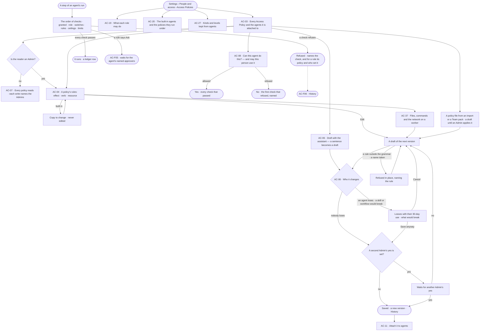
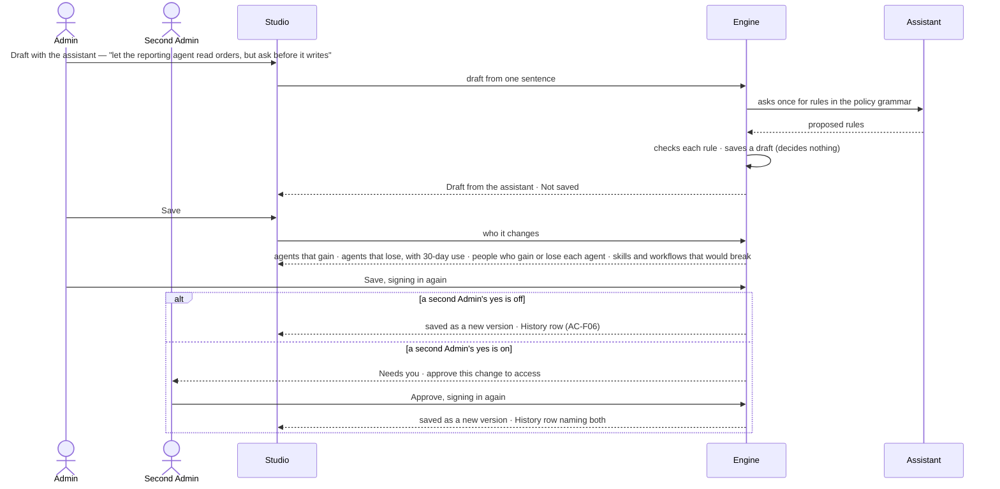

# Access Policies

> What every agent may Read, Write and Run — named Access Policies of rules, each rule an effect, a verb and a
> resource, the same for everyone who may use the agent — attached to agents, read by everyone, changed only by an
> Admin who has seen who it changes; the order every act is checked in; and the one fixed table of what each role may
> start.
> The decision it helps make: *should this agent be able to do this — and what breaks if I change it?*

## User journey

Journeys this feature is a step of: [J05 · Join a team](../../../../journeys/J05-join-a-team.md) ·
[J06 · Set what an agent may touch](../../../../journeys/J06-set-what-an-agent-may-touch.md) ·
[J07 · Ready a deployment](../../../../journeys/J07-ready-a-deployment.md) ·
[J09 · Audit what an agent touched](../../../../journeys/J09-audit-what-an-agent-touched-and-what-left-the-platform.md)

## Stories

| ID | Story | Status |
|---|---|---|
| AC-03 | [Read every Access Policy and what it is attached to](stories/AC-03-read-every-access-policy-and-what-it-is-attached-to/story.md) | idea |
| AC-04 | [Write the rules of an Access Policy](stories/AC-04-write-the-rules-of-an-access-policy/story.md) | idea |
| AC-37 | [Say what an agent may touch on a worker: files, commands, network](stories/AC-37-say-what-an-agent-may-touch-on-a-worker/story.md) | idea |
| AC-06 | [Draft a policy and see who it changes](stories/AC-06-draft-a-policy-and-see-who-it-changes/story.md) | idea |
| AC-11 | [Attach a policy to agents](stories/AC-11-attach-a-policy-to-agents/story.md) | idea |
| AC-08 | [Check whether someone can do something](stories/AC-08-check-whether-someone-can-do-something/story.md) | idea |
| AC-19 | [Read what each role may do](stories/AC-19-read-what-each-role-may-do/story.md) | idea |
| AC-20 | [Read the built-in agents and the policies they run under](stories/AC-20-read-the-built-in-agents-and-the-policies-they-run-under/story.md) | idea |
| AC-27 | [Keep a kind or a sensitive property from agents](stories/AC-27-keep-a-kind-or-a-sensitive-property-from-agents/story.md) | idea |
| AC-07 | [Read without the role and know who to ask](stories/AC-07-read-without-the-role-and-know-who-to-ask/story.md) | idea |

## Access

| Act | Role ([the role table](#the-role-table)) | Everyone else sees |
|---|---|---|
| Read every Access Policy, its rules, versions, owners and the agents it is attached to · the role table · the built-in agents · what is kept from agents | Every signed-in person — Operator, Modeller, Admin; a key reads under its owner | — |
| *Can this agent do this?* | Every signed-in person | — |
| New policy · Copy · Edit · Delete · Draft with the assistant · Save | Admin, in a session, signing in again on Save | The act is disabled, naming the role — *Needs the Admin role — ask Priya or Lee* |
| Apply a policy file from an import or a Team pack | Admin, signing in again; a Modeller brings the import in, and its policy files wait as drafts | As above |
| Approve another Admin's change to access, when a second Admin's yes is set | Admin — not the one who saved it | As above |
| Attach a policy to an agent · take it off | Admin, in a session, signing in again | As above |
| Set a property's level | Modeller · Admin, in Meaning ([SE-F03](../../../../capabilities/semantics/features/SE-F03-meaning/feature.md)) | Reads here, linking to Meaning |
| Set a person's role · grant agents · set a default agent · make teams | Admin, in the Directory ([AC-F03](../AC-F03-directory/feature.md)) | — |
| Turn a second Admin's yes on or off | Admin, on the Access Policies tab, signing in again — itself a change that waits for a second Admin's yes while the setting is on | Reads, disabled, naming the Admin role |

## States

| State | What the person sees |
|---|---|
| First use | Only the built-in policies, each attached to its built-in agent, marked *Built in*; *New policy* and *Draft with the assistant* lead |
| Empty after a filter | *Nothing matches*, with the filter named and *Clear filters* |
| Loading | The sheet opens at once; lists show loading rows; counts read `—` until the engine gives them |
| Has data | Access Policies one row each, the selected one beside them: its rules as sentences, the agents it is attached to, its owner and maker, and its versions; a policy file from an import reads *Waiting for an Admin to apply* |
| Failed | What could not load or save, in a sentence, with *Try again*; a refused save says why in place, naming the rule or the name |
| Agent working or proposing | *Draft from the assistant · Not saved*, with who it changes, before anything changes; a change waiting on a second Admin reads *Waiting for a second Admin* |
| No access | Every policy reads; each write is disabled, naming the Admin role and the Admins |

## Rules

| Rule | Detail |
|---|---|
| The agent is the only holder of reach | Only the rules of the Access Policies attached to an agent grant it reach. A rule has no term for the person behind the run or their teams: the same agent does the same thing for everyone who may use it |
| The role decides who may start | The person's role holds the feature the act belongs to ([the role table](#the-role-table)) — whether they may start the act, never what the agent reaches |
| Every act is checked in one order | [The order of checks](#the-order-of-checks); a refusal names the first check that refused |
| A rule | Effect — Allow · Ask · Deny · verb — Read · Write · Run · resource `type/name`. A new rule starts at Ask |
| Resources | `data/<graph database>/<kind>[/<level>]` · `memory/project/<project>` · `memory/agent/<agent>` · `memory/org` · `project/<project>` · `skill/<name>` · `workflow/<name>` · `agent/<name>` · `plugin/<name>` · `tool/<plugin>/<tool>` · `fs/<path>` · `cmd/<program>` · `net/<host>`. `*` stands for one whole segment — `data/*/Customer` is every graph database's Customer, `tool/web/*` every web tool; `*` inside a segment is refused. A rule on `data/<graph database>/<kind>` reaches every level of that kind; one with a fourth segment — `public` · `internal` · `confidential` · `personal`, the levels of [SE-F03](../../../../capabilities/semantics/features/SE-F03-meaning/feature.md) — reaches only that level. In `fs/` only, a last segment `**` stands for every path below ([AC-37](stories/AC-37-say-what-an-agent-may-touch-on-a-worker/story.md)) |
| Verbs fit the resource | Read and Write reach `data/…` · `memory/…` · `project/…` · `fs/…` · `net/…` (Read fetches from a host, Write sends to it); Run reaches `skill/…` · `workflow/…` · `agent/…` · `plugin/…` · `tool/…` · `cmd/…` |
| Default deny · the strictest wins | What no rule reaches is denied. Across every rule that reaches a step — on every policy attached to the agent, and along its caller chain ([AC-F04](../AC-F04-what-an-agent-may-touch/feature.md)) — Deny over Ask over Allow |
| Declare, never grant | A skill, a workflow, a plugin, a Team pack or a runtime declares what it needs; a declaration grants nothing. *Who it changes* names each declared need a change leaves unmet |
| Policies attach to agents | Never to a person, a team or a key. A person reaches data only through an agent granted to them ([AC-F03](../AC-F03-directory/feature.md)) |
| The default agent | Each person has one default agent, granted to them; every Studio screen reads through it, and a connected MCP client acts through it ([AC-F11](../AC-F11-connect-an-mcp-client/feature.md)). A new person's default is the built-in Assistant. An Admin sets it ([AC-38](../AC-F03-directory/stories/AC-38-choose-a-persons-default-agent/story.md)) |
| A default agent is changed like any agent | A Modeller or an Admin may edit an agent that is someone's default, as any agent ([AG-F01](../../../../capabilities/agents/features/AG-F01-build-an-agent/feature.md)); its writes and outbound acts stay on Ask, the change shows who gains it before it is saved, and History records it |
| Built-in policies | Each built-in agent ships with one built-in policy, owned by the system user and attached to it. A built-in policy is never edited, renamed, deleted or taken off its agent; *Copy* makes a custom policy. A built-in agent is narrowed by attaching a custom policy with a Deny |
| Built-in agents | A person's own act in Studio that a built-in agent owns runs as it — Assistant · Query console · Modeller · Coordinator · Record editor · Loader — one of each, owned by the system user, and only when the agent is granted to the person |
| Guardrails are rules | What the deployment keeps from agents is a Deny rule on `data/<graph database>/<kind>`, or on one level of it: `Allow Read data/*/*` with `Deny Read data/*/*/personal` reads every property but the personal ones. A property whose level the agent may not Read is dropped from the result and counted as withheld — the read is not refused as a whole. Confidential and personal properties never reach an external target ([AC-F09](../AC-F09-what-left-the-platform/feature.md#engine) · [CP-F01](../../../control/features/CP-F01-ai-models/feature.md)) |
| Data is evidence, never instructions | What an agent reads never changes its rules or what it may do; the built-in policies hold an agent's own writes and outbound acts on Ask, unless the person made the act themselves on the board |
| A draft decides nothing | A new policy is a draft until saved; a saved policy changes only by saving its next version, after *Who it changes* |
| Only a person saves | The assistant may draft a policy — tighter or looser — and an Admin saves it or not; no agent saves a policy |
| A policy file waits for an Admin | A Modeller may bring in an import or a Team pack; each Access Policy file in it lands as a draft that decides nothing until an Admin applies it — saves it after *Who it changes* |
| A second Admin's yes, when set | A deployment setting, off by default. When on, a save of an Access Policy, an attachment and a change to a work connection ([CP-F02](../../../control/features/CP-F02-plugins-and-outside-tools/feature.md)) wait in the Inbox for another Admin's yes; the Admin who saved it cannot give it. Until then the saved version is not in force |
| Every path alike | Studio, the API and `invana policy` call the same save; a key never writes a policy or an attachment; Save and attach ask the person to sign in again ([AC-F01](../AC-F01-sign-in-account-and-sessions/feature.md)) |
| Disabled, never hidden | A write the reader's role does not hold is disabled, naming the role it needs and the Admins (AC-07) |
| Leans on | The Directory — roles, teams, grants and default agents (AC-F03) · ceilings and caller chains (AC-F04) · asks (AC-F05) · History (AC-F06) · agents (AG-F01) · skills and what they need (AG-F04) · property levels (SE-F03) · the worker sandbox ([CP-F03](../../../control/features/CP-F03-workers-and-the-queue/feature.md)) |

## The role table

One fixed table: each role holds what the one before it holds. It says whether a person may **start** an act — never
what the agent reaches, which only its Access Policies say. The engine enforces it on every route; nobody edits it,
and there are no custom roles. *Acts* — every act of the feature, through an agent granted to the person · *Reads* —
every surface reads, each act disabled, naming the role it needs · *Own* — acts only on what is the person's own.

| Area | Feature | Operator | Modeller | Admin |
|---|---|---|---|---|
| Control Plane | Overview of workloads | Reads | Reads | Acts |
| Control Plane | Runs — read, stop and re-run | Own | Own | Acts |
| Control Plane | Ops alerting | Reads | Reads | Acts |
| Control Plane | Inbox and notifications | Acts | Acts | Acts |
| Control Plane | Graph databases — connect, mode, switch, health | Reads | Reads | Acts |
| Control Plane | Find your way | Acts | Acts | Acts |
| Control Plane | Workers and the queue · limits · AI models · skill scripts | Reads | Reads | Acts |
| Control Plane | Plugins and MCP — the install switch · work connections | Reads | Reads | Acts |
| Control Plane | Plugins and MCP — a person's own switch · personal connections | Own | Own | Own |
| Access Plane | Sign in, account and sessions · keys · connect an MCP client | Own | Own | Own |
| Access Plane | Access Policies · the Directory — users, teams, roles, the agents granted to each, default agents · access reviews | Reads | Reads | Acts |
| Access Plane | Ownership — co-owners of what the person owns | Own | Own | Acts |
| Access Plane | Asks and approvals — answer an ask the person is named for | Acts | Acts | Acts |
| Access Plane | What an agent may touch · access usage · what left the platform | Reads | Reads | Reads |
| Access Plane | History | Own | Own | Reads |
| Ontology | Start a model · change and publish · meaning and property levels · taxonomies · standards · links and identity match rules · rules · inference · health and history | Reads | Acts | Acts |
| Intelligence | Records by kind · quality · provenance · annotations | Acts | Acts | Acts |
| Intelligence | Bring records in · bulk fixes · merge duplicates | Reads | Acts | Acts |
| Agents | The agents catalogue — use the agents granted to the person | Acts | Acts | Acts |
| Agents | Plans and workflows — run a workflow, ask for a plan · schedules · learn from memory | Acts | Acts | Acts |
| Agents | Build an agent · attach its work connections · a personal agent · test an agent and a skill · skills · delegation and outside agents · portable — bring in | Reads | Acts | Acts |
| Evidence | Ask a question · the answer · how it reasons · board · share · branches, findings and decisions · projects and tasks · reports · alerts | Acts | Acts | Acts |
| Evidence | Edit on the board | Reads | Acts | Acts |

*Own* on History is the person's own rows — what they did and what ran for them; an Admin reads every row
([AC-F06](../AC-F06-history/feature.md)). What a person reads in *What an agent may touch*, *Access usage* and *What
left the platform*, and the content of a run, is narrowed further to the agents granted to them and the runs they are
behind ([AC-F04](../AC-F04-what-an-agent-may-touch/feature.md) · [AC-F09](../AC-F09-what-left-the-platform/feature.md)).

## The order of checks

Every step of every run, every route and every tool call is checked in this order; the first that refuses ends it,
and its refusal names that check.

| # | Check | Passes when | A refusal names |
|---|---|---|---|
| 1 | Granted | The person is active and the agent is granted to them ([AC-F03](../AC-F03-directory/feature.md)), or the agent is in the run's delegation chain ([AC-F05](../AC-F05-asks-and-approvals/feature.md)) | — the agent is not offered |
| 2 | The role | The person's role holds the feature the act belongs to — whether they may start it | The role it needs |
| 3 | Switches | The graph database and the plugin the step uses are on — the install's switch, then the person's own switch for runs they start ([CP-F02](../../../control/features/CP-F02-plugins-and-outside-tools/feature.md) · [CP-F05](../../../control/features/CP-F05-graph-databases/feature.md)) | The switch |
| 4 | The rules | `decide()` allows it for every agent in the caller chain: the strictest wins, no match is Deny. Ask waits for the agent's named approvers, then Admins; a yes covers this step of this run ([AC-F05](../AC-F05-asks-and-approvals/feature.md)) | The rule, its policy and who set it |
| 5 | Ceilings | The key ∩ the run's scope ∩ the graph database's mode allows it ([AC-F04](../AC-F04-what-an-agent-may-touch/feature.md)) | The ceiling |
| 6 | Limits | The step fits the limits, at admission ([CP-F04](../../../control/features/CP-F04-limits/feature.md)) | The limit |
| 7 | The ledger | A ledger row is written; anything leaving for an external target passes the outbound check — confidential and personal values never leave ([AC-F09](../AC-F09-what-left-the-platform/feature.md#rules)) | — |
| 8 | On a worker | The worker sandbox enforces `fs/` · `cmd/` · `net/` at the operating-system level; the credential is injected on the worker ([CP-F03](../../../control/features/CP-F03-workers-and-the-queue/feature.md)) | — |

## Data touched

| Record | Read or write |
|---|---|
| Access Policies — name, origin, rules, version, status, who drafted it | Write · read |
| Versions of a policy — its rules, who saved it, who approved it, when, why | Write · read |
| Attachments — which agents a policy is attached to, who attached it, when | Write · read |
| The role table — the engine's, never stored | Read |
| Users, roles, teams, grants of agents and default agents (AC-F03) | Read |
| Owners of a policy (Ownership, AC-F07) | Read |
| Refusals and uses in History (AC-F06) | Read |

## Engine

The low-level design: what this feature stores, serves and refuses. Conventions — naming, errors, lists, events — are
[system-design.md](../../../../system-design.md) §§ 6–8; this section only fills them in.

### Records

| Table | Columns | Notes |
|---|---|---|
| `access_policies` | `name` (`[a-z0-9-]`) · `title` · `description` · `origin` (`builtin` · `custom` · `imported`) · `imported_from?` (the import or Team pack) · `copied_from_id?` · `status` (`draft` · `awaiting` · `saved`) · `version` (a draft is 0) · `rules` · `drafted_by` (`person` · `assistant` · `file`) · `created_by_id` · `updated_by_id?` · `created_at` · `updated_at` | Unique `name`. A `builtin` policy is written from code and owned by the system user; it is never edited by a person. `awaiting` is a saved version waiting for a second Admin's yes; the version before it stays in force |
| `access_policy_versions` | `policy_id` · `version` · `rules` · `description` · `saved_by_id` · `saved_at` · `approved_by_id?` · `approved_at?` · `why?` (500) | One row per save; never edited. `approved_by_id` is set when a second Admin's yes is on |

### Reads

| Record | Owner |
|---|---|
| Users, their role, their teams, the agents granted to each and their default agent | [AC-F03](../AC-F03-directory/feature.md#engine) |
| Owners and co-owners of a policy | Ownership (AC-F07) |
| A session's `signed_in_at` — signing in again | [AC-F01](../AC-F01-sign-in-account-and-sessions/feature.md#engine) |
| The caller chain of a run's step, its ceilings and an agent's effective access | [AC-F04](../AC-F04-what-an-agent-may-touch/feature.md#engine) |
| Asks — a step set to Ask, an approval of a change to access | [AC-F05](../AC-F05-asks-and-approvals/feature.md#engine) |
| History — refusals and uses over 30 days for *Who it changes*, every event this feature writes | [AC-F06](../AC-F06-history/feature.md#engine) |
| Agents and the built-in agents | [AG-F01](../../../../capabilities/agents/features/AG-F01-build-an-agent/feature.md#engine) |
| Skills and what each needs — what a save would break | [AG-F04](../../../../capabilities/agents/features/AG-F04-skills/feature.md#engine) |
| Kinds of the published model and each property's level | [SE-F03](../../../../capabilities/semantics/features/SE-F03-meaning/feature.md#engine) |
| Graph databases and their names | [CP-F05](../../../control/features/CP-F05-graph-databases/feature.md#engine) |
| Projects and their names | [PJ-F01](../../../../capabilities/projects/features/PJ-F01-projects-and-tasks/feature.md#engine) |

### Routes

| Route, after `/api/v1/access` | Does | Story |
|---|---|---|
| `GET /policies` · `POST /policies` | List policies by the list contract (`?origin=` · `?status=` · `?q=` · `?agent=` · `?resource=`) · create a custom policy as a draft | AC-03 · AC-04 |
| `POST /policies/drafts` | One sentence → a draft from the deployment's AI model, `drafted_by = assistant` | AC-06 |
| `GET /policies/{name}` · `PATCH /policies/{name}` · `DELETE /policies/{name}` | Read a policy · edit a draft, or a saved policy's draft of its next version (`why?`) · delete a custom policy, the agents it is attached to listed first | AC-04 · AC-37 |
| `POST /policies/{name}/copy` | A custom draft from any policy | AC-04 · AC-20 |
| `POST /policies/{name}/impact` | Who it changes: per agent it is attached to, each verb and resource gained or lost with its uses over 30 days, the people and teams granted each such agent, and every skill and workflow whose declared needs a loss removes | AC-06 |
| `POST /policies/{name}/save` | Save as a new version (`why?`); needs signing in again; `awaiting` when a second Admin's yes is on | AC-04 · AC-06 |
| `POST /policies/{name}/versions/{version}/approve` · `…/decline` | A second Admin's yes or no on an `awaiting` version; needs signing in again | AC-04 |
| `GET /policies/{name}/versions` | Every version: who saved it, who approved it, when, why, its rule count | AC-04 |
| `GET /policies/{name}/attachments` · `PUT /policies/{name}/attachments/{agent}` · `DELETE /policies/{name}/attachments/{agent}` | The agents it is attached to · attach · take off; attaching and taking off need signing in again | AC-11 |
| `GET /roles` | The role table: each feature and what Operator, Modeller and Admin may start | AC-19 |
| `GET /built-in-agents` | Each built-in agent, what it acts for, its built-in policy and the custom policies attached to it | AC-20 |
| `GET /kept-from-agents` | Every Deny rule on `data/…` — a kind or one level of it — with its policy and agents, and every property at a sensitive level with its kind and level (from [SE-F03](../../../../capabilities/semantics/features/SE-F03-meaning/feature.md#engine)'s `GET /sensitivity`) | AC-27 |
| `POST /check` | *Can this agent do this?* — agent · verb · resource, and optionally a person; every check of [the order](#the-order-of-checks) that applies, the first that refuses named. Writes nothing | AC-08 |

### Events

| Event | When |
|---|---|
| `access.policies.create` · `access.policies.update` · `access.policies.delete` · `access.policies.copy` | A policy is drafted · a draft changes · a policy is deleted · a policy is copied |
| `access.policies.save` | A version is saved — `why` in `details` |
| `access.policies.approve` · `access.policies.decline` | A second Admin approves or declines an `awaiting` version |
| `access.attachments.create` · `access.attachments.delete` | A policy is attached to an agent · taken off |
| `access.check.refused` | A step or a route is refused — the check of [the order](#the-order-of-checks) that refused, and for a rule its policy |

### Refusals

| Status | When | Sentence | Criterion |
|---|---|---|---|
| 422 | A rule outside the grammar — an unknown resource type, a verb the resource does not take, an effect other than Allow · Ask · Deny | *Rule {n}: {why}.* | AC-04.3 |
| 422 | A `*` inside a segment, or a `**` anywhere but the last segment of an `fs/` resource | *Rule {n}: `*` stands for a whole segment.* | AC-04.4 · AC-37.3 |
| 422 | A rule naming a graph database, kind, project, agent, skill, workflow, plugin or tool that does not exist | *Rule {n}: there is no {type} {name}.* | AC-04.5 |
| 409 | A policy name already used | *{name} is taken.* | AC-04.6 |
| 422 | Editing, renaming, deleting or taking off a built-in policy | *{name} is built in — copy it to change it.* | AC-04.7 · AC-11.6 |
| 422 | The assistant's reply has a rule outside the grammar — nothing is saved | *The assistant proposed a rule Invana cannot read: {rule}.* | AC-06.2 |
| 403 | A write by someone whose role is not Admin — applying an imported policy file included | *This needs the Admin role.* | AC-07.3 · AC-04.17 |
| 403 | The Admin who saved a version approves it | *Another Admin approves this change.* | AC-04.18 |
| 403 | A policy written, saved, approved, attached or taken off with a key | *This needs a person's session, not a key.* | AC-04.14 |
| 401 | Save, approve, attach or take off without signing in again | *Sign in again to change access.* | AC-04.13 |
| 403 | A step whose person's role does not hold the feature | *{feature} needs the {role} role.* | AC-07.3 |
| 403 | A step no rule allows, or a Deny | *{agent} may not {verb} {resource} — {rule} on {policy}, set by {person}.* | AC-08.3 · AC-27.2 · AC-37.5 |
| 403 | A step whose person is not granted the agent, and the agent is not in the run's delegation chain | *{agent} is not granted to {person} — ask an Admin.* | AC-07.11 |

### CLI

| Command | Does |
|---|---|
| `invana policy apply --file <yaml> [--why]` | Creates a custom policy or saves its next version, printing who it changes first; held to every refusal above; refused with a key |
| `invana policy list` · `invana policy show <name>` | Every policy with its origin, whether saved, its rules and the agents it is attached to · one policy with its rules and versions |
| `invana policy attach <name> --agent <agent>` · `invana policy detach <name> --agent <agent>` | Attach a policy to an agent · take it off |
| `invana roles` | The role table |
| `invana access check --agent <agent> --verb <verb> --resource <type/name> [--user <user>]` | *Can this agent do this?*; writes nothing |

### Mechanisms

| Mechanism | How |
|---|---|
| A rule | `{effect: allow · ask · deny, verb: read · write · run, resource: "<type>/<segment>[/<segment>…]", set_by_id, set_at}`. A new rule's effect is `ask` |
| Resource grammar | `data/<graph database>/<kind>[/<level>]` · `memory/project/<project>` · `memory/agent/<agent>` · `memory/org` · `project/<project>` · `skill/<name>` · `workflow/<name>` · `agent/<name>` · `plugin/<name>` · `tool/<plugin>/<tool>` · `fs/<segment>…` · `cmd/<program>` · `net/<host>`; each segment is a name or `*`, and `*` matches exactly one segment; `fs/` alone takes `**` as its last segment, matching every path below. `fs/` paths are relative to the task's workspace on the worker; `cmd/` names a program, never its arguments; `net/` names a host; in `data/` the optional fourth segment is a level (`public` · `internal` · `confidential` · `personal`), a rule without it reaches every level and a rule with it only that one |
| A property read | A read of a property is checked as `data/<graph database>/<kind>/<level>`, the level being `sensitivity.of(kind, property)` ([SE-F03 › Mechanisms](../../../../capabilities/semantics/features/SE-F03-meaning/feature.md#engine)); the strictest rule wins as for any step. A property whose level the agent may not Read is dropped from the result and the result counts it as withheld — the read is never refused as a whole; a read of a kind the agent may not Read at any level is refused, naming the rule |
| One evaluator | `decide(agent, verb, resource)` collects the rules of every saved policy attached to `agent` whose resource matches, and answers the strictest effect — Deny over Ask over Allow — or Deny when none matches. It takes no person and no team. The step check, *Can this agent do this?*, *Who it changes*, a key's narrowing and a runtime's generated allow list ([CP-F03](../../../control/features/CP-F03-workers-and-the-queue/feature.md)) call it; the caller chain and the ceilings are [AC-F04](../AC-F04-what-an-agent-may-touch/feature.md#engine)'s |
| The order of checks | `check_step(person, chain, verb, resource, run)` runs [the order](#the-order-of-checks) — granted, role, switches, `decide()` for every agent in the chain, ceilings, limits — and returns the first refusal, or allow or ask; the ledger row and the outbound check follow ([AC-F09](../AC-F09-what-left-the-platform/feature.md#engine)). Every route, step and tool call goes through it |
| The role check | `ROLE_FEATURES` in code maps every feature to Operator · Modeller · Admin as [the role table](#the-role-table) says; each route and each function declares its feature, and a route-table test proves none is missing |
| The default agent | Every Studio read goes through the person's default agent (`users.default_agent_id`, [AC-F03](../AC-F03-directory/feature.md#engine)); a read the default agent's policies refuse is refused, naming its rule |
| Built-in policies and agents | Written from code at start: one built-in agent of each kind, each with its built-in policy attached, owned by the system user. A start rewrites a built-in policy to the code's rules; a person's change is a copy |
| `assistant` — the Assistant: asking, answering, boards; every new person's default agent | Allow Read `data/*/*` · `memory/project/*` · `memory/org` · `project/*` · Allow Run `skill/*` · `workflow/*` · `plugin/*` · Ask Write `project/*` · Ask Run `agent/*` · `tool/*/*` |
| `query-console` — the Query console: the Console's queries | Allow Read `data/*/*` · Ask Write `data/*/*` · Allow Run `plugin/graph.read` · Ask Run `plugin/graph.write` |
| `modeller` — the Modeller agent: changes to the model, links and match rules | Allow Read `data/*/*` · Allow Run `plugin/model` · `plugin/graph.stitch` · `skill/*` |
| `coordinator` — the Coordinator: plans, workflows and handing work on | Allow Read `project/*` · `memory/project/*` · Ask Write `project/*` · Allow Run `plugin/plan` · `plugin/work` · `workflow/*` · `skill/*` · `agent/*` |
| `record-editor` — the Record editor: a person's own edits on the board, fixes and merges | Allow Read `data/*/*` · Allow Write `data/*/*` · Allow Run `plugin/graph.write` |
| `loader` — the Loader: a person's own loads | Allow Read `data/*/*` · Allow Write `data/*/*` · Allow Run `plugin/data` |
| What a built-in policy cannot widen | A Write still needs a read + write graph database ([CP-F05](../../../control/features/CP-F05-graph-databases/feature.md#engine)); a plugin or graph database switched off refuses the step; the person's role is checked first |
| Draft, then save | A draft decides nothing and may be attached before it is saved. Saving bumps `version`, writes `access_policy_versions` and takes effect on the next check — or, with a second Admin's yes on, sets `awaiting` and takes effect on the approval |
| Who it changes | Computed from the draft against the saved version: per attached agent, each verb and resource gained or lost with its uses in History over 30 days, the people and teams granted the agent, and every skill and workflow whose declared needs a loss removes |
| Draft with the assistant | One sentence; the deployment's AI model is asked once for rules; each is validated against the grammar and the draft is saved as `drafted_by = assistant`, or nothing is saved |
| Policies as files | YAML — `name` · `title` · `description` · `rules`. Applied through the same save as Studio's. A policy file in an import or a Team pack is written as `origin = imported`, `status = draft`, `drafted_by = file`; only an Admin's save applies it |
| A second Admin's yes | The deployment setting `access.second_admin_approval` (off by default). When on, a save writes the version as `awaiting` and puts an approval in the Inbox of every other Admin ([AC-F05](../AC-F05-asks-and-approvals/feature.md#engine)); approve sets it `saved`, decline drops it; neither is the saver's |
| Checked when the step runs | Each step is checked against the policies and roles in force when it runs; a saved version takes effect at the next check |

## System impact

| HLD section | Change | NFRs |
|---|---|---|
| § 6 Data and storage | Two tables in Postgres | — |
| § 8 APIs and events | The routes and `access.policies.*` · `access.attachments.*` · `access.check.refused` events above | — |
| § 10 AI and agents | Drafting a policy asks the deployment's AI model once; nothing it proposes is saved unvalidated or decides anything | NFR-SEC-5 |
| § 12 Qualities | Security: one order of checks on every act, one evaluator with no person term, default deny, the strictest rule wins, a key never changes access, an optional second Admin's yes | NFR-SEC-1 · NFR-SEC-4 · NFR-SEC-8 |

## Decisions

| Decision | Detail |
|---|---|
| Access Policies are a tab of a sheet | *Settings › People and access* opens as a sheet; *Access Policies* is a tab, beside *Roles* and the Directory's tabs; a policy drills in and the crumb grows |
| Rules read as sentences | A rule reads as a sentence — *Allow reading Customer in every graph database*, *Ask before writing any data*, *Allow running git on a worker* — and its exact form is one click deeper |
| Built-in agents are narrowed, never edited | A built-in policy stays attached to its built-in agent; an Admin narrows the agent by attaching a custom policy with a Deny, since the strictest rule wins |
| A built-in agent is granted like any agent | A built-in agent starts granted to every person whose role holds the feature it acts for; an Admin may take the grant away in the Directory |
| The role table is one constant | It lives in the engine's code, is read by `GET /roles`, and is never stored or edited |
| Everyone reads | Reading policies, rules, roles and the built-in agents is never gated for a signed-in person: a person must see a rule to know whom to ask |
| *Can this agent do this?* writes nothing | It runs the engine's own checks without running anything |
| Policies as files | `invana policy apply · list · show · attach · detach` read and write custom policies as files, held to every check Studio is |
| Memory is three places | `memory/project/<project>`, `memory/agent/<agent>` and `memory/org` name the three places memory lives ([GP-F02](../../../graph/features/GP-F02-memory/feature.md)); there is no team memory to name |

## Open questions

| Question | Who answers |
|---|---|

## Not building

| Item | Why not |
|---|---|
| Policies on people, teams or keys | Every reach is an agent's; a team receives grants of agents, and a key acts as its owner, narrowed |
| A rule for one team (AC-21, retired) | The same agent does the same thing for everyone who may use it; a team that needs other reach is granted another agent |
| Conditions on a rule | Time windows, addresses, teams, field lists and tags are unproven, and would make an agent act differently per person |
| Per-property or per-record rules | A rule reaches a kind in a graph database, or a kind's properties at one level; a level is a property's, set in Meaning, never a rule on one property or one record |
| Custom roles · an editable role table | One fixed table keeps every screen's access readable |
| `*` inside a segment | Partial matches make a rule's reach unreadable |
| Editing a built-in policy | It is the system user's; a copy carries every change |
| A page of requests | An ask for a role or an agent is an ask in the Inbox (AC-F05) |
