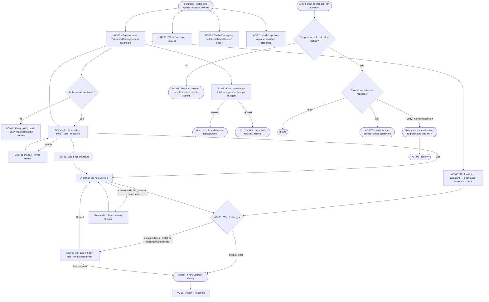
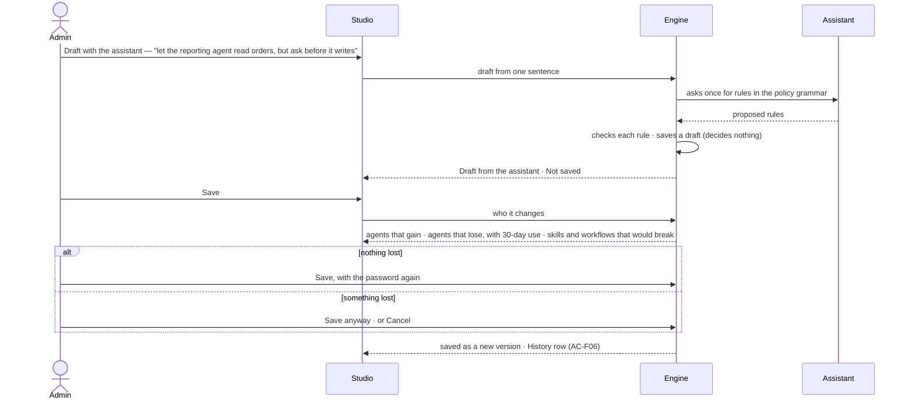

# Access Policies

> What every agent may Read, Write and Run — named Access Policies of rules, each rule an effect, a verb and a
> resource, held for everyone or for one team — attached to agents, read by everyone, changed only by an Admin who has
> seen who it changes; and the one fixed table of what each role may do.
> The decision it helps make: *should this agent be able to do this, for this person — and what breaks if I change it?*

## User journey

Journeys this feature is a step of: [J05 · Join a team](../../../../journeys/J05-join-a-team.md) ·
[J06 · Set what an agent may touch](../../../../journeys/J06-set-what-an-agent-may-touch.md) ·
[J07 · Ready a deployment](../../../../journeys/J07-ready-a-deployment.md) ·
[J09 · Audit what an agent touched](../../../../journeys/J09-audit-what-an-agent-touched-and-what-left-the-platform.md)

## Stories

| ID | Story | Status |
|---|---|---|
| AC-03 | [Read every Access Policy and what it is attached to](stories/AC-03-read-every-access-policy-and-what-it-is-attached-to/story.md) | idea |
| AC-04 | [Write the rules of an Access Policy](stories/AC-04-write-the-rules-of-an-access-policy/story.md) | idea |
| AC-21 | [Hold a rule for one team](stories/AC-21-hold-a-rule-for-one-team/story.md) | idea |
| AC-06 | [Draft a policy and see who it changes](stories/AC-06-draft-a-policy-and-see-who-it-changes/story.md) | idea |
| AC-11 | [Attach a policy to agents](stories/AC-11-attach-a-policy-to-agents/story.md) | idea |
| AC-08 | [Check whether someone can do something](stories/AC-08-check-whether-someone-can-do-something/story.md) | idea |
| AC-19 | [Read what each role may do](stories/AC-19-read-what-each-role-may-do/story.md) | idea |
| AC-20 | [Read the built-in agents and the policies they run under](stories/AC-20-read-the-built-in-agents-and-the-policies-they-run-under/story.md) | idea |
| AC-27 | [Keep a kind or a sensitive property from agents](stories/AC-27-keep-a-kind-or-a-sensitive-property-from-agents/story.md) | idea |
| AC-07 | [Read without the role and know who to ask](stories/AC-07-read-without-the-role-and-know-who-to-ask/story.md) | idea |

## Access

| Act | Role ([the role table](#the-role-table)) | Everyone else sees |
|---|---|---|
| Read every Access Policy, its rules, versions, owners and the agents it is attached to · the role table · the built-in agents · what is kept from agents | Every signed-in person — Operator, Modeller, Admin; a key reads under its owner | — |
| *Can someone do this?* | Every signed-in person | — |
| New policy · Copy · Edit · Delete · Draft with the assistant · Save | Admin, in a session, with the password again on Save | The act is disabled, naming the role — *Needs the Admin role — ask Priya or Lee* |
| Attach a policy to an agent · take it off | Admin, in a session, with the password again | As above |
| Mark a property sensitive | Modeller · Admin, in Meaning ([SE-F03](../../../../capabilities/semantics/features/SE-F03-meaning/feature.md)) | Reads here, linking to Meaning |
| Set a person's role · grant agents · make teams | Admin, in the Directory ([AC-F03](../AC-F03-directory/feature.md)) | — |

## States

| State | What the person sees |
|---|---|
| First use | Only the built-in policies, each attached to its built-in agent, marked *Built in*; *New policy* and *Draft with the assistant* lead |
| Empty after a filter | *Nothing matches*, with the filter named and *Clear filters* |
| Loading | The sheet opens at once; lists show loading rows; counts read `—` until the engine gives them |
| Has data | Access Policies one row each, the selected one beside them: its rules as sentences, the agents it is attached to, its owners and versions |
| Failed | What could not load or save, in a sentence, with *Try again*; a refused save says why in place, naming the rule or the name |
| Agent working or proposing | *Draft from the assistant · Not saved*, with who it changes, before anything changes |
| No access | Every policy reads; each write is disabled, naming the Admin role and the Admins |

## Rules

| Rule | Detail |
|---|---|
| Two checks, both must pass | The person's role holds the feature the act belongs to ([the role table](#the-role-table)); and the rules of the Access Policies attached to the agent the act runs through allow the verb on the resource. Neither widens the other; a refusal names the check that refused |
| A rule | Effect — Allow · Ask · Deny · verb — Read · Write · Run · resource `type/name`, and an optional team. A new rule starts at Ask |
| Resources | `data/<graph database>/<kind>` · `skill/<name>` · `workflow/<name>` · `agent/<name>` · `plugin/<name>` · `tool/<plugin>/<tool>`. `*` stands for one whole segment — `data/*/Customer` is every graph database's Customer, `tool/web/*` every web tool; `*` inside a segment is refused |
| Verbs fit the resource | Read and Write reach `data/…`; Run reaches `skill/…` · `workflow/…` · `agent/…` · `plugin/…` · `tool/…` |
| Default deny · the strictest wins | What no rule reaches is denied. Across every rule that reaches a step — on every policy attached to the agent, for everyone and for the person's teams — Deny over Ask over Allow |
| A team is a rule's only condition | A rule that names a team holds only when the person behind the run is on that team; a rule with no team holds for everyone. A team narrows where a rule holds; it never holds a policy |
| Policies attach to agents | Never to a person, a team or a key. A person reaches data only through an agent they may use ([AC-F03](../AC-F03-directory/feature.md)) |
| Built-in policies | Each built-in agent ships with one built-in policy, owned by the system user and attached to it. A built-in policy is never edited, renamed, deleted or taken off its agent; *Copy* makes a custom policy owned by the person who copied it. A built-in agent is narrowed by attaching a custom policy with a Deny |
| Built-in agents | A person's own act in Studio runs as the built-in agent for it — Assistant · Query console · Modeller · Coordinator · Record editor · Loader — one of each, owned by the system user, and only when the person may use that agent |
| Guardrails are rules | What the deployment keeps from agents is a Deny rule on `data/<graph database>/<kind>`; a sensitive property never reaches an external model ([SE-F03](../../../../capabilities/semantics/features/SE-F03-meaning/feature.md) · [CP-F01](../../../control/features/CP-F01-ai-models/feature.md)) |
| A draft decides nothing | A new policy is a draft until saved; a saved policy changes only by saving its next version, after *Who it changes* |
| Only a person saves | The assistant may draft a policy — tighter or looser — and an Admin saves it or not; no agent saves a policy |
| Every path alike | Studio, the API and `invana policy` call the same save; a key never writes a policy or an attachment; Save and attach ask for the password again ([AC-F01](../AC-F01-sign-in-account-and-sessions/feature.md)) |
| Disabled, never hidden | A write the reader's role does not hold is disabled, naming the role it needs and the Admins (AC-07) |
| Leans on | The Directory — roles, teams and the agents each person may use (AC-F03) · asks (AC-F05) · History (AC-F06) · agents (AG-F01) · skills and what they need (AG-F04) · sensitive properties (SE-F03) · what an agent may touch along a caller chain (AC-F04) |

## The role table

One fixed table: each role holds what the one before it holds. The engine enforces it on every route; nobody edits
it, and there are no custom roles. *Acts* — every act of the feature, within what the agent's policies allow and what
the person owns · *Reads* — every surface reads, each act disabled, naming the role it needs · *Own* — acts only on
what is the person's own.

| Area | Feature | Operator | Modeller | Admin |
|---|---|---|---|---|
| Control Plane | Overview of workloads | Reads | Reads | Acts |
| Control Plane | Runs — read, stop and re-run | Own | Own | Acts |
| Control Plane | Ops alerting | Reads | Reads | Acts |
| Control Plane | Inbox and notifications | Acts | Acts | Acts |
| Control Plane | Graph databases — connect, mode, switch, health | Reads | Reads | Acts |
| Control Plane | Find your way | Acts | Acts | Acts |
| Control Plane | Workers and the queue · limits · AI models · skill scripts | Reads | Reads | Acts |
| Control Plane | Plugins and MCP — the install switch | Reads | Reads | Acts |
| Control Plane | Plugins and MCP — a person's own switch | Own | Own | Own |
| Access Plane | Sign in, account and sessions · keys · connect an MCP client | Own | Own | Own |
| Access Plane | Access Policies · the Directory — users, teams, roles, which agents each may use | Reads | Reads | Acts |
| Access Plane | Ownership — co-owners of what the person owns | Own | Own | Acts |
| Access Plane | Asks and approvals — answer an ask the person is named for | Acts | Acts | Acts |
| Access Plane | What an agent may touch · access usage · what left the platform · History | Reads | Reads | Reads |
| Ontology | Start a model · change and publish · meaning and sensitive properties · taxonomies · standards · links and identity match rules · rules · inference · health and history | Reads | Acts | Acts |
| Intelligence | Records by kind · quality · provenance · annotations | Acts | Acts | Acts |
| Intelligence | Bring records in · bulk fixes · merge duplicates | Reads | Acts | Acts |
| Agents | The agents catalogue — use the agents the person may use | Acts | Acts | Acts |
| Agents | Plans and workflows — run a workflow, ask for a plan · schedules · thinking graph and memory | Acts | Acts | Acts |
| Agents | Build an agent · test an agent and a skill · skills · delegation and outside agents · portable | Reads | Acts | Acts |
| Evidence | Ask a question · the answer · how it reasons · board · share · branches, findings and decisions · projects and tasks · reports · alerts | Acts | Acts | Acts |
| Evidence | Edit on the board | Reads | Acts | Acts |

What a person reads in *What an agent may touch*, *Access usage* and *What left the platform*, and the content of a
run, is narrowed further to what they own or are behind ([AC-F04](../AC-F04-what-an-agent-may-touch/feature.md)).

## Data touched

| Record | Read or write |
|---|---|
| Access Policies — name, origin, rules, version, status, who drafted it | Write · read |
| Versions of a policy — its rules, who saved it, when, why | Write · read |
| Attachments — which agents a policy is attached to, who attached it, when | Write · read |
| The role table — the engine's, never stored | Read |
| Users, roles, teams and the agents each person may use (AC-F03) | Read |
| Owners of a policy (Ownership, AC-F07) | Read |
| Refusals and uses in History (AC-F06) | Read |

## Engine

The low-level design: what this feature stores, serves and refuses. Conventions — naming, errors, lists, events — are
[system-design.md](../../../../system-design.md) §§ 6–8; this section only fills them in.

### Records

| Table | Columns | Notes |
|---|---|---|
| `access_policies` | `name` (`[a-z0-9-]`) · `title` · `description` · `origin` (`builtin` · `custom`) · `copied_from_id?` · `status` (`draft` · `saved`) · `version` (a draft is 0) · `rules` · `drafted_by` (`person` · `assistant`) · `created_by_id` · `updated_by_id?` · `created_at` · `updated_at` | Unique `name`. A `builtin` policy is written from code and owned by the system user; it is never edited by a person |
| `access_policy_versions` | `policy_id` · `version` · `rules` · `description` · `saved_by_id` · `saved_at` · `why?` (500) | One row per save; never edited |
| `access_policy_attachments` | `policy_id` · `agent_id` · `attached_by_id` · `attached_at` | Unique (`policy_id`, `agent_id`). A draft may be attached; it decides nothing until saved |

### Reads

| Record | Owner |
|---|---|
| Users, their role, their teams and the agents each may use | [AC-F03](../AC-F03-directory/feature.md#engine) |
| Owners and co-owners of a policy | Ownership (AC-F07) |
| A session's `signed_in_at` — the password again | [AC-F01](../AC-F01-sign-in-account-and-sessions/feature.md#engine) |
| The caller chain of a run's step, and an agent's effective access | [AC-F04](../AC-F04-what-an-agent-may-touch/feature.md#engine) |
| Asks — a step set to Ask, an ask for a role | [AC-F05](../AC-F05-asks-and-approvals/feature.md#engine) |
| History — refusals and uses over 30 days for *Who it changes*, every event this feature writes | [AC-F06](../AC-F06-history/feature.md#engine) |
| Agents and the built-in agents | [AG-F01](../../../../capabilities/agents/features/AG-F01-build-an-agent/feature.md#engine) |
| Skills and what each needs — what a save would break | [AG-F04](../../../../capabilities/agents/features/AG-F04-skills/feature.md#engine) |
| Kinds of the published model and sensitive properties | [SE-F03](../../../../capabilities/semantics/features/SE-F03-meaning/feature.md#engine) |
| Graph databases and their names | [CP-F05](../../../control/features/CP-F05-graph-databases/feature.md#engine) |

### Routes

| Route, after `/api/v1/access` | Does | Story |
|---|---|---|
| `GET /policies` · `POST /policies` | List policies by the list contract (`?origin=` · `?q=` · `?agent=` · `?resource=`) · create a custom policy as a draft | AC-03 · AC-04 |
| `POST /policies/drafts` | One sentence → a draft from the deployment's AI model, `drafted_by = assistant` | AC-06 |
| `GET /policies/{name}` · `PATCH /policies/{name}` · `DELETE /policies/{name}` | Read a policy · edit a draft, or a saved policy's draft of its next version (`why?`) · delete a custom policy, the agents it is attached to listed first | AC-04 · AC-21 |
| `POST /policies/{name}/copy` | A custom draft from any policy, owned by the person who copied it | AC-04 · AC-20 |
| `POST /policies/{name}/impact` | Who it changes: per agent it is attached to, each verb and resource gained or lost with its uses over 30 days, per team where a rule names one, and every skill and workflow whose needs a loss removes | AC-06 |
| `POST /policies/{name}/save` | Save as a new version (`why?`); needs the password again | AC-04 · AC-06 |
| `GET /policies/{name}/versions` | Every version: who saved it, when, why, its rule count | AC-04 |
| `GET /policies/{name}/attachments` · `PUT /policies/{name}/attachments/{agent}` · `DELETE /policies/{name}/attachments/{agent}` | The agents it is attached to · attach · take off; attaching and taking off need the password again | AC-11 |
| `GET /roles` | The role table: each feature and what Operator, Modeller and Admin may do | AC-19 |
| `GET /built-in-agents` | Each built-in agent, what it acts for, its built-in policy and the custom policies attached to it | AC-20 |
| `GET /kept-from-agents` | Every Deny rule on `data/…` with its policy and team, and every sensitive property with its kind | AC-27 |
| `POST /check` | *Can someone do this?* — person · agent · verb · resource; the role check and every rule that reaches it, the strictest named. Writes nothing | AC-08 |

### Events

| Event | When |
|---|---|
| `access.policies.create` · `access.policies.update` · `access.policies.delete` · `access.policies.copy` | A policy is drafted · a draft changes · a policy is deleted · a policy is copied |
| `access.policies.save` | A version is saved — `why` in `details` |
| `access.attachments.create` · `access.attachments.delete` | A policy is attached to an agent · taken off |
| `access.check.refused` | A step or a route is refused by the role check or a rule — the check, the rule, its policy and team |

### Refusals

| Status | When | Sentence | Criterion |
|---|---|---|---|
| 422 | A rule outside the grammar — an unknown resource type, a verb the resource does not take, an effect other than Allow · Ask · Deny | *Rule {n}: {why}.* | AC-04.3 |
| 422 | A `*` inside a segment | *Rule {n}: `*` stands for a whole segment.* | AC-04.4 |
| 422 | A rule naming a graph database, kind, skill, workflow, agent, plugin or tool that does not exist | *Rule {n}: there is no {type} {name}.* | AC-04.5 |
| 422 | A rule naming a team that does not exist | *Rule {n}: there is no team {team}.* | AC-21.5 |
| 409 | A policy name already used | *{name} is taken.* | AC-04.6 |
| 422 | Editing, renaming, deleting or taking off a built-in policy | *{name} is built in — copy it to change it.* | AC-04.7 · AC-11.6 |
| 422 | The assistant's reply has a rule outside the grammar — nothing is saved | *The assistant proposed a rule Invana cannot read: {rule}.* | AC-06.2 |
| 403 | A write by someone whose role is not Admin | *This needs the Admin role.* | AC-07.3 |
| 403 | A policy written, saved, attached or taken off with a key | *This needs a person's session, not a key.* | AC-04.14 |
| 401 | Save, attach or take off without the password again | *Enter your password again to change access.* | AC-04.13 |
| 403 | A step whose person's role does not hold the feature | *{feature} needs the {role} role.* | AC-07.3 |
| 403 | A step no rule allows, or a Deny | *{agent} may not {verb} {resource} — {rule} on {policy}, set by {person}.* | AC-08.3 · AC-21.3 · AC-27.2 |
| 403 | A step whose person may not use the agent | *{person} may not use {agent} — ask an Admin.* | AC-07.11 |

### CLI

| Command | Does |
|---|---|
| `invana policy apply --file <yaml> [--why]` | Creates a custom policy or saves its next version, printing who it changes first; held to every refusal above; refused with a key |
| `invana policy list` · `invana policy show <name>` | Every policy with its origin, whether saved, its rules and the agents it is attached to · one policy with its rules and versions |
| `invana policy attach <name> --agent <agent>` · `invana policy detach <name> --agent <agent>` | Attach a policy to an agent · take it off |
| `invana roles` | The role table |
| `invana access check --user <user> --agent <agent> --verb <verb> --resource <type/name>` | *Can someone do this?*; writes nothing |

### Mechanisms

| Mechanism | How |
|---|---|
| A rule | `{effect: allow · ask · deny, verb: read · write · run, resource: "<type>/<name>[/<name>]", team_id?, set_by_id, set_at}`. A new rule's effect is `ask` |
| Resource grammar | `data/<graph database>/<kind>` · `skill/<name>` · `workflow/<name>` · `agent/<name>` · `plugin/<name>` · `tool/<plugin>/<tool>`; each segment is a name or `*`, and `*` matches exactly one segment |
| One evaluator | `decide(agent, person, verb, resource)` collects the rules of every saved policy attached to `agent`, keeps those with no team or a team `person` is on, keeps those whose resource matches, and answers the strictest effect — Deny over Ask over Allow — or Deny when none matches. The step check, *Can someone do this?*, *Who it changes* and a key's narrowing call it; the caller chain is [AC-F04](../AC-F04-what-an-agent-may-touch/feature.md#engine)'s |
| The role check | `ROLE_FEATURES` in code maps every feature to Operator · Modeller · Admin as [the role table](#the-role-table) says; each route and each function declares its feature, and a route-table test proves none is missing |
| Built-in policies and agents | Written from code at start: one built-in agent of each kind, each with its built-in policy attached, owned by the system user. A start rewrites a built-in policy to the code's rules; a person's change is a copy |
| `assistant` — the Assistant: asking, answering, boards | Allow Read `data/*/*` · Allow Run `skill/*` · `workflow/*` · `plugin/*` · Ask Run `agent/*` · `tool/*/*` |
| `query-console` — the Query console: the Console's queries | Allow Read `data/*/*` · Ask Write `data/*/*` · Allow Run `plugin/graph.read` · Ask Run `plugin/graph.write` |
| `modeller` — the Modeller agent: changes to the model, links and match rules | Allow Read `data/*/*` · Allow Run `plugin/model` · `plugin/graph.stitch` · `skill/*` |
| `coordinator` — the Coordinator: plans, workflows and handing work on | Allow Run `plugin/plan` · `plugin/work` · `workflow/*` · `skill/*` · `agent/*` |
| `record-editor` — the Record editor: edits on the board, fixes and merges | Allow Read `data/*/*` · Allow Write `data/*/*` · Allow Run `plugin/graph.write` |
| `loader` — the Loader: loads | Allow Read `data/*/*` · Allow Write `data/*/*` · Allow Run `plugin/data` |
| What a built-in policy cannot widen | A Write still needs a read + write graph database ([CP-F05](../../../control/features/CP-F05-graph-databases/feature.md#engine)); a plugin or graph database switched off refuses the step; the person's role is checked first |
| Draft, then save | A draft decides nothing and may be attached before it is saved. Saving bumps `version`, writes `access_policy_versions` and takes effect on the next check |
| Who it changes | Computed from the draft against the saved version: per attached agent, per team where a rule names one, each verb and resource gained or lost with its uses in History over 30 days, and every skill and workflow whose declared needs a loss removes |
| Draft with the assistant | One sentence; the deployment's AI model is asked once for rules; each is validated against the grammar and the draft is saved as `drafted_by = assistant`, or nothing is saved |
| Policies as files | YAML — `name` · `title` · `description` · `rules`. Applied through the same save as Studio's |
| Checked when the step runs | Each step is checked against the policies and roles in force when it runs; a saved version takes effect at the next check |

## System impact

| HLD section | Change | NFRs |
|---|---|---|
| § 6 Data and storage | Three tables in Postgres | — |
| § 8 APIs and events | The routes and `access.policies.*` · `access.attachments.*` · `access.check.refused` events above | — |
| § 10 AI and agents | Drafting a policy asks the deployment's AI model once; nothing it proposes is saved unvalidated or decides anything | NFR-SEC-5 |
| § 12 Qualities | Security: two checks on every act, one evaluator on every path, default deny, the strictest rule wins, a key never changes access | NFR-SEC-1 · NFR-SEC-4 · NFR-SEC-8 |

## Decisions

| Decision | Detail |
|---|---|
| Access Policies are a tab of a sheet | *Settings › People and access* opens as a sheet; *Access Policies* is a tab, beside *Roles* and the Directory's tabs; a policy drills in and the crumb grows |
| Rules read as sentences | A rule reads as a sentence — *Allow reading Customer in every graph database*, *Ask before writing any data, for Finance* — and its exact form is one click deeper |
| Built-in agents are narrowed, never edited | A built-in policy stays attached to its built-in agent; an Admin narrows the agent by attaching a custom policy with a Deny, since the strictest rule wins |
| A built-in agent is granted like any agent | A built-in agent starts granted to every person whose role holds the feature it acts for; an Admin may take the grant away in the Directory |
| The role table is one constant | It lives in the engine's code, is read by `GET /roles`, and is never stored or edited |
| Everyone reads | Reading policies, rules, roles and the built-in agents is never gated for a signed-in person: a person must see a rule to know whom to ask |
| *Can someone do this?* writes nothing | It runs the engine's own two checks without running anything |
| Policies as files | `invana policy apply · list · show · attach · detach` read and write custom policies as files, held to every check Studio is |

## Open questions

| Question | Who answers |
|---|---|

## Not building

| Item | Why not |
|---|---|
| Policies on people, teams or keys | Every act is an agent's; a team narrows where a rule holds, and a key acts as its owner, narrowed |
| Conditions beyond a team | Time windows, addresses, field lists and tags are unproven |
| Per-property or per-record rules | A rule reaches a kind in a graph database; a property is kept from outside models by marking it sensitive |
| Custom roles · an editable role table | One fixed table keeps every screen's access readable |
| `*` inside a segment | Partial matches make a rule's reach unreadable |
| A second person's yes on a policy change | Every change is a History row naming who saved it, after *Who it changes* and the password again |
| Editing a built-in policy | It is the system user's; a copy carries every change |
| A page of requests | An ask for a role or an agent is an ask in the Inbox (AC-F05) |
