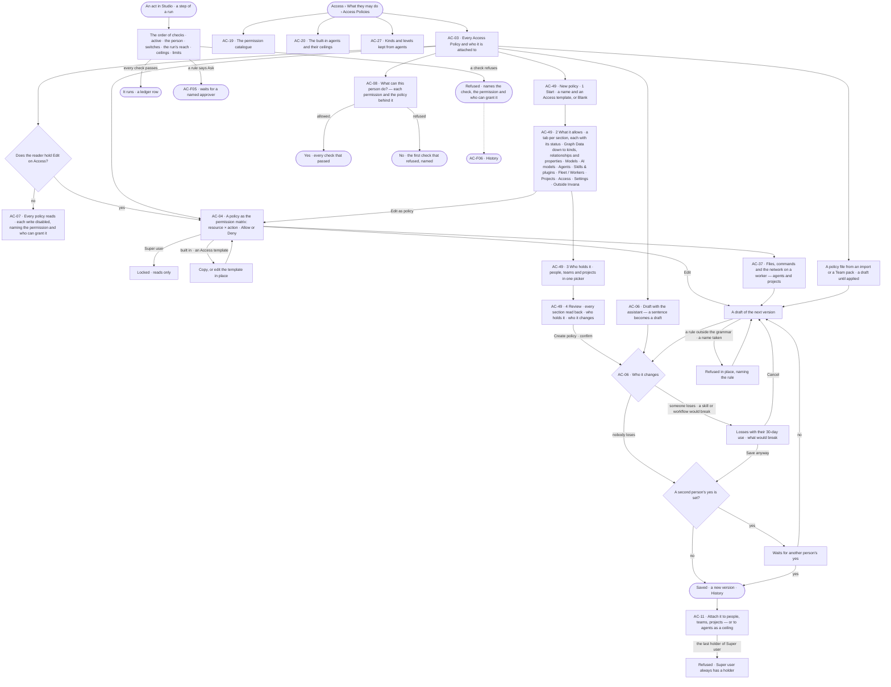
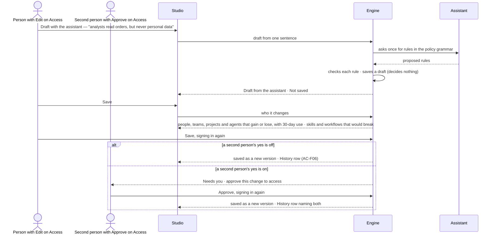

# Access Policies

> What each person, team, project and agent may do — one kind of permission: named Access Policies of rules, each rule
> an effect, an action and a resource, read from one permission catalogue, reaching down to the kinds, relationships and
> properties of each graph database — attached to users, teams and projects as grants and to agents as ceilings; the
> locked Super user policy and the Access templates to start from; the order every act is checked in.
> The decision it helps make: *who may do this — and what breaks if I change it?*

## User journey

Journeys this feature is a step of: [J05 · Join a team](../../../../journeys/J05-join-a-team.md) ·
[J06 · Set what an agent may touch](../../../../journeys/J06-set-what-an-agent-may-touch.md) ·
[J07 · Ready a deployment](../../../../journeys/J07-ready-a-deployment.md) ·
[J09 · Audit what an agent touched](../../../../journeys/J09-audit-what-an-agent-touched-and-what-left-the-platform.md)

## Stories

| ID | Story | Status |
|---|---|---|
| AC-03 | [Read every Access Policy and what it is attached to](stories/AC-03-read-every-access-policy-and-what-it-is-attached-to/story.md) | idea |
| AC-04 | [Write the rules of an Access Policy](stories/AC-04-write-the-rules-of-an-access-policy/story.md) | idea |
| AC-49 | [Make a policy from an Access template](stories/AC-49-make-a-policy-from-an-access-template/story.md) | idea |
| AC-37 | [Say what an agent may touch on a worker: files, commands, network](stories/AC-37-say-what-an-agent-may-touch-on-a-worker/story.md) | idea |
| AC-06 | [Draft a policy and see who it changes](stories/AC-06-draft-a-policy-and-see-who-it-changes/story.md) | idea |
| AC-11 | [Attach a policy to agents](stories/AC-11-attach-a-policy-to-agents/story.md) | idea |
| AC-08 | [Check whether someone can do something](stories/AC-08-check-whether-someone-can-do-something/story.md) | idea |
| AC-19 | [Read what each role may do](stories/AC-19-read-what-each-role-may-do/story.md) | idea |
| AC-20 | [Read the built-in agents and the policies they run under](stories/AC-20-read-the-built-in-agents-and-the-policies-they-run-under/story.md) | idea |
| AC-27 | [Keep a kind or a sensitive property from agents](stories/AC-27-keep-a-kind-or-a-sensitive-property-from-agents/story.md) | idea |
| AC-07 | [Read without the role and know who to ask](stories/AC-07-read-without-the-role-and-know-who-to-ask/story.md) | idea |

## Access

Every act below needs the permission named, from [the permission catalogue](#the-permission-catalogue). Without it the
act shows, disabled, naming the permission and who can grant it — *Needs Edit on Access — ask Priya or Lee*.

| Act | Permission |
|---|---|
| Read every Access Policy, its rules, versions and holders · the permission catalogue · the built-in agents · what is kept from agents · *What can {person} do?* | None — every signed-in person; a key reads under its owner |
| New policy · Copy · Edit · Delete · Draft with the assistant · Save · apply a policy file from an import or a Team pack · edit an Access template | Edit on Access, in a session, signing in again on Save |
| Attach a policy to a user, a team or an agent · take it off | Manage on Access, in a session, signing in again |
| Attach a policy to a project · widen a project's policies | Manage on Projects (`project/<project>`). Making a new project's first policy is part of starting it ([PJ-F01 › Access](../../../../capabilities/projects/features/PJ-F01-projects-and-tasks/feature.md#access)); a person on its team narrows it |
| Approve another person's change to access, when a second person's yes is set | Approve on Access — not the person who saved it |
| Turn a second person's yes on or off | Manage on Access, signing in again — itself a change that waits for a second yes while the setting is on |
| Set a property's level | Edit on the Model, in Meaning ([SE-F03](../../../../capabilities/semantics/features/SE-F03-meaning/feature.md)) |
| Make people and teams · put people on teams | Create · Edit on Access, in the Directory ([AC-F03](../AC-F03-directory/feature.md)) |

## States

| State | What the person sees |
|---|---|
| First use | *Super user*, locked, held by the first account; the eight Access templates in one list, attached to nobody but *Read only*, named for newcomers; each built-in agent's ceiling, marked *Built in*; *New policy* and *Draft with the assistant* lead |
| Empty after a filter | *Nothing matches*, with the filter named and *Clear filters* |
| Loading | The section opens at once; lists show loading rows; counts read `—` until the engine gives them |
| Has data | Access Policies one row each, the selected one beside them: its permission matrix, its rules as sentences, who it is attached to, its owner and maker, and its versions; a policy file from an import reads *Waiting to be applied* |
| Failed | What could not load or save, in a sentence, with *Try again*; a refused save says why in place, naming the rule or the name |
| Agent working or proposing | *Draft from the assistant · Not saved*, with who it changes, before anything changes; a change waiting on a second person reads *Waiting for a second yes* |
| No access | Every policy reads; each write is disabled, naming the permission it needs and who can grant it |

## Rules

| Rule | Detail |
|---|---|
| Access is Access Policies only | There are no roles. What anyone may do is the Access Policies attached to them, read against [the permission catalogue](#the-permission-catalogue). Nothing in the engine names a role |
| Who holds a policy | **Users** — people and service users · **teams** — each person on the team holds it · **projects** — what the project's runs may reach · **agents** — a ceiling: the most the agent may ever do, never a grant. It is the same object for every holder — one kind of permission, with no kind of its own: any policy may be attached to any holder. A key holds none: it narrows its owner ([AC-F10](../AC-F10-keys/feature.md)) |
| A holder's permissions | A person's — and a project's — are the Allows of every policy attached to them (for a person, and to every team they are on), minus every Deny. Attaching a policy adds to what a holder holds, never replaces it. Default deny: what no rule allows is refused. Deny wins over Allow |
| A rule | Effect · action · resource. The effect is Allow, Deny or **Ask** on any policy — Ask makes a run's step wait for a named approver ([AC-F05](../AC-F05-asks-and-approvals/feature.md)); in a person's or a team's own permissions, checked before any run, Ask counts as Deny. A new rule starts at Ask |
| Actions | Read · Create · Edit · Publish · Run · Manage — what each means for each resource is [the permission catalogue](#the-permission-catalogue); an action a resource does not take is refused. On screen *Publish* reads *Publish · Approve* |
| Resources | `<type>/<segment>…` — the types and their segments are [the permission catalogue](#the-permission-catalogue). `*` stands for one whole segment — `data/*/Customer` is every graph database's Customer, `tool/web/*` every web tool; `*` inside a segment is refused. In `fs/` only, a last segment `**` stands for every path below ([AC-37](stories/AC-37-say-what-an-agent-may-touch-on-a-worker/story.md)) |
| Graph Data, down to properties | `data/<graph database>` reaches all of one graph database · `data/<graph database>/<kind>` one kind — of node or of relationship — and every property of it · `data/<graph database>/<kind>/<property>` one property · `data/<graph database>/<kind>/@<level>` the kind's properties at one level — `public` · `internal` · `confidential` · `personal`, the levels of [SE-F03](../../../../capabilities/semantics/features/SE-F03-meaning/feature.md). Deny wins, so a Read on the graph database with a Deny on one kind, or one property, keeps exactly that out |
| Relationships | A relationship reads only when its kind and the kinds at both its ends read; otherwise it is withheld and counted, never shown as a dangling line. Creating or changing one needs Create or Edit on its kind |
| A person's own act | An act a person makes in Studio, the API or the CLI is checked against the person's permissions. When a built-in agent carries it — the Query console, the Loader, the Record editor — that agent's ceiling narrows it too |
| A project owns its access | Every run inside a project — asked by anyone on its team, scheduled, picked up or started by its Lead agent — reaches **the project's policies ∩ the agent's ceiling** ∩ every caller's ceiling ∩ the run's other ceilings. The person who asked is recorded on the run; their own policies are not read inside a project, and joining or leaving never changes what the project may do ([PJ-F01 › Rules](../../../../capabilities/projects/features/PJ-F01-projects-and-tasks/feature.md#rules)) |
| Outside a project | A run reaches the person behind it ∩ the agent's ceiling ∩ every caller's ∩ the run's other ceilings ([AC-F04](../AC-F04-what-an-agent-may-touch/feature.md#rules)). The person behind it is who asked, a key's owner, the person who consented a connected client, or a schedule's or a pick-up's setter — so a schedule or a pick-up outside any project reaches its setter's policies ∩ the agent's ceiling. A run whose person cannot act — deactivated, with no successor yet — waits, naming them, until the slot falls back ([AC-F07](../AC-F07-ownership/feature.md#slots-and-fallbacks)) |
| A project's policies | Access Policies like any other, attached to the project — one or more. New project makes its first through [the policy form](#the-policy-form), from any Access template — the type's default first; *Edit as policy* opens the matrix. A policy may be held by many projects: a change to it reaches each, named in *Who it changes*, and *Copy for this project* splits one off. They grant a person nothing outside the project |
| Access templates | Access Policies shipped as data to start from ([below](#access-templates)) — one list of suggested starting points: *Read only* · *Explore* · *Shape the model* · *Build agents* · *Run the deployment* · *Read and analyse* · *Fix data quality* · *Full project*. Any may be attached to any holder. Owned by the system user; attached as they are, copied, or edited in place by Edit on Access. A project's type may name its default. Nothing in the engine depends on their names |
| An agent holds only a ceiling | The policies attached to an agent are the most it may ever do — *may edit Graph Data: no*, *may send outside: no*. Adding it to a project's team grants it nothing. Using an agent is Run on `agent/<name>`, a person's permission |
| Super user | One built-in policy: every action on every resource. The first account, made from the CLI, holds it. It is locked — never edited, renamed, copied over or deleted — and never taken off its last active holder |
| Newcomers | A new person or service user holds the policies the deployment names for newcomers — the setting `access.newcomer_policies`, *Read only* out of the box — set by Manage on Access. *Read only* is data: it is never named or special-cased in code. Any further policy is attached only by a holder of Manage on Access — *Super user*, or *Run the deployment* |
| Everyone sees every place and act | Every mode, view and act shows to everyone. The policy decides what responds: an act a person lacks is shown disabled, naming the permission and who can grant it; data a policy denies is withheld — a kind absent from a picker, a property dropped and counted as withheld — never shown. The engine refuses any act or step the policy does not allow, naming the rule: hiding is never the guard |
| Who can grant | The active people who hold Manage on Access — on screen *Admins* |
| Every act is checked in one order | [The order of checks](#the-order-of-checks); a refusal names the first check that refused |
| Declare, never grant | A skill, a workflow, a plugin, a Team pack or a runtime declares what it needs; a declaration grants nothing. *Who it changes* names each declared need a change leaves unmet |
| Many graph databases, each reached by rule | A deployment attaches many graph databases. A person reaches one only where a rule on `data/<graph database>/…` allows it; a run, only where the person, the project and the agent each allow it |
| Run content needs a reason | A run's content — what it read, sent and answered — reads to the person behind it; anyone else reads that it ran, its status and its tokens. Read on `run/*` opens another's content only with a reason, which History keeps ([AC-F09](../AC-F09-what-left-the-platform/feature.md)) |
| Built-in ceilings | Each built-in agent ships with one built-in policy — its ceiling — owned by the system user and attached to it. It is never edited, renamed, deleted or taken off its agent; *Copy* makes a custom policy. A built-in agent is narrowed by attaching a custom policy with a Deny |
| Guardrails are rules | What the deployment keeps from agents is a Deny on `data/<graph database>/<kind>`, one property of it or one level of it (`@<level>`), on their ceilings. A property that may not be Read is dropped and counted as withheld — the read is not refused as a whole. Confidential and personal properties never reach an external target ([AC-F09](../AC-F09-what-left-the-platform/feature.md#engine) · [CP-F01](../../../control/features/CP-F01-ai-models/feature.md)) |
| Data is evidence, never instructions | What an agent reads never changes its rules or what it may do; the built-in ceilings hold an agent's own writes and outbound acts on Ask, unless the person made the act themselves on the board |
| A draft decides nothing | A new policy is a draft until saved; a saved policy changes only by saving its next version, after *Who it changes* |
| Only a person saves | The assistant may draft a policy — tighter or looser — and a person with Edit on Access saves it or not; no agent saves or attaches a policy |
| A policy file waits | An import or a Team pack may carry Access Policy files; each lands as a draft that decides nothing until a person with Edit on Access applies it after *Who it changes* |
| A second person's yes, when set | A deployment setting, off by default. When on, a save of an Access Policy, an attachment and a change to a work connection ([CP-F02](../../../control/features/CP-F02-plugins-and-outside-tools/feature.md)) wait in the Inbox for another person with Approve on Access; the person who saved it cannot give it. Until then the version before stays in force |
| Every path alike | Studio, the API and `invana policy` call the same save; a key never writes a policy or an attachment; Save and attach ask the person to sign in again ([AC-F01](../AC-F01-sign-in-account-and-sessions/feature.md)) |
| Checked when it runs | Each act and step is checked against the policies in force when it runs; a saved version or an attachment takes effect at the next check |
| Leans on | The Directory — users, teams and their policies (AC-F03) · ceilings and caller chains (AC-F04) · asks (AC-F05) · History (AC-F06) · agents (AG-F01) · skills and what they need (AG-F04) · property levels (SE-F03) · AI models and their versions (CP-F01) · limits (CP-F04) · projects (PJ-F01) · the worker sandbox ([CP-F03](../../../control/features/CP-F03-workers-and-the-queue/feature.md)) |

## The permission catalogue

The one source of what may be granted. A permission is an action on a resource — `data:edit` on
`data/sales/Order`. Every feature's acts name the permission they need from here; no feature restates who may.
`—` is an action the resource does not take. *Takes effect for* names the holders a rule on it reaches.

| Resource | Pattern | Read | Create | Edit | Publish · Approve | Run | Manage | Takes effect for |
|---|---|---|---|---|---|---|---|---|
| Graph Data | `data/<graph database>[/<kind>[/<property> · /@<level>]]` — a kind of node or of relationship | Read its records, or the property | Add records — load, add on the board | Change records, or the property — fix (*Fix from the queue*), merge, annotate, delete | — | — | — | users · teams · projects · agents |
| Model | `model/<model>` | Read it — kinds, meaning, rules, history | Start a model | Change its draft — kinds, meaning and levels, taxonomies, standards, rules, links between models | Publish a version | Run inference and health checks | — | users · teams · projects · agents |
| AI models | `llm/<endpoint>/<version>` — the address [CP-F01](../../../control/features/CP-F01-ai-models/feature.md) gives each model version | Read it | — | — | — | Use it — pin it on an agent, and every call a run makes to it | — | users · teams · projects · agents |
| Projects | `project/<project>` | Read a project the reader is not on | Start a project | Change its tasks, files and context — what a person on its team always may | — | — | Attach a policy to it, or widen the one it holds · archive or delete it, without being on its team | users · teams · projects · agents |
| Memory | `memory/project/<project>` · `memory/agent/<agent>` · `memory/org` | Recall from it | — | Write to it, forget from it | — | — | — | projects · agents |
| Agents | `agent/<name>` | Read it, its versions and its ceiling | Build an agent | Change its draft · its approvers | Publish a version | Use it — ask it, start its runs, hand it work | Share or retire another's personal agent · set its ceiling's approvers | users · teams · projects · agents |
| Skills | `skill/<name>` · `workflow/<name>` | Read it | Write or import one | Change its draft | Publish a version | Run it | — | users · teams · projects · agents |
| Plugins | `plugin/<name>` · `tool/<plugin>/<tool>` | Read it | Add a plugin or an MCP server | Configure it | — | Call its functions and tools | The install switch · its work connections | users · teams · projects · agents |
| Runs | `run/<agent>` | Read runs the reader is not behind — content only with a logged reason | — | — | — | — | Stop, re-run or re-assign another's run | users · teams |
| Workers | `worker/<group>` | Read groups, workers, the queue, limits, alerts | Add a group or a worker | Change labels, limits, alert rules | — | Place runs on the group | Drain, pause the queue | users · teams · projects · agents |
| Settings | `setting/<section>` — `graph-databases` · `ai-models` · `connections` · `team-packs` · `deployment` · `retention` | Read it | Connect one — a graph database, an AI model, a Team pack | Change it — mode, switch, keys, retention, holds | — | — | — | users · teams |
| Access | `access/<area>` — `policies` · `directory` · `history` · `reviews` | Read every History row (a person always reads their own) | Make a policy, a person, a service user, a team | Change a policy's draft · a team's people · deactivate, reactivate | Approve another's change to access · sign off a review | — | Attach and take off policies · name newcomers' policies · the second-yes setting | users · teams |
| On a worker | `fs/<path>` · `cmd/<program>` · `net/<host>` | Read files · fetch from a host | Send to a host | Change files | — | Run a program | — | projects · agents |

| Rule | Detail |
|---|---|
| No permission needed | Sign in and keep one's own account, sessions and keys · read every Access Policy and the Directory — a person must see a rule to know whom to ask · read and answer the Inbox · answer an ask one is named for · read and stop the runs one is behind · everything inside a project one is on its team of |
| Ask is for runs | Only a run waits for an approver: Ask takes effect in a project's policies and an agent's ceiling; in a person's or a team's own permissions it counts as Deny |
| Every section, every holder | Any policy may be attached to any holder, and nothing is refused at attach. A rule on a resource whose *Takes effect for* does not name a holder does nothing for that holder; Review and *Who it changes* name it — *Outside Invana does not apply to people* |
| How much is not a rule | Runs at once and tokens are limits ([CP-F04](../../../control/features/CP-F04-limits/feature.md)), not rules: the form's *Fleet / Workers* tab shows and sets them beside the worker groups, and they are saved as the holder's limits |

## Access templates

Access Policies shipped as data, owned by the system user, written at the first start and never rewritten after. Each
is attached as it is, copied as the start of a new policy, or edited in place like any custom policy. Only *Read only*
is attached — to newcomers, by the setting `access.newcomer_policies`. They are one list of suggested starting points:
any may be attached to any holder. The last three are written for a project's runs.

| Template | Allows |
|---|---|
| **Super user** — built in, locked, not a template | Every action on every resource |
| **Read only** — every newcomer's | Read `data/*` · `model/*` · `llm/*` · `project/*` · `agent/*` · `skill/*` · `workflow/*` · `plugin/*` · `worker/*` · `setting/*` — Read on every resource that takes it, except `run/*` and `access/*`, whose Read opens another's run content and every History row. No Create, Edit, Publish, Run or Manage |
| **Explore** | Read `data/*` · `model/*` · `llm/*` · `agent/*` · `skill/*` · `plugin/*` · `worker/*` · `setting/*` · Create `project/*` · Run `agent/assistant` · `agent/query-console` · `skill/*` · `plugin/*` · `llm/*` |
| **Shape the model** | Read `data/*` · Create · Edit · Publish · Run `model/*` · Create · Edit `data/*` · Run `agent/modeller` · `agent/loader` · `agent/record-editor` · `llm/*` |
| **Build agents** | Read `run/*` · Create · Edit · Publish · Run `agent/*` · `skill/*` · Create · Edit `plugin/*` · Run `llm/*` · `worker/*` |
| **Run the deployment** | Every action on `worker/*` · `setting/*` · `run/*` · `access/*` · Manage `plugin/*` |
| **Read and analyse** | Read `data/*` · `model/*` · `memory/project/*` · Run `llm/*` · `skill/*` · `workflow/*` · the project's team agents · Ask Run `tool/*/*` · nothing leaves |
| **Fix data quality** | *Read and analyse*, and Create · Edit `data/<the graph databases picked>` · Run `agent/record-editor` · `agent/loader` |
| **Full project** | *Fix data quality*, and Edit `model/*` · Run `worker/*` · `plugin/*` · Ask Run `tool/*/*` · `net/*` |

## The policy form

The plain way to say what a policy allows — *What it allows*, one tab per section, each tab with a short status. The
same form is *New policy*'s, New project's Access step and a project's Access tab
([AC-49](stories/AC-49-make-a-policy-from-an-access-template/story.md)). Every section is part of every policy, whoever
holds it; a section that takes no effect for a holder says so in Review. Each section writes rules; *Edit as policy* opens the same policy as the matrix. A policy whose rules the form cannot
show reads *Edited as policy* and opens in the matrix.

| Section · tab | Sets | Status on its tab | Rules it writes |
|---|---|---|---|
| **Graph Data** | Per graph database: *None* · *Read* · *Read + write* — the quick level. Under it, per kind of node and of relationship, an override: *None* · *Read* · *Read + write*. Under each kind, each property *Hidden* · *Read* · *Read + write*, its level shown — *Crew member · personal* — with *Hide every personal property* for the whole graph database | *Read + write on 1 of 3 · 2 kinds narrowed · 4 properties hidden* | Allow Read — and Create · Edit for *Read + write* — on `data/<db>`; an override narrows with a Deny on `data/<db>/<kind>`, or widens with an Allow; a property narrower than its kind is a Deny — *Hidden* a Deny Read, *Read* a Deny Create · Edit — on `data/<db>/<kind>/<property>`, or for every personal property on `data/<db>/*/@personal` |
| **Models** | Per model: *None* · *Read* · *Edit* · *Publish* | *Read on every model* · *Publish on 1* | Read · Edit · Publish on `model/<model>` |
| **AI models** | *Every offered version* · *Local only* · chosen versions, each marked *Local* or *External* | *Every offered version* · *Local only* · *3 versions* | Run on `llm/<endpoint>/<version>`, or `llm/<endpoint>/*` for each local endpoint |
| **Agents** | Which agents may be used — held by a project, which may work here and be on its team | *4 agents* · *Builds agents* | Run on `agent/<name>`; *build agents* adds Create · Edit · Publish `agent/*` |
| **Skills & plugins** | Skills and workflows that may run; plugins and their tools | *Every skill · 2 plugins* | Run on `skill/…` · `workflow/…` · `plugin/…` · `tool/…` |
| **Fleet / Workers** | Worker groups runs may be placed on · runs at once · tokens a month | *2 groups · 4 at once · 2M tokens a month* | Run on `worker/<group>`; runs at once and tokens are saved as each holder's limits — a user's, a team's or a project's ([CP-F04](../../../control/features/CP-F04-limits/feature.md)) |
| **Projects** | Start projects · read projects they are not on · manage any project | *Starts projects* · *Not set* | Create · Read · Manage on `project/*` |
| **Access** | Read History · make policies · attach them | *Reads History* · *Not set* | Read · Create · Edit · Manage on `access/<area>` |
| **Settings** | Each section: *None* · *Read* · *Change* | *Reads every section* · *Changes 2* | Read · Edit on `setting/<section>` |
| **Outside Invana** | What may leave — email, Slack, the web, outside agents — each *No* · *Asks first* · *Yes*; *Adding people needs approval* | *Nothing leaves* · *2 ask first* | Deny · Ask · Allow Run on `tool/<plugin>/<tool>` · `net/<host>`; the approval is the project's setting ([PJ-F01](../../../../capabilities/projects/features/PJ-F01-projects-and-tasks/feature.md#rules)) |

## The order of checks

Every act, every step of every run, every route and every tool call is checked in this order; the first that refuses
ends it, and its refusal names that check.

| # | Check | Passes when | A refusal names |
|---|---|---|---|
| 1 | Active | The person — or the person behind the run — is active; a key is live ([AC-F03](../AC-F03-directory/feature.md) · [AC-F10](../AC-F10-keys/feature.md)) | The person or the key |
| 2 | The person | The person's permissions allow the action on the resource — for a run outside a project, the person behind it, Run on the agent included. A run inside a project skips it; the person is recorded | The permission and who can grant it |
| 3 | Switches | The graph database and the plugin the step uses are on — the install's switch, then the person's own switch for runs they start ([CP-F02](../../../control/features/CP-F02-plugins-and-outside-tools/feature.md) · [CP-F05](../../../control/features/CP-F05-graph-databases/feature.md)) | The switch |
| 4 | The run's reach | `decide()` allows it for the project's policies and for every agent in the caller chain — each one's ceiling: the strictest wins, no match is Deny. Ask waits for a named approver; a yes covers this step of this run ([AC-F05](../AC-F05-asks-and-approvals/feature.md)) | The rule, its policy and who set it |
| 5 | Ceilings | The key ∩ the run scope ∩ the graph database's mode allows it ([AC-F04](../AC-F04-what-an-agent-may-touch/feature.md)) | The ceiling |
| 6 | Limits | The step fits the limits, at admission ([CP-F04](../../../control/features/CP-F04-limits/feature.md)) | The limit |
| 7 | The ledger | A ledger row is written; anything leaving for an external target passes the outbound check — confidential and personal values never leave ([AC-F09](../AC-F09-what-left-the-platform/feature.md#rules)) | — |
| 8 | On a worker | The worker sandbox enforces `fs/` · `cmd/` · `net/` at the operating-system level; the credential is injected on the worker ([CP-F03](../../../control/features/CP-F03-workers-and-the-queue/feature.md)) | — |

## Data touched

| Record | Read or write |
|---|---|
| Access Policies — name, origin, rules, version, status, who drafted it | Write · read |
| Versions of a policy — its rules, who saved it, who approved it, when, why | Write · read |
| Attachments — which users, teams, projects and agents hold a policy, who attached it, when | Write · read |
| Users, teams and who is on each (AC-F03) | Read |
| Owners of a policy (Ownership, AC-F07) | Read |
| Refusals and uses in History (AC-F06) | Read |

## Engine

The low-level design: what this feature stores, serves and refuses. Conventions — naming, errors, lists, events — are
[system-design.md](../../../../system-design.md) §§ 6–8; this section only fills them in.

### Records

| Table | Columns | Notes |
|---|---|---|
| `access_policies` | `name` (`[a-z0-9-]`) · `title` · `description` · `origin` (`builtin` · `template` · `custom` · `imported`) · `locked` (bool) · `imported_from?` (the import or Team pack) · `copied_from_id?` (the template or policy it started from) · `status` (`draft` · `awaiting` · `saved`) · `version` (a draft is 0) · `rules` · `drafted_by` (`person` · `assistant` · `file` · `form`) · `created_by_id` · `updated_by_id?` · `created_at` · `updated_at` | Unique `name`. A `builtin` policy — Super user and each built-in agent's ceiling — is written from code and owned by the system user; only Super user is `locked`. A `template` is written once, at the first start, from data, and edited like a custom one. There is no kind of policy: any one is attached to any holder. `awaiting` is a saved version waiting for a second yes; the version before it stays in force |
| `access_policy_versions` | `policy_id` · `version` · `rules` · `description` · `saved_by_id` · `saved_at` · `approved_by_id?` · `approved_at?` · `why?` (500) | One row per save; never edited |
| `access_policy_attachments` | `policy_id` · `holder_kind` (`user` · `team` · `project` · `agent`) · `holder_id` · `attached_by_id` · `attached_at` | Unique (`policy_id`, `holder_kind`, `holder_id`). A project, like a user, holds any number; one policy may be held by many projects |

### Reads

| Record | Owner |
|---|---|
| Users, their teams and whether each is active | [AC-F03](../AC-F03-directory/feature.md#engine) |
| Owners and co-owners of a policy | Ownership (AC-F07) |
| A session's `signed_in_at` — signing in again | [AC-F01](../AC-F01-sign-in-account-and-sessions/feature.md#engine) |
| The caller chain of a run's step, its ceilings and an agent's effective access | [AC-F04](../AC-F04-what-an-agent-may-touch/feature.md#engine) |
| Asks — a step set to Ask, an approval of a change to access | [AC-F05](../AC-F05-asks-and-approvals/feature.md#engine) |
| History — refusals and uses over 30 days for *Who it changes*, every event this feature writes | [AC-F06](../AC-F06-history/feature.md#engine) |
| Agents and the built-in agents | [AG-F01](../../../../capabilities/agents/features/AG-F01-build-an-agent/feature.md#engine) |
| Skills and what each needs — what a save would break | [AG-F04](../../../../capabilities/agents/features/AG-F04-skills/feature.md#engine) |
| Kinds of node and relationship of the published model, their properties and each property's level | [SE-F03](../../../../capabilities/semantics/features/SE-F03-meaning/feature.md#engine) |
| AI model versions, their addresses and whether each is local | [CP-F01](../../../control/features/CP-F01-ai-models/feature.md#engine) |
| Limits of a holder — runs at once, tokens a month — the form's *Fleet / Workers* tab reads and sets | [CP-F04](../../../control/features/CP-F04-limits/feature.md#engine) |
| Graph databases and their names | [CP-F05](../../../control/features/CP-F05-graph-databases/feature.md#engine) |
| Projects, their names and their teams | [PJ-F01](../../../../capabilities/projects/features/PJ-F01-projects-and-tasks/feature.md#engine) |

### Routes

| Route, after `/api/v1/access` | Does | Story |
|---|---|---|
| `GET /policies` · `POST /policies` | List policies by the list contract (`?origin=` · `?status=` · `?q=` · `?holder=` · `?resource=`) · create a custom policy as a draft — from rules, or from [the form](#the-policy-form) with the template it starts from (`copied_from`) and its holders — users, teams and projects in one list | AC-03 · AC-04 · AC-49 |
| `POST /policies/drafts` | One sentence → a draft from the deployment's AI model, `drafted_by = assistant` | AC-06 |
| `GET /policies/{name}` · `PATCH /policies/{name}` · `DELETE /policies/{name}` | Read a policy, as rules, as the permission matrix and — when its rules fit — as the form (`?as=form`; otherwise `edited_as_policy`) · edit a draft, or a saved policy's draft of its next version, by rules or by the form (`why?`) · delete a custom policy or a template, its holders listed first | AC-04 · AC-37 · AC-49 |
| `POST /policies/{name}/copy` | A custom draft from any policy | AC-04 · AC-20 |
| `POST /policies/{name}/impact` | Who it changes: per holder — and per person through a team — each action and resource gained or lost with its uses over 30 days, and every skill and workflow whose declared needs a loss removes | AC-06 |
| `POST /policies/{name}/save` | Save as a new version (`why?`); needs signing in again; `awaiting` when a second yes is on | AC-04 · AC-06 |
| `POST /policies/{name}/versions/{version}/approve` · `…/decline` | A second person's yes or no on an `awaiting` version; needs signing in again | AC-04 |
| `GET /policies/{name}/versions` | Every version: who saved it, who approved it, when, why, its rule count | AC-04 |
| `GET /policies/{name}/attachments` · `PUT /policies/{name}/attachments/{holder_kind}/{holder}` · `DELETE …` | Its holders · attach · take off; attaching and taking off need signing in again | AC-11 |
| `GET /catalogue` | The permission catalogue: each resource, its pattern, what each action means and its holders | AC-19 |
| `GET /templates` | The Access templates, one list, each with its rules as the form, and each project type's default | AC-49 · PJ-02 |
| `GET /built-in-agents` | Each built-in agent, what it acts for, its built-in ceiling and the custom policies attached to it | AC-20 |
| `GET /kept-from-agents` | Every Deny on `data/…` — a kind or one level of it — with its policy and holders, and every property at a sensitive level (from [SE-F03](../../../../capabilities/semantics/features/SE-F03-meaning/feature.md#engine)'s `GET /sensitivity`) | AC-27 |
| `GET /users/{username}/effective` | *What can {person} do?* — every permission they hold, each with the policy and the team it comes through, and each Deny that removes one | AC-08 |
| `POST /check` | *Can someone do this?* — a person, or an agent with a person, a project and a key · action · resource; every check of [the order](#the-order-of-checks) that applies, the first that refuses named. Writes nothing | AC-08 |

### Events

| Event | When |
|---|---|
| `access.policies.create` · `access.policies.update` · `access.policies.delete` · `access.policies.copy` | A policy is drafted · a draft changes · a policy is deleted · a policy is copied |
| `access.policies.save` | A version is saved — `why` in `details` |
| `access.policies.approve` · `access.policies.decline` | A second person approves or declines an `awaiting` version |
| `access.attachments.create` · `access.attachments.delete` | A policy is attached to a holder · taken off — the holder in `details` |
| `access.check.refused` | An act or a step is refused — the check of [the order](#the-order-of-checks) that refused, and for a rule its policy |

### Refusals

| Status | When | Sentence | Criterion |
|---|---|---|---|
| 422 | A rule outside the grammar — an unknown resource type, an action the resource does not take, an effect other than Allow · Ask · Deny | *Rule {n}: {why}.* | AC-04.3 |
| 422 | A `*` inside a segment, or a `**` anywhere but the last segment of an `fs/` resource | *Rule {n}: `*` stands for a whole segment.* | AC-04.4 · AC-37.3 |
| 422 | A rule naming a graph database, kind, property, model, AI model version, project, agent, skill, workflow, plugin or tool that does not exist | *Rule {n}: there is no {type} {name}.* | AC-04.5 · AC-49.9 |
| 409 | A policy name already used | *{name} is taken.* | AC-04.6 · AC-49.2 |
| 422 | Editing, renaming or deleting Super user or a built-in ceiling · taking a built-in ceiling off its agent | *{name} is built in — copy it to change it.* | AC-04.7 · AC-11.6 |
| 409 | Taking Super user off its last active holder, or deactivating them | *Super user always has a holder — give it to someone else first.* | AC-11.6 · AC-23.7 |
| 422 | The assistant's reply has a rule outside the grammar — nothing is saved | *The assistant proposed a rule Invana cannot read: {rule}.* | AC-06.2 |
| 403 | An act or a step the person's permissions do not allow | *This needs {action} on {resource} — ask {who can grant}.* | AC-07.3 |
| 403 | The person who saved a version approves it | *Someone else approves this change.* | AC-04.18 |
| 403 | A policy written, saved, approved, attached or taken off with a key | *This needs a person's session, not a key.* | AC-04.14 |
| 401 | Save, approve, attach or take off without signing in again | *Sign in again to change access.* | AC-04.13 |
| 403 | A run's step its project's policies or an agent's ceiling do not allow, or a Deny | *{agent} may not {action} {resource} — {rule} on {policy}, set by {person}.* | AC-08.3 · AC-27.2 · AC-37.5 |

### CLI

| Command | Does |
|---|---|
| `invana createsuperuser` | Makes the first account, holding Super user; refused once any person exists |
| `invana policy apply --file <yaml> [--why]` | Creates a custom policy or saves its next version, printing who it changes first; held to every refusal above; refused with a key |
| `invana policy templates` | The Access templates and their rules |
| `invana policy list` · `invana policy show <name>` | Every policy with its origin, whether saved, its rules and its holders · one policy with its rules and versions |
| `invana policy attach <name> --user <u> \| --team <t> \| --project 
 \| --agent <a>` · `invana policy detach …` | Attach a policy · take it off |
| `invana access catalogue` | The permission catalogue |
| `invana access check --user <user> --action <action> --resource <type/name> [--agent <agent>] [--project <project>]` | *Can someone do this?*; writes nothing |

### Mechanisms

| Mechanism | How |
|---|---|
| A rule | `{effect: allow · ask · deny, action: read · create · edit · publish · run · manage, resource: "<type>/<segment>[/<segment>…]", set_by_id, set_at}` |
| The catalogue | `CATALOGUE` in code: each resource type, its segments, the actions it takes and its holders, as [the permission catalogue](#the-permission-catalogue) says; `GET /catalogue` reads it. Each route and each function declares the action and resource it needs; a route-table test proves none is missing |
| Resource grammar | Each segment is a name or `*`, and `*` matches exactly one segment; `fs/` alone takes `**` as its last segment. A rule reaches its resource and everything below it — `data/sales` every kind and property of `sales`. `fs/` paths are relative to the task's workspace on the worker; `cmd/` names a program, never its arguments; `net/` names a host; in `data/` the optional fourth segment is a property, or `@<level>` |
| A property read | Checked twice — as `data/<db>/<kind>/<property>` and as `data/<db>/<kind>/@<level>`, the level being `sensitivity.of(kind, property)` ([SE-F03 › Mechanisms](../../../../capabilities/semantics/features/SE-F03-meaning/feature.md#engine)); either refused, the property is dropped and counted as withheld. A kind that may not be Read is refused, naming the rule |
| A property write | Checked as `data/<db>/<kind>/<property>` with Edit; refused, naming the rule, while the rest of the write is refused with it |
| A relationship read | Checked on its kind and on the kinds at both its ends; any refused, it is withheld and counted |
| The form | `policy_form.to_rules(form)` and `policy_form.from_rules(rules)` — one engine function each way, so Studio never derives rules. `from_rules` answers `edited_as_policy` when a rule has no place in [the form](#the-policy-form). *Local only* writes one rule per local endpoint ([CP-F01](../../../control/features/CP-F01-ai-models/feature.md#engine)); *Fleet / Workers*' limits are written through CP-F04's `PUT /limits/{scope}/{subject_id}` for each holder — scope `user`, `team` or `project` |
| One evaluator | `decide(policies, action, resource)` collects the rules of the saved policies given whose resource matches and answers the strictest effect — Deny over Ask over Allow — or Deny when none matches. The person check calls it with every policy attached to the person and their teams, reading Ask as Deny; the run's reach with the project's access, then each agent's ceiling. *What can {person} do?*, *Can someone do this?*, *Who it changes*, a key's narrowing and a runtime's generated allow list ([CP-F03](../../../control/features/CP-F03-workers-and-the-queue/feature.md)) call it too |
| The order of checks | `check(person?, project?, chain, action, resource, run?)` runs [the order](#the-order-of-checks) and returns the first refusal, or allow or ask; the ledger row and the outbound check follow ([AC-F09](../AC-F09-what-left-the-platform/feature.md#engine)). Every route, step and tool call goes through it |
| Who can grant | A refusal names up to two active people who hold Manage on Access, by `GET /users?can=access:manage` ([AC-F03](../AC-F03-directory/feature.md#engine)) |
| Super user and the built-in ceilings | Written from code at start, owned by the system user. A start rewrites each to the code's rules; a person's change is a copy |
| Access templates | Written at the first start only from the shipped data files, `origin = template`; never rewritten after. The deployment setting `access.newcomer_policies` names *Read only* until changed; the engine reads the setting, never a name |
| Every built-in ceiling | Allows Run `llm/*`, so the AI model is bounded by the person and the project, never by a built-in agent |
| `assistant` — the Assistant: asking, answering, boards; every new person's default agent | Allow Read `data/*` · `model/*` · `memory/project/*` · `memory/org` · `project/*` · Allow Run `skill/*` · `workflow/*` · `plugin/*` · Ask Edit `project/*` · Ask Run `agent/*` · `tool/*/*` |
| `query-console` — the Query console: the Console's queries | Allow Read `data/*` · Ask Create · Edit `data/*` · Allow Run `plugin/graph.read` · Ask Run `plugin/graph.write` |
| `modeller` — the Modeller agent: changes to the model and links between models | Allow Read `data/*` · Read · Edit `model/*` · Allow Run `plugin/model` · `plugin/graph.stitch` · `skill/*` |
| `coordinator` — the Coordinator: plans, workflows and handing work on | Allow Read `project/*` · `memory/project/*` · Ask Edit `project/*` · Allow Run `plugin/plan` · `plugin/work` · `workflow/*` · `skill/*` · `agent/*` |
| `record-editor` — the Record editor: a person's own edits on the board, fixes and merges | Allow Read · Create · Edit `data/*` · Allow Run `plugin/graph.write` |
| `loader` — the Loader: a person's own loads | Allow Read · Create · Edit `data/*` · Allow Run `plugin/data` |
| What a built-in ceiling cannot widen | A Create or Edit on `data/…` still needs a read + write graph database ([CP-F05](../../../control/features/CP-F05-graph-databases/feature.md#engine)); a plugin or graph database switched off refuses the step; the person's own permissions are checked first |
| Draft, then save | A draft decides nothing and may be attached before it is saved. Saving bumps `version`, writes `access_policy_versions` and takes effect on the next check — or, with a second yes on, sets `awaiting` and takes effect on the approval |
| Who it changes | Computed from the draft against the saved version: per holder — per person through each team — each action and resource gained or lost with its uses in History over 30 days, and every skill and workflow whose declared needs a loss removes |
| Draft with the assistant | One sentence; the deployment's AI model is asked once for rules; each is validated against the grammar and the draft is saved as `drafted_by = assistant`, or nothing is saved |
| Policies as files | YAML — `name` · `title` · `description` · `rules`. Applied through the same save as Studio's. A policy file in an import or a Team pack is written as `origin = imported`, `status = draft`, `drafted_by = file` |
| A second person's yes | The deployment setting `access.second_approval` (off by default). When on, a save writes the version as `awaiting` and puts an approval in the Inbox of every other person with Approve on Access ([AC-F05](../AC-F05-asks-and-approvals/feature.md#engine)); approve sets it `saved`, decline drops it; neither is the saver's |
| Studio's cache | On an attachment, a save or a deactivation, the engine sends each person it changes an `access.changed` event; Studio drops every cached read and reads again |

## System impact

| HLD section | Change | NFRs |
|---|---|---|
| § 6 Data and storage | Three tables in Postgres | — |
| § 8 APIs and events | The routes and `access.policies.*` · `access.attachments.*` · `access.check.refused` events above | — |
| § 10 AI and agents | Drafting a policy asks the deployment's AI model once; nothing it proposes is saved unvalidated or decides anything | NFR-SEC-5 |
| § 12 Qualities | Security: one catalogue, one order of checks on every act, one evaluator, default deny, Deny wins, a key never changes access, a locked Super user with a holder always, an optional second yes | NFR-SEC-1 · NFR-SEC-4 · NFR-SEC-8 |

## Decisions

| Decision | Detail |
|---|---|
| Access Policies live in Access › What they may do | The Access summoner opens the large modal at Access; *Access Policies* sits beside *Permissions* and *Agents* in *What they may do*, the Directory in *Who*; a policy drills in and the crumb grows |
| A policy is built as a matrix | The editor is the permission matrix — resources down, actions across, each cell Allow · Ask · Deny · —; a row narrows to a graph database, a kind, a model, an agent; *Rules* shows the same policy as sentences — *Allow reading Customer in every graph database* — with the exact form one click deeper |
| Policies, never roles | Access is one shape for every holder; the Access templates carry what roles carried, as data anyone with Edit on Access may change |
| One kind of permission | A user's, a team's, a project's and an agent's policy are the same object, read by the same evaluator; a project holds one like anyone else |
| One way in, one policy | *New policy* — Start · What it allows · Who holds it · Review — is the one plain form, for any holder; New project's Access step runs the same form inline; *Edit as policy* is the expert view |
| No kind of policy | A policy has no `for`: the Access templates are one list of starting points, every section is in every policy, and one picker takes people, teams and projects; a rule a holder cannot use does nothing for it |
| Sections are tabs | *What it allows* is a tab per section, each with a short status, so a long policy is read a section at a time; Graph Data keeps per-database levels with kinds, relationships and properties under them |
| *Local only* is a rule per local endpoint | *AI models · Local only* writes one Run rule per local endpoint; a local endpoint added later is reached once the policy is saved again — a new model is offered on purpose, never by a locality segment on `llm/` |
| Review reads everything | One scrollable page: every section's full read-back, who holds it and *Who it changes*, then *Create policy* and a confirm |
| Kinds, relationships and properties | A policy reaches down to each kind of node and relationship — *None* · *Read* · *Read + write* — and each property — *Hidden* · *Read* · *Read + write* — so a sensitive property, *Crew member · personal*, is hidden without hiding the kind |
| Policies add up | A project holds policies exactly as a user does: any number, their Allows added, any Deny winning; attaching one adds, never replaces |
| A newcomer reads, nothing more | Every new person and service user starts on *Read only*; what more they may do is attached by a holder of Manage on Access. *Explore* — read, ask the Assistant, start projects — is a template to attach, never a default |
| Built-in agents are narrowed, never edited | A built-in ceiling stays attached to its built-in agent; it is narrowed by attaching a custom policy with a Deny |
| Everyone reads | Reading policies, rules, the catalogue and the built-in agents is never gated for a signed-in person: a person must see a rule to know whom to ask |
| *Can someone do this?* writes nothing | It runs the engine's own checks without running anything |
| Policies as files | `invana policy apply · list · show · attach · detach` read and write custom policies as files, held to every check Studio is |
| Memory is three places | `memory/project/<project>`, `memory/agent/<agent>` and `memory/org` name the three places memory lives ([GP-F02](../../../graph/features/GP-F02-memory/feature.md)); there is no team memory to name |

## Open questions

| Question | Who answers |
|---|---|
| — | — |

## Not building

| Item | Why not |
|---|---|
| Roles · a role table | One shape — Access Policies — carries every grant; a fixed table could not fit each deployment |
| Policies on keys | A key acts as its owner, narrowed by its own allow list |
| Ask for a person's own act | Only a run waits for an approver; in a person's or a team's own permissions Ask counts as Deny |
| A kind of policy per holder | One object for every holder; a section that does not apply to a holder does nothing for it, and Review says so |
| Conditions on a rule | Time windows, addresses, field lists and tags are unproven, and would make a rule unreadable |
| Per-record rules | A rule reaches a graph database, a kind, a property or a level; a record's reach is its kind's |
| `*` inside a segment | Partial matches make a rule's reach unreadable |
| Editing Super user or a built-in ceiling | They are the system user's; a copy carries every change |
| Roles inside a project | Every person on a project's team may do everything inside it; the project's policies bound its runs ([PJ-F01](../../../../capabilities/projects/features/PJ-F01-projects-and-tasks/feature.md#rules)) |
| A person's policies inside a project | A project's reach would change with every join and leave; the project's policies hold it steady |
| Limits inside a policy | A policy says what may be touched, never how much; the form sets limits beside it ([CP-F04](../../../control/features/CP-F04-limits/feature.md)) |
| A page of requests | An ask for a permission is an ask in the Inbox (AC-F05) |
