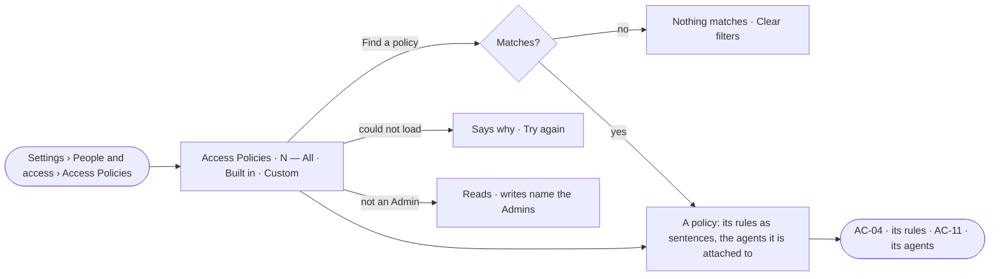

# AC-03 · Read every Access Policy and what it is attached to

**As** an Admin **I want** one list of every Access Policy — built in and custom — with the agents each is attached to
**so that** I read what every agent may do in one place instead of piecing it together.

Tasks: [task.md](task.md) · Feature: [AC-F02](../../feature.md)

## Who can

| Lens | Can | Otherwise sees |
|---|---|---|
| Admin | Read every policy; *New policy* and *Draft with the assistant* | — |
| Operator | Read every policy, its rules and the agents it is attached to; a Modeller reads the same | *New policy* and *Draft with the assistant* disabled — *Needs the Admin role — ask Priya or Lee* |

## Flow

## Acceptance criteria

| # | Given | When | Then |
|---|---|---|---|
| AC-03.1 | A signed-in person | they open *People and access* | it opens as a sheet over the work, on *Access Policies*, beside *Roles* and the Directory's tabs |
| AC-03.2 | The deployment's policies | the list is read | one row per policy — its title, *Built in* or *Custom*, its rules in a line, the agents it is attached to, its owners, when it changed; a built-in policy has no *changed* |
| AC-03.3 | The list | it is filtered | tabs *All · Built in · Custom* each carry the engine's count; *Attached to* filters by an agent and *Reaches* by a resource |
| AC-03.4 | The list | the reader types in *Find a policy* | only matching policies show; with none, *Nothing matches* and *Clear filters* |
| AC-03.5 | A deployment with no custom policy | the list is read | the built-in policies show, each attached to its built-in agent; *New policy* leads |
| AC-03.6 | A policy with a Deny rule | its row is read | the line says what it keeps back first — *Denies writing any data* |
| AC-03.7 | A policy's row | *Attached to* is read | it names the agents' avatars and names, built-in agents first; a draft attached to agents reads *Draft — decides nothing* |
| AC-03.8 | An Operator | they open the list | every policy reads; *New policy* and *Draft with the assistant* are disabled, naming the Admin role and the Admins |
| AC-03.9 | The list cannot load | the sheet opens | it says why, with *Try again* |
| AC-03.10 | The sheet open on a policy | the page reloads | the same tab and policy open again, from the URL |
| AC-03.11 | A person at the command line | they list the policies, or show one by name | every policy reads with its origin, whether it is saved, its rules and its agents; one shown adds its versions — the same reading Studio shows |

## Screens

| Surface | Lens | First use | Empty after a filter | Loading | Has data | Failed | Agent working or proposing | No access |
|---|---|---|---|---|---|---|---|---|
| Access Policies — the list | Admin | settings.access · Built in only | settings.access · Nothing matches | settings.access · Loading | settings.access | settings.access · Could not load | — | — |
| Access Policies — the list | Operator | access.locked · Built in only | access.locked · Nothing matches | access.locked · Loading | access.locked | access.locked · Could not load | — | access.locked |
