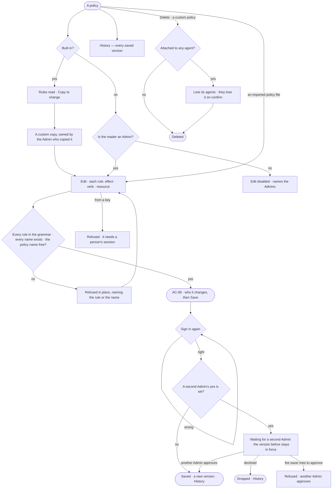

# AC-04 · Write the rules of an Access Policy

**As** an Admin **I want** an Access Policy written as rules — Allow, Ask or Deny; Read, Write or Run; on a named
resource — **so that** an agent gets exactly what a job needs and nothing more.

Tasks: [task.md](task.md) · Feature: [AC-F02](../../feature.md)

## Who can

| Lens | Can | Otherwise sees |
|---|---|---|
| Admin | Read a policy's rules and versions; write a new or a copied policy; edit and delete a custom policy; *Copy* any policy; apply a policy file an import or a Team pack brought in; approve another Admin's change when a second Admin's yes is set. Saving asks them to sign in again | A built-in policy has no *Edit*, *Rename* or *Delete* — *Copy to change*; their own waiting change has no *Approve* |
| Operator | Read a policy's rules and versions; a Modeller reads the same, and may bring in an import whose policy files wait for an Admin | *New policy*, *Edit*, *Copy*, *Apply* and *Delete* disabled — *Needs the Admin role — ask Priya or Lee* |

## Flow

## Acceptance criteria

| # | Given | When | Then |
|---|---|---|---|
| AC-04.1 | A policy | it is opened | each rule reads as a sentence — *Allow reading Customer in every graph database*, *Ask before running any web tool*, *Deny writing any data* — Deny first, then Ask, then Allow; the exact form — effect · verb · resource — is one click deeper |
| AC-04.2 | An Admin adding a rule | they pick it | the effect is one of Allow · Ask · Deny and starts at Ask; the verb is Read or Write on `data/…` · `memory/…` · `project/…` · `fs/…` · `net/…`, Run on `skill/…` · `workflow/…` · `agent/…` · `plugin/…` · `tool/…` · `cmd/…`; the resource is picked from what exists, with `*` for a whole segment; the rule has no team or other condition |
| AC-04.3 | A rule | its resource type is unknown, its verb does not fit the resource, or its effect is not Allow · Ask · Deny | the save is refused in place, naming the rule |
| AC-04.4 | A rule | its resource puts `*` inside a segment — `data/sales*/Order` | the save is refused in place, naming the rule; `*` stands only for a whole segment |
| AC-04.5 | A rule | it names a graph database, kind, project, skill, workflow, agent, plugin or tool that does not exist | the save is refused in place, naming the rule and the missing name |
| AC-04.6 | A new policy | its name is already used | it is refused in place, naming the policy |
| AC-04.7 | A built-in policy | it is opened | it reads *Built in*, owned by the system user; there is no *Edit*, *Rename* or *Delete*; *Copy to change* makes a custom draft |
| AC-04.8 | A custom policy attached to agents | it is deleted | the agents are listed first, and lose it on confirm |
| AC-04.9 | A saved policy | its *History* is read | every version: who saved it, when, why, its rule count |
| AC-04.10 | Rules on the policies an agent holds | a step is checked | what no rule reaches is denied; where rules disagree, Deny over Ask over Allow, across every policy attached to the agent; the answer is the same whoever is behind the run |
| AC-04.11 | A rule on `data/*/Customer` | a step reads Customer in any graph database | the rule reaches it; `data/*/*` reaches every kind in every graph database |
| AC-04.12 | An Operator | they open a custom policy | it reads; *Edit*, *Copy* and *Delete* are disabled, naming the Admin role and the Admins |
| AC-04.13 | An Admin | they save a policy | they sign in again first — the password or the SSO, and the second factor; nothing changes until they do, and a failed sign-in changes nothing |
| AC-04.14 | A change to a policy — from Studio, the API, a key or a policy file applied from the command line | it is made | every path is held to the same checks; with a key it is refused, naming that it needs a person's session |
| AC-04.15 | An Admin at the command line | they apply a policy file | who it changes prints first, then the custom policy is created or its next version saved, held to every check Studio is; a file naming a built-in policy is refused, naming it |
| AC-04.16 | A saved version | the next step of any run is checked | it is checked against the new version; a step already done keeps the version it ran under, named in *How it got here* |
| AC-04.17 | A Modeller brings in an import or a Team pack holding an Access Policy file | it lands | the policy reads *Waiting for an Admin to apply* and decides nothing; a Modeller's *Apply* is refused, naming the Admin role; an Admin's *Apply* shows who it changes, then saves it |
| AC-04.18 | A second Admin's yes is set on | an Admin saves a policy | the version reads *Waiting for a second Admin* and the version before stays in force; every other Admin finds it in *Needs you*; another Admin's yes puts it in force and History names both; the saver's own *Approve* is refused, naming that another Admin approves |
| AC-04.19 | A second Admin's yes is off — the default | an Admin saves a policy | it is in force at the next check, with no second yes |

## Screens

| Surface | Lens | First use | Empty after a filter | Loading | Has data | Failed | Agent working or proposing | No access |
|---|---|---|---|---|---|---|---|---|
| A policy — its rules | Admin | settings.access · New policy | — | settings.access · Loading | settings.access | settings.access · Rule refused | — | settings.access · Built in |
| A policy — its rules | Operator | — | — | access.locked · Loading | access.locked | access.locked · Could not load | — | access.locked |
| Sign in again | Admin | — | — | — | settings.access · Password again | settings.access · Password again · Wrong password | — | — |
| Sign in again | Operator | — | — | — | — | — | — | access.locked |
| Waiting for a second Admin | Admin | — | — | settings.access · Loading | settings.access · Waiting for a second Admin | settings.access · Approve refused | — | — |
| Waiting for a second Admin | Operator | — | — | — | access.locked · Waiting for a second Admin | — | — | access.locked |
| An imported policy file | Admin | — | — | — | settings.access · Waiting to apply | settings.access · Rule refused | — | — |
| An imported policy file | Operator | — | — | — | access.locked · Waiting to apply | — | — | access.locked · Waiting to apply |
| A policy — History | Admin | — | — | settings.access · Loading | settings.access · History | settings.access · Could not load | — | — |
| A policy — History | Operator | — | — | access.locked · Loading | access.locked · History | access.locked · Could not load | — | access.locked · History |
