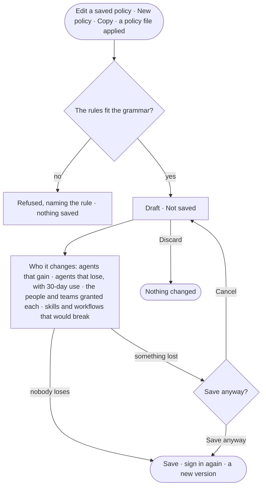

# AC-06 · Draft a policy and see who it changes

**As** an Admin **I want** to see which agents gain, which lose and which skills and workflows would break before I save
a policy, a copy or an applied file **so that** I never break an agent by accident — a draft decides nothing, and I decide
whether it is saved.

Tasks: [task.md](task.md) · Feature: [AC-F02](../../feature.md)

## Who can

| Access | Can | Otherwise sees |
|---|---|---|
| Admin | Save, save anyway, cancel or discard a draft | — |
| Operator | Nothing here without Read on `access/policies`; a person who holds Read but not Edit on Access reads a draft | *No access* — *Needs Read on Access — ask Priya or Lee*; with Read, *Save* disabled — *Needs Edit on Access — ask Priya or Lee* |

## Flow

## Acceptance criteria

| # | Given | When | Then |
|---|---|---|---|
| AC-06.1 | An Admin | they start a new policy, edit a saved one or copy one | a draft appears, marked *Draft · Not saved*, and decides nothing until saved |
| AC-06.2 | A draft | a rule falls outside the policy grammar | nothing is saved; it says which rule was refused |
| AC-06.3 | A draft | any step is checked | it decides nothing until saved |
| AC-06.4 | A draft, or an edit of a saved policy | *Save* is pressed | *Who it changes* shows first: each agent it is attached to, what it gains or loses, and the people and teams granted that agent — the same change for each of them |
| AC-06.5 | A change that removes access an agent used | *Who it changes* is read | each loss names the verb and resource and how often the agent used it in the last 30 days |
| AC-06.6 | A change that removes what a skill or workflow needs | *Who it changes* is read | each skill and workflow that would break is named, with its version, its agent and the need it loses |
| AC-06.7 | A change to a rule's effect | *Who it changes* is read | each agent whose effect moves is named, with the resource, the effect before and after, and its uses in the last 30 days |
| AC-06.8 | *Who it changes* | the Admin presses *Save anyway* | it saves as the version it names, after signing in again, and takes effect on the next check — or, with a second Admin's yes set, once another Admin approves (AC-04.18) |
| AC-06.9 | *Who it changes* | the Admin presses *Cancel* | nothing changes; the draft stays |
| AC-06.10 | A draft | the Admin presses *Discard* | it is gone; nothing changed |
| AC-06.11 | A draft attached to agents before it is saved | *Who it changes* is read | it is drawn against those agents; the attachment takes effect when it is saved |
| AC-06.12 | A saved change | History is read | it shows who saved it, when and why (AC-F06) |
| AC-06.14 | A person with Read on `access/policies` but not Edit on Access | they open a draft or the section | the draft reads; *Save* is disabled, naming Edit on Access and who can grant it; without Read it reads *No access* |
| AC-06.15 | *Who it changes* | it is read | it is a per-agent table — the agent, what it gains or loses, the resource, its uses in the last 30 days — and, below it, each skill or workflow that would be refused, with its version and the need it loses, each with *Add {need} to this policy, then save*; an agent that loses nothing is not listed, and a change that loses nobody reads *Nobody loses access* |
| AC-06.16 | A loss the table names | the Admin presses *Add {need} to this policy, then save* | the need is added to the draft, *Who it changes* is worked out again and the row leaves the table when nothing is lost; nothing is saved until *Save* |

## Screens

| Surface | Access | First use | Empty after a filter | Loading | Has data | Failed | Agent working or proposing | No access |
|---|---|---|---|---|---|---|---|---|
| A draft policy | Admin | settings.policies · New | — | settings.policies · Loading | settings.policies · Draft | settings.policies · Rule refused | — | — |
| A draft policy | Operator | — | — | — | — | — | — | settings.policies · No access |
| Who it changes | Admin | — | — | settings.policies · Working out who it changes | settings.policies · Nobody loses | settings.policies · What would break · Per agent | — | — |
| Who it changes | Operator | — | — | — | — | — | — | settings.policies · No access |
| New policy · 4 Who it changes | Admin | — | — | settings.policies · New · Working out who it changes | settings.policies · New · Nobody loses | settings.policies · New · What would break | — | — |
| New policy · 4 Who it changes | Operator | — | — | — | — | — | — | settings.policies · No access |
