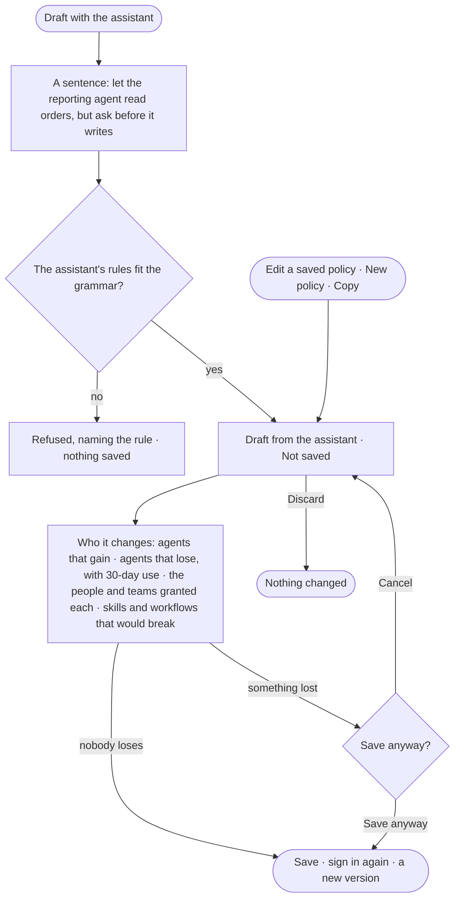

# AC-06 · Draft a policy and see who it changes

**As** an Admin **I want** the assistant to draft an Access Policy from a sentence, and to see which agents gain, which
lose and which skills and workflows would break before I save **so that** I never break an agent by accident — the
assistant proposes the policy, and I decide whether it is saved.

Tasks: [task.md](task.md) · Feature: [AC-F02](../../feature.md)

## Who can

| Lens | Can | Otherwise sees |
|---|---|---|
| Admin | Draft with the assistant; save, save anyway, cancel or discard | — |
| Operator | — ; a Modeller is the same | *Draft with the assistant* and *Save* disabled — *Needs the Admin role — ask Priya or Lee* |

## Flow

## Acceptance criteria

| # | Given | When | Then |
|---|---|---|---|
| AC-06.1 | An Admin | they give *Draft with the assistant* a sentence | a draft policy appears, marked *Draft from the assistant · Not saved*, named from the sentence |
| AC-06.2 | The assistant's reply | a rule falls outside the policy grammar | nothing is saved; it says which rule was refused |
| AC-06.3 | A draft | any step is checked | it decides nothing until saved |
| AC-06.4 | A draft, or an edit of a saved policy | *Save* is pressed | *Who it changes* shows first: each agent it is attached to, what it gains or loses, and the people and teams granted that agent — the same change for each of them |
| AC-06.5 | A change that removes access an agent used | *Who it changes* is read | each loss names the verb and resource and how often the agent used it in the last 30 days |
| AC-06.6 | A change that removes what a skill or workflow needs | *Who it changes* is read | each skill and workflow that would break is named, with its version, its agent and the need it loses |
| AC-06.7 | A change to a rule's effect | *Who it changes* is read | each agent whose effect moves is named, with the resource, the effect before and after, and its uses in the last 30 days |
| AC-06.8 | *Who it changes* | the Admin presses *Save anyway* | it saves as the version it names, after signing in again, and takes effect on the next check — or, with a second Admin's yes set, once another Admin approves (AC-04.18) |
| AC-06.9 | *Who it changes* | the Admin presses *Cancel* | nothing changes; the draft stays |
| AC-06.10 | A draft | the Admin presses *Discard* | it is gone; nothing changed |
| AC-06.11 | A draft attached to agents before it is saved | *Who it changes* is read | it is drawn against those agents; the attachment takes effect when it is saved |
| AC-06.12 | A saved change | History is read | it shows who saved it, when and why (AC-F06) |
| AC-06.13 | A draft from the assistant | the Admin opens *How it got here* | it shows the sentence, the rules the assistant proposed, and the checks they passed |
| AC-06.14 | An Operator | they open a draft or the sheet | the draft reads; *Draft with the assistant* and *Save* are disabled, naming the Admin role and the Admins |

## Screens

| Surface | Lens | First use | Empty after a filter | Loading | Has data | Failed | Agent working or proposing | No access |
|---|---|---|---|---|---|---|---|---|
| A draft policy | Admin | settings.access · Draft with the assistant | — | settings.access · Drafting | settings.access · Draft | settings.access · Rule refused | settings.access · Draft from the assistant | — |
| A draft policy | Operator | — | — | — | access.locked | — | — | access.locked |
| Who it changes | Admin | — | — | settings.access · Working out who it changes | settings.access · Nobody loses | settings.access · What would break | — | — |
| Who it changes | Operator | — | — | — | — | — | — | access.locked |
