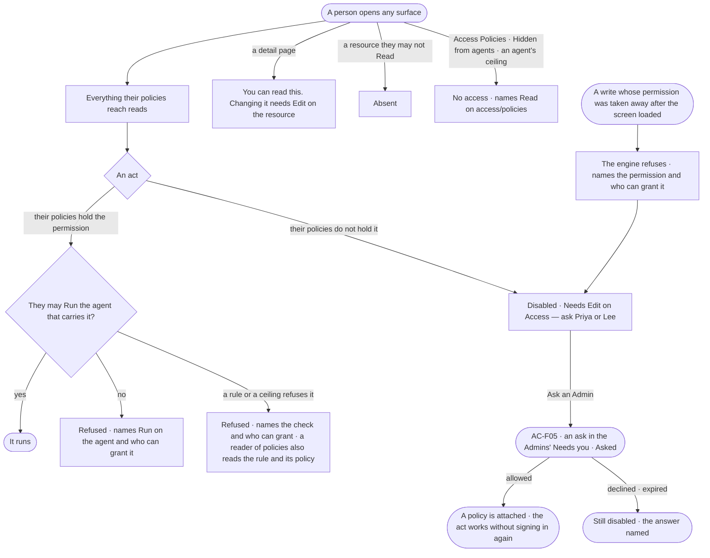

# AC-07 · Read without the access and know who to ask

**As** an analyst **I want** to read every surface my Access Policies reach, and for every act I cannot do to see the
permission it needs and who can grant it **so that** I learn what exists and whom to ask, instead of hitting a dead end.

Tasks: [task.md](task.md) · Feature: [AC-F02](../../feature.md)

## Who can

There are no roles: what a person may do is the Access Policies attached to them, read against
[the permission catalogue](../../feature.md#the-permission-catalogue). *Admins* are the active people who hold Manage on Access.

| Access | Can | Otherwise sees |
|---|---|---|
| Admin | Every act; this story is what the others see | — |
| Operator | Read every surface their Access Policies reach; look, ask, open boards and re-run their own runs, through the agents they may Run. Any further act is theirs when a policy attached to them holds its permission | Each act their policies do not hold disabled — *Needs Edit on Access — ask Priya or Lee*; a detail page says *You can read this. Changing it needs Edit on agent/support — ask Priya* |

## Flow

## Acceptance criteria

| # | Given | When | Then |
|---|---|---|---|
| AC-07.1 | A person | they open any mode, modal or overlay their Access Policies reach | it reads in full; nothing they may read is hidden |
| AC-07.2 | A person in *Access* | the section is read | teams and the Directory read; Access Policies, *Hidden from agents* and the built-in agents' ceilings read *No access* (AC-07.15); the permission catalogue still reads |
| AC-07.3 | Any act the reader's policies do not hold, anywhere in Studio | it is drawn | it is disabled, never hidden; its tooltip and accessible description name the permission and who can grant it — *Needs Edit on Access — ask Priya or Lee*; tried through the API, it is refused, naming the permission |
| AC-07.4 | The people named | the reader is one of them, or there are more than three | the reader is left out; past three it reads *Priya, Lee or 3 others* |
| AC-07.5 | A permission nobody else holds | the refusal draws | it reads *Ask an Admin* |
| AC-07.6 | A detail page whose changes the reader's policies do not hold — a skill, an agent, a model, a policy | it opens | one line says *You can read this. Changing it needs Edit on agent/support — ask Priya* |
| AC-07.7 | A resource the reader's policies may not Read | the frame draws | it is absent, never shown empty |
| AC-07.8 | A person whose policies allow Read and Run on an agent | they look, ask, open boards, or re-run their own run | it works, as for an Admin |
| AC-07.9 | A write whose permission was taken away after the screen loaded | it is tried | the engine refuses it, naming the permission and who can grant it, and the act turns disabled |
| AC-07.10 | Studio has not yet learned the reader's permissions, or could not | an act is drawn | it is enabled; the engine still checks every act and its refusal names the permission |
| AC-07.11 | A person whose policies hold the act's permission but not Run on the agent that carries it | they try it | it is refused before anything runs, naming Run on `agent/<name>` and who can grant it |
| AC-07.12 | A person whose act a rule or a ceiling refuses | they read the refusal | it names the check that refused and who can grant; a person with Read on `access/policies` also reads the rule, its policy and the Admins who can change it, and anyone else does not |
| AC-07.13 | A person who lacks the permission an act needs | they press *Ask an Admin* | one ask for that permission appears in the Admins' Needs you (AC-F05); never decided by the asker; the act reads *Asked*, and pressing again joins the open ask |
| AC-07.15 | A person without Read on `access/policies`, an Operator included | they open an Access Policy, *Hidden from agents*, the built-in agents, an agent's ceiling or effective view, or a check, or ask the API | it reads *No access* — *This needs Read on access/policies — ask Priya or Lee* — and nothing says what a policy holds or hides |
| AC-07.14 | A person given a policy that holds the permission | they reach the act | it works, without signing in again |

## Screens

| Surface | Access | First use | Empty after a filter | Loading | Has data | Failed | Agent working or proposing | No access |
|---|---|---|---|---|---|---|---|---|
| Access, read only | Admin | — | — | — | — | — | — | — |
| Access, read only | Operator | settings.people · Locked · Built in only | settings.people · Locked · Nothing matches | settings.people · Locked · Loading | settings.people · Locked | settings.people · Locked · Permission lost | — | settings.people · Locked |
| *Ask an Admin*, pressed | Admin | — | — | — | — | — | — | — |
| *Ask an Admin*, pressed | Operator | — | — | — | settings.people · Locked · Asked | — | — | — |
| A mode, read only | Admin | — | — | — | model.models | — | — | — |
| A mode, read only | Operator | — | — | — | model.models · Read only | — | — | model.models · Read only |
| A detail page, read only | Admin | — | — | — | agents.agents · Detail | — | — | — |
| A detail page, read only | Operator | — | — | — | agents.agents · Detail · Read only | — | — | agents.agents · Detail · Read only |
| An act no agent reaches | Admin | — | — | — | — | settings.agent_access · Locked · No agent reaches it | — | — |
| An act no agent reaches | Operator | — | — | — | — | settings.agent_access · Locked · No agent reaches it | — | settings.agent_access · Locked · No agent reaches it |
| An Access Policy, without Read | Admin | — | — | — | — | — | — | — |
| An Access Policy, without Read | Operator | — | — | — | — | — | — | settings.policies · No access |
