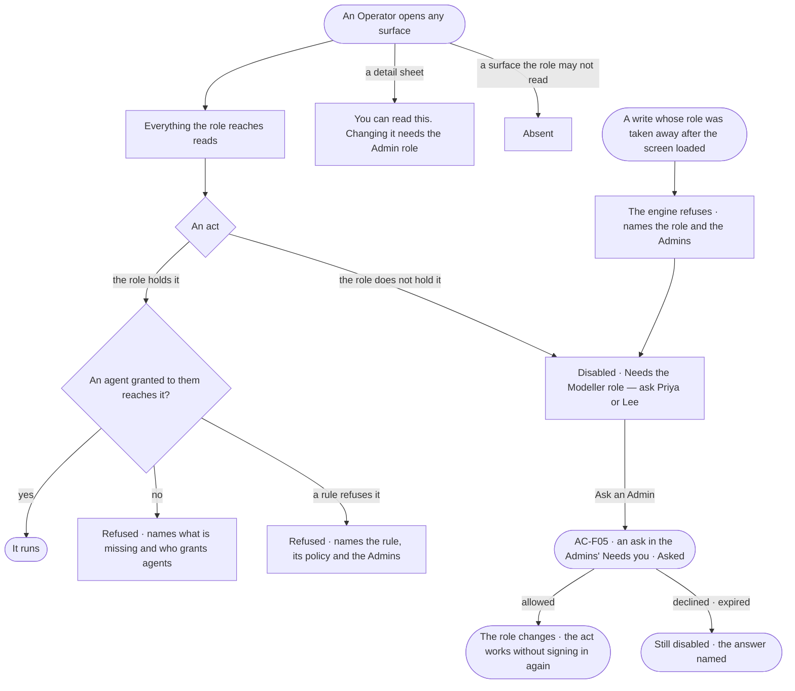

# AC-07 · Read without the role and know who to ask

**As** an analyst **I want** to read every surface my role reaches, and every act I cannot do to name the role or the
agent it needs and who can help **so that** I learn what exists and whom to ask, instead of hitting a dead end.

Tasks: [task.md](task.md) · Feature: [AC-F02](../../feature.md)

## Who can

| Lens | Can | Otherwise sees |
|---|---|---|
| Admin | Every act; this story is what the others see | — |
| Operator | Read every surface their role reaches; look, ask, open boards, re-run their own runs, through the agents granted to them. A Modeller also acts on the model and records | Each act the role does not hold disabled — *Needs the Modeller role — ask Priya or Lee*; a detail sheet says *You can read this. Changing it needs …* |

## Flow

## Acceptance criteria

| # | Given | When | Then |
|---|---|---|---|
| AC-07.1 | An Operator | they open any mode, sheet or overlay their role reaches | it reads in full; nothing they may read is hidden |
| AC-07.2 | An Operator in *People and access* | the sheet is read | every policy, rule, role, team and built-in agent reads; one line names who can change them — *You can read every policy. Priya and Lee can change them* |
| AC-07.3 | Any act the reader's role does not hold, anywhere in Studio | it is drawn | it is disabled, never hidden; its tooltip and accessible description name the role and who holds it — *Needs the Admin role — ask Priya or Lee*; tried through the API, it is refused, naming the role |
| AC-07.4 | The people named | the reader is one of them, or there are more than three | the reader is left out; past three it reads *Priya, Lee or 3 others* |
| AC-07.5 | A role nobody else holds | the refusal draws | it reads *Ask an Admin* |
| AC-07.6 | A detail sheet whose changes the reader's role does not hold — a skill, an agent, a model, a policy | it opens | one line says *You can read this. Changing it needs the Modeller role — ask Priya* |
| AC-07.7 | A surface the reader's role may not read at all | the frame draws | it is absent, never shown empty |
| AC-07.8 | An Operator | they look, ask, open boards, or re-run their own run | it works, as for an Admin |
| AC-07.9 | A write whose role was taken away after the screen loaded | it is tried | the engine refuses it, naming the role and who holds it, and the act turns disabled |
| AC-07.10 | Studio has not yet learned the reader's role, or could not | an act is drawn | it is enabled; the engine still checks every act and its refusal names the role |
| AC-07.11 | A person whose role holds the act, but no agent granted to them reaches it | they try it | it is refused before anything runs, naming what is missing and who grants agents |
| AC-07.12 | A person whose act an agent's rule refuses | they read the refusal | it names the rule, its policy and the Admins who can change it |
| AC-07.13 | A person who lacks the role an act needs | they press *Ask an Admin* | one ask for that role appears in the Admins' Needs you (AC-F05); never decided by the asker; the act reads *Asked*, and pressing again joins the open ask |
| AC-07.14 | A person given a role | they reach an act it holds | it works, without signing in again |

## Screens

| Surface | Lens | First use | Empty after a filter | Loading | Has data | Failed | Agent working or proposing | No access |
|---|---|---|---|---|---|---|---|---|
| People and access, read only | Admin | — | — | — | — | — | — | — |
| People and access, read only | Operator | access.locked · Built in only | access.locked · Nothing matches | access.locked · Loading | access.locked | access.locked · Role lost | — | access.locked |
| *Ask an Admin*, pressed | Admin | — | — | — | — | — | — | — |
| *Ask an Admin*, pressed | Operator | — | — | — | access.locked · Asked | — | — | — |
| A mode, read only | Admin | — | — | — | model.board | — | — | — |
| A mode, read only | Operator | — | — | — | model.board · Read only | — | — | model.board · Read only |
| A sheet, read only | Admin | — | — | — | agents.agent | — | — | — |
| A sheet, read only | Operator | — | — | — | agents.agent · Read only | — | — | agents.agent · Read only |
| An act no agent reaches | Admin | — | — | — | — | access.locked · No agent reaches it | — | — |
| An act no agent reaches | Operator | — | — | — | — | access.locked · No agent reaches it | — | access.locked · No agent reaches it |
