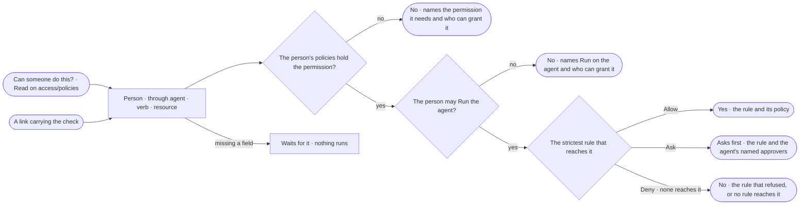

# AC-08 · Check whether someone can do something

**As** an Admin **I want** to ask whether a person, through an agent, may Read, Write or Run a resource — and which
check decides — without running anything **so that** access is proven, not guessed.

Tasks: [task.md](task.md) · Feature: [AC-F02](../../feature.md)

## Who can

| Access | Can | Otherwise sees |
|---|---|---|
| Admin | Check any person through any agent | — |
| Operator | Nothing here without Read on `access/policies`: the check names rules and policies. A person who holds it checks any person through any agent | *No access* — *Needs Read on Access — ask Priya or Lee* |

## Flow

## Acceptance criteria

| # | Given | When | Then |
|---|---|---|---|
| AC-08.1 | A person with Read on `access/policies` | they open *Can someone do this?* from the policies list, a policy or a person | it takes a person · an agent · a verb — Read · Write · Run · a resource `type/name`; without that Read it reads *No access*, naming Read on `access/policies` and who can grant it |
| AC-08.2 | A check both checks allow | it is run | it reads *Yes*, naming the permission the person holds and the rule that allowed it, with its policy |
| AC-08.3 | A check one check refuses | it is run | it reads *No*, naming the check that refused — the permission the person lacks, the agent the person may not Run, or the rule, its policy and who set it; with no rule reaching it, *No rule allows this* |
| AC-08.4 | A check whose strictest rule is Ask | it is run | it reads *Asks first*, naming the rule and the agent's named approvers |
| AC-08.5 | Two people granted the same agent, on different teams | each is checked for the same verb and resource | the rule answer is the same for both; only whether each may Run the agent and what their own policies hold can differ, and the result names which |
| AC-08.6 | A check | it runs | it is the engine's own check, the one a run's steps pass, and it writes nothing |
| AC-08.7 | A link that carries the person, agent, verb and resource | it is opened | the check opens filled and runs once; closing it drops the check from the URL |
| AC-08.8 | A field missing | the check is read | it waits for it and runs nothing |
| AC-08.9 | An Operator with Read on `access/policies` | they check anyone | it works as for an Admin; an Operator without it reads *No access* (AC-08.1) |
| AC-08.10 | A check that could not run | it is read | it says why, with *Try again* |
| AC-08.11 | A filled check | its link is copied | the address carries `dialog=check` with `user`, `agent`, `verb` and `resource` |
| AC-08.12 | A check | it is run | the answer lists every layer the engine's own check passed through, in order — the permission the person holds · the policies they hold · the agent's policies · the person who started it and the project it runs in · the boundary — each reading *allows* or *refuses*, the first that refuses marked; the answer above them is the same *Yes* · *No* · *Asks first* of AC-08.2 to AC-08.4 |
| AC-08.13 | The check is opened from a policy, a person or an agent | it opens | it opens as a modal over the page it came from, filled with what that page knows; closing it returns there |

## Screens

| Surface | Access | First use | Empty after a filter | Loading | Has data | Failed | Agent working or proposing | No access |
|---|---|---|---|---|---|---|---|---|
| Can someone do this? | Admin | settings.policies · Ask a check | — | settings.policies · Checking | settings.policies · No, names the rule | settings.policies · Could not check | — | — |
| Can someone do this? | Operator | — | — | — | — | — | — | settings.policies · No access |
