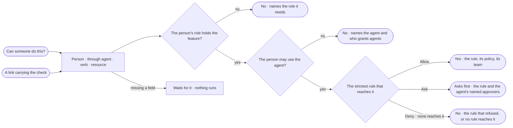

# AC-08 · Check whether someone can do something

**As** an Admin **I want** to ask whether a person, through an agent, may Read, Write or Run a resource — and which
check decides — without running anything **so that** access is proven, not guessed.

Tasks: [task.md](task.md) · Feature: [AC-F02](../../feature.md)

## Who can

| Lens | Can | Otherwise sees |
|---|---|---|
| Admin | Check any person through any agent | — |
| Operator | Check any person through any agent; a Modeller the same | — |

## Flow

## Acceptance criteria

| # | Given | When | Then |
|---|---|---|---|
| AC-08.1 | Any signed-in person | they open *Can someone do this?* from the policies list, a policy or a person | it takes a person · an agent · a verb — Read · Write · Run · a resource `type/name` |
| AC-08.2 | A check both checks allow | it is run | it reads *Yes*, naming the role that holds the feature and the rule that allowed it, with its policy and team |
| AC-08.3 | A check one check refuses | it is run | it reads *No*, naming the check that refused — the role, the agent the person may not use, or the rule, its policy and who set it; with no rule reaching it, *No rule allows this* |
| AC-08.4 | A check whose strictest rule is Ask | it is run | it reads *Asks first*, naming the rule and the agent's named approvers |
| AC-08.5 | A person on a team a rule names | they are checked | the team's rules count; for a person not on it, they do not, and the result names the team |
| AC-08.6 | A check | it runs | it is the engine's own check, the one a run's steps pass, and it writes nothing |
| AC-08.7 | A link that carries the person, agent, verb and resource | it is opened | the check opens filled and runs once; closing it drops the check from the URL |
| AC-08.8 | A field missing | the check is read | it waits for it and runs nothing |
| AC-08.9 | An Operator | they check anyone | it works as for an Admin |
| AC-08.10 | A check that could not run | it is read | it says why, with *Try again* |
| AC-08.11 | A filled check | its link is copied | the address carries `dialog=check` with `user`, `agent`, `verb` and `resource` |

## Screens

| Surface | Lens | First use | Empty after a filter | Loading | Has data | Failed | Agent working or proposing | No access |
|---|---|---|---|---|---|---|---|---|
| Can someone do this? | Admin | settings.access · Ask a check | — | settings.access · Checking | settings.access · No, names the rule | settings.access · Could not check | — | — |
| Can someone do this? | Operator | access.locked · Ask a check | — | access.locked · Checking | access.locked · No, names the rule | access.locked · Could not check | — | — |
