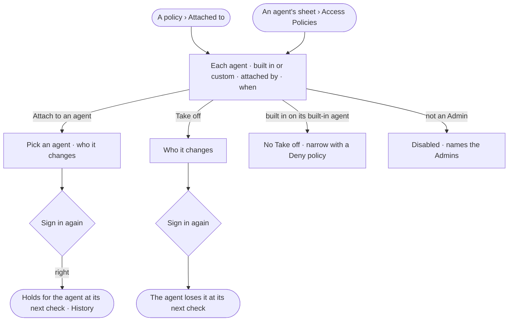

# AC-11 · Attach a policy to agents

**As** an Admin **I want** to attach an Access Policy to the agents it should hold for, and take it off, in one place
**so that** I see a policy's reach and change it on purpose.

Tasks: [task.md](task.md) · Feature: [AC-F02](../../feature.md)

## Who can

| Lens | Can | Otherwise sees |
|---|---|---|
| Admin | Read the agents a policy is attached to; attach it to an agent; take it off. Each asks them to sign in again | A built-in policy on its built-in agent has no *Take off* |
| Operator | Read the agents a policy is attached to; a Modeller reads the same | *Attach to an agent* and *Take off* disabled — *Needs the Admin role — ask Priya or Lee* |

## Flow

## Acceptance criteria

| # | Given | When | Then |
|---|---|---|---|
| AC-11.1 | A policy | *Attached to* is read | each agent reads with its name, *Built in*, *Shared* or *Personal* and who made it, who attached the policy and when; built-in agents first, then by name |
| AC-11.2 | An agent's sheet | its *Access Policies* are read | every policy attached to it reads, with a link to each, and *What it may do* (AC-F04) |
| AC-11.3 | An Admin | they attach a policy to an agent | *Who it changes* shows for that agent first, with the people and teams granted it; after signing in again, the agent holds it at its next check — or once a second Admin approves, when that is set (AC-04.18) |
| AC-11.4 | An Admin | they take a policy off an agent | *Who it changes* shows first; after signing in again, the agent loses it at its next check |
| AC-11.5 | An agent with no policy attached | a step of its run is checked | it is denied — no rule reaches it — and the refusal names the agent and that no policy is attached |
| AC-11.6 | A built-in policy on its built-in agent | *Take off* is sought | there is none, and the API refuses it, naming the policy; *Attach* a custom policy with a Deny narrows the agent |
| AC-11.7 | A policy attached or taken off | History is read | it shows who did it, to which agent, and when (AC-F06) |
| AC-11.8 | An Operator | they open *Attached to* | every agent reads; *Attach to an agent* and *Take off* are disabled, naming the Admin role and the Admins |
| AC-11.9 | An attempt to attach a policy to a person, a team or a key | it is made | there is no such act; a person and a team are granted agents (AC-F03), and a key acts as its owner, narrowed |

## Screens

| Surface | Lens | First use | Empty after a filter | Loading | Has data | Failed | Agent working or proposing | No access |
|---|---|---|---|---|---|---|---|---|
| Attached to | Admin | settings.access · Not attached | settings.access · Nothing matches | settings.access · Loading | settings.access | settings.access · Could not load | — | — |
| Attached to | Operator | access.locked · Not attached | access.locked · Nothing matches | access.locked · Loading | access.locked | access.locked · Could not load | — | access.locked |
| Attach to an agent | Admin | — | — | — | settings.access · Attach to an agent | settings.access · Could not attach | — | — |
| Attach to an agent | Operator | — | — | — | — | — | — | access.locked |
