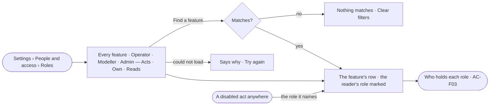

# AC-19 · Read what each role may do

**As** an analyst **I want** to read, feature by feature, what an Operator, a Modeller and an Admin may do **so that** I
know which role an act needs and whom to ask, without trying it first.

Tasks: [task.md](task.md) · Feature: [AC-F02](../../feature.md)

## Who can

| Lens | Can | Otherwise sees |
|---|---|---|
| Admin | Read the role table; set a person's role in the Directory (AC-F03) | The table has no *Edit* — it is fixed |
| Operator | Read the role table and their own role; a Modeller the same | — |

## Flow

## Acceptance criteria

| # | Given | When | Then |
|---|---|---|---|
| AC-19.1 | A signed-in person | they open *Roles* | one table reads: each feature, grouped by Control Plane · Access Plane · Ontology · Intelligence · Agents · Evidence, with what Operator, Modeller and Admin may do — *Acts* · *Own* · *Reads* |
| AC-19.2 | The table | it is read | each role holds everything the one before it holds; the reader's own role is marked |
| AC-19.3 | The table | an Admin reads it | there is no *Edit*, no new role and no copy; it reads *Fixed — the same in every deployment* |
| AC-19.4 | Any route or step | the engine checks it | it is checked against the same table the sheet shows; an act whose role is not held is refused, naming the role (AC-07) |
| AC-19.5 | The table | the reader types in *Find a feature* | only matching features show; with none, *Nothing matches* and *Clear filters* |
| AC-19.6 | A disabled act that names a role | the reader follows *What each role may do* | *Roles* opens on that feature's row |
| AC-19.7 | A role's column | its head is read | it names how many people hold it and links to them in the Directory (AC-F03) |
| AC-19.8 | The table cannot load | the sheet opens | it says why, with *Try again* |
| AC-19.9 | A person at the command line | they run `invana roles` | the same table reads |

## Screens

| Surface | Lens | First use | Empty after a filter | Loading | Has data | Failed | Agent working or proposing | No access |
|---|---|---|---|---|---|---|---|---|
| Roles | Admin | — | settings.roles · Nothing matches | settings.roles · Loading | settings.roles | settings.roles · Could not load | — | — |
| Roles | Operator | — | settings.roles · Nothing matches | settings.roles · Loading | settings.roles · Your role marked | settings.roles · Could not load | — | — |
