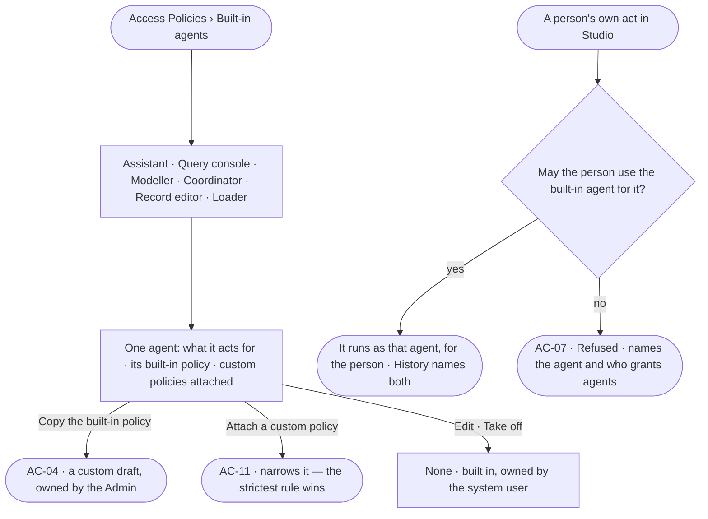

# AC-20 · Read the built-in agents and the policies they run under

**As** an Admin **I want** to read the built-in agents a person's own acts run as, and the policies each runs under
**so that** I know what a person can reach without an agent of their own, and narrow it on purpose.

Tasks: [task.md](task.md) · Feature: [AC-F02](../../feature.md)

## Who can

| Lens | Can | Otherwise sees |
|---|---|---|
| Admin | Read every built-in agent and its policies; *Copy* a built-in policy; attach a custom policy to a built-in agent (AC-11) | A built-in agent and its built-in policy have no *Edit*, *Rename*, *Delete* or *Take off* |
| Operator | Read every built-in agent, what it acts for and its policies; a Modeller the same | *Copy* and *Attach* disabled — *Needs the Admin role — ask Priya or Lee* |

## Flow

## Acceptance criteria

| # | Given | When | Then |
|---|---|---|---|
| AC-20.1 | A deployment | *Built-in agents* is read | six agents read, one of each — Assistant · Query console · Modeller · Coordinator · Record editor · Loader — each owned by the system user, with what it acts for and its built-in policy |
| AC-20.2 | A built-in agent | it is opened | its built-in policy's rules read as sentences, then each custom policy attached to it, then *What it may do* — every rule at once (AC-F04) |
| AC-20.3 | A built-in agent or its built-in policy | an edit, rename, delete or take-off is tried, from any path | it is refused, naming it as built in; *Copy* makes a custom draft owned by the person who copied it |
| AC-20.4 | A custom policy with a Deny attached to a built-in agent | a step of that agent is checked | the Deny holds — the strictest rule wins — and the refusal names the custom policy |
| AC-20.5 | A person's own act in Studio — a question to the Assistant, a query in the Console, a change to the model, a plan run, an edit on the board, a load | it runs | it runs as the built-in agent for it, for that person; History and *How it got here* name the person and the agent |
| AC-20.6 | A person not granted the built-in agent an act runs as | they try the act | it is refused before it runs, naming the agent and who grants agents (AC-07) |
| AC-20.7 | A new deployment | it starts | every built-in agent exists with its built-in policy attached, and is granted to every person whose role holds the feature it acts for |
| AC-20.8 | The Query console | a query in the Console writes data | the write asks first, by its built-in policy; every query it runs is recorded |
| AC-20.9 | An Operator | they open *Built-in agents* | every agent and policy reads; *Copy* and *Attach* are disabled, naming the Admin role and the Admins |
| AC-20.10 | The list cannot load | it opens | it says why, with *Try again* |

## Screens

| Surface | Lens | First use | Empty after a filter | Loading | Has data | Failed | Agent working or proposing | No access |
|---|---|---|---|---|---|---|---|---|
| Built-in agents | Admin | — | — | settings.access · Loading | settings.access · Built-in agents | settings.access · Could not load | — | — |
| Built-in agents | Operator | — | — | access.locked · Loading | access.locked · Built-in agents | access.locked · Could not load | — | access.locked · Built-in agents |
| A built-in agent | Admin | — | — | settings.access · Loading | settings.access · Built-in agent | settings.access · Built in refused | — | — |
| A built-in agent | Operator | — | — | access.locked · Loading | access.locked · Built-in agent | access.locked · Could not load | — | access.locked · Built-in agent |
| A person's act, no grant | Admin | — | — | — | — | access.locked · Agent not granted | — | — |
| A person's act, no grant | Operator | — | — | — | — | access.locked · Agent not granted | — | access.locked · Agent not granted |
