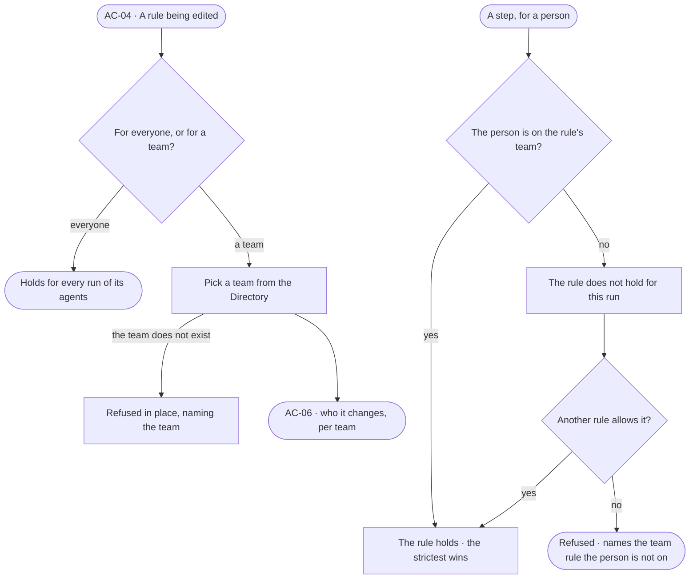

# AC-21 · Hold a rule for one team

**As** an Admin **I want** a rule that holds only when the person behind the run is on a named team **so that** one
agent serves several teams, each reaching only what its work needs.

Tasks: [task.md](task.md) · Feature: [AC-F02](../../feature.md)

## Who can

| Lens | Can | Otherwise sees |
|---|---|---|
| Admin | Name a team on any rule of a custom policy, or clear it; read which teams each rule holds for | — |
| Operator | Read which team each rule holds for, and which teams they are on; a Modeller the same | *For a team* disabled — *Needs the Admin role — ask Priya or Lee* |

## Flow

## Acceptance criteria

| # | Given | When | Then |
|---|---|---|---|
| AC-21.1 | A rule on a custom policy | an Admin sets *For a team* | the rule reads with its team — *Allow writing Order in sales-db, for Finance* — and holds only for runs whose person is on Finance |
| AC-21.2 | A rule with no team | a step of its agent is checked | it holds for every person behind the run |
| AC-21.3 | An Allow rule for Finance | a person not on Finance runs the agent | the rule does not hold for them; with no other rule allowing the step, it is refused, naming the rule and its team |
| AC-21.4 | A person on two teams | a step is checked | every rule for either team, and every rule for everyone, holds; the strictest wins — a Deny for one team holds even where the other team's rule allows |
| AC-21.5 | A rule naming a team that does not exist | it is saved | it is refused in place, naming the rule and the team |
| AC-21.6 | A team a rule names | it is deleted in the Directory | the rule holds for nobody; it reads *Team removed* until an Admin changes it, and *Who it changes* named the rule before the delete (AC-F03) |
| AC-21.7 | A person added to or taken off a team | their next step is checked | the team's rules hold, or stop holding, from that check |
| AC-21.8 | A policy with team rules | *Who it changes* is read | gains and losses show per team, with the people on each team counted by the engine (AC-06) |
| AC-21.9 | A run refused by a team rule | the person opens *How it got here* | it names the rule, its team, and that the person is not on it |
| AC-21.10 | An Operator | they open a policy | each rule's team reads and their own teams are marked; *For a team* is disabled, naming the Admin role and the Admins |

## Screens

| Surface | Lens | First use | Empty after a filter | Loading | Has data | Failed | Agent working or proposing | No access |
|---|---|---|---|---|---|---|---|---|
| A rule for a team | Admin | settings.access · No teams yet | — | settings.access · Loading | settings.access · For a team | settings.access · Team refused | — | — |
| A rule for a team | Operator | — | — | access.locked · Loading | access.locked · For a team | access.locked · Could not load | — | access.locked · For a team |
| Team removed | Admin | — | — | — | settings.access · Team removed | — | — | — |
| Team removed | Operator | — | — | — | access.locked · Team removed | — | — | access.locked · Team removed |
