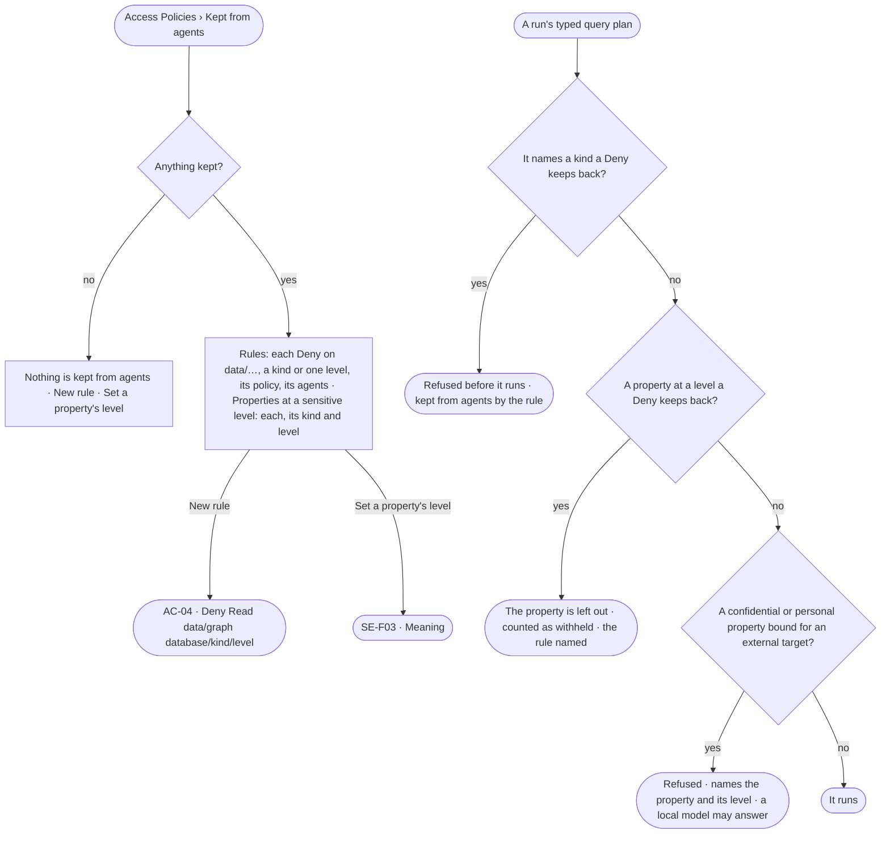

# AC-27 · Keep a kind or a sensitive property from agents

**As** a modeller **I want** what the deployment keeps from agents — whole kinds, or a kind's properties at one
sensitivity level, by a Deny rule, and the confidential and personal properties that never leave — read in one place,
and every answer to say when it ran into one **so that** people choose what an answer rests on, rather than
discovering it afterwards.

Tasks: [task.md](task.md) · Feature: [AC-F02](../../feature.md)

## Who can

Reading is every signed-in person's; the acts follow [the role table](../../feature.md#the-role-table).

| Lens | Can | Otherwise sees |
|---|---|---|
| Admin | Read *Kept from agents*; write a Deny rule on `data/<graph database>/<kind>` or on one level of it in a policy (AC-04); set a property's level in Meaning | — |
| Operator | Read *Kept from agents*. A Modeller also sets a property's level in Meaning and asks an Admin for a Deny rule | *New rule* disabled — *Needs the Admin role — ask Priya or Lee*; *Set level* disabled — *Needs the Modeller role — ask an Admin* |

## Flow

## Acceptance criteria

| # | Given | When | Then |
|---|---|---|---|
| AC-27.1 | A deployment | *Kept from agents* is read | it lists every Deny rule on `data/…` — the kind, graph database and level it reaches, its policy, the agents it holds for — and every property at a confidential or personal level with its kind and level; with none, *Nothing is kept from agents* |
| AC-27.2 | A Deny rule on `data/<graph database>/Customer` attached to an agent | a typed query plan of that agent names Customer in that graph database | the plan is refused before it is compiled, naming the rule, its policy and who set it; no record is read |
| AC-27.3 | A Deny rule on `data/*/Customer` | a plan names Customer in any graph database | it is refused the same way; the rule reaches every graph database's Customer, at every level |
| AC-27.4 | A question that needs a kind a rule keeps back | the run settles | the answer reads *kept from agents*, naming the rule, its policy and what it was grounded in — never worded as the data not holding it |
| AC-27.5 | A property whose level is confidential or personal | an agent's call to an external AI model, an outside tool or an outside agent would carry it | the call is refused before it leaves, naming the property and its level; a local model may still answer (SE-F03 · CP-F01) |
| AC-27.6 | A property at a sensitive level | *Kept from agents* is read | it reads *Never to an external target*, names its level, links to its kind's Meaning and names who set it |
| AC-27.7 | A run refused by a kind kept back, or a call refused for a level | the person opens *How it got here* | it names the step, the rule or the property and its level, and its policy |
| AC-27.8 | A Modeller | they want a kind or a level kept back | *Ask an Admin* raises an ask in the Admins' Needs you (AC-F05) naming the kind, the level and the graph database; an Admin writes the rule (AC-04) |
| AC-27.9 | Deny rules and levels | a policy file is applied from the command line | a Deny on `data/…`, with or without a level, is saved like any rule (AC-04.15); levels are the model's, never a policy file's |
| AC-27.10 | An Operator | they open *Kept from agents* | everything reads; *New rule* and *Set level* are disabled, naming the role each needs |
| AC-27.11 | An agent with `Allow Read data/*/*` and `Deny Read data/*/*/personal` | it reads a kind that has personal properties | every property but the personal ones is in the result, which says how many properties it withheld and names the rule; the read is not refused |
| AC-27.12 | A Deny rule on one level of a kind | an agent reads that kind | only the properties at that level are withheld; properties at other levels are read |

## Screens

| Surface | Lens | First use | Empty after a filter | Loading | Has data | Failed | Agent working or proposing | No access |
|---|---|---|---|---|---|---|---|---|
| Kept from agents | Admin | settings.access · Nothing kept | — | settings.access · Loading | settings.access · Kept from agents | settings.access · Could not load | — | — |
| Kept from agents | Operator | access.locked · Nothing kept | — | access.locked · Loading | access.locked · Kept from agents | access.locked · Could not load | — | access.locked · Kept from agents |
| A refused step | Admin | — | — | — | — | access.locked · Kept from agents | — | — |
| A refused step | Operator | — | — | — | — | access.locked · Kept from agents | — | access.locked · Kept from agents |
| An answer with withheld properties | Admin | — | — | — | access.locked · Withheld | — | — | — |
| An answer with withheld properties | Operator | — | — | — | access.locked · Withheld | — | — | access.locked · Withheld |
