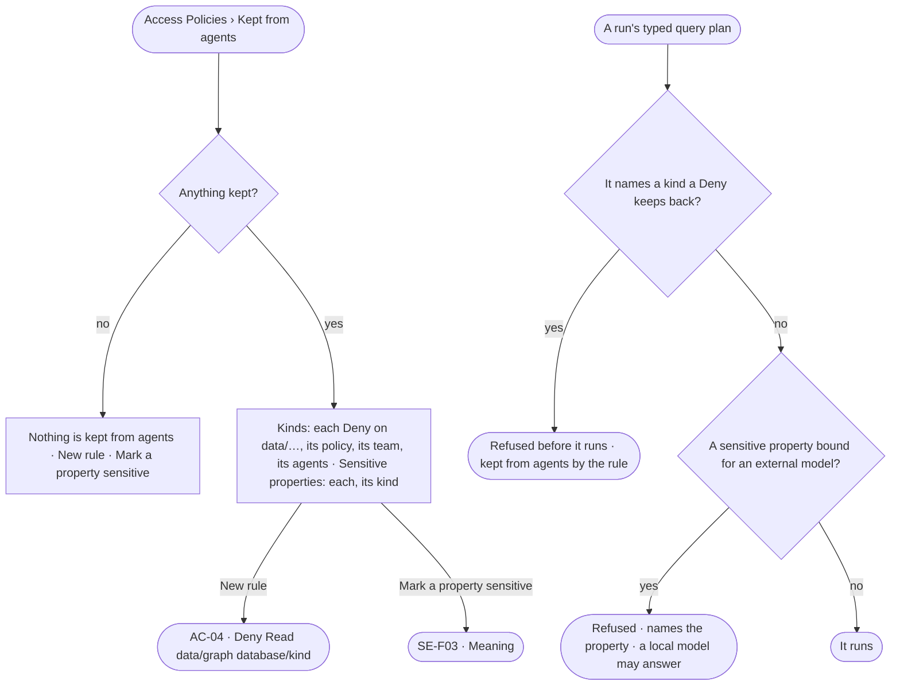

# AC-27 · Keep a kind or a sensitive property from agents

**As** a modeller **I want** what the deployment keeps from agents — whole kinds by a Deny rule, sensitive properties
from every external model — read in one place, and every answer to say when it ran into one **so that** people choose
what an answer rests on, rather than discovering it afterwards.

Tasks: [task.md](task.md) · Feature: [AC-F02](../../feature.md)

## Who can

| Lens | Can | Otherwise sees |
|---|---|---|
| Admin | Read *Kept from agents*; write a Deny rule on `data/<graph database>/<kind>` in a policy (AC-04); mark a property sensitive in Meaning | — |
| Operator | Read *Kept from agents*. A Modeller also marks a property sensitive in Meaning and asks an Admin for a Deny rule | *New rule* disabled — *Needs the Admin role — ask Priya or Lee*; *Mark sensitive* disabled — *Needs the Modeller role* |

## Flow

## Acceptance criteria

| # | Given | When | Then |
|---|---|---|---|
| AC-27.1 | A deployment | *Kept from agents* is read | it lists every Deny rule on `data/…` — the kind and graph database it reaches, its policy, its team, the agents it holds for — and every sensitive property with its kind; with none, *Nothing is kept from agents* |
| AC-27.2 | A Deny rule on `data/<graph database>/Customer` attached to an agent | a typed query plan of that agent names Customer in that graph database | the plan is refused before it is compiled, naming the rule, its policy and who set it; no record is read |
| AC-27.3 | A Deny rule on `data/*/Customer` | a plan names Customer in any graph database | it is refused the same way; the rule reaches every graph database's Customer |
| AC-27.4 | A question that needs a kind a rule keeps back | the run settles | the answer reads *kept from agents*, naming the rule, its policy and what it was grounded in — never worded as the data not holding it |
| AC-27.5 | A property marked sensitive in Meaning | an agent's call to an external model would carry it | the call is refused, naming the property; a local model may still answer (SE-F03 · CP-F01) |
| AC-27.6 | A sensitive property | *Kept from agents* is read | it reads *Never to an external model*, links to its kind's Meaning, and names who marked it |
| AC-27.7 | A run refused by a kind kept back or a sensitive property | the person opens *How it got here* | it names the step, the rule or the property, and its policy |
| AC-27.8 | A Modeller | they want a kind kept back | *Ask an Admin* raises an ask in the Admins' Needs you (AC-F05) naming the kind and graph database; an Admin writes the rule (AC-04) |
| AC-27.9 | Deny rules and sensitive marks | a policy file is applied from the command line | a Deny on `data/…` is saved like any rule (AC-04.15); sensitive marks are the model's, never a policy file's |
| AC-27.10 | An Operator | they open *Kept from agents* | everything reads; *New rule* and *Mark a property sensitive* are disabled, naming the role each needs |

## Screens

| Surface | Lens | First use | Empty after a filter | Loading | Has data | Failed | Agent working or proposing | No access |
|---|---|---|---|---|---|---|---|---|
| Kept from agents | Admin | settings.access · Nothing kept | — | settings.access · Loading | settings.access · Kept from agents | settings.access · Could not load | — | — |
| Kept from agents | Operator | access.locked · Nothing kept | — | access.locked · Loading | access.locked · Kept from agents | access.locked · Could not load | — | access.locked · Kept from agents |
| A refused step | Admin | — | — | — | — | access.locked · Kept from agents | — | — |
| A refused step | Operator | — | — | — | — | access.locked · Kept from agents | — | access.locked · Kept from agents |
