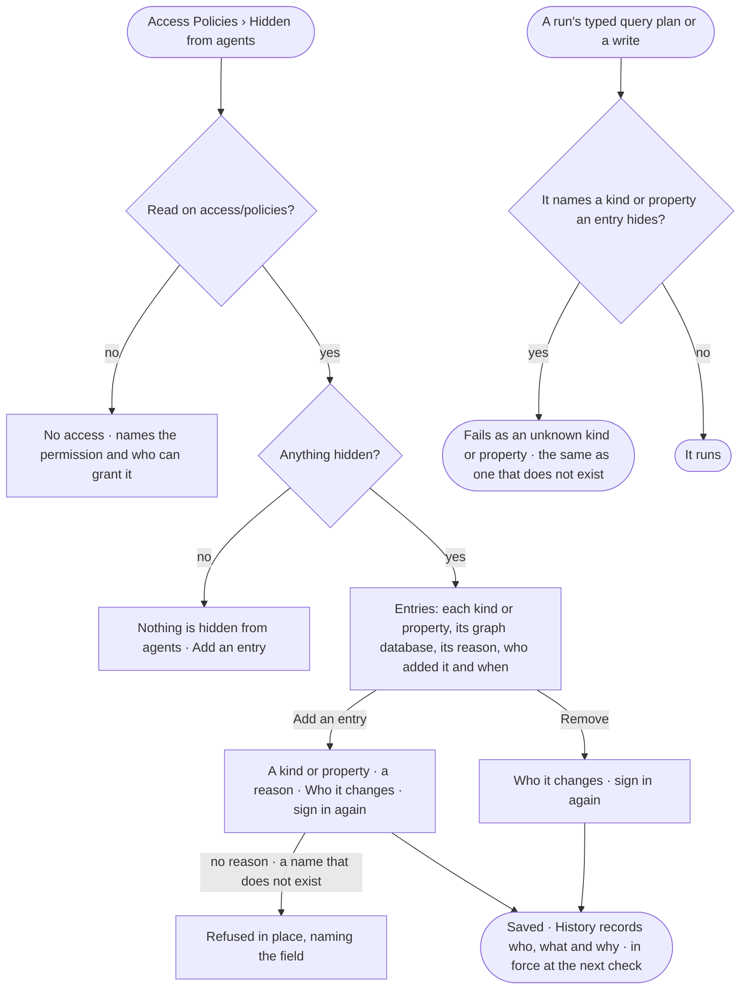

# AC-27 · Keep a kind or a property from agents

**As** an admin **I want** one list of the kinds and properties the deployment hides from every agent, each with the
reason it is hidden, that I alone add to and remove from **so that** an agent never sees what it must not, and no
answer hints that it exists.

Tasks: [task.md](task.md) · Feature: [AC-F02](../../feature.md)

## Who can

*Hidden from agents* is read with Read on `access/policies`; its entries change with Manage on Access, signing in again
([AC-F02 › Property access](../../feature.md#property-access)).

| Access | Can | Otherwise sees |
|---|---|---|
| Admin | Read *Hidden from agents*; add an entry — a kind or a property of a graph database, with a reason; remove one; read *Who it changes* first | — |
| Operator | Nothing here: without Read on `access/policies` they never see what is hidden | *No access* — *Needs Read on access/policies — ask Priya or Lee* |

## Flow

## Acceptance criteria

| # | Given | When | Then |
|---|---|---|---|
| AC-27.1 | A reader with Read on `access/policies` | *Hidden from agents* is read | it lists every entry — the kind or property, its graph database, its reason, who added it and when; with none, *Nothing is hidden from agents* |
| AC-27.2 | An entry on `data/<graph database>/Customer` | a typed query plan of any agent names Customer in that graph database | the plan fails as *There is no kind Customer*, the sentence of a kind that does not exist; nothing names the entry and no record is read |
| AC-27.3 | An entry on `data/*/Customer` | a plan names Customer in any graph database | it fails the same way; the entry reaches every graph database's Customer, every property of it |
| AC-27.4 | A question that needs a kind or property an entry hides | the run settles | the answer is made from what the agent can see and never says anything was hidden; when nothing is left to answer from, it ends *cannot answer · not in Graph Data* |
| AC-27.7 | A run | the person opens *How it got here* | it names only the steps and sources the agent could see; nothing names a hidden kind or property |
| AC-27.9 | A policy file | it is applied from the command line | a Deny on `data/…` is saved like any rule (AC-04.15); a file never adds to or removes from *Hidden from agents* — its entries change only in Access |
| AC-27.10 | A person without Read on `access/policies` | they open *Hidden from agents* | it reads *No access*, naming Read on `access/policies` and who can grant it; nothing is listed and nothing says what is hidden |
| AC-27.11 | An agent with `Allow Read data/*` and an entry on one property of a kind | it reads that kind | every other property is in the result; the result carries no count and no note of what is left out; the read is not refused |
| AC-27.13 | An entry on a property | an agent's query names it | the query fails as *{kind} has no property {property}*, the sentence of a property that does not exist, and the schema the AI model is told never listed it |
| AC-27.19 | An entry on a kind or a property | a person or an agent writes to it — a load, a record edit, a model publish | the write fails as *There is no kind {kind}* or *{kind} has no property {property}*, as for one that does not exist; nothing is written |
| AC-27.20 | An Admin | they add an entry and give no reason, or name a kind or property that does not exist | it is refused in place, naming the field |
| AC-27.21 | An Admin | they add an entry with a reason and sign in again | *Who it changes* names each person and run it changes first; once saved it holds for every agent at the next check, History records who, what and why, and the reason reads beside the entry |
| AC-27.22 | An Admin | they remove an entry and sign in again | *Who it changes* is read first; once saved the kind or property reads again for every agent allowed it; History records it |
| AC-27.23 | A property newly added to a model, or newly tagged personal or confidential in Meaning | an agent reads its kind | the property is read, since nothing hides a property automatically; it is hidden only once an Admin adds it |
| AC-27.24 | A person who holds Read on `access/policies` but not Manage on Access | they open *Hidden from agents* | the entries read; *Add an entry* and *Remove* are disabled, naming Manage on Access and who can grant it |

## Screens

| Surface | Access | First use | Empty after a filter | Loading | Has data | Failed | Agent working or proposing | No access |
|---|---|---|---|---|---|---|---|---|
| Hidden from agents | Admin | settings.policies · Nothing hidden | — | settings.policies · Loading | settings.policies · Hidden from agents | settings.policies · Could not load | — | — |
| An entry, added or removed | Admin | — | — | — | settings.policies · Hidden from agents · Who it changes | settings.policies · Hidden from agents · Entry refused | — | — |
| Hidden from agents | Operator | — | — | — | — | — | — | settings.policies · No access |
| An entry, added or removed | Operator | — | — | — | — | — | — | settings.policies · No access |
