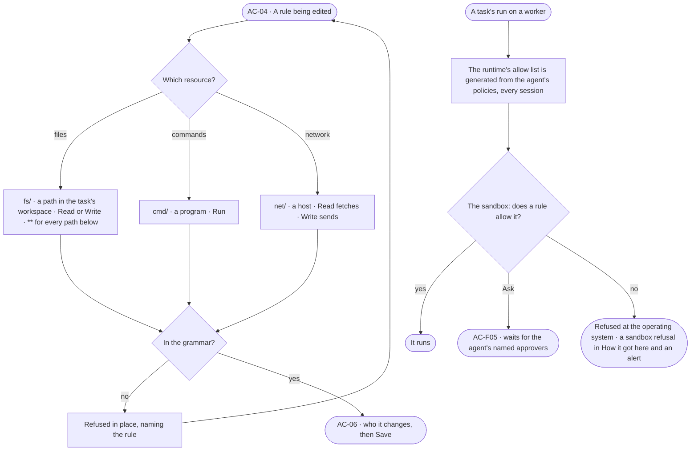

# AC-37 · Say what an agent may touch on a worker: files, commands, network

**As** an Admin **I want** an agent's Access Policies to say which files in its workspace it may read and write, which
programs it may run and which hosts it may reach **so that** an agent working on a worker — Invana's or an outside
runtime — touches only what its job needs, whatever the runtime itself would allow.

Tasks: [task.md](task.md) · Feature: [AC-F02](../../feature.md)

## Who can

| Lens | Can | Otherwise sees |
|---|---|---|
| Admin | Write `fs/` · `cmd/` · `net/` rules on a custom policy; read what each agent may touch on a worker | — |
| Operator | Read every `fs/` · `cmd/` · `net/` rule and what each agent may touch on a worker; a Modeller reads the same | *Edit* disabled — *Needs the Admin role — ask Priya or Lee* |

## Flow

## Acceptance criteria

| # | Given | When | Then |
|---|---|---|---|
| AC-37.1 | An Admin adding a rule | they pick a worker resource | `fs/<path>` takes Read or Write, a path relative to the task's workspace; `cmd/<program>` takes Run, a program by name, never its arguments; `net/<host>` takes Read — fetching from the host — or Write — sending to it |
| AC-37.2 | A rule | it reads | as a sentence — *Allow writing every file under src*, *Allow running git*, *Ask before sending to api.example.com*, *Deny reaching any host* |
| AC-37.3 | An `fs/` rule | `**` is its last segment — `fs/src/**` | it reaches every path below `src`; `**` anywhere else, or `*` inside a segment, is refused in place, naming the rule |
| AC-37.4 | An agent with no `fs/` · `cmd/` · `net/` rule | it runs on a worker | it reads, writes, runs and reaches nothing there — default deny holds on a worker as everywhere |
| AC-37.5 | An agent's run on a worker | it touches a file, runs a program or reaches a host no rule allows | the worker's sandbox refuses it at the operating system, whatever the runtime asked for; *How it got here* names the rule and its policy, and a security alert is raised ([CP-F11](../../../../../control/features/CP-F11-ops-alerting/feature.md)) |
| AC-37.6 | An outside runtime on a worker | a session starts | its own allow list is generated from the agent's Access Policies for that session and never kept by hand; a change saved to the policies reaches the next session |
| AC-37.7 | A rule that says Ask on a worker resource | the run reaches it | it waits for the agent's named approvers like any ask ([AC-F05](../../../AC-F05-asks-and-approvals/feature.md)); a yes covers this step of this run |
| AC-37.8 | A skill, a plugin or a runtime | it declares the files, programs or hosts it needs | the declaration grants nothing; *Who it changes* names each declared need no policy meets |
| AC-37.9 | An Operator | they open a policy with worker rules | they read; *Edit* is disabled, naming the Admin role and the Admins |
| AC-37.10 | A run refused on a worker | the person behind it opens *How it got here* | it shows the step, the file, program or host, and the rule that refused it |

## Screens

| Surface | Lens | First use | Empty after a filter | Loading | Has data | Failed | Agent working or proposing | No access |
|---|---|---|---|---|---|---|---|---|
| Worker rules on a policy | Admin | settings.access · No worker rules | — | settings.access · Loading | settings.access · Worker rules | settings.access · Rule refused | — | — |
| Worker rules on a policy | Operator | access.locked · No worker rules | — | access.locked · Loading | access.locked · Worker rules | access.locked · Could not load | — | access.locked · Worker rules |
