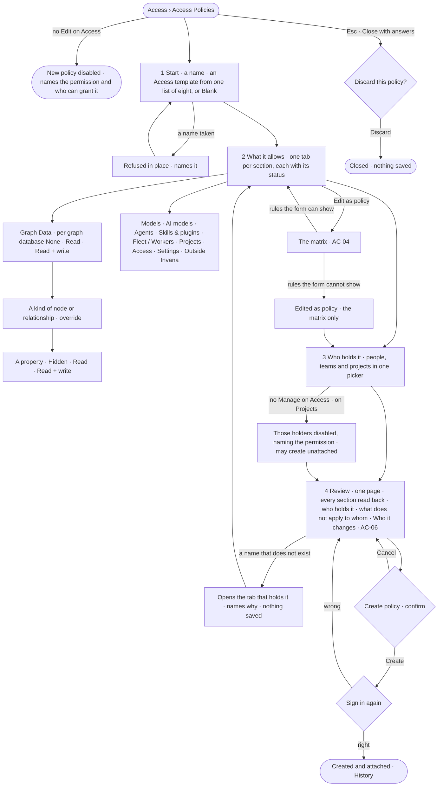

# AC-49 · Make a policy from an Access template

**As** an Admin **I want** to make one Access Policy by starting from an Access template, saying a section at a time
what it allows — down to the kinds, relationships and properties of each graph database — and giving it to people,
teams and projects in one go, **so that** each holder gets exactly the reach the work needs without my writing rules
by hand.

Tasks: [task.md](task.md) · Feature: [AC-F02](../../feature.md)

## Who can

Making a policy needs Edit on Access; giving it to people or teams, Manage on Access; giving it to a project, Manage on
Projects for it — [AC-F02 › Access](../../feature.md#access).

| Lens | Can | Otherwise sees |
|---|---|---|
| Admin | *New policy*: name it, start from an Access template or Blank, set each tab of *What it allows* or *Edit as policy*, pick who holds it — people, teams and projects in one picker — read the whole policy back in Review and *Create policy* after a confirm, signing in again | — |
| Operator | Read every template and every policy, tab by tab and as the matrix | *New policy* disabled — *Needs Edit on Access — ask Priya or Lee*; with Edit on Access but not Manage on Access, people and teams in *Who holds it* are disabled, naming the permission; a project without Manage on Projects for it, likewise; the policy is created unattached |

## Flow

## Acceptance criteria

| # | Given | When | Then |
|---|---|---|---|
| AC-49.1 | A person with Edit on Access in Access Policies | they press *New policy* | one modal opens with a step strip — *1 Start · 2 What it allows · 3 Who holds it · 4 Review* — on Start: a name, and one list of *Read only* · *Explore* · *Shape the model* · *Build agents* · *Run the deployment* · *Read and analyse* · *Fix data quality* · *Full project* and *Blank*, each with one line of what it allows; there is no choice of who the policy is for |
| AC-49.2 | Start | the name is already used | it is refused in place — *{name} is taken.* — and *Next* stays off |
| AC-49.3 | A template picked | *What it allows* opens | it shows one tab per section — **Graph Data** · **Models** · **AI models** · **Agents** · **Skills & plugins** · **Fleet / Workers** · **Projects** · **Access** · **Settings** · **Outside Invana** — every one present whatever the template, filled from it, each tab with its short status — *Read on 2 of 3 graph databases* · *Not set* ([AC-F02 › The policy form](../../feature.md#the-policy-form)) |
| AC-49.4 | The Graph Data tab | it is read | each graph database reads *None* · *Read* · *Read + write*; opening one lists its kinds of node and of relationship, each inheriting the level with an override *None* · *Read* · *Read + write*; opening a kind lists its properties, each *Hidden* · *Read* · *Read + write* with its level |
| AC-49.5 | A graph database at *Read + write*, a kind set *None*, one property *Hidden* and another *Read* | the policy is created and a holder reads and edits that graph database | the kind is absent from every picker and refused by name; the hidden property is dropped from every record of its kind and counted as withheld; the *Read* property shows and its edit is refused, naming the rule; the other kinds and properties read and change |
| AC-49.6 | A relationship kind that reads, one of whose end kinds is *None* | a holder reads it | the relationship is withheld and counted, never drawn to a missing end |
| AC-49.7 | *Hide every personal property* on a graph database | the policy is created | every property at the personal level — *Crew member · personal* — reads *Hidden*, by one Deny on `@personal` |
| AC-49.8 | The AI models tab | it is read | *Every offered version* · *Local only* · chosen versions, each named exactly and marked *Local* or *External*; *Local only* writes one rule per local endpoint, so one added later is reached once the policy is saved again; a version not chosen is absent from the agent's model picker for the holder and refused in a run |
| AC-49.9 | A tab or a rule naming a graph database, kind, property, model, AI model version, agent, skill, plugin, tool or project that does not exist | they press *Create policy* | it is refused, Review opening the tab that holds it and naming it |
| AC-49.10 | A policy whose *Outside Invana* or *Settings* is set | it is held by a project and by a person | nothing is refused: each section takes effect for the holders its resources reach, and Review reads, per holder, what does not apply — *Outside Invana does not apply to people* · *Settings does not apply to projects* |
| AC-49.11 | *Edit as policy* | it is pressed | the same policy opens as the matrix (AC-04); back in the tabs, every change shows; a rule the form cannot show turns the tabs into *Edited as policy*, the matrix the only editor |
| AC-49.12 | The Fleet / Workers tab | it is set | worker groups are rules; *Runs at once* and *Tokens a month* show as limits beside them and are saved, on *Create policy*, as each holder's limits — a user's, a team's or a project's (CP-F04) — never as rules |
| AC-49.13 | Who holds it | it opens | one picker lists people, teams and projects together, each marked by what it is, searchable; any may be picked, none needed |
| AC-49.14 | A person with Edit on Access but not Manage on Access — or without Manage on Projects for a project | they reach *Who holds it* | those holders are disabled, naming the permission and who can grant it; *Create policy* creates the policy with the holders they may give it to, or unattached |
| AC-49.15 | Review | it opens | one scrollable page reads every section in full — each tab's settings as sentences, Graph Data per graph database down to its kinds and properties — then who holds it, what does not apply to whom, and *Who it changes* for every holder that gains or loses (AC-06) |
| AC-49.16 | Review | they press *Create policy* | a confirm reads *Create {name} and give it to {n} holders?* — *Cancel* · *Create*; *Create* asks the person to sign in again, then the policy is created and attached, and History records both |
| AC-49.17 | A project that already holds other policies, picked in *Who holds it* | the policy is created | the project holds it beside them — its Allows added, any Deny winning; *Who it changes* named the project and what it gains and loses |
| AC-49.18 | A rule set to Ask, in a policy held by a person | a run behind that person, outside any project, reaches it | it is refused, naming the rule — Ask counts as Deny in a person's own permissions; Review read *Asks first counts as No for people* |
| AC-49.19 | An Operator without Edit on Access | they open Access Policies | *New policy* is disabled — *Needs Edit on Access — ask Priya or Lee*; every template and policy reads tab by tab and as the matrix |
| AC-49.20 | Answers on any step | the person presses Esc or Close | a confirm asks *Discard this policy?* — *Keep editing* · *Discard*; nothing is saved |

## Screens

| Surface | Lens | First use | Empty after a filter | Loading | Has data | Failed | Agent working or proposing | No access |
|---|---|---|---|---|---|---|---|---|
| New policy · Start | Admin | settings.policies · New · Start | — | settings.policies · New · Start · Loading templates | settings.policies · New · Start · Template picked | settings.policies · New · Start · Name taken | — | — |
| New policy · Start | Operator | — | — | — | — | — | — | settings.policies · Locked · New disabled |
| What it allows · tabs | Admin | settings.policies · New · What it allows · From template | settings.policies · New · What it allows · No kind matches | settings.policies · New · What it allows · Loading kinds | settings.policies · New · What it allows · Kinds and properties | settings.policies · New · What it allows · Could not load | — | — |
| What it allows · tabs | Operator | — | — | — | settings.policies · Locked · What it allows · Read only | — | — | settings.policies · Locked · What it allows · Read only |
| What it allows · Edited as policy | Admin | — | — | — | settings.policies · New · What it allows · Edited as policy | — | — | — |
| What it allows · Edited as policy | Operator | — | — | — | settings.policies · Locked · Edited as policy | — | — | settings.policies · Locked · Edited as policy |
| Who holds it | Admin | settings.policies · New · Who holds it · None picked | settings.policies · New · Who holds it · Nothing matches | settings.policies · New · Who holds it · Loading | settings.policies · New · Who holds it | settings.policies · New · Who holds it · Could not load | — | settings.policies · New · Who holds it · Some disabled |
| Who holds it | Operator | — | — | — | — | — | — | settings.policies · Locked · New disabled |
| Review | Admin | — | — | settings.policies · New · Review · Who it changes loading | settings.policies · New · Review | settings.policies · New · Review · Refused | — | — |
| Review · Create policy | Admin | — | — | — | settings.policies · New · Review · Confirm | — | — | — |
| Review · Create policy | Operator | — | — | — | — | — | — | settings.policies · Locked · New disabled |
| Review | Operator | — | — | — | — | — | — | settings.policies · Locked · New disabled |
