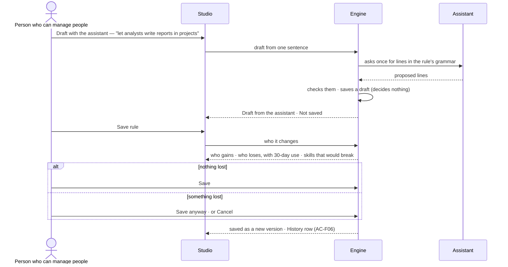

# Access rules

> Who may do what in this Graph — the access rules people, groups, agents and keys hold — read as sentences in one
> sheet, changed on purpose, and proven before anything runs. The decision it helps make: *should this person, team, agent or key be
> able to do this — and what breaks if I change it?*

## User journey

Journeys this feature is a step of: [J05 · Join a Graph someone set up](../../../../journeys/J05-join-a-graph-someone-set-up.md) · [J06 · Set what an agent may touch](../../../../journeys/J06-set-what-an-agent-may-touch.md)

## Stories

| ID | Story | Status |
|---|---|---|
| AC-03 | [Read every access rule and who holds it](stories/AC-03-read-every-access-rule-and-who-holds-it/story.md) | idea |
| AC-04 | [Say exactly what an access rule allows](stories/AC-04-say-exactly-what-an-access-rule-allows/story.md) | idea |
| AC-05 | [Set limits on an access rule](stories/AC-05-set-limits-on-an-access-rule/story.md) | idea |
| AC-06 | [Draft an access rule and see who it changes](stories/AC-06-draft-an-access-rule-and-see-who-it-changes/story.md) | idea |
| AC-07 | [Read access without the grant and know who to ask](stories/AC-07-read-access-without-the-grant-and-know-who-to-ask/story.md) | idea |
| AC-08 | [Test whether someone can do something](stories/AC-08-test-whether-someone-can-do-something/story.md) | idea |

## Access

| Act | Role (`.claude/team/TEAM.md` §7) | Everyone else sees |
|---|---|---|
| Read every access rule, its lines, limits, holders and versions | Every member in a signed-in session — no line governs it; an agent or a key reads it under a line ([Reading access is no act — for people](../../product.md#decisions)) | A key's details — its own rule, expiry, last use — read only to its holder and to someone who can manage people; anyone else sees its name and holder |
| *Can someone do this?* — test access | Operator — every member in a signed-in session; an agent or a key under a line | — |
| New rule · Edit · Delete · Draft with the assistant · Save | `iam-admin` · shown as *Can manage people* | The act is shown as *Ask Priya*, naming someone who can manage people; the tooltip names the grant |
| Set a line's value — on a custom, a built-in, a person's own or the *For everyone* rule | `iam-admin` · shown as *Can manage people*, as writing the rule; loosening needs a session, never a key; loosening a built-in or the *For everyone* rule waits for an Owner who did not make it (AC-04.20); only an Owner edits another Owner's own rule (AC-04.18) | As above |

## States

| State | What the person sees |
|---|---|
| First use | Only the six built-in rules, one per grant, each with its starting lines shown, and a rule for everyone if there is one; *New rule* and *Draft with the assistant* lead |
| Empty after a filter | *Nothing matches*, with the filter named and *Clear filters* |
| Loading | The sheet opens at once; lists show loading rows; counts read `—` until the engine gives them |
| Has data | Access rules one row each, the selected one beside them: what it allows, its limits, who holds it |
| Failed | What could not load or save, in a sentence, with *Try again*; a refused save says why in place, naming the line or the name |
| Agent working or proposing | *Draft from the assistant · Not saved*, with who it changes, before anything changes |
| No access | Every rule reads; each write is shown as *Ask Priya*, naming someone who can manage people |

## Rules

| Rule | Detail |
|---|---|
| Allowed only where every check allows | What the skill needs ∩ the holder's access rules ∩ the person who started the run ∩ the view of the graph ∩ every rule for everyone ∩ the holder's own rule — a person's, a key's or an agent's ∩ every caller along the chain. A refusal names the check and the rule (or the person) that refused |
| Nothing is allowed that no rule allows | What no line reaches with Ask or Allow is denied ([Deny by default](../../product.md#decisions)). Deny goes only on the *For everyone* rule and on a holder's own rule ([Where Deny may sit](../../product.md#decisions)). A rule for everyone is how a Graph keeps something back; the other rules a holder has still add up |
| Six kinds of access rule | *Built in* — the six grants (Operator · Can work on projects · Can build agents · Can shape the model · Owner · Can manage people), each with its starting lines shown; a line's value may be changed, the rule never deleted or renamed · *Custom* · *A person's own* — narrows one person, edited by *Can manage people* · *A key's own* — narrows one key · *An agent's own* — narrows one agent, edited from its sheet by *Can build agents*: it tightens, or loosens back no further than the Graph and never past a locked line · *For everyone* — the most anyone in the Graph may do, held without being given |
| A line | What may be done · to what · with conditions · and its value — Allow · Ask · Deny, for every holder ([one access model](../../product.md#decisions)); a new line starts at Ask. Conditions are only: some fields (only these · all but these), helper depth (at most N levels), until (an instant) |
| What it reaches | Lines group by what they reach: graph data · AI models · outside (the web, MCP tools, mail) · cache · people · agents (making helpers, handing work on) · projects · datasets |
| A draft decides nothing | A new rule is a draft until saved; a saved rule changes by saving a new version, after its impact |
| Saving shows who it changes | Who gains, who loses (with each loss's use in the last 30 days), which holders move to another value, and which skills would break — before the save |
| The tightest limit binds | Limits sit on rules; across a holder's rules the tightest wins. An agent's own settings sit under them; one above is refused when saved, naming the rule |
| Disabled, never hidden | Without *Can manage people* every write shows, shown as *Ask <name>* (design language §5); reading is every member's |
| *Ask <name>* raises an ask | Pressed, it raises a person's ask for the grant the act needs, in Needs you (AC-15) of the person named — or, when they cannot give it, of those who can; it is never decided by the asker nor whoever it benefits, and Owner and *Can manage people* only by an Owner it does not benefit. A repeat joins the open ask (AC-07.10) |
| Leans on | Asks (AC-F05) · History of every change and refusal (AC-F06) · who holds a rule (AC-F03) · what an agent may touch (AC-F04) · views of the graph (MO-F05) |

## Data touched

| Record | Read or write |
|---|---|
| Access rules — kind, lines, limits, version, who drafted it | Write · read |
| Versions of a rule — who saved it, when, why | Write · read |
| A line's value — Allow · Ask · Deny — its version, who set it, and whether it is locked | Write · read |
| Refusals in History (AC-F06) | Read |
| Usage against limits — tokens, agents at once, helpers — stored by the engine | Read |
| A change waiting for an Owner — what it changes, who made it, whom it benefits, when it takes effect on the one-Owner delay | Write · read |

## Decisions

| Decision | Detail |
|---|---|
| Access is a sheet in Settings | *Settings › People and access* opens as a sheet with tabs *Access rules · People and groups · Agents · Keys*; a rule, a group or an agent drills in and the crumb grows. It is not a product of its own |
| Access rules read as sentences | A rule's name and lines read as plain sentences (*Analysts can ask*); the exact lines are one click deeper |
| The grants are built-in rules | The six grants are the built-in rules; holding *Can build agents* is holding that rule. Their starting lines are shown and their values may be changed; the rules are never deleted or renamed, and the Owner's Allow on access changes never moves ([Someone can always decide](../../product.md#decisions)) |
| Every member reads | Reading access is never gated for a person in a signed-in session; only changing it is ([Reading access is no act — for people](../../product.md#decisions)) |
| Test access writes nothing | *Can someone do this?* runs the engine's own check without running anything; a link may carry the check and opens filled |
| Rules as files | `invana iam apply · list · show` writes and reads custom and for-everyone rules as files, printing who it changes first; the engine holds it to every rule Studio is held to ([Every permission rule is the engine's](../../product.md#decisions)) |

## Open questions

| Question | Who answers |
|---|---|

## Not building

| Item | Why not |
|---|---|
| Lines that forbid, beyond Deny | Deny goes only on the *For everyone* rule and a holder's own rule; anywhere else, precedence is where access gets unreadable |
| Conditions beyond fields, depth and until | Time windows, addresses and tags are unproven |
| Rules shared across Graphs | Everything is per Graph |
| Custom grants | A custom rule carries what a grant cannot; the six grants stay the product's words |
| Per-record permissions | What a rule reaches is the unit; a finer grain is unproven |
| Stored connections — OAuth or API keys for outside sources | Invana pulls from and pushes to no outside source yet; an MCP server's credential lives on the workers |
| Sign-in providers | Password sign-in first; single sign-on is install setup, later |
| A page of requests | An ask for access is an ask in the Inbox (AC-15) |
