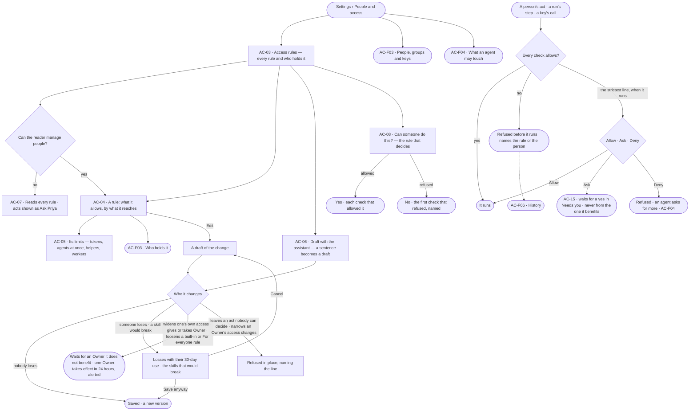
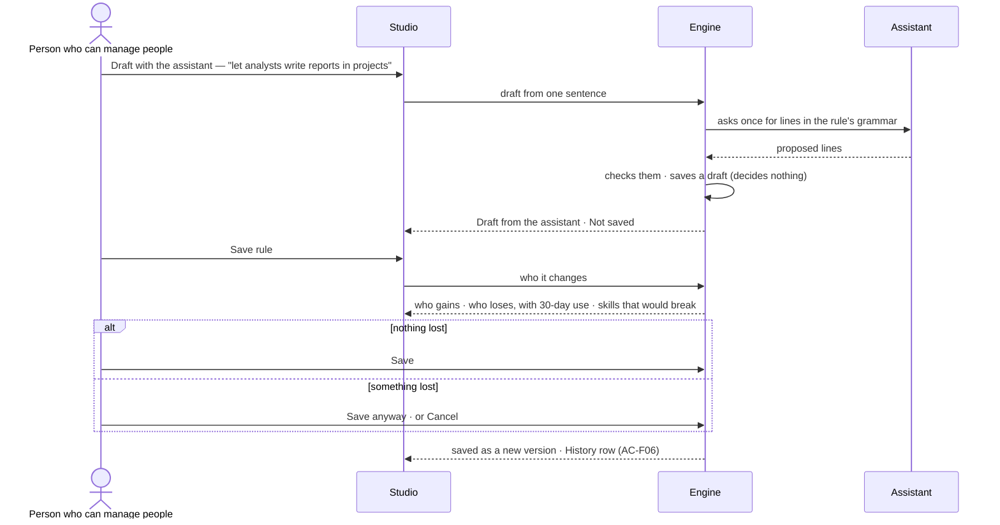

# Access rules

> Who may do what in this Graph — the access rules people, groups, agents and keys hold — read as sentences in one
> sheet, changed on purpose, and proven before anything runs. The decision it helps make: *should this person, team, agent or key be
> able to do this — and what breaks if I change it?*

## User journey

Journeys this feature is a step of: [J05 · Join a Graph someone set up](../../../../journeys/J05-join-a-graph-someone-set-up.md) · [J06 · Set what an agent may touch](../../../../journeys/J06-set-what-an-agent-may-touch.md)

## Stories

| ID | Story | Status |
|---|---|---|
| AC-03 | [Read every access rule and who holds it](stories/AC-03-read-every-access-rule-and-who-holds-it/story.md) | idea |
| AC-04 | [Say exactly what an access rule allows](stories/AC-04-say-exactly-what-an-access-rule-allows/story.md) | idea |
| AC-05 | [Set limits on an access rule](stories/AC-05-set-limits-on-an-access-rule/story.md) | idea |
| AC-06 | [Draft an access rule and see who it changes](stories/AC-06-draft-an-access-rule-and-see-who-it-changes/story.md) | idea |
| AC-07 | [Read access without the grant and know who to ask](stories/AC-07-read-access-without-the-grant-and-know-who-to-ask/story.md) | idea |
| AC-08 | [Test whether someone can do something](stories/AC-08-test-whether-someone-can-do-something/story.md) | idea |

## Access

| Act | Role (`.claude/team/TEAM.md` §7) | Everyone else sees |
|---|---|---|
| Read every access rule, its lines, limits, holders and versions | Every member in a signed-in session — no line governs it; an agent or a key reads it under a line ([Reading access is no act — for people](../../product.md#decisions)) | A key's details — its own rule, expiry, last use — read only to its holder and to someone who can manage people; anyone else sees its name and holder |
| *Can someone do this?* — test access | Operator — every member in a signed-in session; an agent or a key under a line | — |
| New rule · Edit · Delete · Draft with the assistant · Save | `iam-admin` · shown as *Can manage people* | The act is shown as *Ask Priya*, naming someone who can manage people; the tooltip names the grant |
| Set a line's value — on a custom, a built-in, a person's own or the *For everyone* rule | `iam-admin` · shown as *Can manage people*, as writing the rule; loosening needs a session, never a key; loosening a built-in or the *For everyone* rule waits for an Owner who did not make it (AC-04.20); only an Owner edits another Owner's own rule (AC-04.18) | As above |

## States

| State | What the person sees |
|---|---|
| First use | Only the six built-in rules, one per grant, each with its starting lines shown, and a rule for everyone if there is one; *New rule* and *Draft with the assistant* lead |
| Empty after a filter | *Nothing matches*, with the filter named and *Clear filters* |
| Loading | The sheet opens at once; lists show loading rows; counts read `—` until the engine gives them |
| Has data | Access rules one row each, the selected one beside them: what it allows, its limits, who holds it |
| Failed | What could not load or save, in a sentence, with *Try again*; a refused save says why in place, naming the line or the name |
| Agent working or proposing | *Draft from the assistant · Not saved*, with who it changes, before anything changes |
| No access | Every rule reads; each write is shown as *Ask Priya*, naming someone who can manage people |

## Rules

| Rule | Detail |
|---|---|
| Allowed only where every check allows | What the skill needs ∩ the holder's access rules ∩ the person who started the run ∩ the view of the graph ∩ every rule for everyone ∩ the holder's own rule — a person's, a key's or an agent's ∩ every caller along the chain. A refusal names the check and the rule (or the person) that refused |
| Nothing is allowed that no rule allows | What no line reaches with Ask or Allow is denied ([Deny by default](../../product.md#decisions)). Deny goes only on the *For everyone* rule and on a holder's own rule ([Where Deny may sit](../../product.md#decisions)). A rule for everyone is how a Graph keeps something back; the other rules a holder has still add up |
| Six kinds of access rule | *Built in* — the six grants (Operator · Can work on projects · Can build agents · Can shape the model · Owner · Can manage people), each with its starting lines shown; a line's value may be changed, the rule never deleted or renamed · *Custom* · *A person's own* — narrows one person, edited by *Can manage people* · *A key's own* — narrows one key · *An agent's own* — narrows one agent, edited from its sheet by *Can build agents*: it tightens, or loosens back no further than the Graph and never past a locked line · *For everyone* — the most anyone in the Graph may do, held without being given |
| A line | What may be done · to what · with conditions · and its value — Allow · Ask · Deny, for every holder ([one access model](../../product.md#decisions)); a new line starts at Ask. Conditions are only: some fields (only these · all but these), helper depth (at most N levels), until (an instant) |
| What it reaches | Lines group by what they reach: graph data · AI models · outside (the web, MCP tools, mail) · cache · people · agents (making helpers, handing work on) · projects |
| A draft decides nothing | A new rule is a draft until saved; a saved rule changes by saving a new version, after its impact |
| Saving shows who it changes | Who gains, who loses (with each loss's use in the last 30 days), which holders move to another value, and which skills would break — before the save |
| The tightest limit binds | Limits sit on rules; across a holder's rules the tightest wins. An agent's own settings sit under them; one above is refused when saved, naming the rule |
| Disabled, never hidden | Without *Can manage people* every write shows, shown as *Ask <name>* (design language §5); reading is every member's |
| *Ask <name>* raises an ask | Pressed, it raises a person's ask for the grant the act needs, in Needs you (AC-15) of the person named — or, when they cannot give it, of those who can; it is never decided by the asker nor whoever it benefits, and Owner and *Can manage people* only by an Owner it does not benefit. A repeat joins the open ask (AC-07.10) |
| Leans on | Asks (AC-F05) · History of every change and refusal (AC-F06) · who holds a rule (AC-F03) · what an agent may touch (AC-F04) · views of the graph — the check on what a run may see, use and send ([SE-F09 › Engine](../../../../capabilities/semantics/features/SE-F09-views-of-the-graph/feature.md#engine)) · act rules a statement blocks, warns on or reports ([SE-F07 › Engine](../../../../capabilities/semantics/features/SE-F07-rules/feature.md#engine)) |

## Data touched

| Record | Read or write |
|---|---|
| Access rules — kind, lines, limits, version, who drafted it | Write · read |
| Versions of a rule — who saved it, when, why | Write · read |
| A line's value — Allow · Ask · Deny — its version, who set it, and whether it is locked | Write · read |
| Refusals in History (AC-F06) | Read |
| Usage against limits — tokens, agents at once, helpers — stored by the engine | Read |
| A change waiting for an Owner — what it changes, who made it, whom it benefits, when it takes effect on the one-Owner delay | Write · read |

## Engine

The low-level design: what this feature stores, serves and refuses. Conventions — naming, errors, lists, events — are
[system-design.md](../../../../system-design.md) §§ 6–8; this section only fills them in.

### Records

| Table | Columns | Notes |
|---|---|---|
| `access_rules` | `graph_id` · `name` (`[a-z0-9-]`) · `kind` (`managed` · `custom` · `person` · `agent` · `inline` · `boundary`) · `holder_kind?` · `holder_id?` · `status` (`draft` · `saved`) · `description` · `statements` · `limits` · `version` (a draft is 0) · `owner_id?` · `drafted_by` (`person` · `assistant`) · `created_by_id?` · `updated_by_id?` · `created_at` · `updated_at` | Unique (`graph_id`, `name`). `managed` is a built-in rule · `person` · `agent` · `inline` are a person's, an agent's and a key's own rule, one per holder, named by `holder_kind` and `holder_id` · `boundary` is *For everyone* |
| `access_rule_versions` | `rule_id` · `version` · `statements` · `limits` · `description` · `saved_by_id?` · `saved_at` · `why?` (500) | One row per save; never edited |
| `access_pending_changes` | `graph_id` · `kind` (`rule_save` · `holding` · `grant` · `group_member` · `unlock` · `agent_operated_clear`) · `change` (the change, frozen) · `hash` · `made_by_id` · `benefits[]` · `approval_id?` · `takes_effect_at?` · `status` (`waiting` · `applied` · `cancelled` · `declined`) · `created_at` · `decided_at?` | A change that waits for an Owner. `approval_id` when another Owner may decide it ([AC-F05](../AC-F05-asks-and-approvals/feature.md#engine)); `takes_effect_at` on the one-Owner delay |

### Reads

| Record | Owner |
|---|---|
| Who holds a rule — people, groups, agents, keys — and a group's members | [AC-F03](../AC-F03-groups-keys-and-holders/feature.md#engine) |
| The check a run's step passes, and an agent's effective access | [AC-F04](../AC-F04-what-an-agent-may-touch/feature.md#engine) |
| Asks — a pending change waiting for an Owner, an *Ask <name>* | [AC-F05](../AC-F05-asks-and-approvals/feature.md#engine) |
| History — refusals over 30 days for impact, every event this feature writes | [AC-F06](../AC-F06-history/feature.md#engine) |
| A session's `signed_in_at` — the fresh sign-in | [AC-F01](../AC-F01-sign-in-account-and-sessions/feature.md#engine) |
| Members and the roles each holds | [GR-F04](../../../graph/features/GR-F04-this-graph/feature.md#engine) |
| Views of the graph — the check on what a run may see, use and send | [SE-F09](../../../../capabilities/semantics/features/SE-F09-views-of-the-graph/feature.md#engine) |
| Agents, their own settings and the skills bound to them — what a save would break | [AG-F01](../../../../capabilities/agents/features/AG-F01-build-an-agent/feature.md#engine) · [AG-F04](../../../../capabilities/agents/features/AG-F04-skills/feature.md#engine) |
| Runs and their tokens — used now against a limit | [AG-F03](../../../../capabilities/agents/features/AG-F03-runs-and-how-the-agents-are-doing/feature.md#engine) |
| Worker-seconds and pools a run used | [RT-F03](../../../runtime/features/RT-F03-workers-and-the-queue/feature.md#engine) |

### Routes

| Route, after `/api/v1/u/{u}/{g}/access` | Does | Story |
|---|---|---|
| `GET /overview` | The sheet's counts: `people` · `service_accounts` · `groups` · `agents` · `rules {managed, custom, person, agent, inline, boundary}` · `tokens_live` · `tokens_expiring_week` | AC-03 |
| `GET /rules` · `POST /rules` | List rules by the list contract (`?kind=` · `?q=`) · create a custom or *For everyone* rule as a draft | AC-03 · AC-04 |
| `POST /rules/drafts` | One sentence → a draft from the Graph's AI model, `drafted_by = assistant` | AC-06 |
| `GET /rules/{name}` · `PATCH /rules/{name}` · `DELETE /rules/{name}` | Read a rule · edit a draft, or a saved rule's draft of its next version (`why?`) · delete a custom or *For everyone* rule, its holders listed first | AC-04 |
| `POST /rules/{name}/impact` | Who it changes: per holder — people, agents, the members of holding groups — each act gained or lost with its use over 30 days, each value that moves, every bound skill that would break, and the version a save writes | AC-06 |
| `POST /rules/{name}/save` | Save as a new version (`why?`) — or, when the change waits for an Owner, a `access_pending_changes` row (`202`) | AC-04 · AC-06 |
| `GET /rules/{name}/versions` | Every version: who saved it, when, why, its line and limit counts | AC-04 |
| `GET /rules/{name}/limits` | Each limit: ceiling · used now · per | AC-05 |
| `POST /test` | *Can someone do this?* — who · started by · does · to (`· field`) · view of the graph; every check's verdict and the first that refuses. Writes nothing | AC-08 |
| `GET /pending-changes` · `POST /pending-changes/{id}/cancel` | Changes waiting for an Owner · the Owner cancels one on the one-Owner delay | AC-04 · AC-11 |

### Events

| Event | When |
|---|---|
| `access.rules.create` · `access.rules.update` · `access.rules.delete` | A rule is drafted · a draft changes · a rule is deleted |
| `access.rules.save` | A version is saved — `why` in `details` |
| `access.pending_changes.create` · `access.pending_changes.apply` · `access.pending_changes.cancel` | A change waits for an Owner · takes effect · is cancelled or declined |

### Refusals

| Status | When | Sentence | Criterion |
|---|---|---|---|
| 422 | A line outside the grammar — an unknown reach, nothing to do, a condition other than fields · depth · until | *Line {n}: {why}.* | AC-04.3 |
| 422 | The assistant's reply has a line outside the grammar — nothing is saved | *The assistant proposed a line Invana cannot read: {line}.* | AC-06.2 |
| 409 | A rule name already used in the Graph | *{name} is taken in this graph.* | AC-04.5 |
| 422 | Renaming or deleting a built-in rule, or editing a key's own rule | *{rule} is built in — its lines' values change, never the rule.* · *A key's own rule changes only by minting a new key.* | AC-04.6 · AC-04.7 |
| 422 | Deny on a rule that is not *For everyone* or a holder's own | *Deny goes only on For everyone or a holder's own rule.* | AC-04.13 |
| 422 | A line that makes an Owner's access changes Ask or Deny | *An Owner always decides access changes.* | AC-04.18 |
| 403 | Someone who is not an Owner edits an Owner's own rule | *Only an Owner edits an Owner's own rule.* | AC-04.18 |
| 422 | A change that leaves an act nobody can decide | *Nobody could decide {act} after this.* | AC-04.19 |
| 403 | A key loosens a line, edits *For everyone*, or makes any change that widens a holder | *This needs a person's session, not a key.* | AC-04.16 |
| 422 | A rule file naming a built-in or a key's own rule | *{name} is not a rule a file writes.* | AC-04.23 |
| 422 | An agent's own setting above a ceiling of a rule it holds — on the agent's save ([AG-F01](../../../../capabilities/agents/features/AG-F01-build-an-agent/feature.md#engine)) | *{rule} caps {limit} at {ceiling}.* | AC-05.4 |
| 409 | A run would start with its holder at a rule's tokens-a-month ceiling, and the rule may not ask for more | *{rule} caps tokens a month at {ceiling}.* | AC-05.5 |
| 409 | Cancelling a pending change that is not waiting | *This change is {status}.* | API only — Studio offers *Cancel* only while it waits |

### CLI

| Command | Does |
|---|---|
| `invana iam apply --file <yaml> [--why]` | Creates a custom or *For everyone* rule or saves its next version, printing who it changes first; held to every refusal above |
| `invana iam list` · `invana iam show <name>` | Every rule with its kind, whether saved, what it allows and who holds it · one rule with its lines, limits and versions |

### Mechanisms

| Mechanism | How |
|---|---|
| A line | `{value: allow · ask · deny, actions: [glob], resources: [glob], conditions: {fields?: {only? \| except?: [name]}, depth?: {max}, until?: instant}, locked?, set_by_id, set_at}`. A new line's value is `ask` |
| A resource | The layer first: `graph/<Kind>/<key>[·field]` · `sensitivity/<public · internal · confidential · personal>` · `llm/<provider>/<model>` · `connector/<name>` · `plugin/<name>` · `skill/<name>` · `third_party/web/<host>` · `third_party/mcp/<server>/<tool>` · `third_party/mail/*` · `cache/*` · `human/*` · `agent/<name>` · `project/<key>` · `access/*` |
| Matching | A glob's `*` matches any run of characters, dots and slashes included; `llm.call` matches every function whose bound is `llm`. A function whose bound is `none` needs no line |
| One evaluator | `allows(statements, action, resource, bound, field, depth, now)` answers the value of the strictest line that matches — Deny over Ask over Allow — or Deny when none does. The step check, test access, impact and a narrowed key all call it |
| Holdings | `policies_for(graph, principal)` — saved rules held directly, through groups, by an unexpired holding and, for a person, as the built-in rules of their roles; a draft is skipped by every check |
| Built-in rules | One `managed` rule per role, written from the code when a Graph is made and on every start; a start adds missing starting lines and never overwrites a value a person set. Starting values are [Access › Starting lines are shown](../../product.md#decisions) |
| Built-in actions | `operator` — `graph.read.*` · `graph.stitch.preview` on `graph/*` · `llm.call` on `llm/*` · `web.*` · `science.*` · `mail.read` on `third_party/*` · `contributor` — `work.*` on `agent/*` and `project/*` · `graph.write.edits` on `graph/*` · `builder` — `work.spawn_agent` · `work.delegate` on `agent/*` · `modeller` — `graph.write.*` · `graph.stitch.*` · `model.*` · `data.*` on `graph/*` · `owner` — `*` on `*` · `iam-admin` — `access.*` on `access/*` |
| Draft, then save | A draft decides nothing and may already be held by the holders it is meant for. Saving bumps `version`, writes `access_rule_versions` and takes effect on the next check; a saved rule changes only by saving its next version |
| Impact | Computed from the draft against the saved version: per holder, the acts gained and lost with each loss's uses in History over 30 days, each value that moves, and every skill bound to a holding agent whose needs a loss removes |
| Draft with the assistant | One sentence; the Graph's AI model is asked once for lines; each is validated against the grammar and the draft is saved as `drafted_by = assistant`, or nothing is saved |
| Rules as files | YAML — `name` · `kind` (`custom` · `boundary`) · `description` · `statements` · `limits`. Applied through the same save as Studio's |
| Limits | `{tokens_month?, tokens_run?, live_agents?, descendants?, depth?, worker_seconds_hour?, pools?, may_ask_more?}` on a rule; across a holder's rules the tightest binds; a run's budget and ceilings are the smaller of the agent's and its rules' |
| Used now | Counted by the engine from settled and running runs: `tokens_month` since the 1st · `tokens_run` the 95th percentile (nearest rank) of a run's tokens over 30 days · `live_agents` the live runs · `descendants` the largest live tree, with its run. Worker-seconds and pools are metered by workers |
| Test access | Runs the one evaluator for who · started by · view of the graph, through every check a step passes, and writes nothing. A link carrying the check opens it filled: `?dialog=test&who=<kind>:<id>&by=<user id>&does=<action>&to=<resource>&world=<id>` |
| A change that waits for an Owner | Loosening a built-in rule or *For everyone*, and a change that gives or takes Owner or *Can manage people*, or widens its maker, is written as an `access_pending_changes` row with its hash. With another Owner it does not benefit, an `access` ask goes to them; with one Owner, `takes_effect_at` is now plus 24 hours, every Owner is alerted, and the clock applies it unless cancelled. Applying re-checks the hash |
| Every path alike | Studio, the API, keys and `invana iam apply` call the same save; the key refusals and the fresh sign-in ([AC-F01](../AC-F01-sign-in-account-and-sessions/feature.md#engine)) apply on every path |
| An Owner's access change is told | Every access change an Owner makes or allows writes its History row and an Inbox row to every other Owner |

## System impact

| HLD section | Change | NFRs |
|---|---|---|
| § 6 Data and storage | Three tables in Invana's own store | — |
| § 8 APIs and events | The routes and `access.rules.*` · `access.pending_changes.*` events above | — |
| § 10 AI and agents | Drafting a rule asks the Graph's AI model once; nothing it proposes is saved unvalidated or decides anything | — |
| § 12 Qualities | Security: deny by default, one evaluator on every path, the strictest value wins, loosening for the whole Graph needs a second Owner or a 24-hour delay | — |

## Decisions

| Decision | Detail |
|---|---|
| Access is a sheet in Settings | *Settings › People and access* opens as a sheet with tabs *Access rules · People and groups · Agents · Keys*; a rule, a group or an agent drills in and the crumb grows. It is not a product of its own |
| Access rules read as sentences | A rule's name and lines read as plain sentences (*Analysts can ask*); the exact lines are one click deeper |
| The grants are built-in rules | The six grants are the built-in rules; holding *Can build agents* is holding that rule. Their starting lines are shown and their values may be changed; the rules are never deleted or renamed, and the Owner's Allow on access changes never moves ([Someone can always decide](../../product.md#decisions)) |
| Every member reads | Reading access is never gated for a person in a signed-in session; only changing it is ([Reading access is no act — for people](../../product.md#decisions)) |
| Test access writes nothing | *Can someone do this?* runs the engine's own check without running anything; a link may carry the check and opens filled |
| Rules as files | `invana iam apply · list · show` writes and reads custom and for-everyone rules as files, printing who it changes first; the engine holds it to every rule Studio is held to ([Every permission rule is the engine's](../../product.md#decisions)) |

## Open questions

| Question | Who answers |
|---|---|

## Not building

| Item | Why not |
|---|---|
| Lines that forbid, beyond Deny | Deny goes only on the *For everyone* rule and a holder's own rule; anywhere else, precedence is where access gets unreadable |
| Conditions beyond fields, depth and until | Time windows, addresses and tags are unproven |
| Rules shared across Graphs | Everything is per Graph |
| Custom grants | A custom rule carries what a grant cannot; the six grants stay the product's words |
| Per-record permissions | What a rule reaches is the unit; a finer grain is unproven |
| Stored connections — OAuth or API keys for outside sources | Invana pulls from and pushes to no outside source yet; an MCP server's credential lives on the workers |
| Sign-in providers | Password sign-in first; single sign-on is install setup, later |
| A page of requests | An ask for access is an ask in the Inbox (AC-15) |
| Signed grants to remote workers | A worker holds no access; every step is checked against its holder's rules before it is handed out (AC-F04) |
| A second policy grammar of principals and verbs | One grammar: a line is functions on resources with a value; the strictest value wins |
