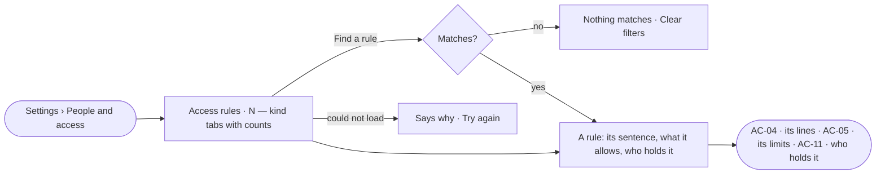

# AC-03 · Read every access rule and who holds it

**As** the owner of a Graph **I want** one list of every access rule — built in, custom, a key's own and for everyone —
with who holds each **so that** I read who may do what in one place instead of piecing it together.

Tasks: [task.md](task.md) · Feature: [AC-F02](../../feature.md)

## Who can

| Lens | Can | Otherwise sees |
|---|---|---|
| Admin | Read every rule; *New rule* and *Draft with the assistant* | — |
| Operator | Read every rule and who holds it | *New rule* and *Draft with the assistant* shown as *Ask Priya*, naming someone who can manage people |

## Flow

## Acceptance criteria

| # | Given | When | Then |
|---|---|---|---|
| AC-03.1 | A Graph | a member opens *People and access* | it opens as a sheet over the work, on *Access rules*, with tabs *Access rules · People and groups · Agents · Keys* |
| AC-03.2 | A Graph's rules | the list is read | one row per rule — its name as a sentence, its kind, what it allows in a line, how many hold it, when it changed; a built-in rule has no *changed* |
| AC-03.3 | The list | it is filtered by kind | tabs *All · Built in · Custom · A key's own · For everyone* each carry the engine's count |
| AC-03.4 | The list | the reader types in *Find a rule* | only matching rules show; with none, *Nothing matches* and *Clear filters* |
| AC-03.5 | A Graph with no custom rule | the list is read | the six built-in rules show, and any rule for everyone; *New rule* leads |
| AC-03.6 | A rule for everyone | its row is read | *What it allows* says what it keeps back (*No agent sends email without asking*) |
| AC-03.7 | Any rule's row | it is read | *Who holds it* names its holders' avatars and names — groups, then agents, then people; helpers an agent makes are not counted |
| AC-03.8 | A Graph whose rules fit one page | the list is read | built in, then custom, then a key's own, then for everyone, each by name |
| AC-03.9 | An Operator | they open the list | every rule reads; *New rule* and *Draft with the assistant* are shown as *Ask Priya*, naming someone who can manage people |
| AC-03.10 | The list cannot load | the sheet opens | it says why, with *Try again* |
| AC-03.11 | The sheet open on a rule | the page reloads | the same tab and rule open again, from the URL |

## Screens

| Surface | Lens | First use | Empty after a filter | Loading | Has data | Failed | Agent working or proposing | No access |
|---|---|---|---|---|---|---|---|---|
| Access rules — the list | Admin | settings.access · Built in only | settings.access · Nothing matches | settings.access · Loading | settings.access | settings.access · Could not load | — | — |
| Access rules — the list | Operator | shell.locked · Built in only | shell.locked · Nothing matches | shell.locked · Loading | shell.locked | shell.locked · Could not load | — | shell.locked |
