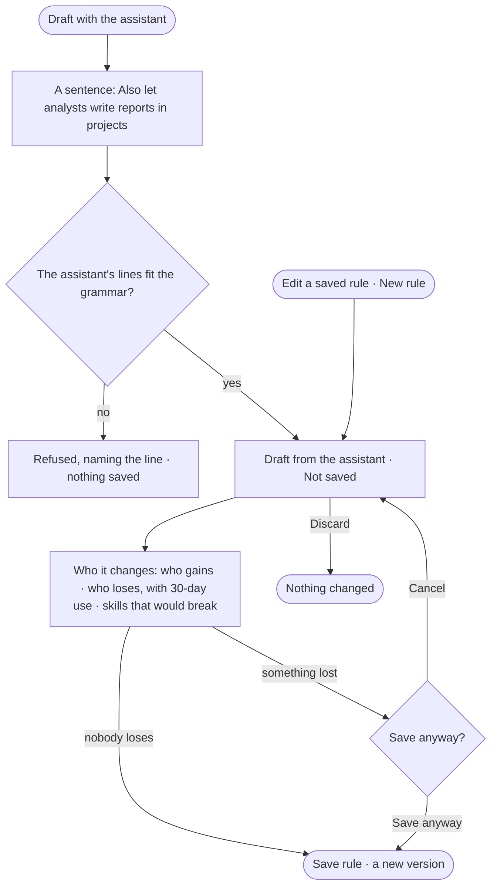

# AC-06 · Draft an access rule and see who it changes

**As** someone who can manage people **I want** the assistant to draft an access rule from a sentence, and to see who
gains, who loses and what would break before I save **so that** I never break an agent by accident — the assistant
proposes the rule, and I decide whether it is saved.

Tasks: [task.md](task.md) · Feature: [AC-F02](../../feature.md)

## Who can

| Lens | Can | Otherwise sees |
|---|---|---|
| Admin | Draft with the assistant; save, save anyway, cancel or discard | — |
| Operator | — | *Draft with the assistant* and *Save rule* shown as *Ask Priya*, naming someone who can manage people |

## Flow

## Acceptance criteria

| # | Given | When | Then |
|---|---|---|---|
| AC-06.1 | Someone who can manage people | they give *Draft with the assistant* a sentence | a draft rule appears, marked *Draft from the assistant · Not saved*, named from the sentence |
| AC-06.2 | The assistant's reply | a line falls outside the rule grammar | nothing is saved; it says which line was refused |
| AC-06.3 | A draft | any access is checked | it decides nothing until saved |
| AC-06.4 | A draft, or an edit of a saved rule | *Save rule* is pressed | *Who it changes* shows first: each holder (people, agents, and the people and agents of holding groups) and what they gain or lose |
| AC-06.5 | A change that removes access a holder used | *Who it changes* is read | each loss names what it reached and how often it was used in the last 30 days |
| AC-06.6 | A change that a bound skill needs | *Who it changes* is read | each skill that would break is named, with its version and its agent |
| AC-06.7 | *Who it changes* | the person presses *Save anyway* | it saves as the version it names, and takes effect on the next check |
| AC-06.8 | *Who it changes* | the person presses *Cancel* | nothing changes; the draft stays |
| AC-06.9 | A draft | the person presses *Discard* | it is gone; nothing changed |
| AC-06.10 | A draft meant for some holders | it is attached to them before saving | who it changes is drawn against them; their holding takes effect when it is saved |
| AC-06.11 | A saved change | History is read | it shows who saved it, when and why (AC-F06) |
| AC-06.12 | A draft from the assistant | the person opens *How it got here* | it shows the sentence, the lines the assistant proposed, and the checks they passed |
| AC-06.13 | An Operator | they open a draft or the sheet | *Draft with the assistant* and *Save rule* are shown as *Ask Priya* |
| AC-06.14 | A change to a line's mode | *Who it changes* is read | each holder — person, agent or key — whose value moves is named, with the item, its mode before and after, and how often it used it in the last 30 days |

## Screens

| Surface | Lens | First use | Empty after a filter | Loading | Has data | Failed | Agent working or proposing | No access |
|---|---|---|---|---|---|---|---|---|
| A draft rule | Admin | settings.access · Draft with the assistant | — | settings.access · Drafting | settings.access · Draft | settings.access · Line refused | settings.access · Draft from the assistant | — |
| A draft rule | Operator | — | — | — | access.locked | — | — | access.locked |
| Who it changes | Admin | — | — | settings.access · Working out who it changes | settings.access · Nobody loses | settings.access · Skills that would break | — | — |
| Who it changes | Operator | — | — | — | — | — | — | access.locked |
