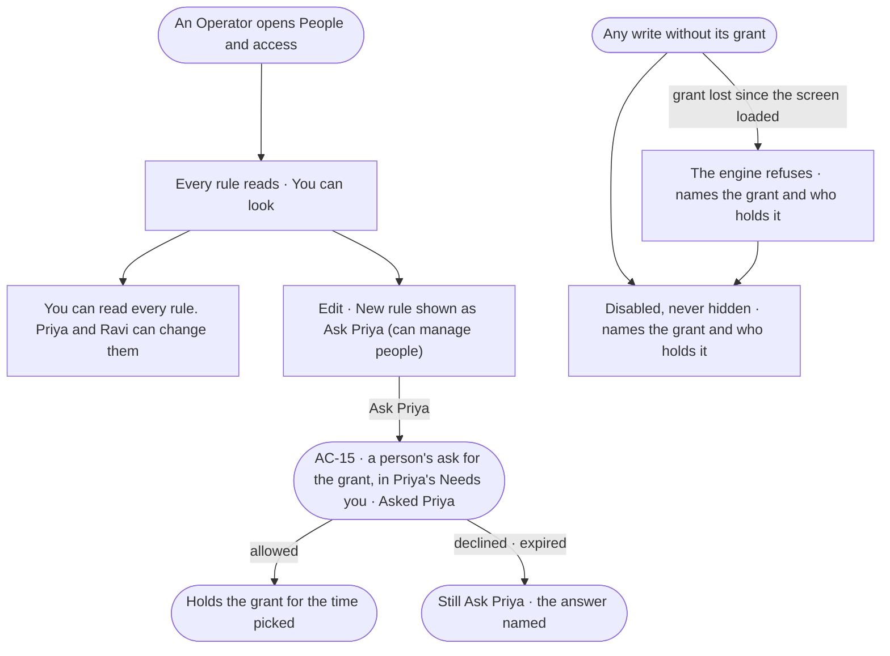

# AC-07 · Read access without the grant and know who to ask

**As** a member who cannot manage people **I want** to read every access rule and see who can change it, and every
refused act to name what it needs and who holds it **so that** I know who to ask instead of hitting a dead end.

Tasks: [task.md](task.md) · Feature: [AC-F02](../../feature.md)

## Who can

| Lens | Can | Otherwise sees |
|---|---|---|
| Admin | Every act; this story is what the others see | — |
| Operator | Read every rule, person, group, agent and limit | Each write shown as *Ask Priya*, naming someone who holds the grant; a line *You can read every rule. Priya and Ravi can change them* |

## Flow

## Acceptance criteria

| # | Given | When | Then |
|---|---|---|---|
| AC-07.1 | An Operator | they open *People and access* | every rule, its lines, limits and holders read; a chip says *You can look* |
| AC-07.2 | An Operator | the sheet is read | one line names who can change rules — *You can read every rule. Priya and Ravi can change them* |
| AC-07.3 | Any act whose grant the reader lacks, anywhere in Studio | it is drawn | it is disabled, never hidden; its tooltip and accessible description name the grant and who holds it — *Needs Can manage people — ask Priya* |
| AC-07.4 | The holders named | the reader is one of them, or there are more than three | the reader is left out; past three it reads *Priya, Ravi or 3 others* |
| AC-07.5 | A write whose grant was taken away after the screen loaded | it is tried | the engine refuses it, naming the grant and who holds it, and the act turns disabled |
| AC-07.6 | Studio has not yet learned the reader's grants, or could not | an act is drawn | it is enabled; the engine still checks every write and its refusal names the grant |
| AC-07.7 | An Operator | they search, filter or open any rule, person, group or agent | it works as it does for someone who can manage people; only the writes differ |
| AC-07.8 | A detail surface whose main act the reader cannot do — a skill, an agent, a model, a project | it opens | one line says *You can read this skill. Editing needs Can build agents — ask Ravi* |
| AC-07.9 | An install Admin who is not a member of the Graph | they open its access | they are refused like any non-member — being Admin opens no Graph |
| AC-07.10 | A member who lacks the grant an act needs | they press *Ask Priya* | one person's ask for that grant appears in Needs you (AC-15) — Priya's when she may give it, else of those who may; never decided by the asker nor whoever it benefits, and Owner or *Can manage people* only by an Owner it does not benefit; the act reads *Asked Priya*, and pressing again joins the open ask; allowed, the reader holds the grant for the time picked |

## Screens

| Surface | Lens | First use | Empty after a filter | Loading | Has data | Failed | Agent working or proposing | No access |
|---|---|---|---|---|---|---|---|---|
| People and access, read only | Admin | — | — | — | — | — | — | — |
| People and access, read only | Operator | access.locked · Built in only | access.locked · Nothing matches | access.locked · Loading | access.locked | access.locked · Grant lost | — | access.locked |
| *Ask Priya*, pressed | Admin | — | — | — | — | — | — | — |
| *Ask Priya*, pressed | Operator | — | — | — | access.locked · Asked | — | — | — |
