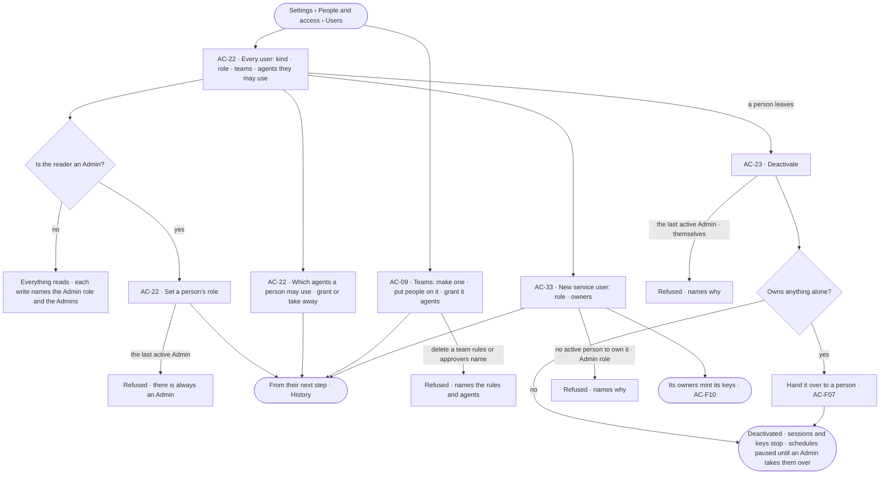

# Directory

> Every user of the deployment — people, agents, service users and the system user — each person's one role, the flat
> teams people are on, which agents each person may use, and deactivating a person who leaves.
> The decision it helps make: *who is in this deployment, with which role, on which teams — and which agents may they
> use?*

## User journey

Journeys this feature is a step of: [J05 · Join a team](../../../../journeys/J05-join-a-team.md) ·
[J07 · Ready a deployment](../../../../journeys/J07-ready-a-deployment.md)

## Stories

| ID | Story | Status |
|---|---|---|
| AC-22 | [See every user and set a person's role](stories/AC-22-see-every-user-and-set-a-persons-role/story.md) | idea |
| AC-33 | [Make a service user for automation](stories/AC-33-make-a-service-user-for-automation/story.md) | idea |
| AC-09 | [Make teams and put people on them](stories/AC-09-make-teams-and-put-people-on-them/story.md) | idea |
| AC-23 | [Deactivate a person who leaves](stories/AC-23-deactivate-a-person-who-leaves/story.md) | idea |

## Access

| Act | Role ([the role table](../AC-F02-access-policies/feature.md#the-role-table)) | Everyone else sees |
|---|---|---|
| Read every user, their kind, role, teams and the agents they may use · every team and its people | Every signed-in person — Operator, Modeller, Admin | — |
| Set a person's role · grant an agent to a person or a team, or take it away | Admin, in a session, with the password again | Disabled — *Needs the Admin role — ask Priya or Lee* |
| New team · rename · describe · delete · add or remove a person | Admin, in a session | As above |
| Deactivate · reactivate a person or a service user · hand over what they own alone | Admin, in a session, with the password again | As above |
| Make a service user | Admin, in a session, with the password again | As above |
| Mint and revoke a service user's keys · add its co-owners | Its owners ([AC-F10](../AC-F10-keys/feature.md) · [AC-F07](../AC-F07-ownership/feature.md)) | — |

## States

| State | What the person sees |
|---|---|
| First use | Users: the first Admin, the system user and the built-in agents. Teams: *No teams yet — a rule can hold for one team* with *New team* |
| Empty after a filter | *Nothing matches*, with the filter named and *Clear filters* |
| Loading | The sheet opens at once; lists show loading rows; counts read `—` until the engine gives them |
| Has data | Users one row each, by kind; teams one row each; the selected one beside them |
| Failed | What could not load or save, in a sentence, with *Try again*; a refused save says why in place, naming the person, the team or the rule |
| Agent working or proposing | — no agent changes the Directory |
| No access | Everything reads; each write is disabled, naming the Admin role and the Admins |

## Rules

| Rule | Detail |
|---|---|
| Four kinds of user | **Person** — signs in, holds one role · **Agent** — acts only through the Access Policies attached to it, holds no role · **Service user** — a user for automation, owned by people, never signs in, acts only through keys ([AC-F10](../AC-F10-keys/feature.md)), Operator or Modeller · **System** — the one system user, owns what Invana ships, never signs in, holds no role |
| One role each | A person and a service user hold exactly one role — Operator · Modeller · Admin — read against [the role table](../AC-F02-access-policies/feature.md#the-role-table). A new person or service user is an Operator unless the Admin who makes them says otherwise; a service user is never an Admin |
| A service user is owned, and owns nothing | At least one active person owns it ([AC-F07](../AC-F07-ownership/feature.md)); its owners mint its keys. What a run it is behind makes is owned by its owners |
| Which agents a person may use | An agent is granted to a person or to a team; a person may use the agents granted to them and to every team they are on. A built-in agent starts granted to every person whose role holds the feature it acts for ([AC-F02](../AC-F02-access-policies/feature.md#decisions)) |
| Teams are flat and own nothing | A team is a list of people and service users. No team is on another team; a team owns no resource, holds no policy and is never an agent's caller. A rule may name a team ([AC-21](../AC-F02-access-policies/stories/AC-21-hold-a-rule-for-one-team/story.md)), an agent may be granted to one, and a team may be an agent's named approvers ([AC-26](../AC-F05-asks-and-approvals/stories/AC-26-name-who-answers-an-agents-asks/story.md)) |
| There is always an Admin | The last active Admin cannot lose the role or be deactivated |
| Deactivating keeps the work | A deactivated user signs in to nothing and their keys and sessions stop; their work, authorship and History stay. What they own alone is handed over first ([AC-F07](../AC-F07-ownership/feature.md)); their schedules pause until an Admin takes them over |
| Changes take effect at the next step | A role, a team, a grant or a deactivation is read at each step's check, so a run already going meets it at its next step |
| Leans on | Accounts and sign-in (AC-F01) · keys (AC-F10) · Access Policies and the role table (AC-F02) · named approvers (AC-F05) · History (AC-F06) · Ownership (AC-F07) · agents (AG-F01) · schedules (AG-F07) |

## Data touched

| Record | Read or write |
|---|---|
| Users — kind, role, active or deactivated, who deactivated them and when | Write · read |
| Teams and the people on them | Write · read |
| Grants — which agents each person and each team may use | Write · read |
| Owners of what a leaver owns (AC-F07) | Write, through hand-over |
| Owners of a service user (AC-F07) | Write, when it is made |

## Engine

The low-level design: what this feature stores, serves and refuses. Conventions — naming, errors, lists, events — are
[system-design.md](../../../../system-design.md) §§ 6–8; this section only fills them in.

### Records

| Table | Columns | Notes |
|---|---|---|
| `access_users` — the Directory's columns | `kind` (`person` · `agent` · `service` · `system`) · `role?` (`operator` · `modeller` · `admin`; `operator` · `modeller` for a service user; none for an agent and the system user) · `agent_id?` (an agent user's agent) · `description?` (a service user's) · `is_active` · `deactivated_at?` · `deactivated_by_id?` | The account and sign-in columns are [AC-F01](../AC-F01-sign-in-account-and-sessions/feature.md#engine)'s; only a person has an email and a password. One `system` row, written at start |
| `access_teams` | `name` (`[a-z0-9-]`, unique) · `title` · `description` · `created_by_id` · `created_at` · `updated_at` | No team holds another |
| `access_team_members` | `team_id` · `user_id` (a person or a service user) · `added_by_id` · `added_at` | Unique (`team_id`, `user_id`) |
| `access_agent_grants` | `agent_id` · `grantee_kind` (`user` · `team`) · `grantee_id` · `origin` (`role` · `admin`) · `granted_by_id?` · `granted_at` | Unique (`agent_id`, `grantee_kind`, `grantee_id`). `origin = role` for a built-in agent's starting grant |

### Reads

| Record | Owner |
|---|---|
| Accounts, passwords, sessions and signing in again | [AC-F01](../AC-F01-sign-in-account-and-sessions/feature.md#engine) |
| Keys — a service user's only credential | [AC-F10](../AC-F10-keys/feature.md#engine) |
| The role table, Access Policies, rules that name a team, and the one evaluator | [AC-F02](../AC-F02-access-policies/feature.md#engine) |
| Named approvers that name a team or a person | [AC-F05](../AC-F05-asks-and-approvals/feature.md#engine) |
| History — every event this feature writes | [AC-F06](../AC-F06-history/feature.md#engine) |
| Owners — what a user owns, alone or with others, and hand-over | [AC-F07](../AC-F07-ownership/feature.md#engine) |
| Agents and the built-in agents | [AG-F01](../../../../capabilities/agents/features/AG-F01-build-an-agent/feature.md#engine) |
| Schedules a deactivated person created — paused, taken over | [AG-F07](../../../../capabilities/agents/features/AG-F07-schedules/feature.md#engine) |

### Routes

| Route, after `/api/v1/access` | Does | Story |
|---|---|---|
| `GET /users` | Every user by the list contract (`?kind=` · `?role=` · `?team=` · `?active=` · `?q=` on name, username or email): `username` · `name` · `kind` · `role?` · `teams[]` · `agents_count` · `is_active` · `last_signed_in_at?`; the tab counts are the engine's | AC-22 |
| `POST /service-users` | Make a service user `{username, name, description?, role?, owners[], password}` — `role` is `operator` unless `modeller` | AC-33 |
| `GET /users/{username}` · `PATCH /users/{username}` | One user with their teams, the agents they may use and how (`direct` · a team), and what they own (AC-F07) · set `role`; needs the password again | AC-22 |
| `POST /users/{username}/deactivate` · `POST /users/{username}/reactivate` | Deactivate — `{hand_over_to?}`, the person who receives what they own alone; needs the password again · reactivate | AC-23 |
| `GET /teams` · `POST /teams` | Teams: `name` · `title` · `people_count` · `rules_count` · `agents_count` · make one | AC-09 |
| `GET /teams/{name}` · `PATCH /teams/{name}` · `DELETE /teams/{name}` | One team with `members[]`, the rules that name it, the agents granted to it and the agents it approves for · rename or describe · delete one no rule or approver names | AC-09 |
| `POST /teams/{name}/members` · `DELETE /teams/{name}/members/{username}` | Put a person or a service user on it · take one off | AC-09 |
| `GET /grants` · `POST /grants` · `DELETE /grants/{id}` | Grants by the list contract (`?agent=` · `?user=` · `?team=`) · grant an agent `{agent, user? \| team?}` · take it away; writes need the password again | AC-22 · AC-09 |

### Events

| Event | When |
|---|---|
| `access.users.create` | A service user is made — its role and owners in `details` |
| `access.users.role` | A person's or a service user's role changes — `{from, to}` in `details` |
| `access.users.deactivate` · `access.users.reactivate` | A user is deactivated — who received what they owned alone in `details` · reactivated |
| `access.teams.create` · `access.teams.update` · `access.teams.delete` | A team is made · changed · deleted |
| `access.teams.members.add` · `access.teams.members.remove` | A person joins · leaves a team |
| `access.grants.create` · `access.grants.delete` | An agent is granted to a person or a team · taken away |

### Refusals

| Status | When | Sentence | Criterion |
|---|---|---|---|
| 409 | The last active Admin loses the role or is deactivated | *There is always an Admin — make another first.* | AC-22.5 · AC-23.7 |
| 422 | A role set on an agent or the system user | *{user} holds no role — {kind}.* | AC-22.3 |
| 422 | The Admin role on a service user | *A service user is an Operator or a Modeller.* | AC-33.2 |
| 422 | A service user with no owner, or an owner who is not an active person | *A service user needs at least one active person to own it.* | AC-33.3 |
| 409 | A username already used | *{username} is taken.* | AC-33.12 |
| 409 | A team name already used | *{name} is taken.* | AC-09.3 |
| 422 | Putting an agent, the system user or a team on a team | *Only people and service users join a team.* | AC-09.5 |
| 409 | Deleting a team a rule or an agent's approvers name | *{team} is named by {rules} and {agents} — change them first.* | AC-09.9 |
| 422 | Deactivating oneself | *Ask another Admin to deactivate you.* | AC-23.8 |
| 422 | Deactivating the system user or an agent | *{user} cannot be deactivated — {why}.* | AC-23.9 |
| 409 | Deactivating someone who owns things alone, with no one to receive them | *{n} things only {person} owns need a new owner.* | AC-23.3 |
| 401 | A deactivated user signs in, or one of their keys calls | *This account is deactivated.* | AC-23.4 |
| 403 | A write by someone whose role is not Admin | [AC-F02 › Refusals](../AC-F02-access-policies/feature.md#refusals) | AC-22.10 · AC-09.11 · AC-33.10 |
| 403 | A Directory write with a key | [AC-F02 › Refusals](../AC-F02-access-policies/feature.md#refusals) | AC-22.11 · AC-33.11 |

### CLI

| Command | Does |
|---|---|
| `invana users list` · `invana users role <username> <role>` | Every user · set a person's or a service user's role; refused with a key |
| `invana users create-service <username> --name --owner <username>… [--role modeller]` | Makes a service user, as `POST /service-users` |
| `invana users deactivate <username> --hand-over-to <username>` | Deactivates, as `POST /users/{username}/deactivate` |
| `invana teams list` · `invana teams add <team> <username>` · `invana teams remove <team> <username>` | Teams and their people |

### Mechanisms

| Mechanism | How |
|---|---|
| The system user | One `access_users` row, `kind = system`, no password, written at start; it owns the built-in agents, policies, workflows and skills ([AC-F07](../AC-F07-ownership/feature.md#engine)) |
| A service user | An `access_users` row of `kind = service`, no email, no password; its owners are `access_owners` rows of `resource_type = service_user` written in the same transaction ([AC-F07](../AC-F07-ownership/feature.md#engine)). Its keys are its only credential ([AC-F10](../AC-F10-keys/feature.md#engine)); a sign-in as it is refused like a wrong password |
| An agent is a user | Each agent has an `access_users` row of `kind = agent` linked by `agent_id`, so History and ownership name it as one user; it holds no role and never signs in |
| May a person use an agent | At each step: an `access_agent_grants` row for the person or a team they are on, and the person active. A refusal names the agent and the Admins ([AC-F02 › Refusals](../AC-F02-access-policies/feature.md#refusals)) |
| Built-in starting grants | At start, each built-in agent is granted with `origin = role` to every person whose role holds its feature; a role change adds the grant of a feature the new role holds. An Admin's take-away stays taken away |
| Deactivating | In one transaction: what the person owns alone is handed over to `hand_over_to` ([AC-F07 › Hand-over](../AC-F07-ownership/feature.md#mechanisms)) and they leave every resource they co-own; `is_active` false; every session ends; their keys are refused while deactivated; their schedules pause, each naming why ([AG-F07](../../../../capabilities/agents/features/AG-F07-schedules/feature.md#engine)); asks they raised close expired; their team places and grants stay, counting for nothing |
| Reactivating | `is_active` true; nothing handed over comes back; their schedules stay paused until an Admin takes them over |
| Team places and grants read at the check | The evaluator reads them at each step, never copied ([AC-F02 › One evaluator](../AC-F02-access-policies/feature.md#mechanisms)) |

## System impact

| HLD section | Change | NFRs |
|---|---|---|
| § 6 Data and storage | Three tables and the Directory's columns on `access_users` in Postgres | — |
| § 8 APIs and events | The users, teams and grants routes and `access.users.*` · `access.teams.*` · `access.grants.*` events above | — |
| § 12 Qualities | Security: one role each, read at every step; a deactivated user's sessions and keys stop at once; there is always an Admin | NFR-SEC-1 · NFR-SEC-2 |

## Decisions

| Decision | Detail |
|---|---|
| The Directory is tabs of one sheet | *Settings › People and access* — *Users* and *Teams* beside *Access Policies* and *Roles*; a user or a team drills in and the crumb grows |
| Deactivate, never delete | A person who leaves is deactivated, so their work, authorship and History keep a name |
| Hand-over is part of deactivating | The Admin picks who receives what the leaver owns alone, in the same act; co-owned things simply lose them as an owner |
| Agents appear as users | One list answers "who acts here"; an agent's row opens its sheet, where its policies are |

## Open questions

| Question | Who answers |
|---|---|

## Not building

| Item | Why not |
|---|---|
| Nested teams · teams that own | A flat list of people carries every team we know of |
| Invitations | An Admin makes the account directly ([AC-18](../AC-F01-sign-in-account-and-sessions/stories/AC-18-give-a-person-an-account/story.md)) |
| Deleting a user | Work and History must keep a name; deactivating is enough |
| Several roles per person | One fixed role reads plainly on every screen |
| A team lead role | Teams own nothing and decide nothing on their own; a team may be named as an agent's approvers |
