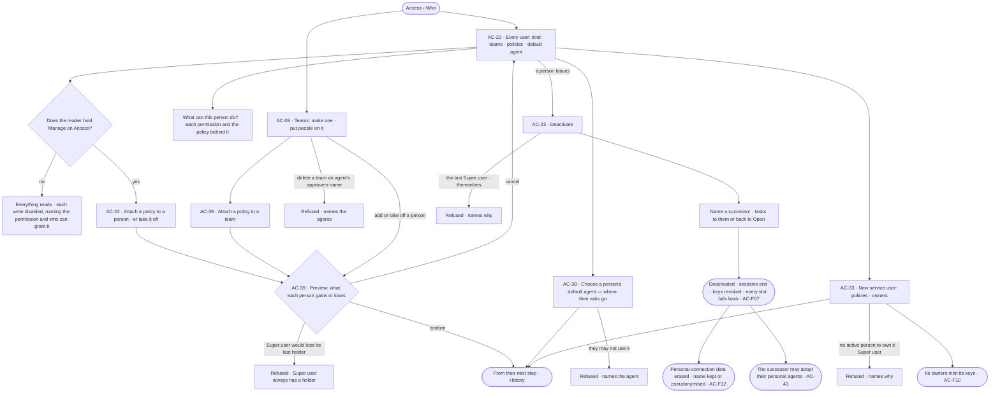

# Directory

> Every user of the deployment — people, agents, service users and the system user — the flat teams people are on,
> the Access Policies attached to each person and team with a preview of who gains or loses what, each person's one
> default agent, and deactivating a person who leaves, naming the successor who takes every place they held.
> The decision it helps make: *who is in this deployment, on which teams — and what may each of them do?*

## User journey

Journeys this feature is a step of: [J05 · Join a team](../../../../journeys/J05-join-a-team.md) ·
[J12 · A person leaves and the team keeps working](../../../../journeys/J12-a-person-leaves-and-the-team-keeps-working.md) ·
[J07 · Ready a deployment](../../../../journeys/J07-ready-a-deployment.md)

## Stories

| ID | Story | Status |
|---|---|---|
| AC-22 | [See every user and set a person's role](stories/AC-22-see-every-user-and-set-a-persons-role/story.md) | idea |
| AC-33 | [Make a service user for automation](stories/AC-33-make-a-service-user-for-automation/story.md) | idea |
| AC-09 | [Make teams and put people on them](stories/AC-09-make-teams-and-put-people-on-them/story.md) | idea |
| AC-39 | [Grant agents to a team and see who gains them](stories/AC-39-grant-agents-to-a-team-and-see-who-gains-them/story.md) | idea |
| AC-38 | [Choose a person's default agent](stories/AC-38-choose-a-persons-default-agent/story.md) | idea |
| AC-23 | [Deactivate a person who leaves](stories/AC-23-deactivate-a-person-who-leaves/story.md) | idea |

## Access

Each act needs the permission named, from [the permission catalogue](../AC-F02-access-policies/feature.md#the-permission-catalogue);
without it the act shows, disabled, naming the permission and who can grant it.

| Act | Permission |
|---|---|
| Read every user, their kind, teams, policies and default agent · every team, its people and its policies · *What can {person} do?* | None — every signed-in person |
| Attach a policy to a person, a service user or a team, or take it off · set a person's default agent · name newcomers' policies | Manage on Access, in a session, signing in again |
| New team · rename · describe · delete · add or remove a person | Create · Edit on Access, in a session |
| Make a service user | Create on Access, in a session, signing in again |
| Deactivate · reactivate a person or a service user, naming the successor | Edit on Access, in a session, signing in again |
| Mint and revoke a service user's keys · add its co-owners | Its owners ([AC-F10](../AC-F10-keys/feature.md) · [AC-F07](../AC-F07-ownership/feature.md)) |

## States

| State | What the person sees |
|---|---|
| First use | Users: the first person, holding *Super user*, the system user and the built-in agents. Teams: *No teams yet — give a whole team its policies at once* with *New team* |
| Empty after a filter | *Nothing matches*, with the filter named and *Clear filters* |
| Loading | The section opens at once; lists show loading rows; counts read `—` until the engine gives them |
| Has data | Users one row each, by kind, with their policies; teams one row each; the selected one beside them with *What can they do?* |
| Failed | What could not load or save, in a sentence, with *Try again*; a refused save says why in place, naming the person, the team or the policy |
| Agent working or proposing | — no agent changes the Directory; an attachment's preview shows what each person gains or loses before it is saved |
| No access | Everything reads; each write is disabled, naming the permission it needs and who can grant it |

## Rules

| Rule | Detail |
|---|---|
| Four kinds of user | **Person** — signs in, holds Access Policies · **Agent** — holds only a ceiling, its Access Policies ([AC-F02](../AC-F02-access-policies/feature.md#rules)) · **Service user** — a user for automation, owned by people, never signs in, acts only through keys ([AC-F10](../AC-F10-keys/feature.md)), holds Access Policies · **System** — the one system user, owns what Invana ships, never signs in, holds none |
| People and teams hold policies | A person's permissions are the policies attached to them and to every team they are on ([AC-F02 › Rules](../AC-F02-access-policies/feature.md#rules)). A new person or service user holds the newcomers' policies — *Read only* out of the box; only a holder of Manage on Access attaches more. A service user never holds *Super user* |
| A service user is owned, and owns nothing | At least one active person owns it ([AC-F07](../AC-F07-ownership/feature.md)); its owners mint its keys. What a run it is behind makes is the organisation's, made by the service user |
| Using an agent is a permission | A person may use an agent where their permissions allow Run on `agent/<name>` — through a policy on them or a team they are on |
| A change shows who it changes | Attaching or taking off a policy, and adding a person to a team or taking one off, previews what each person gains or loses before it is saved ([AC-39](stories/AC-39-grant-agents-to-a-team-and-see-who-gains-them/story.md)) |
| One default agent each | Each person has one default agent — where their asks go when they name none, and what a connected MCP client asks ([AC-F11](../AC-F11-connect-an-mcp-client/feature.md)). It grants nothing and reads nothing for them. A new person's default is the built-in Assistant; a person with Manage on Access may set another the person may use ([AC-38](stories/AC-38-choose-a-persons-default-agent/story.md)). A person who loses Run on their default agent falls back to the Assistant |
| Teams are flat and own nothing | A team is a list of people and service users. No team is on another team; a team owns no resource and is never an agent's caller. A team holds Access Policies — each person on it holds them — and may be an agent's named approvers ([AC-26](../AC-F05-asks-and-approvals/stories/AC-26-name-who-answers-an-agents-asks/story.md)) |
| Super user always has a holder | Taking *Super user* off its last active holder, or deactivating them, is refused; a deployment with one holder is told to name a second |
| Deactivating names a successor | A deactivated user signs in to nothing, their sessions end and their keys are revoked; their work, authorship and History stay. The successor — an active person — takes every place the leaver held, by [AC-F07 › Slots and fallbacks](../AC-F07-ownership/feature.md#slots-and-fallbacks), schedules and pick-ups they set included; their personal-connection data is erased and their name kept or pseudonymised ([AC-F12](../AC-F12-leaving-and-keeping/feature.md)) |
| Changes take effect at the next step | A policy, a team, a default agent or a deactivation is read at each check, so a run already going meets it at its next step |
| A revoke clears what Studio holds | When a person loses a permission or is deactivated, the engine tells Studio to clear its cache of what that person read ([AC-F02 › Mechanisms](../AC-F02-access-policies/feature.md#mechanisms)) |
| Leans on | Accounts and sign-in (AC-F01) · keys (AC-F10) · Access Policies and the permission catalogue (AC-F02) · named approvers (AC-F05) · History (AC-F06) · Ownership (AC-F07) · agents (AG-F01) · schedules (AG-F07) |

## Data touched

| Record | Read or write |
|---|---|
| Users — kind, active or deactivated, who deactivated them, when and their successor | Write · read |
| Teams and the people on them | Write · read |
| Policies attached to each person and team ([AC-F02](../AC-F02-access-policies/feature.md#engine)) | Write · read |
| Each person's default agent | Write · read |
| Owners of what a leaver owns, their chats and their slots (AC-F07) | Write, through the successor |
| Owners of a service user (AC-F07) | Write, when it is made |

## Engine

The low-level design: what this feature stores, serves and refuses. Conventions — naming, errors, lists, events — are
[system-design.md](../../../../system-design.md) §§ 6–8; this section only fills them in.

### Records

| Table | Columns | Notes |
|---|---|---|
| `access_users` — the Directory's columns | `kind` (`person` · `agent` · `service` · `system`) · `agent_id?` (an agent user's agent) · `default_agent_id?` (a person's or a service user's; the built-in Assistant when none is set) · `description?` (a service user's) · `is_active` · `deactivated_at?` · `deactivated_by_id?` · `successor_id?` (a person) | The account and sign-in columns are [AC-F01](../AC-F01-sign-in-account-and-sessions/feature.md#engine)'s; only a person has an email and a password. One `system` row, written at start. No role column |
| `access_teams` | `name` (`[a-z0-9-]`, unique) · `title` · `description` · `created_by_id` · `created_at` · `updated_at` | No team holds another |
| `access_team_members` | `team_id` · `user_id` (a person or a service user) · `added_by_id` · `added_at` | Unique (`team_id`, `user_id`) |

### Reads

| Record | Owner |
|---|---|
| Accounts, passwords, sessions and signing in again | [AC-F01](../AC-F01-sign-in-account-and-sessions/feature.md#engine) |
| Keys — a service user's only credential | [AC-F10](../AC-F10-keys/feature.md#engine) |
| Access Policies, their attachments, the catalogue, the order of checks and the one evaluator | [AC-F02](../AC-F02-access-policies/feature.md#engine) |
| Named approvers that name a team or a person | [AC-F05](../AC-F05-asks-and-approvals/feature.md#engine) |
| History — every event this feature writes | [AC-F06](../AC-F06-history/feature.md#engine) |
| Owners — what a user owns, alone or with others, and hand-over | [AC-F07](../AC-F07-ownership/feature.md#engine) |
| Agents and the built-in agents | [AG-F01](../../../../capabilities/agents/features/AG-F01-build-an-agent/feature.md#engine) |
| Schedules and pick-up a deactivated person set — the setter moved to the successor, the first setter kept | [AG-F07](../../../../capabilities/agents/features/AG-F07-schedules/feature.md#engine) |
| Retention, holds, the names setting and a departure's erasure | [AC-F12](../AC-F12-leaving-and-keeping/feature.md#engine) |

### Routes

| Route, after `/api/v1/access` | Does | Story |
|---|---|---|
| `GET /users` | Every user by the list contract (`?kind=` · `?policy=` · `?team=` · `?active=` · `?can=<type>:<action>` · `?q=` on name, username or email): `username` · `name` · `kind` · `teams[]` · `policies[]` · `default_agent` · `is_active` · `last_signed_in_at?`; the tab counts are the engine's | AC-22 |
| `POST /service-users` | Make a service user `{username, name, description?, policies[]?, owners[], password}` — the newcomers' policies unless named | AC-33 |
| `GET /users/{username}` · `PATCH /users/{username}` | One user with their teams, their policies and how each comes (`direct` · a team), their default agent, and what they own (AC-F07) · set `default_agent`; needs signing in again. What they may do is [AC-F02](../AC-F02-access-policies/feature.md#routes)'s `GET /users/{username}/effective` | AC-22 · AC-38 |
| `GET /users/{username}/departure` · `POST /users/{username}/deactivate` · `POST /users/{username}/reactivate` | What deactivating them does — their slots, service users, personal agents, chats, keys, personal connections and copies to erase, counted · deactivate `{successor, tasks: successor \| open}`; needs signing in again · reactivate — a pseudonymised person `{name, email}` | AC-23 · AC-45 |
| `GET /teams` · `POST /teams` | Teams: `name` · `title` · `people_count` · `policies[]` · make one | AC-09 |
| `GET /teams/{name}` · `PATCH /teams/{name}` · `DELETE /teams/{name}` | One team with `members[]`, its policies and the agents it approves for · rename or describe · delete one no approver names | AC-09 |
| `POST /teams/{name}/members` · `DELETE /teams/{name}/members/{username}` | Put a person or a service user on it · take one off; each returns the preview first unless `confirm` | AC-09 · AC-39 |
| `POST /preview` | For an attachment, a take-off, or a person added to or taken off a team: per person, each permission gained or lost, and whose default agent falls back. Writes nothing | AC-39 |

### Events

| Event | When |
|---|---|
| `access.users.create` | A service user is made — its policies and owners in `details` |
| `access.users.deactivate` · `access.users.reactivate` | A user is deactivated — the successor and what went where in `details` · reactivated |
| `access.teams.create` · `access.teams.update` · `access.teams.delete` | A team is made · changed · deleted |
| `access.teams.members.add` · `access.teams.members.remove` | A person joins · leaves a team — the permissions they gained or lost in `details` |
| `access.users.default_agent` | A person's default agent changes — `{from, to, why}` in `details`; `why` is `set` or `lost` |

### Refusals

| Status | When | Sentence | Criterion |
|---|---|---|---|
| 409 | Taking *Super user* off its last active holder, or deactivating them | [AC-F02 › Refusals](../AC-F02-access-policies/feature.md#refusals) | AC-22.5 · AC-23.7 |
| 422 | A policy attached to an agent user or the system user from the Directory | *{user} holds no policy here — {kind}.* | AC-22.3 |
| 422 | *Super user* on a service user | *A service user never holds Super user.* | AC-33.2 |
| 422 | A service user with no owner, or an owner who is not an active person | *A service user needs at least one active person to own it.* | AC-33.3 |
| 409 | A username already used | *{username} is taken.* | AC-33.12 |
| 409 | A team name already used | *{name} is taken.* | AC-09.3 |
| 422 | Putting an agent, the system user or a team on a team | *Only people and service users join a team.* | AC-09.5 |
| 409 | Deleting a team an agent's approvers name | *{team} answers asks for {agents} — change them first.* | AC-09.9 |
| 422 | A default agent the person may not use | *{person} may not use {agent} — give them Run on it first.* | AC-38.3 |
| 422 | Deactivating oneself | *Ask someone else to deactivate you.* | AC-23.8 |
| 422 | Deactivating the system user or an agent | *{user} cannot be deactivated — {why}.* | AC-23.9 |
| 422 | Deactivating with no successor, or one who is not an active person | *Name an active person to take over from {person}.* | AC-23.3 |
| 401 | A deactivated user signs in, or one of their keys calls | *This account is deactivated.* | AC-23.4 |
| 403 | A write the person's permissions do not allow | [AC-F02 › Refusals](../AC-F02-access-policies/feature.md#refusals) | AC-22.10 · AC-09.11 · AC-33.10 |
| 403 | A Directory write with a key | [AC-F02 › Refusals](../AC-F02-access-policies/feature.md#refusals) | AC-22.11 · AC-33.11 |

### CLI

| Command | Does |
|---|---|
| `invana users list` | Every user, their teams and policies |
| `invana users create-service <username> --name --owner <username>… [--policy <name>…]` | Makes a service user, as `POST /service-users` |
| `invana users deactivate <username> --successor <username> [--tasks open]` | Deactivates, as `POST /users/{username}/deactivate`, printing what goes where first |
| `invana teams list` · `invana teams add <team> <username>` · `invana teams remove <team> <username>` | Teams and their people; a change prints its preview first |

Attaching a policy is `invana policy attach` ([AC-F02 › CLI](../AC-F02-access-policies/feature.md#cli)).

### Mechanisms

| Mechanism | How |
|---|---|
| The system user | One `access_users` row, `kind = system`, no password, written at start; it owns the built-in agents, the built-in and starter policies, workflows and skills ([AC-F07](../AC-F07-ownership/feature.md#engine)) |
| The first account | `invana createsuperuser` writes the first person and attaches *Super user* to them ([AC-F02 › CLI](../AC-F02-access-policies/feature.md#cli)) |
| A service user | An `access_users` row of `kind = service`, no email, no password; its owners are `access_owners` rows of `resource_type = service_user` written in the same transaction ([AC-F07](../AC-F07-ownership/feature.md#engine)). Its keys are its only credential ([AC-F10](../AC-F10-keys/feature.md#engine)); a sign-in as it is refused like a wrong password |
| An agent is a user | Each agent has an `access_users` row of `kind = agent` linked by `agent_id`, so History and ownership name it as one user; its ceiling is attached to the agent, never to this row, and it never signs in |
| Newcomers | A person made by an account, the first SSO sign-in or `POST /service-users` gets `access_policy_attachments` rows for each policy in `access.newcomer_policies` ([AC-F02 › Mechanisms](../AC-F02-access-policies/feature.md#mechanisms)) |
| The preview | `preview(change)` lists, for every person the change reaches, their permissions before and after; a person who still holds a permission through another policy gains or loses nothing. A person who would lose Run on their default agent falls back to the built-in Assistant, named in the preview |
| Deactivating | In one transaction: `is_active` false, `successor_id` set; every session ends; every key they minted is revoked ([AC-F10](../AC-F10-keys/feature.md#engine)); the successor takes their service users, their chats outside projects and — as chosen — their tasks, and each slot falls back, setters of schedules and pick-ups included ([AC-F07 › Succession](../AC-F07-ownership/feature.md#mechanisms)); their personal agents retire; the departure's erasure runs ([AC-F12 › Departure](../AC-F12-leaving-and-keeping/feature.md#mechanisms)); asks they raised close expired; their team places and policies stay, counting for nothing. A refusal changes nothing |
| Reactivating | `is_active` true; nothing handed on comes back and erased data stays erased; a pseudonymised person is given a name and an email again |
| Super user's holders | Every take-off and deactivation counts the active holders of *Super user* it would leave and refuses at none; `GET /users` returns `super_users_short` while fewer than two are active, for the warning |
| Team places read at the check | The person check reads a person's policies and teams at each check, never copied ([AC-F02 › One evaluator](../AC-F02-access-policies/feature.md#mechanisms)) |

## System impact

| HLD section | Change | NFRs |
|---|---|---|
| § 6 Data and storage | Two tables and the Directory's columns on `access_users` in Postgres | — |
| § 8 APIs and events | The users and teams routes and `access.users.*` · `access.teams.*` events above | — |
| § 12 Qualities | Security: policies read at every check; every change previewed before saved; a deactivated user's sessions and keys stop at once; Studio's cache cleared on a revoke; Super user always has a holder | NFR-SEC-1 · NFR-SEC-2 |

## Decisions

| Decision | Detail |
|---|---|
| The Directory is Access › Who | *Users* and *Teams*, beside *What they may do* (*Access Policies* · *Permissions*); a user or a team drills in and the crumb grows; each reads *What can they do?* |
| Deactivate, never delete | A person who leaves is deactivated, so their work, authorship and History keep a name |
| The successor is part of deactivating | The person deactivating names the successor in the same act; one person takes every place the leaver held, so nothing is left to chase afterwards |
| Two holders of Super user, never one | A holder who is away or leaves never locks the deployment; a deployment with one is told to name a second |
| Agents appear as users | One list answers "who acts here"; an agent's row opens its page, where its ceiling is |
| The default agent only routes asks | A person reads their default agent in *You*; it is where their asks go, never what they may reach |

## Open questions

| Question | Who answers |
|---|---|

## Not building

| Item | Why not |
|---|---|
| Nested teams · teams that own | A flat list of people carries every team we know of |
| Invitations | An account is made directly ([AC-18](../AC-F01-sign-in-account-and-sessions/stories/AC-18-give-a-person-an-account/story.md)) |
| Deleting a user | Work and History must keep a name; deactivating is enough |
| Roles | Access Policies on people and teams carry every grant ([AC-F02](../AC-F02-access-policies/feature.md#not-building)) |
| A team lead | Teams own nothing and decide nothing on their own; a team may be named as an agent's approvers |
