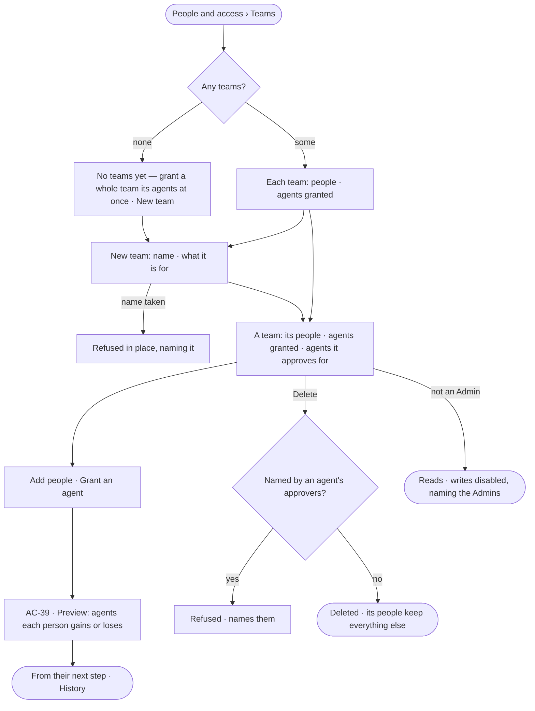

# AC-09 · Make teams and put people on them

**As** an Admin **I want** flat teams of people, each granted the agents it needs **so that** a whole team gets its
agents at once, without a grant per person.

Tasks: [task.md](task.md) · Feature: [AC-F03](../../feature.md)

## Who can

| Lens | Can | Otherwise sees |
|---|---|---|
| Admin | Make, rename, describe and delete a team; put people and service users on it and take them off; grant it an agent or take one away | A team an agent's approvers name has no *Delete* until they change |
| Operator | Read every team, its people, the agents granted to it and the agents whose asks it answers; a Modeller reads the same | *New team*, *Add people*, *Grant an agent* and *Delete* disabled — *Needs the Admin role — ask Priya or Lee* |

## Flow

## Acceptance criteria

| # | Given | When | Then |
|---|---|---|---|
| AC-09.1 | A deployment with no teams | *Teams* is read | *No teams yet — grant a whole team its agents at once* reads, with *New team* |
| AC-09.2 | An Admin | they make a *New team* with a name and what it is for | it is listed with no people and no agents; History records it |
| AC-09.3 | A team name already used | a *New team* is made with it | it is refused in place, naming it |
| AC-09.4 | An Admin on a team's page | they add a person or a service user, or take one off | the preview names the agents that person gains or loses (AC-39); on confirm, they may use them, or may not, from their next step; no rule changes for anyone |
| AC-09.5 | *Add people* | it is offered | it lists people and service users only — never an agent, the system user or another team |
| AC-09.6 | A team | its page is read | it shows its people, the agents granted to it and the agents whose asks it answers (AC-26) |
| AC-09.7 | An Admin | they grant an agent to a team, after its preview (AC-39) and signing in again | every person on the team may use it from their next step; taking it away ends that for whoever has no other grant |
| AC-09.8 | A team | an owner is chosen for anything | a team is never offered as an owner; a policy is never attached to a team and no rule names one (AC-11.9) |
| AC-09.9 | A team named by an agent's approvers | it is deleted | it is refused, naming each agent, so no ask loses its approvers silently |
| AC-09.10 | A team no approvers name | it is deleted, confirming by name | it is gone; its people keep their role and their other teams |
| AC-09.11 | An Operator or a Modeller | they open *Teams* | everything reads; each write is disabled, naming the Admin role and the Admins |
| AC-09.12 | A filter that matches no team | it is applied | *Nothing matches* reads with *Clear filters* |
| AC-09.13 | The teams could not load | *Teams* is opened | *Could not load teams* reads, with *Try again* |

## Screens

| Surface | Lens | First use | Empty after a filter | Loading | Has data | Failed | Agent working or proposing | No access |
|---|---|---|---|---|---|---|---|---|
| Teams and a team | Admin | settings.access · No teams yet | settings.access · Nothing matches | settings.access · Loading | settings.access · A team | settings.access · Could not load | — | — |
| Teams and a team | Operator | access.locked · No teams yet | access.locked · Nothing matches | access.locked · Loading | access.locked · A team | access.locked · Could not load | — | access.locked · A team |
| New team | Admin | — | — | — | settings.access · New team | settings.access · Name taken | — | — |
| New team | Operator | — | — | — | — | — | — | access.locked · A team |
| Delete a team | Admin | — | — | — | settings.access · Delete a team | settings.access · Team in use | — | — |
| Delete a team | Operator | — | — | — | — | — | — | access.locked · A team |
