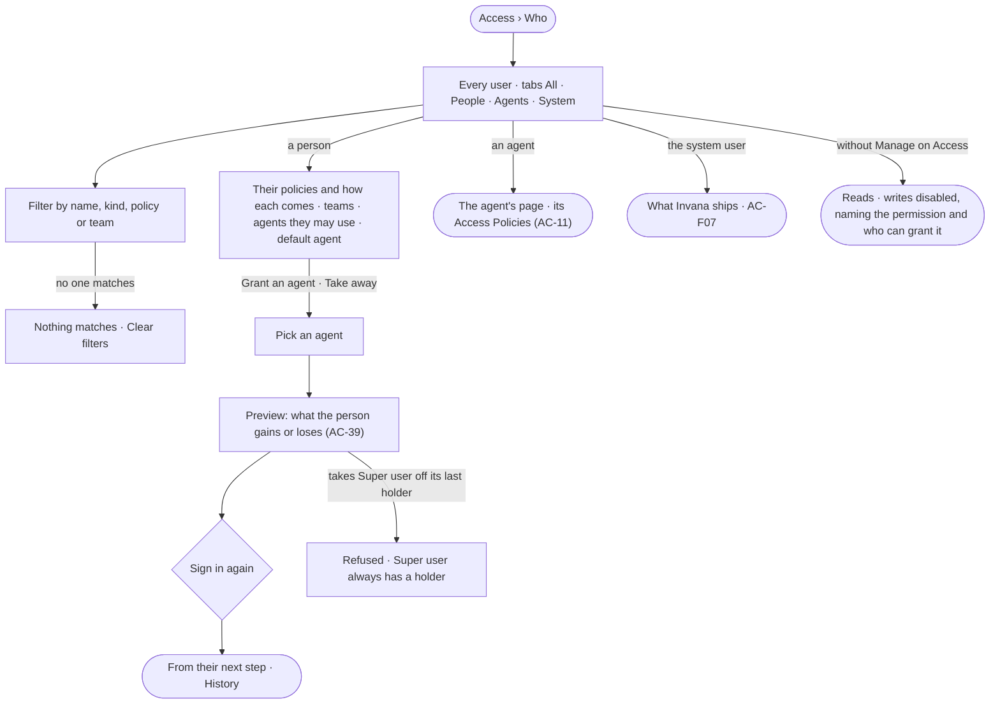

# AC-22 · See every user and the agents each may use

**As** an Admin **I want** every user of the deployment in one list — people, agents and the system
user — with the policies that reach each person and the agents they may use **so that** I can read who acts here
and change what a person may use by granting or taking away an agent, on purpose.

Tasks: [task.md](task.md) · Feature: [AC-F03](../../feature.md)

## Who can

A policy is attached to an agent, never to a person ([AC-11](../../../AC-F02-access-policies/stories/AC-11-attach-a-policy-to-agents/story.md)); a person is granted agents, directly or through a team; there is no role to set.

| Access | Can | Otherwise sees |
|---|---|---|
| Admin | Read every user; grant an agent to a person or take a direct grant away, after its preview (Manage on Access, AC-39); set a person's default agent (AC-38). Each change asks them to sign in again | Taking *Super user* off its last active holder is refused |
| Operator | Read every user, their teams, the policies attached to them, the agents they may use and their default agent | *Grant an agent*, *Take away* and *Change default agent* disabled — *Needs Manage on Access — ask Priya or Lee* |

## Flow

## Acceptance criteria

| # | Given | When | Then |
|---|---|---|---|
| AC-22.1 | A signed-in person | they open *Users* | every user reads one row each — name · username · kind (*Person* · *Agent* · *System*) · policies · teams · default agent · *Deactivated* where it applies — with tabs *All · People · Agents · System* and the engine's counts |
| AC-22.2 | A fresh deployment | *Users* is read | the first person, holding *Super user*, the system user and each built-in agent read; the system user reads *Owns what Invana ships · never signs in* and holds no policy |
| AC-22.3 | An agent's or the system user's row | it is read | it offers no *Grant an agent* from here; an agent's row opens its page, with the Access Policies attached to it (AC-11) |
| AC-22.4 | A person with Manage on Access | they grant an agent to a person or take a direct grant away, after its preview, and sign in again | the person holds the change from their next step, including a run already going, and Studio clears what it held for them; *History* records who changed whom, which agent, and when (AC-F06) |
| AC-22.5 | *Super user* held by one active person | it is taken off them, or they are deactivated | it is refused — *Super user always has a holder — give it to someone else first* |
| AC-22.13 | A deployment where one active person holds *Super user* | *Users* is read by a holder of Manage on Access | it reads *Name a second holder of Super user*, with the people who could hold it |
| AC-22.14 | An Admin | they press *Grant an agent* on a person and sign in again | *Sign in again* names *Grant* and returns to the person's *Agent grants* reading the new agent; a wrong password returns to the same *Sign in again* with the message; a refusal reads *Could not save* |
| AC-22.6 | A person's row | *Policies* is read | each policy reads with how it reaches them — *Attached to you* or the team's name — and the newcomers' policies read *Newcomer* |
| AC-22.7 | A person with Manage on Access | they take a direct agent grant away, after its preview and signing in again | from their next step the person may not use that agent unless a team grants it; a take-away clears what Studio held from that agent for them; History records it |
| AC-22.8 | A person who lost Run on an agent | they start a run with it | it is refused, naming the permission and who can grant it (AC-07) |
| AC-22.9 | A filter that matches no one | it is applied | *Nothing matches* reads, naming the filter, with *Clear filters* |
| AC-22.10 | A person without Manage on Access | they open *Users* | everything reads; *Grant an agent* and *Take away* are disabled, naming Manage on Access and who can grant it; the API refuses the write |
| AC-22.11 | A grant made with a key | it is sent | it is refused — it needs a person's session |
| AC-22.12 | The users could not load | the list is opened | *Could not load users* reads, with *Try again* |

## Screens

| Surface | Access | First use | Empty after a filter | Loading | Has data | Failed | Agent working or proposing | No access |
|---|---|---|---|---|---|---|---|---|
| Users | Admin | settings.people · First person | settings.people · Nothing matches | settings.people · Loading | settings.people | settings.people · Could not load | — | — |
| Users | Operator | settings.people · Locked · Users · First person | settings.people · Locked · Users · Nothing matches | settings.people · Locked · Users · Loading | settings.people · Locked · Users | settings.people · Locked · Users · Could not load | — | settings.people · Locked · Users |
| A person — policies and agents | Admin | settings.people · One Super user | — | — | settings.people · A person | settings.people · Super user needs a holder | — | — |
| A person — policies and agents | Operator | — | — | — | settings.people · Locked · A person | — | — | settings.people · Locked · A person |
| Grant an agent to a person | Admin | — | — | — | settings.people · Agent grants · Preview | settings.people · Agent grants · Could not save | — | — |
| Grant an agent to a person | Operator | — | — | — | — | — | — | settings.people · Locked · A person |
| Grant an agent to a person · Sign in again | Admin | — | — | — | access.signin · Sign in again · Grant | access.signin · Sign in again · Grant · Wrong password | — | — |
| Grant an agent to a person · Sign in again | Operator | — | — | — | — | — | — | settings.people · Locked · A person |
| Grant an agent to a person · Granted | Admin | — | — | — | settings.people · Agent grants | — | — | — |
| Grant an agent to a person · Granted | Operator | — | — | — | — | — | — | settings.people · Locked · A person |
