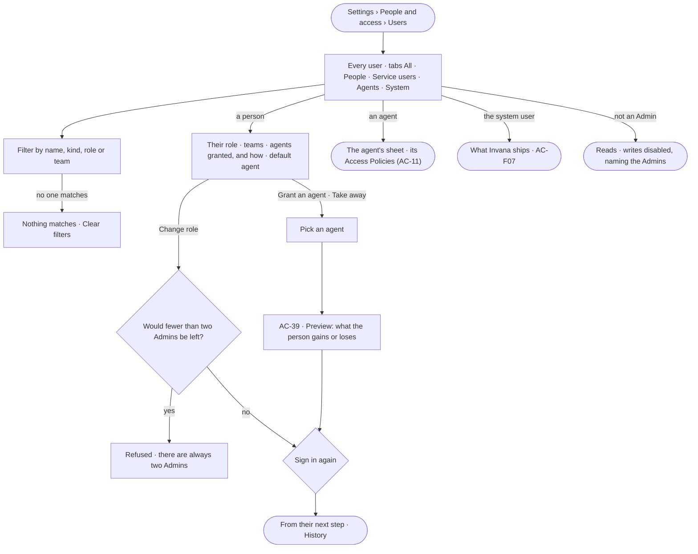

# AC-22 · See every user and set a person's role

**As** an Admin **I want** every user of the deployment in one list — people, agents, service users and the system
user — with each person's role and the agents they may use **so that** I can read who acts here and change a person's
role or their agents on purpose.

Tasks: [task.md](task.md) · Feature: [AC-F03](../../feature.md)

## Who can

| Lens | Can | Otherwise sees |
|---|---|---|
| Admin | Read every user; set a person's or a service user's role; grant an agent to a person or take it away, after its preview; set a person's default agent (AC-38). Each change asks them to sign in again | An Admin's role is fixed while only two Admins are active |
| Operator | Read every user, their role, their teams, the agents granted to them and their default agent; a Modeller reads the same | *Change role* and *Grant an agent* disabled — *Needs the Admin role — ask Priya or Lee* |

## Flow

## Acceptance criteria

| # | Given | When | Then |
|---|---|---|---|
| AC-22.1 | A signed-in person | they open *Users* | every user reads one row each — name · username · kind (*Person* · *Agent* · *Service user* · *System*) · role · teams · agents granted · default agent · *Deactivated* where it applies — with tabs *All · People · Service users · Agents · System* and the engine's counts |
| AC-22.2 | A fresh deployment | *Users* is read | the first Admin, the system user and each built-in agent read; the system user reads *Owns what Invana ships · never signs in* and has no role |
| AC-22.3 | An agent's or the system user's row | it is read | it shows no role and offers no *Change role*; an agent's row opens its sheet, with the Access Policies attached to it (AC-11) |
| AC-22.4 | An Admin | they change a person's role and sign in again | the person holds that role from their next step, including a run already going, and Studio clears what it held for them; the role changes which acts they may start, never what an agent reaches; *History* records who changed whom, from what, to what, and when (AC-F06) |
| AC-22.5 | Two active Admins | either's role is changed away from Admin | it is refused — *There are always two Admins — make another first* |
| AC-22.13 | A deployment with one active Admin | *Users* is read by an Admin | it reads *Name a second Admin — there are always two*, with the people who could be made one |
| AC-22.6 | A person's row | *Agents granted* is read | each agent reads with how it reaches them — *Granted to you* or the team's name — and built-in agents granted by role read *By role* |
| AC-22.7 | An Admin | they grant an agent to a person, or take a direct grant away, after its preview and signing in again | from their next step the person may use it, or may not; a take-away clears what Studio held from that agent for them; History records it |
| AC-22.8 | A person whose agent was taken away | they start a run with it | it is refused, naming the agent and the Admins (AC-07) |
| AC-22.9 | A filter that matches no one | it is applied | *Nothing matches* reads, naming the filter, with *Clear filters* |
| AC-22.10 | An Operator or a Modeller | they open *Users* | everything reads; *Change role* and *Grant an agent* are disabled, naming the Admin role and the Admins; the API refuses the write |
| AC-22.11 | A role change or a grant made with a key | it is sent | it is refused — it needs a person's session |
| AC-22.12 | The users could not load | the list is opened | *Could not load users* reads, with *Try again* |

## Screens

| Surface | Lens | First use | Empty after a filter | Loading | Has data | Failed | Agent working or proposing | No access |
|---|---|---|---|---|---|---|---|---|
| Users | Admin | settings.people · First Admin | settings.people · Nothing matches | settings.people · Loading | settings.people | settings.people · Could not load | — | — |
| Users | Operator | access.locked · Users · First Admin | access.locked · Users · Nothing matches | access.locked · Users · Loading | access.locked · Users | access.locked · Users · Could not load | — | access.locked · Users |
| A person — role and agents | Admin | settings.people · One Admin | — | — | settings.people · A person | settings.people · Two Admins | — | — |
| A person — role and agents | Operator | — | — | — | access.locked · A person | — | — | access.locked · A person |
