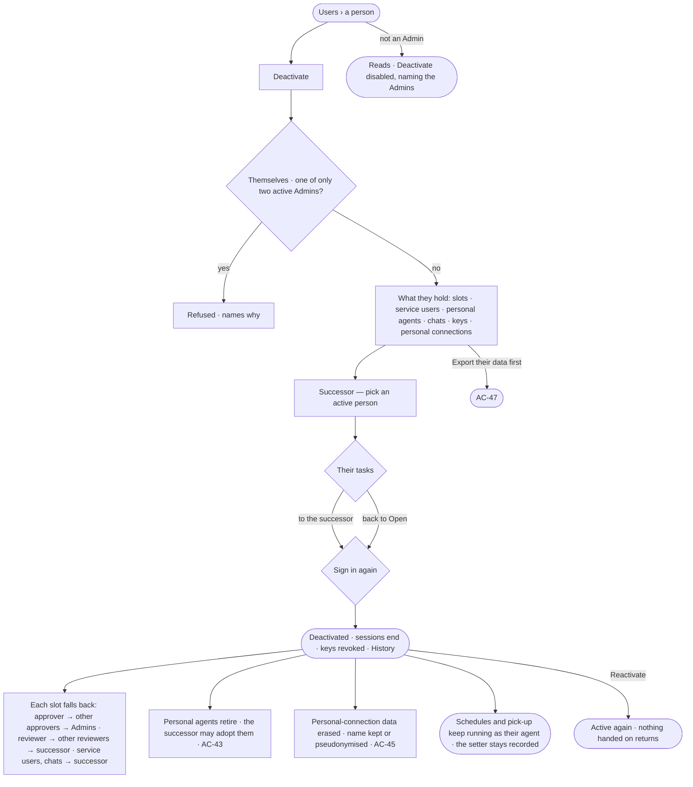

# AC-23 · Deactivate a person who leaves

**As** an Admin **I want** to deactivate a person who leaves and name their successor, who takes every place they
held on the work **so that** they cannot act from then on, no work waits on them, and their work keeps its name.

Tasks: [task.md](task.md) · Feature: [AC-F03](../../feature.md)

## Who can

| Lens | Can | Otherwise sees |
|---|---|---|
| Admin | Deactivate a person or a service user, naming a successor; choose whether the leaver's tasks go to the successor or back to *Open*; reactivate them. Each asks them to sign in again | Their own row has no *Deactivate*; an Admin's row has none while only two Admins are active |
| Operator | Read who is deactivated, by whom, when and who succeeded them; a Modeller reads the same | *Deactivate* and *Reactivate* disabled — *Needs the Admin role — ask Priya or Lee* |

## Flow

## Acceptance criteria

| # | Given | When | Then |
|---|---|---|---|
| AC-23.1 | An Admin on an active person's row | they choose *Deactivate* | a modal lists, with the engine's counts, each slot the person holds — approver, reviewer, task assignee, schedule or pick-up setter — and the service users they own, their personal agents, their chats outside projects, their keys and their personal connections, and where each goes |
| AC-23.2 | The modal | the Admin picks an active person as successor, chooses where the tasks go and signs in again | the person is deactivated; the successor takes every service user they owned and every chat they started outside a project; tasks assigned to them go to the successor or back to *Open*, as chosen; their slots fall back as [AC-F07 › Slots and fallbacks](../../../AC-F07-ownership/feature.md#slots-and-fallbacks) says |
| AC-23.3 | Deactivating | it is sent with no successor, or a successor who is not an active person | it is refused — *Name an active person to take over from {person}* |
| AC-23.4 | A deactivated person | they sign in, or a key of theirs is used | it is refused — *This account is deactivated*; every session they had ended at deactivation and every key they minted is revoked |
| AC-23.5 | Schedules and pick-up the person set | their next firing comes | it runs as its agent, as before; the person stays recorded as who set it (AG-F07) |
| AC-23.6 | A run going behind a deactivated person | its next step is checked | it is refused, naming that the person was deactivated; asks they raised close expired |
| AC-23.7 | Two active Admins | someone tries to deactivate either | it is refused — *There are always two Admins — make another first* |
| AC-23.8 | An Admin | they try to deactivate themselves | there is no *Deactivate* on their own row, and the API refuses it — *Ask another Admin to deactivate you* |
| AC-23.9 | The system user or an agent | it is offered for deactivation | there is no *Deactivate*; an agent is retired or taken away from people instead (AC-22.7) |
| AC-23.10 | A deactivated person | their work, boards, findings, authorship and History are read | everything stays, under their name or their code (AC-45), marked *Deactivated* |
| AC-23.11 | The successor | the deactivation saves | their Inbox lists what they took over — service users, chats, tasks, reviewer places — and the personal agents they may adopt (AC-43) |
| AC-23.12 | A deactivated person | an Admin chooses *Reactivate* and signs in again | they may sign in again with their role, teams and grants; nothing handed on comes back, and erased data stays erased |
| AC-23.13 | A deactivation or a reactivation | History is read | it shows who did it, to whom, when, the successor and what went where (AC-F06) |
| AC-23.14 | An Operator or a Modeller | they open a deactivated person's row | it reads *Deactivated by Lee on 3 March · succeeded by Sam*; *Reactivate* is disabled, naming the Admin role and the Admins |
| AC-23.15 | Deactivating could not save | it is sent | nothing changes — no hand-over, no fallback, no erasure — and the modal says why, with *Try again* |

## Screens

| Surface | Lens | First use | Empty after a filter | Loading | Has data | Failed | Agent working or proposing | No access |
|---|---|---|---|---|---|---|---|---|
| Deactivate — what they hold · successor | Admin | settings.people · Deactivate · Holds nothing | — | settings.people · Deactivate · Loading | settings.people · Deactivate | settings.people · Deactivate · Could not save | — | settings.people · Two Admins |
| Deactivate — what they hold · successor | Operator | — | — | — | — | — | — | access.locked · A person |
| A deactivated person | Admin | — | — | — | settings.people · Deactivated | — | — | — |
| A deactivated person | Operator | — | — | — | access.locked · Deactivated | — | — | access.locked · Deactivated |
