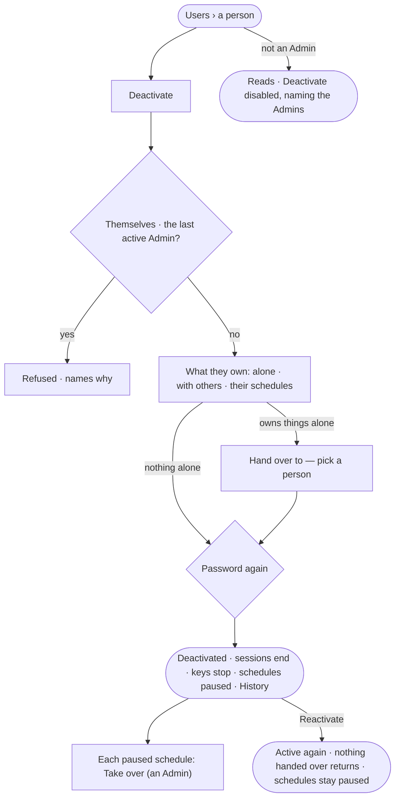

# AC-23 · Deactivate a person who leaves

**As** an Admin **I want** to deactivate a person who leaves, handing over what they own alone in the same act
**so that** they cannot act from then on, nothing they own is left without an owner, and their work keeps its name.

Tasks: [task.md](task.md) · Feature: [AC-F03](../../feature.md)

## Who can

| Lens | Can | Otherwise sees |
|---|---|---|
| Admin | Deactivate a person or a service user, choosing who receives what they own alone; reactivate them. Each asks for the password again | Their own row and the last active Admin's have no *Deactivate* |
| Operator | Read who is deactivated, by whom and when; a Modeller reads the same | *Deactivate* and *Reactivate* disabled — *Needs the Admin role — ask Priya or Lee* |

## Flow

## Acceptance criteria

| # | Given | When | Then |
|---|---|---|---|
| AC-23.1 | An Admin on an active person's row | they choose *Deactivate* | a modal lists what the person owns alone, what they own with others, and the schedules they created, each with its count from the engine |
| AC-23.2 | A person who owns things alone | the Admin picks one active person to hand them to and enters the password again | each thing owned alone gets that person as its owner (AC-F07); things owned with others simply lose the leaver as an owner |
| AC-23.3 | A person who owns things alone | deactivating is sent with no one to receive them | it is refused — *{n} things only {person} owns need a new owner* |
| AC-23.4 | A deactivated person | they sign in, or a key of theirs is used | it is refused — *This account is deactivated*; every session they had ended at deactivation |
| AC-23.5 | A deactivated person's schedules | their next firing comes | it does not run; each reads *Paused — its creator was deactivated* until an Admin chooses *Take over*, after which it runs as that Admin (AG-F07) |
| AC-23.6 | A run going behind a deactivated person | its next step is checked | it is refused, naming that the person was deactivated; asks they raised close expired |
| AC-23.7 | The last active Admin | someone tries to deactivate them | it is refused — *There is always an Admin — make another first* |
| AC-23.8 | An Admin | they try to deactivate themselves | there is no *Deactivate* on their own row, and the API refuses it — *Ask another Admin to deactivate you* |
| AC-23.9 | The system user or an agent | it is offered for deactivation | there is no *Deactivate*; an agent is taken away from people instead (AC-22.7) |
| AC-23.10 | A deactivated person | their work, boards, findings, authorship and History are read | everything stays, under their name, marked *Deactivated* |
| AC-23.11 | A deactivated person | an Admin chooses *Reactivate* with the password again | they may sign in again with their role, teams and grants; nothing handed over comes back, and their schedules stay paused until taken over |
| AC-23.12 | A deactivation or a reactivation | History is read | it shows who did it, to whom, when, and who received what (AC-F06) |
| AC-23.13 | An Operator or a Modeller | they open a deactivated person's row | it reads *Deactivated by Lee on 3 March*; *Reactivate* is disabled, naming the Admin role and the Admins |
| AC-23.14 | Deactivating could not save | it is sent | nothing changes — no hand-over, no pause — and the modal says why, with *Try again* |

## Screens

| Surface | Lens | First use | Empty after a filter | Loading | Has data | Failed | Agent working or proposing | No access |
|---|---|---|---|---|---|---|---|---|
| Deactivate — what they own · hand over to | Admin | settings.people · Deactivate · Owns nothing alone | — | settings.people · Deactivate · Loading | settings.people · Deactivate | settings.people · Deactivate · Could not save | — | — |
| Deactivate — what they own · hand over to | Operator | — | — | — | — | — | — | access.locked · A person |
| A deactivated person | Admin | — | — | — | settings.people · Deactivated | settings.people · Last Admin | — | — |
| A deactivated person | Operator | — | — | — | access.locked · Deactivated | — | — | access.locked · Deactivated |
