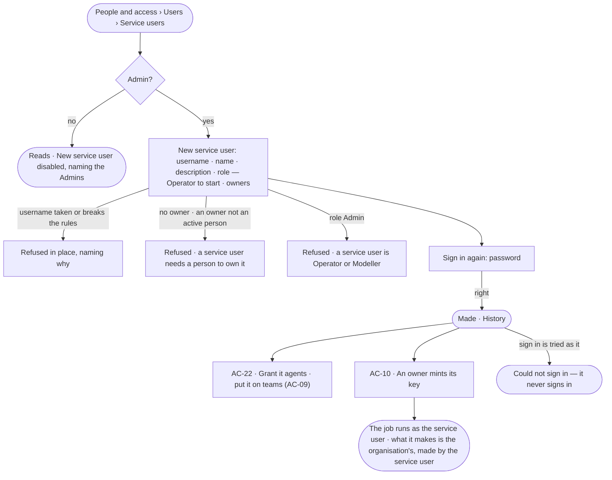

# AC-33 · Make a service user for automation

**As** an Admin **I want** a user for a nightly job or a CI pipeline that is not any one person, owned by the people
who run it, **so that** the job keeps working when one of them leaves, and History says the job acted, not a colleague.

Tasks: [task.md](task.md) · Feature: [AC-F03](../../feature.md)

## Who can

| Lens | Can | Otherwise sees |
|---|---|---|
| Admin | Make a service user — username, name, description, role (Operator or Modeller) and its first owners; set its role and grant it agents (AC-22); deactivate it (AC-23). Each asks for the password again | — |
| Operator | Read every service user, its owners, role, teams and agents. As one of its owners: mint and revoke its keys ([AC-10](../../../AC-F10-keys/stories/AC-10-mint-a-key-that-acts-as-its-owner-narrowed/story.md)) and add co-owners ([AC-24](../../../AC-F07-ownership/stories/AC-24-share-and-hand-over-what-i-own/story.md)) | *New service user* disabled, naming the Admin role and the Admins |

## Flow

## Acceptance criteria

| # | Given | When | Then |
|---|---|---|---|
| AC-33.1 | An Admin on *Users › Service users* | they make a service user with a username, a name, a description and at least one owner, and enter the password again | it is made as an Operator unless they chose Modeller; it reads under *Service users* with its owners, and History records who made it |
| AC-33.2 | *New service user* | the role is chosen | Operator and Modeller are offered; Admin is not, and the API refuses it — *A service user is an Operator or a Modeller* |
| AC-33.3 | *Owners* | none is chosen, or an agent, a team, another service user or a deactivated person is | it is refused — *A service user needs at least one active person to own it* |
| AC-33.4 | A service user | a sign-in is tried with its username | it is refused as *Could not sign in*; it has no password and never signs in (AC-01.9) |
| AC-33.5 | An owner of a service user | they open *Settings › You › Keys* | the service user is offered as *Owner* on *New key*, and its keys list beside their own (AC-10.7) |
| AC-33.6 | A key of a service user | a script calls with it | it acts as the service user — its role, the agents granted to it and to its teams — narrowed by the key; History names the service user as who acted |
| AC-33.7 | A run a service user is behind | it makes an agent, a board or any owned resource | it is the organisation's, made by the service user through the agent; the service user owns nothing (AC-F07) |
| AC-33.8 | A service user's row | it is read | it shows its owners, role, teams, the agents it may use, its live keys' count and *Never signs in* |
| AC-33.9 | The last owner of a service user | they are deactivated | what they own alone is handed over with the rest (AC-23.2); the service user keeps working under its new owner |
| AC-33.10 | An Operator or a Modeller | they open *Service users* | everything reads; *New service user* is disabled, naming the Admin role and the Admins; the API refuses it |
| AC-33.11 | A service user made with a key | it is sent | it is refused — *This needs a person's session, not a key* |
| AC-33.12 | A username already used | a service user is made with it | it is refused in place — *{username} is taken* |

## Screens

| Surface | Lens | First use | Empty after a filter | Loading | Has data | Failed | Agent working or proposing | No access |
|---|---|---|---|---|---|---|---|---|
| Service users | Admin | settings.people · No service users yet | settings.people · Nothing matches | settings.people · Loading | settings.people · Service users | settings.people · Could not load | — | — |
| Service users | Operator | access.locked · No service users yet | access.locked · Nothing matches | access.locked · Loading | access.locked · Service users | access.locked · Could not load | — | access.locked · Service users |
| New service user | Admin | — | — | access.sign_in_again | settings.people · New service user | settings.people · Needs an owner | — | — |
| New service user | Operator | — | — | — | — | — | — | access.locked · New service user |
| A service user | Admin | — | — | settings.people · Loading | settings.people · A service user | settings.people · Could not load | — | — |
| A service user | Operator | — | — | access.locked · Loading | access.locked · A service user | access.locked · Could not load | — | access.locked · A service user |
