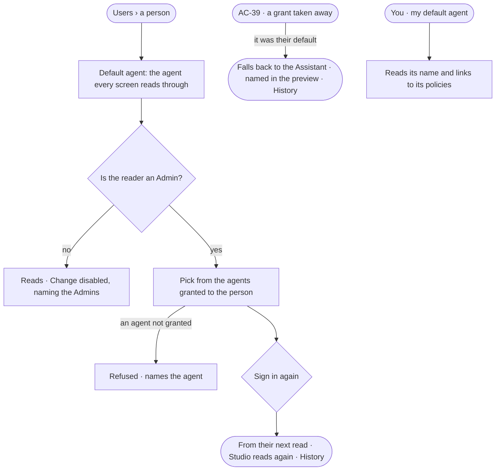

# AC-38 · Choose a person's default agent

**As** an Admin **I want** to choose, for each person, the one agent every Studio screen reads through **so that** what
a person sees is decided by an agent whose rules anyone can read, and the same for everyone who holds that agent.

Tasks: [task.md](task.md) · Feature: [AC-F03](../../feature.md)

## Who can

| Lens | Can | Otherwise sees |
|---|---|---|
| Admin | Read every person's default agent; set it to an agent granted to that person, signing in again | An agent not granted to the person is not offered |
| Operator | Read their own default agent in *You* and everyone's in *Users*; a Modeller reads the same | *Change default agent* disabled — *Needs the Admin role — ask Priya or Lee* |

## Flow

## Acceptance criteria

| # | Given | When | Then |
|---|---|---|---|
| AC-38.1 | A new person | their account is made | their default agent is the built-in Assistant |
| AC-38.2 | An Admin on a person's page | they set the default agent to one granted to that person, signing in again | from the person's next read, every Studio screen reads through that agent; Studio drops what it held and reads again; History records who changed it, from what, to what |
| AC-38.3 | An Admin | they pick an agent not granted to the person | it is refused, naming the agent — *{agent} is not granted to {person} — grant it first* |
| AC-38.4 | A person whose default agent's grant is taken away | the take-away is saved | the preview named it first (AC-39); their default falls back to the built-in Assistant, and History records why |
| AC-38.5 | A person | they open *You* | their default agent reads by name, linking to the Access Policies it runs under |
| AC-38.6 | A read on any Studio screen | the default agent's rules refuse it | it is refused, naming the rule and its policy (AC-07), never shown and hidden |
| AC-38.7 | An Operator or a Modeller | they open a person's page | the default agent reads; *Change default agent* is disabled, naming the Admin role and the Admins; the API refuses the write |
| AC-38.8 | A change of default agent with a key | it is sent | it is refused — it needs a person's session |

## Screens

| Surface | Lens | First use | Empty after a filter | Loading | Has data | Failed | Agent working or proposing | No access |
|---|---|---|---|---|---|---|---|---|
| A person — default agent | Admin | settings.people · Default is the Assistant | — | settings.people · Loading | settings.people · Default agent | settings.people · Not granted | — | — |
| A person — default agent | Operator | access.locked · Default is the Assistant | — | access.locked · Loading | access.locked · Default agent | access.locked · Could not load | — | access.locked · Default agent |
| You — my default agent | Admin | settings.me · Default is the Assistant | — | settings.me · Loading | settings.me · Default agent | settings.me · Could not load | — | — |
| You — my default agent | Operator | settings.me · Default is the Assistant | — | settings.me · Loading | settings.me · Default agent | settings.me · Could not load | — | — |
