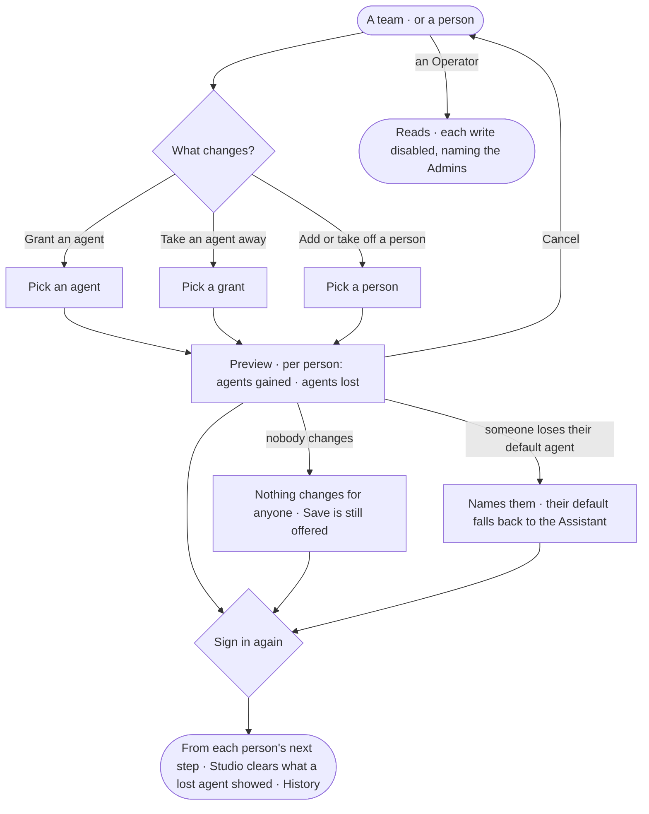

# AC-39 · Grant agents to a team and see who gains them

**As** an Admin **I want** to grant an agent to a team, or to a person, and see before I save which agents each person
gains or loses **so that** a grant or a team change never gives or takes an agent from someone by surprise.

Tasks: [task.md](task.md) · Feature: [AC-F03](../../feature.md)

## Who can

| Access | Can | Otherwise sees |
|---|---|---|
| Admin | Grant an agent to a team or a person, or take it away; add a person to a team or take one off; read the preview of each before saving, signing in again | — |
| Operator | Read every team's agents and every person's agents and how each reaches them | *Grant an agent*, *Take away*, *Add people* disabled — *Needs Manage on Access — ask Priya or Lee* |

## Flow

## Acceptance criteria

| # | Given | When | Then |
|---|---|---|---|
| AC-39.1 | An Admin on a team's page | they grant it an agent | the preview lists every person on the team and, for each, *Gains {agent}* — or *Has it already*, naming the other grant |
| AC-39.2 | An Admin | they take an agent away from a team or a person | the preview lists each person who loses it; a person who still has it through another grant reads *Keeps it through {grant}* |
| AC-39.3 | An Admin | they add a person to a team or take one off | the preview lists the agents that person gains or loses through that team |
| AC-39.4 | A change that would take away a person's default agent | its preview is read | it names the person and that their default falls back to the built-in Assistant (AC-38.4) |
| AC-39.5 | A preview | the Admin presses *Cancel* | nothing changes |
| AC-39.6 | A preview | the Admin saves, signing in again | the grants change from each person's next step; Studio clears what each person who lost an agent read through it; History records the change and the people it reached |
| AC-39.7 | A grant | it is saved | it gives the agent to the person or team and nothing else: what the agent may touch is still only its Access Policies' (AC-F02) |
| AC-39.8 | An Admin at the command line | they grant an agent or take it away | the preview prints first, then the change, held to every check Studio is |
| AC-39.9 | A person without Manage on Access | they open a team or a person | grants read; every write is disabled, naming Manage on Access and who can grant it; the API refuses the write |
| AC-39.10 | A grant made with a key | it is sent | it is refused — it needs a person's session |
| AC-39.11 | A preview | the Admin presses *Save* | *Sign in again* names *Grant* or *Take away* and the state it returns to — *Agent grants* reading the change; a wrong password returns to the same *Sign in again*; a refusal reads *Could not save*, with *Back* to the preview |

## Screens

| Surface | Access | First use | Empty after a filter | Loading | Has data | Failed | Agent working or proposing | No access |
|---|---|---|---|---|---|---|---|---|
| A team — its agents | Admin | settings.people · Teams · A team · No agents | — | settings.people · Teams · Loading | settings.people · Teams · A team · Agents | settings.people · Teams · Could not load | — | — |
| A team — its agents | Operator | settings.people · Teams · Locked · A team · No agents | — | settings.people · Teams · Locked · Loading | settings.people · Teams · Locked · A team · Agents | settings.people · Teams · Locked · Could not load | — | settings.people · Teams · Locked · A team · Agents |
| Grant · 1 What changes | Admin | settings.people · Teams · Grant | — | — | settings.people · Teams · Grant · Agent picked | — | — | — |
| Grant · 1 What changes | Operator | — | — | — | — | — | — | settings.people · Teams · Grant · Locked · A person |
| Preview of a grant | Admin | — | — | settings.people · Teams · Grant · Preview · Loading | settings.people · Teams · Grant · Preview | settings.people · Teams · Grant · Preview · Could not save | settings.people · Teams · Grant · Preview · Default falls back | — |
| Preview of a grant | Operator | — | — | — | — | — | — | settings.people · Teams · Grant · Locked · A person |
| Grant · Sign in again | Admin | — | — | — | access.signin · Sign in again · Grant | access.signin · Sign in again · Grant · Wrong password | — | — |
| Grant · Sign in again | Operator | — | — | — | — | — | — | settings.people · Teams · Grant · Locked · A person |
| Grant · Granted | Admin | — | — | — | settings.people · Agent grants | settings.people · Teams · Grant · Preview · Could not save | — | — |
| Grant · Granted | Operator | — | — | — | — | — | — | settings.people · Teams · Grant · Locked · A person |
| Take away · Sign in again | Admin | — | — | — | access.signin · Sign in again · Take away | access.signin · Sign in again · Take away · Wrong password | — | — |
| Take away · Sign in again | Operator | — | — | — | — | — | — | settings.people · Teams · Grant · Locked · A person |
