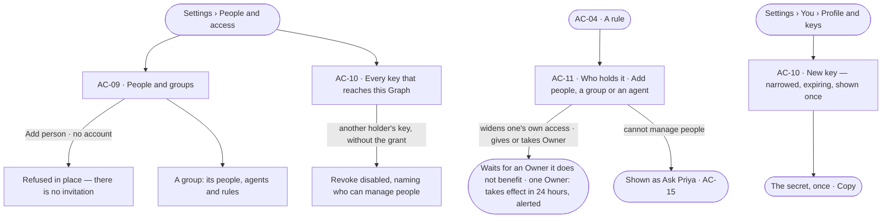

# Groups, keys and who holds a rule

> Who holds each access rule — people, groups, agents and service accounts — and the keys that act as their holder,
> narrowed. The decision it helps make: *should this person, team or key hold this — and for how long?*

## User journey

Journeys this feature is a step of: [J05 · Join a Graph someone set up](../../../../journeys/J05-join-a-graph-someone-set-up.md)

## Stories

| ID | Story | Status |
|---|---|---|
| AC-09 | [Grant a team once, with people and groups](stories/AC-09-grant-a-team-once-with-people-and-groups/story.md) | idea |
| AC-10 | [Mint a key that acts as its holder, narrowed](stories/AC-10-mint-a-key-that-acts-as-its-holder-narrowed/story.md) | idea |
| AC-11 | [See and change who holds an access rule](stories/AC-11-see-and-change-who-holds-an-access-rule/story.md) | idea |

## Access

| Act | Role (`.claude/team/TEAM.md` §7) | Everyone else sees |
|---|---|---|
| Read people, service accounts, groups and each agent's access | Operator — every member | — |
| Add people, a group or an agent to a rule · take them off | `iam-admin` · shown as *Can manage people*; widening one's own access is an Ask, and Owner and *Can manage people* are given or taken only by an Owner it does not benefit (AC-11.10) | As above |
| Add person · New service account · New group · a group's members | `iam-admin` · shown as *Can manage people* | As above |
| Mint and revoke one's own key · mark it agent-operated | Operator — every member | — |
| Mint a key for a service account · revoke another holder's key | `iam-admin` · shown as *Can manage people* | The holder field offers only *You*; *Revoke* on another's key is disabled, naming who can manage people |

## States

| State | What the person sees |
|---|---|
| First use | People: the Graph's members; Groups: *No groups yet — attach a rule once, to a team* with *New group*. Keys: *No keys yet* — what a key is for, and *New key* |
| Empty after a filter | *Nothing matches*, with the filter named and *Clear filters* |
| Loading | The sheet opens at once; lists show loading rows; counts read `—` until the engine gives them |
| Has data | People, groups and service accounts one row each; who holds the selected rule; every key that reaches this Graph |
| Failed | What could not load or save, in a sentence, with *Try again*; a refused save says why in place, naming the line or the name |
| Agent working or proposing | — no agent changes who holds a rule |
| No access | Every person, group and holder reads; each write is shown as *Ask Priya*, naming someone who can manage people |

## Rules

| Rule | Detail |
|---|---|
| Who holds access | People (members and service accounts), groups and agents. A key acts as its holder. Workers hold none — they only run steps |
| A group passes on what it holds | Every person and agent in it holds what the group holds, built-in rules included; nothing is copied |
| A key can only narrow | A key acts as its holder and may carry its own rule; it is never wider than the holder, and the holder's own access still applies |
| Agent-operated keys | A key or service account marked *agent-operated* — by someone who can manage people, or by a holder on their own key — is held to every rule agents are: its access changes are never Allow, and its asks are an agent's. A service account's keys start agent-operated; clearing the mark widens its holder |
| Leans on | Access rules (AC-F02) · asks (AC-F05) · History of every change (AC-F06) · members of the Graph (GR-F04) |

## Data touched

| Record | Read or write |
|---|---|
| Holdings — who holds a rule, how (directly · via a group · for a run), who added them, when it ends | Write · read |
| A key's or service account's *agent-operated* mark | Write · read |
| Groups and their people and agents | Write · read |
| Service accounts | Write · read |
| Keys — name, holder, its own rule, expiry, last used | Write · read |

## Engine

The low-level design: what this feature stores, serves and refuses. Conventions — naming, errors, lists, events — are
[system-design.md](../../../../system-design.md) §§ 6–8; this section only fills them in.

### Records

| Table | Columns | Notes |
|---|---|---|
| `access_rule_attachments` | `rule_id` · `graph_id` · `holder_kind` (`person` · `group` · `agent` · `token`) · `holder_id` · `attached_by_id?` · `attached_at` · `ends_at?` · `run_id?` · `via` (`direct` · `ask`) · `approval_id?` | A holding. `run_id` for *for run #N*; `via = ask` with its `approval_id` when an ask allowed it |
| `access_groups` | `graph_id` · `name` · `description` · `created_by_id?` · `created_at` | Unique (`graph_id`, `name`) |
| `access_group_members` | `group_id` · `member_kind` (`person` · `agent`) · `member_id` · `added_by_id?` · `added_at` | Unique (`group_id`, `member_kind`, `member_id`) |
| `access_tokens` | `user_id` (the holder) · `name` (1–64) · `token_hash` (sha256, unique) · `last_four` · `graph_id?` (bound to one Graph) · `policy_id?` (its own rule) · `agent_operated` · `created_by_id?` · `created_at` · `expires_at?` · `last_used_at?` · `revoked_at?` | A key. Unique (`user_id`, `name`) among live keys |

### Reads

| Record | Owner |
|---|---|
| Accounts — a service account is an `access_users` row with `is_service_account` | [AC-F01](../AC-F01-sign-in-account-and-sessions/feature.md#engine) |
| Access rules, a key's own rule, the one evaluator, and a change that waits for an Owner | [AC-F02](../AC-F02-access-rules/feature.md#engine) |
| Asks — an *access* ask that adds a holding | [AC-F05](../AC-F05-asks-and-approvals/feature.md#engine) |
| Members and their roles; adding a person to the Graph | [GR-F04](../../../graph/features/GR-F04-this-graph/feature.md#engine) |
| An agent's membership of the Graph | [AG-F02](../../../../capabilities/agents/features/AG-F02-the-agents-catalogue/feature.md#engine) |
| History — every event this feature writes | [AC-F06](../AC-F06-history/feature.md#engine) |

### Routes

| Route, after `/api/v1/u/{u}/{g}/access` | Does | Story |
|---|---|---|
| `GET /people` | Members and service accounts: `user_id` · `username` · `name` · `email?` · `kind` (`person` · `service`) · `groups[]` · `rules[]` · `tokens` (live keys reaching the Graph) · `signs_in_with` · `description?`; the tab counts are the engine's | AC-09 |
| `POST /service-accounts` · `PATCH /service-accounts/{id}` | Make one — `{username (2–64), description? (500)}`, a member as Operator · change its description or its *agent-operated* mark | AC-09 · AC-10 |
| `GET /groups` · `POST /groups` | Groups: `id` · `name` · `description` · `people_count` · `agents_count` · `rules` · make one | AC-09 |
| `GET /groups/{name}` · `PATCH /groups/{name}` · `DELETE /groups/{name}` | One group with `members[]` and `held[]` (`{attachment_id, name, kind, summary}`) · rename or describe · delete it and its holdings | AC-09 |
| `POST /groups/{name}/members` · `DELETE /groups/{name}/members/{member_kind}:{member_id}` | Add a person or an agent · remove one | AC-09 |
| `GET /rules/{name}/holders` · `POST /rules/{name}/holders` · `DELETE /rules/{name}/holders/{attachment_id}` | Who holds it (`?holder_kind=`) · add a holder for this run · N days · always · take one off | AC-11 |
| `GET /tokens` | Every key that reaches the Graph: `id` · `name` · `last_four` · `holder {user_id, username, kind}` · `graph_bound` · `narrowed_to` · `agent_operated` · `expires_at?` · `last_used_at?` · `created_at` · `created_by?` · `expired`, with `expiry_day_choices` and `max_tokens`; another holder's key carries only `name` and `holder` unless the reader can manage people | AC-10 |
| `POST /tokens` · `PATCH /tokens/{id}` · `DELETE /tokens/{id}` | Mint a key bound to this Graph — `{name, expires_in_days?, holder_id?, narrow_to?}`; the secret only in this answer · set its *agent-operated* mark · revoke it | AC-10 |

| Route, install-wide, after `/api/v1/access/auth/me` | Does | Story |
|---|---|---|
| `GET /tokens` · `POST /tokens` · `PATCH /tokens/{id}` · `DELETE /tokens/{id}` | One's own profile keys — reaching every Graph the holder is on — with `expiry_day_choices` and `max_tokens`; the secret only in `POST`'s answer | AC-10 |

### Events

| Event | When |
|---|---|
| `access.rules.attach` · `access.rules.detach` | A holder is added · taken off, or a holding ends |
| `access.groups.create` · `access.groups.update` · `access.groups.delete` | A group is made · changed · deleted |
| `access.groups.members.add` · `access.groups.members.remove` | A person or an agent joins · leaves a group |
| `access.service_accounts.create` · `access.service_accounts.update` | A service account is made · its description or mark changes |
| `access.tokens.create` · `access.tokens.update` · `access.tokens.revoke` | A key is minted · its mark changes · it is revoked — never the secret |
| `access.tokens.refused` | A key's call is refused — the reason, never the secret |

### Refusals

| Status | When | Sentence | Criterion |
|---|---|---|---|
| 409 | A service account username already on the install | *{username} is taken.* | AC-09.7 |
| 409 | A group name already used in the Graph | *{name} is taken in this graph.* | AC-09.15 |
| 409 | Adding a group member who is already in it | *{member} is already in {group}.* | API only — Studio offers only those not in it |
| 409 | A key name the holder already uses on a live key | *You already have a key named {name}.* | AC-10.20 |
| 409 | Minting past the install's ceiling of live keys per holder | *{n} of {max} keys — revoke one first.* | AC-10.11 |
| 422 | A *Narrow to* line wider than the holder may do | *Never wider than the holder.* | AC-10.6 |
| 403 | Minting for another holder, or revoking or marking another holder's key, without *Can manage people* | *This needs Can manage people — ask {holders}.* | AC-10.16 |
| 403 | A call the key's own rule does not allow — `token_narrowed` | *Key {name} is narrowed by {rule} — it does not allow {action}.* | AC-10.5 |
| 401 | A revoked key | *This key was revoked.* | AC-10.9 |
| 401 | An expired key | *This key expired on {date}.* | AC-10.10 |
| 400 | A key carried in a URL | *A key is never accepted in a URL.* | AC-10.14 |

### CLI

| Command | Does |
|---|---|
| — | No command of its own — a key is minted in a signed-in session |

### Mechanisms

| Mechanism | How |
|---|---|
| A key's value | `invana_pat_` + 32 random bytes; only its sha256 and `last_four` are kept. The prefix routes it without a JWT decode and lets a secret scanner match a leak |
| A key's limits | `expires_in_days` from `auth_token_expiry_day_choices` (`[30, 90, 365]` by default) or never · `auth_max_personal_access_tokens` live keys per holder (20 by default) · `last_used_at` touched at most once a minute. Both settings are validated before a request reaches the manager |
| A key bound to a Graph | Minted under the Graph's `…/access/tokens`, it reaches that Graph only; a profile key reaches every Graph its holder is on. A call to a Graph the holder left is refused as a non-member's ([GR-F04](../../../graph/features/GR-F04-this-graph/feature.md#engine)) |
| A key's own rule | *Narrow to* writes an `inline` rule named after the key, held by it, whose lines start as [Access › Starting lines are shown](../../product.md#decisions) says; checked against the holder at mint, deleted with the key |
| What a narrowed key reaches | A route maps to one action: a read under the Graph is `graph.read.api` on `graph/*`; `GET /api/v1/access/auth/me` always; on the Graph's MCP server each `tools/call` is one action on one resource — `agent.ask` on `agent/<name>`, a function on what it touches — and `tools/list` lists every served tool. Any other route, or an action the rule does not allow, is `token_narrowed` |
| Agent-operated | A key or service account marked `agent_operated` is held to every rule an agent is: its access changes are never Allow, its asks are an agent's, and reading access is under a line starting at Deny. A service account's keys start marked; clearing a mark widens its holder — a person's session and, where it benefits the one clearing it, a change that waits for an Owner ([AC-F02](../AC-F02-access-rules/feature.md#engine)) |
| A group passes on what it holds | Checked at each check, never copied; a group's built-in rules are holdings, so a member's effective roles are their own and their groups', unioned |
| A holding ends | `ends_at` and a `run_id` holding are read at each check; past its end or once its run ends, it does not count |
| A service account | An `access_users` row with `is_service_account`, no email and no usable password, made in one Graph and a member of it as Operator; only keys act as it |
| Leaving the Graph | Removing a member removes their group memberships and holdings in that Graph; deleting a group removes its holdings, never its members' own |
| Owner and *Can manage people* | Adding or taking either, and any holding that widens the one who adds it, goes through [AC-F02 › A change that waits for an Owner](../AC-F02-access-rules/feature.md#mechanisms) |

## System impact

| HLD section | Change | NFRs |
|---|---|---|
| § 6 Data and storage | Four tables in Invana's own store | — |
| § 8 APIs and events | The Graph's `…/access` people, groups, holders and tokens routes; one's own keys under `/api/v1/access/auth/me/tokens`; the events above | — |
| § 12 Qualities | Security: keys hashed and shown once, never in a URL, prefixed for secret scanners, never wider than the holder | — |

## Decisions

| Decision | Detail |
|---|---|
| Keys are shown once | A key's secret is shown once, at creation, and never again |

## Open questions

| Question | Who answers |
|---|---|

## Not building

| Item | Why not |
|---|---|
| Nested groups | One level carries teams |
| Invitations | A member is added directly by email or username |
| Showing a key's secret again | A secret that can be read back is a stored password |
| What a key did, per key | Last used is the key's only record of use; History records the person |
| Rotating a key, and expiry reminders by email | Revoke and mint is the whole of rotation; the product has no mail path for it |
| A key's own rate or token ceiling | A key is its holder; the holder's limits and their rules' limits already bind it |
| Refusing a *Narrow to* line that matches nothing | A line only narrows; one that reaches nothing narrows the key to less, and the starting lines are shown before the key is made (AC-10.17) |
| Minting a key from the command line | A key is minted from *Profile and keys* or *People and access*, in a signed-in session |
