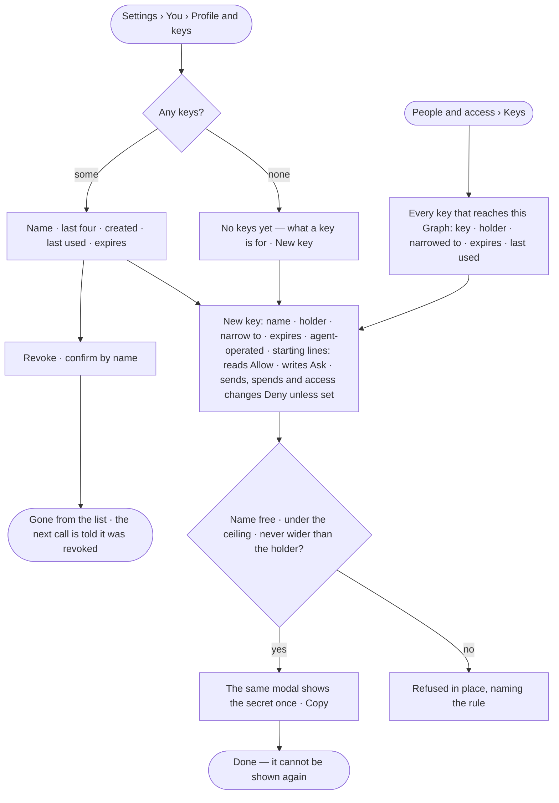
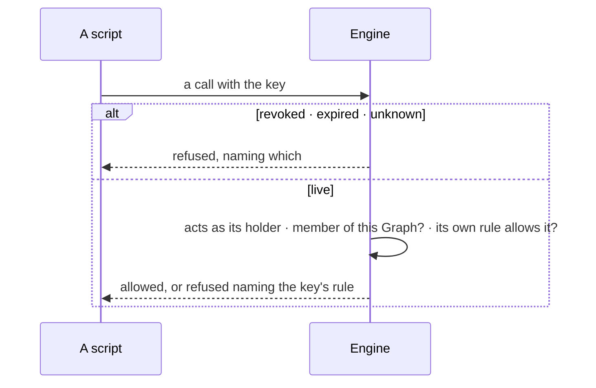

# AC-10 · Mint a key that acts as its holder, narrowed

**As** a member — or someone who can manage people, for a service account — **I want** a key that acts as its holder
for scripts, CI and Claude Code, narrowed to what one job needs, expiring and shown once **so that** software pushes
data without a person's login, and a leaked key reaches only that.

Tasks: [task.md](task.md) · Feature: [AC-F03](../../feature.md)

## Who can

| Lens | Can | Otherwise sees |
|---|---|---|
| Admin | Mint and revoke their own keys and mark them agent-operated; mint a key for a service account; read every key's details; revoke any key that reaches the Graph | — |
| Operator | Mint and revoke their own keys and mark them agent-operated, on their profile and in this Graph | *Holder* offers only *You*; another's key reads by name and holder only; *Revoke* on it shown as *Ask Priya*, naming someone who can manage people |

## Flow

## Acceptance criteria

| # | Given | When | Then |
|---|---|---|---|
| AC-10.1 | A member with no keys | *Profile and keys* is read | *No keys yet* says what a key is for — *For scripts and Claude Code. A key acts as you, can do less than you, and expires* — with *New key* |
| AC-10.2 | A member | they mint a key with a name and an expiry from the install's choices, or never | the same modal turns into the secret with *Copy* and *It is not shown again*; *Done* closes it |
| AC-10.3 | A minted key | the modal is closed | the secret can never be shown again; the list offers minting another |
| AC-10.4 | A key | it is used by a script | it acts as its holder in every Graph they are a member of, with their access — or, minted in a Graph, in that Graph only |
| AC-10.5 | A key minted with *Narrow to* lines | a call its own rule does not allow is made | it is refused, naming the key and its rule |
| AC-10.6 | *Narrow to* | a line is wider than the holder may do | the mint is refused, *Never wider than the holder* |
| AC-10.7 | Someone who can manage people | they mint a key whose holder is a service account of the Graph | it acts as that service account |
| AC-10.8 | A member removed from a Graph | their key calls it | it is refused; the key still reaches their other Graphs |
| AC-10.9 | A key | its holder revokes it, confirming by name | it leaves the list; the next call is refused, told it was revoked |
| AC-10.10 | A key past its expiry | it is used | it is refused as expired; the row stays, marked *Expired*, until revoked |
| AC-10.11 | A member at the install's ceiling of keys | the list is read | *New key* is disabled and the count says why |
| AC-10.12 | A call made with a key | it tries to mint or revoke a key, change a password, delete the account or add a user | it is refused — managing credentials needs a signed-in session |
| AC-10.13 | A holder's password change | their keys are used | they still work; only sessions end |
| AC-10.14 | A key in a URL | a call carries it there | it is not accepted |
| AC-10.15 | *People and access › Keys*, read by someone who can manage people | it is read | every live or expired key bound to the Graph and every profile key of a member: key · holder · narrowed to · expires · last used |
| AC-10.16 | An Operator | they open *Keys* | their own keys read in full; another's key reads by name and holder only — its own rule, expiry and last use are absent; *Holder* offers only *You*; *Revoke* on another's key is shown as *Ask Priya* |
| AC-10.17 | A new key | it is minted | its own rule starts reads at Allow, writes at Ask, and sends, spends and access changes at Deny unless the minter sets them when the key is made, never wider than the holder; the starting lines are shown before the key is made |
| AC-10.18 | A key | its holder marks it *agent-operated*, or it is a service account's key | it is held to every rule agents are, its access changes never Allow; a service account's keys start marked; clearing the mark is a widening of its holder (AC-04.16 · AC-11.11) |
| AC-10.19 | An agent-operated key | it reads access rules, holders or *Can someone do this?* | the read is under a line on its own rule, starting at Deny, as an agent's does; on a key not marked it starts at Allow, with its other reads ([Reading access is no act](../../../../product.md#decisions)) |
| AC-10.20 | A name the holder already uses on a live key | a key is minted with it | it is refused in place, naming it |

## Screens

| Surface | Lens | First use | Empty after a filter | Loading | Has data | Failed | Agent working or proposing | No access |
|---|---|---|---|---|---|---|---|---|
| Your keys | Admin | settings.me · No keys yet | — | settings.me · Loading | settings.me | settings.me · At the ceiling | — | — |
| Your keys | Operator | settings.me · No keys yet | — | settings.me · Loading | settings.me | settings.me · At the ceiling | — | — |
| New key — then its secret | Admin | — | — | — | settings.me · Key created | settings.me · Wider than the holder | — | — |
| New key — then its secret | Operator | — | — | — | settings.me · Key created | settings.me · Wider than the holder | — | settings.me · Only you as holder |
| This Graph's keys | Admin | settings.access · No keys yet | settings.access · Nothing matches | settings.access · Loading | settings.access · Keys | settings.access · Could not load | — | — |
| This Graph's keys | Operator | access.locked · No keys yet | access.locked · Nothing matches | access.locked · Loading | access.locked · Keys | access.locked · Could not load | — | access.locked · Keys |
