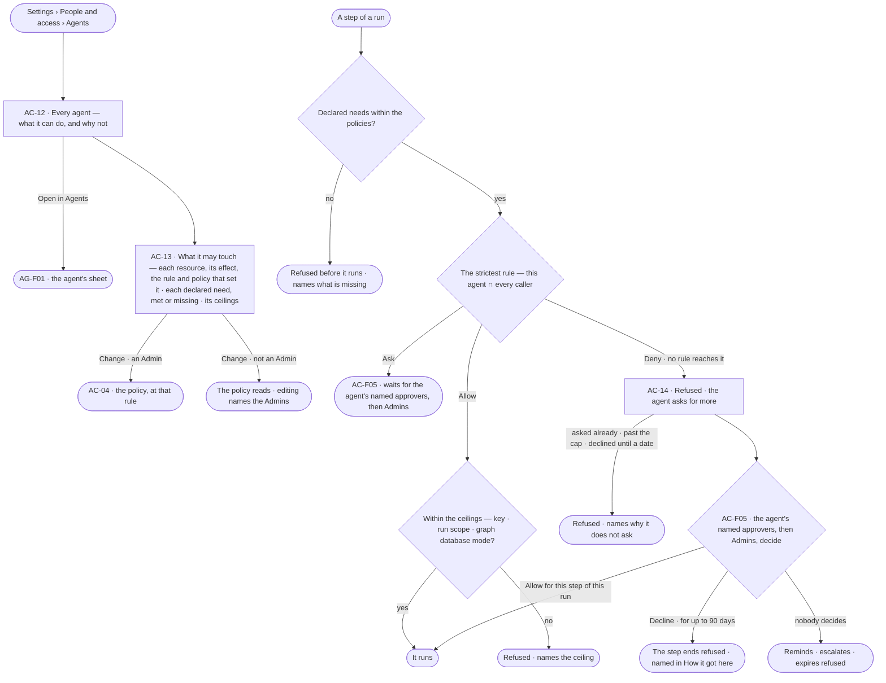
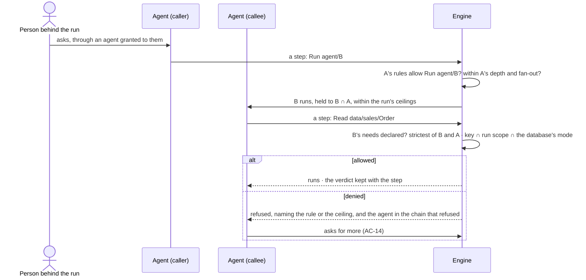

# What an agent may touch

> What each agent can actually Read, Write and Run and why not — its Access Policies narrowed by every caller along a
> chain and by the ceilings of the run it is in — the same for everyone who may use it — beside what its skills,
> plugins and workflows declare they need, and the ask a denied agent raises for more.
> The decision it helps make: *should this agent be able to touch this — and should it have more when it asks?*

## User journey

Journeys this feature is a step of: [J06 · Set what an agent may touch](../../../../journeys/J06-set-what-an-agent-may-touch.md) ·
[J09 · Audit what an agent touched](../../../../journeys/J09-audit-what-an-agent-touched-and-what-left-the-platform.md)

## Stories

| ID | Story | Status |
|---|---|---|
| AC-12 | [See why an agent can or cannot](stories/AC-12-see-why-an-agent-can-or-cannot/story.md) | idea |
| AC-13 | [See what an agent may touch](stories/AC-13-see-what-an-agent-may-touch/story.md) | idea |
| AC-14 | [A denied agent asks for more](stories/AC-14-a-blocked-agent-asks-for-more/story.md) | idea |

## Access

| Act | Role ([the role table](../AC-F02-access-policies/feature.md#the-role-table)) | Everyone else sees |
|---|---|---|
| Read every agent's access — what it can do, every rule that reaches it, its declared needs, its ceilings, its refusals | Every signed-in person — Operator, Modeller, Admin | — |
| Attach a policy to an agent from here, or *Change* a rule | Admin, in a session ([AC-11](../AC-F02-access-policies/stories/AC-11-attach-a-policy-to-agents/story.md) · [AC-04](../AC-F02-access-policies/stories/AC-04-write-the-rules-of-an-access-policy/story.md)) | Disabled, naming the Admin role and the Admins |
| Decide an ask for more | The agent's named approvers, then Admins, in a session — never the person it benefits ([AC-F05](../AC-F05-asks-and-approvals/feature.md)) | The ask reads; its acts are disabled, naming who it waits on |
| Set the caps on asks for more | Admin, in Limits ([CP-F04](../../../control/features/CP-F04-limits/feature.md)) | The caps read |

## States

| State | What the person sees |
|---|---|
| First use | The built-in agents, each with its built-in policy; an agent made here with no policy attached reads *Holds no policy — every act is denied* |
| Empty after a filter | *Nothing matches*, with the filter named and *Clear filters* |
| Loading | The sheet opens at once; lists show loading rows; counts read `—` until the engine gives them |
| Has data | Each agent, what it can actually do and why not; each resource with its effect and the rule and policy that set it; each declared need, met or missing; the ceilings a run would add |
| Failed | What could not load, in a sentence, with *Try again* |
| Agent working or proposing | A denied agent asking for more in Needs you |
| No access | Every agent's access reads; attaching and *Change* are disabled, naming the Admin role and the Admins |

## Rules

| Rule | Detail |
|---|---|
| Everyone reads an agent's access | What an agent may touch is read from Access Policies, which every signed-in person reads; a person must see a rule to know whom to ask. What an agent did — its usage, its calls and a run's content — is read as [Access usage](../AC-F08-access-usage/feature.md) and [What left the platform](../AC-F09-what-left-the-platform/feature.md) say |
| The same for everyone | An agent's access is its Access Policies', narrowed only by its callers and its ceilings; the person behind a run, their role and their teams never change what the agent reaches. Who may start a run is the role and the grant ([AC-F02 › The order of checks](../AC-F02-access-policies/feature.md#the-order-of-checks)) |
| Who is behind a run | A run a person starts has that person behind it; a key's run has the key's owner; a connected client's run has the person who consented. A scheduled run and a project's pick-up run as the agent, with the person who set them recorded ([AG-F07](../../../../capabilities/agents/features/AG-F07-schedules/feature.md)); no person's grant or role is checked for them, and they keep running if that person leaves |
| Narrowed at every hop | Delegating is a Run on `agent/<name>`; the callee runs with the callee's rules ∩ every caller's rules, within the caller's depth and fan-out ([AG-F05](../../../../capabilities/agents/features/AG-F05-delegation-and-outside-agents/feature.md)). The strictest effect along the chain wins. Narrowing is agent to agent only. A helper an agent makes holds its maker's access, narrowed, and none of its own |
| Ceilings only narrow | What the rules allow is narrowed by every ceiling that applies to the run — never widened: the **key** it runs under ([AC-F10](../AC-F10-keys/feature.md)) or the connected client's narrowing ([AC-F11](../AC-F11-connect-an-mcp-client/feature.md)) · the **run scope** · a **credential's scope** at the outside system · the **graph database's mode** — a Write needs a read + write graph database ([CP-F05](../../../control/features/CP-F05-graph-databases/feature.md)) · the **worker sandbox** on a worker ([CP-F03](../../../control/features/CP-F03-workers-and-the-queue/feature.md)) |
| The run scope | A run inside a project reaches `memory/project/…` and `project/…` only for its own project, the projects related to it ([PJ-F01](../../../../capabilities/projects/features/PJ-F01-projects-and-tasks/feature.md)) and its task, whatever its policies allow beyond them; a run outside any project has no run scope |
| Outside agents | An agent of kind *external*, reached over A2A or MCP, is Ask by default: a Run on it waits for a named approver unless a rule allows it ([AG-F05](../../../../capabilities/agents/features/AG-F05-delegation-and-outside-agents/feature.md)) |
| Declared needs | A skill, plugin, workflow or function declares the verbs and resources it needs; a declaration grants nothing. It is usable by an agent when every need is within the agent's policies and its ceilings. Otherwise it is refused before it runs, naming the first need missing |
| Switched off is refused first | A step needing a graph database or plugin switched off is refused before any rule is read, naming who switched it off — the install's switch for every run, the person's own for the runs they start ([CP-F02](../../../control/features/CP-F02-plugins-and-outside-tools/feature.md) · [CP-F05](../../../control/features/CP-F05-graph-databases/feature.md)) |
| Only people change access | No agent writes a policy, a rule, an attachment, a grant, a role, a team, an owner or an approver; a step that would is refused. An agent's route to more is an ask for the act it needs |
| Asks for more are bounded | An *item* is one verb on one resource. A denied step asks at most once per run per item; a match to an open ask joins it; a helper's or a delegate's asks count against its root agent. Asks for more are capped per agent per day and for the deployment per day — limits an Admin sets in [Limits](../../../control/features/CP-F04-limits/feature.md) |
| A yes is for this step of this run | An allowed ask for more lets that step, for that agent, in that run — never its children and never another run. A lasting change is a rule an Admin saves, after *Who it changes* (AC-06) |
| Checked when the step runs | Each step is checked against the policies in force when it runs; a policy saved mid-run holds from the next step, and an open ask on an act it now denies closes refused, naming the rule |
| Leans on | Access Policies, the order of checks and the one evaluator (AC-F02) · grants (AC-F03) · asks (AC-F05) · History of every verdict (AC-F06) · keys (AC-F10) · agents (AG-F01) · skills and their needs (AG-F04) · delegation (AG-F05) · projects and their relations (PJ-F01) |

## Data touched

| Record | Read or write |
|---|---|
| Access Policies, their rules, versions and attachments (AC-F02) | Read |
| Grants of agents (AC-F03) | Read |
| Declared needs of skills, plugins, workflows and functions | Read |
| A run's key, project, related projects and task — its ceilings | Read |
| Asks for more (AC-F05) and refusals in History (AC-F06) | Read |

## Engine

The low-level design: what this feature stores, serves and refuses. Conventions — naming, errors, lists, events — are
[system-design.md](../../../../system-design.md) §§ 6–8; this section only fills them in.

### Records

| Table | Columns | Notes |
|---|---|---|
| — | — | No table of its own: it reads [AC-F02](../AC-F02-access-policies/feature.md#engine)'s rules through the one evaluator, keeps each verdict on a History row ([AC-F06](../AC-F06-history/feature.md#engine)) and raises asks for more as [AC-F05](../AC-F05-asks-and-approvals/feature.md#engine) rows |

### Reads

| Record | Owner |
|---|---|
| Access Policies, rules, attachments, the order of checks and the one evaluator `decide()` | [AC-F02](../AC-F02-access-policies/feature.md#engine) |
| Users and the agents granted to each | [AC-F03](../AC-F03-directory/feature.md#engine) |
| Asks for more — raised, joined, declined until a date | [AC-F05](../AC-F05-asks-and-approvals/feature.md#engine) |
| History — refusals, and the verdict kept with each step | [AC-F06](../AC-F06-history/feature.md#engine) |
| A key's narrowing | [AC-F10](../AC-F10-keys/feature.md#engine) |
| The caps on asks for more | [CP-F04](../../../control/features/CP-F04-limits/feature.md#engine) |
| Switches and declared needs of plugins and functions | [CP-F02](../../../control/features/CP-F02-plugins-and-outside-tools/feature.md#engine) |
| Graph databases, their mode and switch | [CP-F05](../../../control/features/CP-F05-graph-databases/feature.md#engine) |
| Agents and their kind; skills and their declared needs | [AG-F01](../../../../capabilities/agents/features/AG-F01-build-an-agent/feature.md#engine) · [AG-F04](../../../../capabilities/agents/features/AG-F04-skills/feature.md#engine) |
| A run, the person behind it, its key, its project and task, its caller chain and its steps | [CP-F10](../../../control/features/CP-F10-runs-and-how-the-agents-are-doing/feature.md#engine) |
| A project's related projects | [PJ-F01](../../../../capabilities/projects/features/PJ-F01-projects-and-tasks/feature.md#engine) |
| Delegation depth and fan-out | [AG-F05](../../../../capabilities/agents/features/AG-F05-delegation-and-outside-agents/feature.md#engine) |

### Routes

| Route, after `/api/v1/access` | Does | Story |
|---|---|---|
| `GET /agents` | One row per agent by the list contract (`?kind=builtin · custom · external` · `?q=`): `name` · `kind` · `policies[]` · `allowed` (resources it may reach) · `needs_missing` · `refused_7d` · `made_by` · `granted_count`; helpers counted on their maker | AC-12 |
| `GET /agents/{name}/effective?caller=&project=&key=` | What it can do, called by that agent chain, within the ceilings of that project and key: `{agent, callers[], ceilings[], rows[], needs[], delegates[]}`; a row `{verb, resource, effect, rule, policy, policy_version, set_by, narrowed_by?, ceiling?, why}` | AC-12 · AC-13 |
| `GET /agents/{name}/needs` | Each skill, plugin, workflow and function the agent uses, each need, and whether it is met — missing names the rule, the ceiling or the switch | AC-13 |
| `GET /agents/{name}/refusals` | A page of the agent's refused History rows | AC-12 |

### Events

| Event | When |
|---|---|
| — | No event of its own: each verdict is a History row ([AC-F06](../AC-F06-history/feature.md#engine)) and a refusal is `access.check.refused` ([AC-F02](../AC-F02-access-policies/feature.md#engine)); an ask for more is `access.approvals.request` ([AC-F05](../AC-F05-asks-and-approvals/feature.md#engine)) |

### Refusals

| Status | When | Sentence | Criterion |
|---|---|---|---|
| step | A step no rule along the chain allows, or a Deny — `policy_refused`; it fails before it runs and nothing is spent | *{agent} may not {verb} {resource} — {rule} on {policy}{, via caller}.* | AC-12.10 · AC-14.1 |
| step | A step its rules allow but a ceiling does not — the key, the run scope or a credential's scope | *{ceiling} keeps {agent} from {verb} {resource}.* | AC-13.16 |
| step | A step whose skill, plugin, workflow or function declares a need the agent's policies do not allow | *{thing} needs {verb} {resource} — {agent}'s policies do not allow it.* | AC-13.7 |
| step | A Write on a read-only graph database | *{database} is read-only — {thing} needs to write.* | AC-13.8 |
| step | A step needing a graph database or plugin switched off | *{name} is switched off by {person}.* | AC-13.9 |
| step | A step that would write a policy, rule, attachment, grant, role, team, owner or approver | *Only a person changes access.* | AC-14.10 |
| step | A second ask for the same item in one run | *Already asked — {ask}.* | AC-14.9 |
| step | An ask for more past the agent's daily cap or the deployment's | *{n} asks today — the {agent or deployment} cap is {cap}.* | AC-14.13 |
| step | An ask for more on an item declined for that agent until a date | *Declined until {date} by {person}.* | AC-14.12 |

### CLI

| Command | Does |
|---|---|
| `invana access effective <agent> [--caller <agent>] [--project <project>]` | What the agent can do, each row with its rule, policy and any ceiling; writes nothing |

### Mechanisms

| Mechanism | How |
|---|---|
| The gate | Steps 3 – 5 of [the order of checks](../AC-F02-access-policies/feature.md#the-order-of-checks): the switches its graph databases and plugins need; then each declared need and the step's own verb and resource through `decide(agent, verb, resource)` ([AC-F02](../AC-F02-access-policies/feature.md#engine)) for the agent and for every caller along the chain — the strictest answer wins; then the ceilings. The first refusal is named |
| A step's resource | A graph read or write: `data/<graph database>/<kind>` for each kind the typed query plan names · memory: `memory/project/<project>` · `memory/agent/<agent>` · `memory/org` · a project's tasks, files and context: `project/<project>` · a skill: `skill/<name>` · a workflow: `workflow/<name>` · handing work on: `agent/<name>` · a plugin's function: `plugin/<name>` · a tool: `tool/<plugin>/<tool>` · on a worker: `fs/<path>` · `cmd/<program>` · `net/<host>` |
| The caller chain | A run carries its chain of agents from the root; `decide()` runs once per agent on it, none with a person; depth and fan-out are the caller's ([AG-F05](../../../../capabilities/agents/features/AG-F05-delegation-and-outside-agents/feature.md#engine)) |
| The ceilings | `ceilings(run)` intersects, in order, the key's allow list ([AC-F10](../AC-F10-keys/feature.md#engine)) · the run scope — a run with a project keeps `memory/project/…` and `project/…` to its project, its related projects and its task · the graph database's mode. A credential's scope is the outside system's own and refuses there; the worker sandbox enforces `fs/` · `cmd/` · `net/` on the worker ([CP-F03](../../../control/features/CP-F03-workers-and-the-queue/feature.md#engine)) |
| Declared needs | Read from the registry and the skill's version; each need is a verb and a resource. A need on `data/…` with Write is also held to the graph database's mode |
| A verdict is kept | Each step's History row keeps the effect, the rule, its policy and version, any ceiling that narrowed it and who saved the rule, as they were when the step ran; *How it got here* reads these, never today's policies |
| An ask for more | A denied step raises one `access` ask per run per item; a match to an open ask joins it; caps count asks raised since 00:00 UTC, per root agent and for the deployment |
| A policy saved mid-run | The next step is checked against it; an open ask on an act it now denies closes refused, naming the rule |
| The effective view | Rows are the union of every resource a rule on an attached policy names and every declared need, grouped by resource type; a row's effect is the strictest along the chain, then narrowed by the ceilings chosen; a need no rule reaches reads *No rule — denied* |

## System impact

| HLD section | Change | NFRs |
|---|---|---|
| § 10 AI and agents | Every step is checked before it runs against its declared needs, the strictest rule along the caller chain and the run's ceilings; a denied agent asks a person, capped per agent and for the deployment | NFR-SEC-5 |
| § 12 Qualities | Security: an agent never does more than its own policies and its callers' allow, within its ceilings, the same for everyone; no agent changes access; every verdict is kept with the step | NFR-SEC-1 |

## Decisions

| Decision | Detail |
|---|---|
| Agents are read here, built in Agents | *People and access › Agents* reads each agent's access; *Open in Agents* opens its sheet |
| One view for everyone | *What it can do* reads the same for every reader, since no rule depends on the person; a reader may add a caller, a project or a key to see the ceilings a run would add |
| An ask for more allows this step of this run only | A lasting change is an Admin's saved rule; the ask offers an Admin *Draft a rule*, which opens a draft with *Who it changes* (AC-06) |

## Open questions

| Question | Who answers |
|---|---|

## Not building

| Item | Why not |
|---|---|
| Building agents here | Agents builds them (AG-F01); this reads them |
| Rules held by a worker | Workers run any agent's steps; access belongs to the agent, and the sandbox enforces the agent's `fs/` · `cmd/` · `net/` rules there |
| Narrowing by the person or their teams | The same agent does the same thing for everyone who may use it |
| Allowing an ask for more for days or always | A lasting change is a rule an Admin saves after seeing who it changes |
| Rules of an agent's own beside its policies | Every rule lives on an Access Policy attached to the agent |
