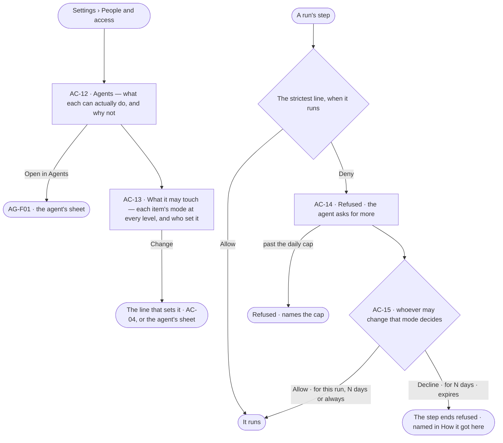

# What an agent may touch

> What each agent can actually do in this Graph and why not, every item's value at every level and who set it — and
> the ask a denied agent raises for more. The decision it helps make: *should this agent be able to touch this — and
> should it have more when it asks?*

## User journey

Journeys this feature is a step of: [J06 · Set what an agent may touch](../../../../journeys/J06-set-what-an-agent-may-touch.md)

## Stories

| ID | Story | Status |
|---|---|---|
| AC-12 | [See why an agent can or cannot](stories/AC-12-see-why-an-agent-can-or-cannot/story.md) | idea |
| AC-13 | [See what an agent may touch](stories/AC-13-see-what-an-agent-may-touch/story.md) | idea |
| AC-14 | [A denied agent asks for more](stories/AC-14-a-blocked-agent-asks-for-more/story.md) | idea |

## Access

| Act | Role (`.claude/team/TEAM.md` §7) | Everyone else sees |
|---|---|---|
| An agent's access from its own sheet | Read: every member · attach a rule: `iam-admin` | As above |
| Read what an agent may touch — every item's value, its level and who set it | Operator — every member | — |
| Lock a Deny line on a holder's own rule — never one on an Owner's access changes · mark a key or service account agent-operated | `iam-admin` · shown as *Can manage people* | As above |
| Edit an agent's own rule — tighten, or loosen back no further than the Graph, never past a locked line | `builder` · shown as *Can build agents* · Admin, from the agent's sheet (AG-F01) | Each value reads; changing it is disabled, naming *Can build agents* |
| Change the daily caps on asks for more — per holder and for the Graph | `owner` · shown as *Owner*, in *This graph › General* (GR-15) | The caps read in *Usage and limits* (GR-14); changing them is shown as *Ask Priya (owner)* |
| Decide an ask — an agent's ask for more, or a person's act set to Ask | Someone who holds Allow on that act, from a signed-in session, never the asker nor whoever it benefits; the Owner always holds Allow on access changes (AC-F05) | The ask reads; its acts are disabled, naming who it waits on |

## States

| State | What the person sees |
|---|---|
| First use | Each agent of the Graph with what it may touch on the starting lines of its own rule |
| Empty after a filter | *Nothing matches*, with the filter named and *Clear filters* |
| Loading | The sheet opens at once; lists show loading rows; counts read `—` until the engine gives them |
| Has data | Each agent, what it can actually do and why not; every item's value at every level and who set it |
| Failed | What could not load or save, in a sentence, with *Try again* |
| Agent working or proposing | An agent denied by a line, asking for more in Needs you |
| No access | Every agent's access reads; each write is shown as *Ask Priya*, naming someone who can manage people |

## Rules

| Rule | Detail |
|---|---|
| An agent never does more than its starter | A run a person started is bounded by what that person may do |
| Helpers hold their maker's access | A helper an agent makes holds its root agent's access, narrowed; never rules of its own. An agent handed work holds its own, narrowed by the root agent's own rule; the strictest value along the caller chain binds ([the strictest along the caller chain](../../product.md#decisions)) |
| A locked Deny | Someone who can manage people may lock a Deny line on a holder's own rule — never one that reaches an Owner's access changes; a builder cannot change or remove it |
| Asks for more are bounded | An *item* is one act on one thing — a function, a kind or a sensitivity, an AI model version, an agent, or a line. Asks for more are capped at 20 per holder per day, and at 200 for the whole Graph — limits its Owner changes in *This graph › General* (GR-15). A helper's or a delegate's asks count against its root agent. A repeat of an open ask joins it rather than making another (AC-14) |
| Asks for access go to the Inbox | An ask for access, a higher limit, or more than a line allows (AC-14) is an ask in Needs you (AC-15); allowed, it adds the holder for this run · N days · always, and *Who holds it* says when it ends |
| Leans on | Access rules (AC-F02) · asks (AC-F05) · History of every refusal (AC-F06) · agents built in Agents (AG-F01) · what a run may see, narrowed the same way along the chain ([SE-F09 › Engine](../../../../capabilities/semantics/features/SE-F09-views-of-the-graph/feature.md#engine)) |

## Data touched

| Record | Read or write |
|---|---|
| The Graph's daily caps on asks for more — per holder and for the Graph — and the asks made today | Write · read |
| Refusals in History (AC-F06) | Read |

## Engine

The low-level design: what this feature stores, serves and refuses. Conventions — naming, errors, lists, events — are
[system-design.md](../../../../system-design.md) §§ 6–8; this section only fills them in.

### Records

| Table | Columns | Notes |
|---|---|---|
| — | — | No table of its own: it checks against [AC-F02](../AC-F02-access-rules/feature.md#engine)'s rules, keeps each verdict on a History row ([AC-F06](../AC-F06-history/feature.md#engine)) and raises asks for more as [AC-F05](../AC-F05-asks-and-approvals/feature.md#engine) rows |

### Reads

| Record | Owner |
|---|---|
| Access rules, a line's value, lock and setter, the one evaluator and limits | [AC-F02](../AC-F02-access-rules/feature.md#engine) |
| Holdings and groups | [AC-F03](../AC-F03-groups-keys-and-holders/feature.md#engine) |
| Asks for more — raised, joined, declined for N days | [AC-F05](../AC-F05-asks-and-approvals/feature.md#engine) |
| History — refusals, and the verdict kept with each step | [AC-F06](../AC-F06-history/feature.md#engine) |
| The daily caps on asks for more | [GR-F04](../../../graph/features/GR-F04-this-graph/feature.md#engine) |
| Agents, their skills' needs, owner and *May delegate to*; refusing a looser own rule on the agent's save | [AG-F01](../../../../capabilities/agents/features/AG-F01-build-an-agent/feature.md#engine) · [AG-F04](../../../../capabilities/agents/features/AG-F04-skills/feature.md#engine) |
| A run, its starter, its caller chain and its steps | [AG-F03](../../../../capabilities/agents/features/AG-F03-runs-and-how-the-agents-are-doing/feature.md#engine) |
| Handing work to another agent | [AG-F05](../../../../capabilities/agents/features/AG-F05-delegation-and-outside-agents/feature.md#engine) |
| The view of the graph a run is held to | [SE-F09](../../../../capabilities/semantics/features/SE-F09-views-of-the-graph/feature.md#engine) |

### Routes

| Route, after `/api/v1/u/{u}/{g}/access` | Does | Story |
|---|---|---|
| `GET /agents` | One row per agent: `agent_id` · `name` · `kind` · `version` · `rules[]` · `functions_allowed` · `refused_7d` · `refused_line` · `owner`; helpers counted on their maker | AC-12 |
| `GET /agents/{id}/effective?started_by=&run_id=&world_id=` | What it can do: `{agent, owner, started_by?, world?, rules[], layers, rows[], delegates[], functions_allowed, allowed, refused}`; a row `{action, resource, layer, bound, needs, rules, started_by, world, boundary, value, level, line_version, set_by, locked, effective, why}` | AC-12 · AC-13 |
| `GET /agents/{id}/refusals` | A page of the agent's refused History rows | AC-12 |

### Events

| Event | When |
|---|---|
| — | No event of its own: each verdict is a History row ([AC-F06](../AC-F06-history/feature.md#engine)); an ask for more is `access.approvals.request` ([AC-F05](../AC-F05-asks-and-approvals/feature.md#engine)) |

### Refusals

| Status | When | Sentence | Criterion |
|---|---|---|---|
| step | A check refuses a step — `policy_refused`, the step fails before it runs and nothing is spent | *{check}: {rule or person} does not allow {action} on {resource}.* | AC-12.12 · AC-14.1 |
| step | An access change that widens the agent, its helpers, its starter or its delegates, or loosens any line | *An agent's access change is never allowed — Deny, fixed.* | AC-14.14 |
| step | A second ask for the same item in one run | *Already asked — {ask}.* | AC-14.9 |
| step | An ask for more past the holder's daily cap or the Graph's | *{n} asks today — the {holder or graph} cap is {cap}.* | AC-14.13 |
| step | An ask for more on an item its holder was declined for N days | *Declined until {date} by {person}.* | AC-14.17 |
| 403 | An agent changes a line's value — deciding an ask is [AC-F05](../AC-F05-asks-and-approvals/feature.md#refusals)'s | *Only a person decides.* | AC-14.10 |

### CLI

| Command | Does |
|---|---|
| — | No command of its own |

### Mechanisms

| Mechanism | How |
|---|---|
| The gate | `check(run, step)` runs before every step whose function has a bound: what its skill needs ∩ the agent's rules ∩ its own rule ∩ the person who started the run ∩ the view of the graph ∩ every *For everyone* rule ∩ every caller along the chain — against the lines in force when the step runs. The view keeps enforcing as each step touches a record ([SE-F09](../../../../capabilities/semantics/features/SE-F09-views-of-the-graph/feature.md#engine)) |
| A step's resource | A graph function: `graph/<Kind>/*` when its arguments name a kind, else the layer · an AI model call: `llm/<provider>/<model>` of the run's endpoint · `web.*`: `third_party/web/<host>` · `mcp.<server>.<tool>`: `third_party/mcp/<server>/<tool>` · `mail.*`: `third_party/mail/*` · handing work to an agent: `agent/<name>` · raising a task: `project/<key>` |
| A resource not known before the step | Checked at the layer: a line matches when its action matches and one of its resources is in that layer |
| A verdict is kept | Every step's History row keeps the value that applied, its level, the line's version and who set it, as they were when the step ran; *How it got here* reads these, never today's lines |
| A refusal | The step fails `bound` · `policy_refused`, naming the first check that refused, the layer and the rule or person |
| Helpers and delegates | A helper holds its root agent's rules, narrowed, and none of its own; a delegate holds its own, narrowed by the root agent's own rule. *May delegate to* (`always` · `ask` · `never`) sits under the rules: `always` runs only when the caller's rules allow `work.delegate` on `agent/<name>`, else it asks the target's owner; an unlisted target is `ask`; `never` refuses; a helper the caller made is always allowed |
| An agent's access change | Fixed for every agent: one that widens or loosens is Deny; any other is at most Ask. No line, lock or ask moves it |
| A locked Deny | `locked` on a Deny line of a holder's own rule, set by someone who can manage people; a builder's edit to the agent's own rule cannot change or remove it. No lock reaches an Owner's access changes |
| An ask for more | A denied step may raise one `access` ask per run per item — one act on one thing; a match to an open ask joins it. A helper's or a delegate's asks count against its root agent. The daily caps count asks raised since 00:00 UTC, per holder and per Graph |
| A tightened line mid-run | The next step is checked against it; an open ask on an act the line now denies closes refused, naming the line |
| The effective matrix | Rows are the union of the agent's skills' needs and the functions its rules allow, grouped by layer; a row's resource is the narrowest a matching line names — most segments without a wildcard, then longest. An item no line reaches reads *No line — denied*; data with no sensitivity is flagged unlabelled |

## System impact

| HLD section | Change | NFRs |
|---|---|---|
| § 10 AI and agents | Every step is checked before it runs against every bound along the caller chain; a denied agent asks a person, capped per holder and per Graph | — |
| § 12 Qualities | Security: an agent never does more than its starter; its access change is never Allow; every verdict is kept with the step | — |

## Decisions

| Decision | Detail |
|---|---|
| Agents are read here, built in Agents | The Agents tab reads each agent's access; *Open in Agents* opens its sheet. A rule added to an agent from either side is one record |

## Open questions

| Question | Who answers |
|---|---|

## Not building

| Item | Why not |
|---|---|
| Building agents here | Agents builds them (AG-F01); this reads them |
| Rules on workers | Workers run any agent's steps; access belongs to the agent |
