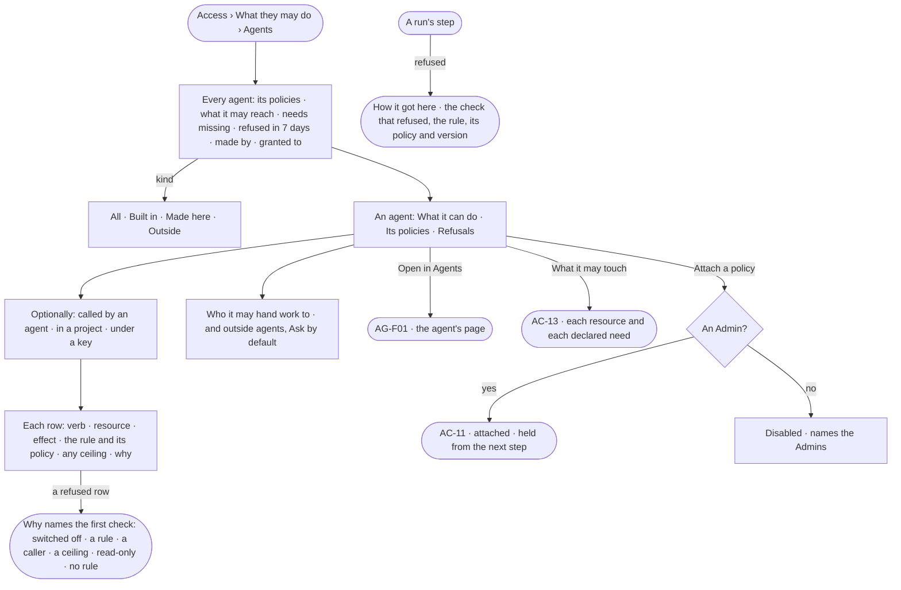

# AC-12 · See why an agent can or cannot

**As** an Admin **I want** every agent's access, with why each act is allowed or refused **so that** I see why an agent
can or cannot — its ceiling, and what it reaches for a given person — and a refusal never surprises anyone in a run.

Tasks: [task.md](task.md) · Feature: [AC-F04](../../feature.md)

## Who can

| Access | Can | Otherwise sees |
|---|---|---|
| Admin | Read every agent's access; attach a policy to it (AC-11) | — |
| Operator | Read every agent's access, its policies and its refusals when they hold Read on `access/policies`; without it nothing here | *No access* — *Needs Read on Access — ask Priya or Lee*; with Read, *Attach a policy* disabled — *Needs Manage on Access — ask Priya or Lee* |

## Flow

## Acceptance criteria

| # | Given | When | Then |
|---|---|---|---|
| AC-12.1 | The deployment's agents | *Agents* is read | one row per built-in, made-here and outside agent — its policies, how many resources it may reach, needs missing, refused in 7 days, who made it and how many people it is granted to; helpers are counted on their maker, not listed |
| AC-12.2 | The tab | it is read | it says *An agent holds every Read, Write and Run through the Access Policies attached to it. Workers hold none — they only run steps* |
| AC-12.3 | An agent | it is opened | tabs *What it can do · Its policies · Refusals*, and *Open in Agents* |
| AC-12.4 | *What it can do* | it is read, optionally *Called by* an agent, *In* a project or *Under* a key | each row reads verb · resource · effect · the rule and its policy · any ceiling that narrows it · why, for that chain and those ceilings |
| AC-12.5 | An agent's *What it can do* | it opens, and then a reader names a person behind the run | it opens on the agent's ceiling — the same rows for every reader; with a person named, each row narrows to what that person's default agent also allows, a row the person lacks reading *Not for {person} — {rule} on their default agent* |
| AC-12.6 | A refused row | *Why* is read | it names the first check that refuses — *{database} is switched off by {person}* · *{rule} on {policy}* · *{caller} may not* · *{ceiling} keeps it from this* · *{database} is read-only* · *No rule — denied* |
| AC-12.7 | An agent with no policy attached | *What it can do* is read | every row reads *Denied · holds no policy*, and for an Admin *Attach a policy* leads |
| AC-12.8 | A resource a rule allows that no declared need uses | it is listed | it reads *Nothing it uses needs it* |
| AC-12.9 | A helper an agent made | its access is read | it holds its maker's access, narrowed, and lists no policy of its own |
| AC-12.10 | A run's step | a check refuses it | the step fails *refused* before it runs and nothing is spent, naming the check and the agent in the chain that refused — and, to a person with Read on `access/policies`, the rule and its policy; the refusal is in *Refusals* and History (AC-F06) |
| AC-12.11 | *Who it may hand work to* | it is read | each agent it may run, the rule that allows it, and its effect; an outside agent reads *Ask* unless a rule allows it |
| AC-12.12 | A callee run by a caller | its access is read with *Called by* | each row reads the strictest of the callee and every caller, and names which one narrowed it |
| AC-12.13 | An Admin | they attach a policy from here or from the agent's page in Agents | it is one attachment (AC-11); it holds from the agent's next step |
| AC-12.14 | A person with Read on `access/policies` but not Manage on Access | they open an agent | everything reads; *Attach a policy* is disabled, naming Manage on Access and who can grant it |
| AC-12.17 | A person without Read on `access/policies` | they open an agent's access, its effective view or its refusals, or ask the API or `invana access effective` | it reads *No access*, naming Read on `access/policies` and who can grant it; no rule, policy, setter or *Hidden from agents* entry shows (AC-27.26) |
| AC-12.18 | *What it can do* | it is read | it is a matrix of action × resource, and each row reads, in columns: what the skill needs · its policies · the person who started it · the project it runs in · the boundary · *Effective* · *Why not* — the first column that refuses is marked and the others read what they would have allowed |
| AC-12.19 | *What it can do* | the reader picks *Started by* and *In a project* | the matrix is worked out again for that person and that project — the agent's ceiling when neither is picked (AC-12.5) — and the picks are in the address, so the view can be shared |
| AC-12.20 | *Who it may hand work to* | it is read | it lists each agent the reader's agent may run (AC-12.11) inside the same view, below the matrix, with the rule that allows it |
| AC-12.15 | A refused step | the reader opens *How it got here* on its run | it shows the step, the check that refused it, the rule, its policy and version, any ceiling that narrowed it and who saved the rule, as they were when the step ran |
| AC-12.16 | The list of agents | it fails to load | it says what could not load, with *Try again* |

## Screens

| Surface | Access | First use | Empty after a filter | Loading | Has data | Failed | Agent working or proposing | No access |
|---|---|---|---|---|---|---|---|---|
| Agents — the list | Admin | settings.agent_access · Built-in agents only | settings.agent_access · Nothing matches | settings.agent_access · Loading | settings.agent_access · Agents | settings.agent_access · Could not load | — | — |
| Agents — the list | Operator | settings.agent_access · Locked · Built-in agents only | settings.agent_access · Locked · Nothing matches | settings.agent_access · Locked · Loading | settings.agent_access · Locked · Agents | settings.agent_access · Locked · Could not load | — | settings.agent_access · Locked · Agents |
| An agent — what it can do | Admin | settings.agent_access · Holds no policy | — | settings.agent_access · Loading | settings.agent_access · What it can do | settings.agent_access · Could not load | — | — |
| An agent — what it can do | Operator | settings.agent_access · Locked · Holds no policy | — | settings.agent_access · Locked · Loading | settings.agent_access · Locked · What it can do | settings.agent_access · Locked · Could not load | — | settings.agent_access · Locked · What it can do |
| An agent — refusals | Admin | settings.agent_access · No refusals | — | settings.agent_access · Loading | settings.agent_access · Refusals | settings.agent_access · Could not load | — | — |
| An agent — refusals | Operator | settings.agent_access · Locked · No refusals | — | settings.agent_access · Locked · Loading | settings.agent_access · Locked · Refusals | settings.agent_access · Locked · Could not load | — | settings.agent_access · Locked · Refusals |
| The refused step on its run | Admin | — | — | agents.runs · Detail · Loading | agents.runs · Detail · Refused by a rule | agents.runs · Detail · Failed | — | — |
| The refused step on its run | Operator | — | — | agents.runs · Detail · Loading | agents.runs · Detail · Refused by a rule | agents.runs · Detail · Failed | — | agents.runs · Detail · Content withheld |
